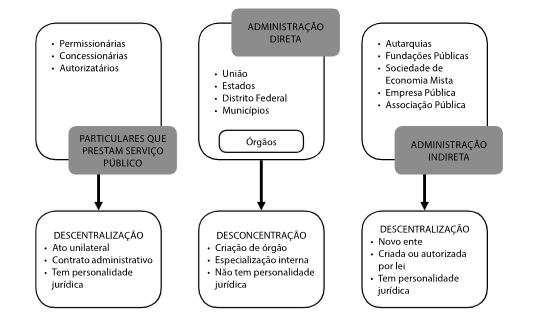

# Resumos — CGU · AFFC · Edital nº 1/2026

> Compilação dos resumos (Conhecimentos básicos e complementares), organizada por assunto. Impressão e divisão por seções conforme o assunto.

## Índice de assuntos
- Administração Pública e Fundamentos de Políticas Públicas
- Estado, Democracia, Direitos e Ciência Política
- Ética Pública e Responsabilidade Profissional
- Fundamentos de Auditoria Governamental e Atuação Integrada da CGU
- Fundamentos de Direito Público Aplicado, Controle e Responsabilização
- Fundamentos de Evidências, Dados e Inteligência Artificial
- Fundamentos de Governança, Riscos e Integridade Pública e Privada
- Fundamentos de Transparência, Ouvidoria e Participação Social
- Sociedade Brasileira, Desigualdades, Diversidade e Desenvolvimento

# Administração Pública e Fundamentos de Políticas Públicas

## Modelos de administração

### Resumo

**Modelos de administração pública** são as diferentes formas de organizar e conduzir a coisa pública, cada um com ênfase própria. O mais cobrado em provas distingue:

- **Patrimonialista** → confusão entre o público e o privado.
- **Burocrático (weberiano)** → regras, impessoalidade, hierarquia e mérito.
- **Gerencial (Nova Gestão Pública)** → eficiência, resultados e foco no cidadão.
- **Societal / participativo** → dimensão sociopolítica e participação social.

No Brasil esses modelos **não se substituíram linearmente**: eles coexistem e se superpõem (hibridismo), de modo que traços patrimonialistas, burocráticos, gerenciais e participativos convivem na mesma administração.

### 1. Burocracia e profissionalização

#### O que é (modelo burocrático weberiano)

Deriva da **dominação racional-legal** de Max Weber (ao lado da tradicional e da carismática). A burocracia é o modelo **racional** por excelência: busca previsibilidade e eficiência por meio de normas impessoais.

#### Características (tipo ideal weberiano)

- **Formalidade:** atos e decisões baseados em **regras escritas** (leis, normas, regulamentos).
- **Impessoalidade:** o cargo vale mais que a pessoa; decisões iguais para casos iguais.
- **Hierarquia:** estrutura de autoridade escalonada.
- **Meritocracia / competência técnica:** seleção e promoção pelo **mérito**, não por favoritismo.
- **Divisão do trabalho e especialização:** atribuições definidas por cargos e funções.
- **Racionalidade e previsibilidade:** padronização e continuidade.
- **Documentação:** registros formais das decisões.

#### Profissionalização do serviço público

- **Concurso público** como forma de ingresso (CF/88, art. 37, II) e **carreira** estruturada, plano de cargos e **capacitação**.
- No Brasil, a primeira tentativa de implantar a burocracia weberiana foi o **DASP (1938)**, com foco em concurso e treinamento — mas sem consolidar uma política de recursos humanos.
- A burocracia trouxe **legalidade, impessoalidade e combate ao nepotismo**, substituindo o padrão patrimonialista.

#### Limites e disfunções

- **Rigidez** e **excesso de formalismo** (o "burocratismo"): foco em **meios** e procedimentos, e não em resultados.
- **Autorreferenciamento** e **resistência à mudança**; distanciamento do cidadão.
- Disfunções clássicas apontadas na literatura (p. ex. **Merton**): incapacidade treinada, ritualismo, apego às regras.

### 2. Gestão orientada a resultados

#### O que é (modelo gerencial / Nova Gestão Pública)

Surge com a **Nova Gestão Pública (New Public Management)**, difundida nos anos 1980–90 (Reino Unido, Nova Zelândia, Austrália, EUA — obra *Reinventing Government*, 1992). Adota um **enfoque de gestão do setor privado** aplicado ao Estado: eficiência, desempenho e foco no **cidadão-usuário**.

#### Características

- **Foco em resultados** e em **eficiência** (econômico-financeira), mais do que em procedimentos.
- **Metas e indicadores de desempenho**, avaliação e **responsabilização** por resultados.
- **Flexibilidade e descentralização**, autonomia gerencial dos gestores.
- **Foco no cidadão / usuário** dos serviços e à **qualidade**.
- **Accountability** (prestação de contas + responsabilização).

#### Instrumentos

- **Planejamento estratégico** e **gestão por resultados** (objetivos, metas e indicadores **pactuados**).
- **Acordo de resultados** (pactuação de metas entre níveis/dirigentes), **contratos de gestão**.
- **PDCA** (planejar–executar–verificar–agir) e ciclos de monitoramento/avaliação.
- No Brasil, a **Reforma Bresser / Plano Diretor da Reforma do Aparelho do Estado (PDRAE, 1995)**, no governo FHC, marca a transição "da administração burocrática à gerencial", com a separação de atividades exclusivas de Estado, serviços não exclusivos e produção para o mercado, além de agências executivas/reguladoras.

#### Limites e críticas

- **Fragmentação** da estrutura do governo e **perda da perspectiva integrada** dos problemas e políticas.
- **Distorção/redução da dimensão estratégica**; foco excessivo em metas em detrimento do **interesse público**.
- **Déficits de responsividade e de accountability**; risco de equiparar a função pública ao modelo privado.

### 3. Participação e governança

#### O que é (modelo societal / participativo)

Formulado sobretudo por **Ana Paula Paes de Paula (2005)**, enfatiza a **dimensão sociopolítica** da gestão. Propõe uma **gestão pública compartilhada**, com ampliação da **democracia** e participação dos atores sociais na formulação e no **controle** das políticas. Distingue-se do gerencial, cuja ênfase é **econômico-financeira e institucional-administrativa**.

#### Participação social

- **Conselhos de políticas públicas** (gestores): principal canal de participação, presentes nos três níveis de governo (saúde, assistência social, educação etc.), com representação de governo e sociedade.
- **Conferências** de políticas públicas: instâncias periódicas (em geral a cada 2 anos), de avaliação e proposição de rumos.
- **Audiências e consultas públicas**, **ouvidorias**, **orçamento participativo** e plataformas digitais.
- Base constitucional: **arts. 198, 204 e 206 da CF/88** (participação na saúde, assistência social e educação) → **controle social**.

#### Governança pública (Decreto nº 9.203/2017)

- **Conceito:** "conjunto de **mecanismos de liderança, estratégia e controle** postos em prática para **avaliar, direcionar e monitorar a gestão**", com vistas à condução de políticas públicas e à prestação de serviços de interesse da sociedade.
- **Princípios (art. 3º):** capacidade de resposta; integridade; confiabilidade; melhoria regulatória; prestação de contas e responsabilidade; transparência.
- **Mecanismos (art. 5º):** **liderança** (integridade, competência, responsabilidade, motivação); **estratégia**; **controle**.
- **Diretrizes (art. 4º):** buscar resultados para a sociedade, simplificação administrativa, monitoramento/avaliação, coordenação, padrões de conduta, controles internos baseados em risco, decisões orientadas por evidências, participação da sociedade, comunicação transparente etc.
- **Abrange a administração federal direta, autárquica e fundacional**; prevê **gestão de riscos**, **programa de integridade** (art. 19) e **auditoria interna governamental** (art. 18).

#### Limites

- **Representatividade** e **assimetrias** de poder/informação entre Estado e sociedade.
- **Risco de captura** e de esvaziamento dos espaços participativos (falta de autonomia/recursos).
- Risco de a participação se tornar apenas consultiva, sem influência real na decisão.

### 4. Limites e contribuições de diferentes modelos na realidade brasileira

- **Patrimonialista:** presente desde o Brasil colonial; confunde público e privado e favorece **nepotismo, clientelismo e corrupção**. Não foi totalmente superado — sobrevive em práticas cotidianas.
- **Burocrático:** **contribuiu** com profissionalização, impessoalidade e legalidade (concurso, carreira, DASP, CF/88); **limita-se** pela rigidez, formalismo e foco em meios.
- **Gerencial:** **contribuiu** com foco em eficiência, resultados e modernização (PDRAE/1995, agências, contratos de gestão); **limita-se** pela fragmentação e por déficits democráticos.
- **Societal / participativo:** **contribui** ampliando cidadania e controle social (conselhos, conferências, ouvidorias); **limita-se** pela representatividade e pelo risco de captura.
- **Síntese:** no Brasil há **hibridismo** — os modelos se combinam e se sobrepõem. A trajetória é marcada pela **CF/88** (redemocratização e participação) e pela **Reforma de 1995** (gerencialismo), e a **governança pública (Decreto 9.203/2017)** busca integrar resultados, integridade e participação.

### Detalhes que merecem destaque

- **Weber:** três tipos de dominação — **tradicional, carismática e racional-legal** (a burocracia é a expressão da racional-legal).
- **Disfunções da burocracia** (Merton e outros): incapacidade treinada, ritualismo, excesso de formalismo, decisão pela posição hierárquica.
- **PDRAE (1995)** distingue três formas de administração: **patrimonialista, burocrática e gerencial**.
- **Governança × governabilidade:** **governança** = capacidade de **avaliar, direcionar e monitorar** a gestão (mecanismos: liderança, estratégia e controle); **governabilidade** = condições **políticas** (legitimidade, apoio, coalizões) para governar.
- **Accountability** = **prestação de contas + responsabilização** (não é só punição).
- **Conselhos** são permanentes; **conferências** são periódicas (instâncias de avaliação/proposição).
- O **Decreto 9.203/2017** aplica-se à administração **direta, autárquica e fundacional** (não à indireta empresarial).

### Comparações que a banca costuma cobrar (certo/errado)

| Conceito A         | Conceito B                     | Diferença-chave                                                                                                   |
| ------------------ | ------------------------------ | ----------------------------------------------------------------------------------------------------------------- |
| Patrimonialista    | Burocrático                    | Patrimonialista = público/privado confundidos, favoritismo; burocrático = impessoalidade, mérito e regras         |
| Burocrático        | Gerencial                      | Burocrático = foco em **meios/procedimentos**; gerencial = foco em **resultados/eficiência**                       |
| Gerencial          | Societal / participativo       | Gerencial = ênfase **econômico-financeira/institucional**; societal = ênfase **sociopolítica** e participação       |
| Governança         | Governabilidade                | Governança = como **avaliar, direcionar e monitorar** a gestão; governabilidade = **condições políticas** de governo |
| Eficiência         | Eficácia                       | Eficiência = **como** usar os recursos; eficácia = **atingir as metas**                                            |
| Conselhos          | Conferências                   | Conselhos = **permanentes**; conferências = **periódicas** (avaliação/proposição)                                  |

### Pegadinhas e erros comuns

> Cuidado com termos absolutos ("sempre", "nunca", "exclusivamente") e com a troca de requisitos.

- Tratar **burocracia** como sinônimo de ineficiência — em Weber ela é **racional** e busca **eficiência**.
- Confundir os **três tipos de dominação** de Weber (tradicional, carismática, racional-legal).
- Achar que o **gerencial substituiu** o burocrático — no Brasil os modelos **coexistem** (hibridismo).
- Confundir **governança** (mecanismos de avaliação/direção/monitoramento) com **governabilidade** (condições políticas).
- Reduzir **accountability** a punição — envolve também **prestação de contas**.
- Trocar **eficiência** (meios), **eficácia** (metas) e **efetividade** (impacto).
- Dizer que o **Decreto 9.203/2017** se aplica a toda a administração indireta — aplica-se à **direta, autárquica e fundacional**.
- Confundir **conselhos** (permanentes) com **conferências** (periódicas).
- Errar o ano/autor da reforma gerencial brasileira (**Bresser Pereira / PDRAE, 1995** — não 2005).
- Achar que o modelo **societal** é o mesmo que o **gerencial** (têm ênfases distintas).
- Afirmar que o **patrimonialismo** foi totalmente superado no Brasil — ele **persiste** em práticas.

## Organização administrativa

### Resumo

O estado é dividido em três funções: legislativa, administrativa (executiva) e jurisdicional. Essa divisão é adotada pela constituição federal porém ela tem uma flexibilidade, fazendo com que os poderes possam fazer ações que não são diretamente ligadas ao seu dever.

"A Administração Pública é o conjunto de órgãos, agentes e entidades, de qualquer dos três poderes, que cumpre a função administrativa. Para isso, ela usará de duas técnicas: a desconcentração e a descentralização"

### 1. Administração direta e indireta

Quando é o estado, que por meio dos seus orgãos ou agentes, exerce as tarefas, isso é denominado como um exercicio centralizado. Assim quando o estado exerce as tarefas por meio de pessoas jurídicas autônomas, pela administrações indiretas. Essa pessoa jurídica responde judicialmente por erros.

- **Direta:** o próprio Estado (União, estados, DF e municípios) executa as atividades por meio de seus órgãos, que não têm personalidade jurídica própria.
- **Indireta:** entidades com personalidade jurídica própria, criadas para executar atividades de forma descentralizada.
- **Exemplos:** órgãos (ministérios, secretarias) na direta; autarquias, fundações, empresas públicas e sociedades de economia mista na indireta.

#### Outorga e delegação

A administração publica descentralizada ou indireta podem ser criadas de duas formas: outorga ou delegação.

Outorga é através de uma criação/autorização para a criação da entidade para prestar esse serviço (geralmente essa autorização vem por tempo indeterminado).

Delegação transfere para uma pessoa delegada a autorização para que possa executar o serviço com a fiscalização do Estado. Nessa forma essa autorização é feita por tempo determinado.



#### Espécies de entidades da administração indireta

| Entidade                    | Personalidade              | Natureza                                                     | Exemplos                            |
| --------------------------- | -------------------------- | ------------------------------------------------------------ | ----------------------------------- |
| Autarquia                   | Direito público            | Criada por lei; executa atividade típica da Administração    | INSS, IBAMA, universidades federais |
| Fundação pública            | Direito público ou privado | Sem fins lucrativos; atividade de interesse social           | FUNAI, IBGE                         |
| Empresa pública             | Direito privado            | Capital 100% público; atividade econômica ou serviço público | Correios, Caixa                     |
| Sociedade de economia mista | Direito privado            | Sociedade anônima com capital majoritariamente público       | Petrobras, Banco do Brasil          |

> A criação depende de **lei específica** (art. 37, XIX, da CF/88); trata-se de descentralização por **outorga**.

### 2. Descentralização e desconcentração

#### Descentralização (para outra pessoa/entidade):

Descentralização é quando o Estado transfere a execução da atividade para **outra pessoa**: uma entidade da administração indireta (por **outorga**, geralmente por tempo indeterminado) ou um particular (por **delegação**, por tempo determinado, sob fiscalização do Estado).

#### Desconcentração (dentro da mesma pessoa/órgão):

Concentração é quando o exercício da atividade se vem por meio da competência do órgão publico quando não há nenhuma divisão interna. Quando o órgão é desconcentração da administração, as tarefas são pertencentes a mesma pessoa jurídica, a transferência é dentro da própria pessoa jurídica, que tem em consideração a vinculação hierárquica.

**Exemplos:** Delegacias de Polícia, ministérios da União, Secretarias de estado e município, postos de atendimento da Receita Federal, as Casas Legislativas, os Tribunais de Justiça, as Subprefeituras e as escolas públicas.

### 3. Órgãos públicos

#### Criação e Extinção de Orgãos

Orgãos podem ser criados e extintos por leis (art. 61, §1º, inciso II, alínea “e”, da Constituição Federal) com a iniciativa do presidente (quando é na esfera federal). Essas ações não ocorrem mediante ato administrativo (decreto), pode só ser utilizado para organização da administração publica.

#### Critérios para Classificação

- Esfera de Ação: Centrais são quando as atribuições é feita em todo o território nacional, estadual ou municipal (secretarias e ministerios). Locais são as que atuam em apenas uma parte do território, como delegacias regionais.
- Posição Estatal: Independentes são aqueles que são originarios da Constituição e que são representativos dos Três Poderes, não tem subordinação hierarquica ou funcional, são exercido por agentes publicos, como Casas Legislativas, Chefia do Executivo e Tribunais. Os autonomos, localizados na cupula administrativa, são diretamente subordinados aos independentes, participam das decições do governo e tem autonomia, são as secretarias de estado, municipio, SNI e Ministerio Publico.
- Superiores: direção e comando, são sujeitos a subordinação com uma chefia, sem autonomia, entram na categoria as coordenadorias, gabinetes e etc.
- Subalternos: subordinados a orgão de decisão superior. Principal função é a de execução.

#### Estrutura

- Simples: unico centro de atribuição, não contem subdivisoes.
- Compostos: tem varios outros orgãos como em ministerios e secretarias de estado, chegam ate os simples que são o ultimo da cadeia por não ter mais divisóes.

#### Órgão × Entidade

- **Órgão:** centro de competência sem personalidade jurídica, criado e extinto por lei; não possui patrimônio próprio, e sua atuação é imputada à pessoa jurídica a que pertence.
- **Entidade:** pessoa jurídica com personalidade própria (pública ou privada), criada para compor a administração indireta; possui patrimônio e capacidade processual próprios.

### 4. Agentes públicos

- **Conceito:** toda pessoa física que presta serviço ao Estado, de forma permanente ou transitória, com ou sem remuneração.
- **Classificação (agentes políticos, administrativos, honoríficos, delegados, de fato):**
  - **Agentes políticos:** ocupam a alta direção do Estado e definem diretrizes (Presidente, Governadores, Prefeitos, Ministros, Secretários e parlamentares).
  - **Agentes administrativos:** exercem atividades administrativas — servidores públicos (estatutários, empregados públicos e temporários).
  - **Agentes honoríficos:** convocados para funções relevantes sem remuneração (jurados, mesários eleitorais).
  - **Agentes delegados:** particulares que executam atividade delegada (concessionárias, permissionárias, leiloeiros, notários).
  - **Agentes de fato:** atuam sem investidura regular ou com investidura putativa (função de fato).
- **Ponto de atenção:** "agente público" é o gênero, e "servidor público" é uma espécie; a forma de investidura e a responsabilidade variam conforme o tipo.

### 5. Funções da administração pública
Representa as etapas e mecanismos que o Estado utiliza para conduzir as medidas para a administração publica. Nela consistem essas 4 funções.

- **Formulação:** Fase de planejamento e tomada de decisão, identifica as demandas e define as prioridades. Estabelece metas e diretrizes das politicas publicas e orçamentarias.
- **Execução:** Colocação pratica do que foi planejado com prestações diretas ou indiretas de serviços, se propoe a cumprir as metas e diretrizes propostas na etapa de formulação.
- **Regulação:** Estabelece regras, normas e os padroes que precisam ser seguido para o funcionamento dos setores publicos ou privados. Garante a concorrencia justa e também as qualidades dos serviços. Age para a proteção dos direitos. Exemplos: agências reguladoras (ANEEL, ANATEL, ANS).
- **Controle:** Fiscaliza, monitora e avalia as ações e gastos. Utiliza as normas e diretrizes feitas pela regulação e verifica se está seguindo as leis, se os recursos são bem aplicados (**eficiência**), se as metas são cumpridas (**eficácia**) e se há impacto real na sociedade (**efetividade**). Espécies: controle interno (a própria administração — no Executivo federal, a CGU), controle externo (Poder Legislativo com o auxílio do Tribunal de Contas) e controle social.

### 6. Arranjos de cooperação com entes federativos e entidades não estatais

#### Federalismo e cooperação

Quando os próprios membros da federação (União, Estados, DF e Municípios) se associam para otimizar recursos e planejar ações comuns:

- **Consórcios públicos:** associações públicas formadas por dois ou mais entes federativos (regulamentadas pela Lei nº 11.107/2005). Permitem compras conjuntas, gestão de resíduos sólidos e serviços de saúde compartilhados, gerando ganho de escala.
- **Convênios administrativos:** acordos de mútua cooperação para a realização de um objetivo comum, sem fins lucrativos, com repasse de verbas (ex.: convênio entre o Ministério da Educação e um município para reforma de escolas).
- **Fundos setoriais e transferências:** mecanismos de financiamento compartilhado, como o **Fundeb** (educação básica) e o **SUS** (saúde), que distribuem recursos de forma vinculada a metas de desempenho.
- **Regiões metropolitanas e aglomerações urbanas:** instituídas por leis estaduais para integrar a organização, o planejamento e a execução de funções públicas de interesse comum entre municípios limítrofes.

#### Entes federativos

São os componentes autônomos da federação — **União, Estados, Distrito Federal e Municípios** — dotados de autonomia (autogoverno, autoadministração, autolegislação e autofinanciamento). A federação brasileira é indissolúvel (arts. 1º e 18 da CF/88).

#### Entidades não estatais

##### Organizações Sociais (OS)

As **OS** (Lei nº 9.637/1998) são uma qualificação conferida a entidades privadas sem fins lucrativos, para que possam absorver algumas atividades atribuídas a entidades ou órgãos públicos da União. O Estado repassa a essas entidades as atividades que podem ser mais eficientes na iniciativa privada, a fim de enxugar a máquina administrativa e reduzir o déficit. A seleção de uma entidade privada deve ser feita mediante procedimento público, objetivo e impessoal. O **objeto** das OSs é restrito às áreas de ensino, pesquisa científica, desenvolvimento tecnológico, proteção e preservação do meio ambiente, cultura e saúde (art. 1º da Lei). O Decreto nº 9.190/2017 veda a qualificação de OSs para atividades exclusivas de Estado, apoio técnico e administrativo à administração pública federal, e fornecimento de bens, equipamentos ou execução de obra pública em favor da administração federal (art. 3º).

##### Organizações da Sociedade Civil de Interesse Público (OSCIP)

As **OSCIP** (Lei nº 9.790/1999) surgem com o objetivo de ser um **instrumento de fomento público** às entidades do terceiro setor, para fortalecer a prestação não estatal de atividades sociais, sem a pretensão de substituir o Estado na prestação de serviços. Essa natureza de mecanismo de incentivo à filantropia justifica o regime jurídico distinto das OSs. A OSCIP **não é uma nova espécie de pessoa jurídica de direito privado**, mas um **título** conferido pelo Poder Executivo a uma entidade privada sem fins lucrativos. É um ato vinculado, sendo competência do Ministro da Justiça a apreciação do requerimento.

##### Parcerias (Lei nº 13.019/2014)

A Lei prevê três instrumentos de parceria:

- **Termo de colaboração:** formaliza parcerias iniciadas pela administração pública, com transferência de recursos financeiros.
- **Termo de fomento:** formaliza parcerias propostas pelas OSCs, com transferência de recursos financeiros.
- **Acordo de cooperação:** formaliza parcerias sem transferência de recursos financeiros.

### Detalhes que merecem destaque

- **Criação/extinção de órgãos:** por **lei** (art. 61, §1º, II, "e", da CF/88), com iniciativa do Presidente na esfera federal — **não** por decreto (o decreto apenas organiza a administração).
- **Classificação dos órgãos:**
  - Quanto à **esfera de ação:** centrais (atuam em todo o território) × locais (parte do território).
  - Quanto à **posição estatal:** independentes (previstos na Constituição), autônomos, superiores e subalternos.
  - Quanto à **estrutura:** simples (sem subdivisões) × compostos.
- **Outorga × delegação:** outorga cria/transfere para **entidade** (em regra, por tempo **indeterminado**); delegação transfere a **particular**, com fiscalização do Estado e por tempo **determinado**.
- **Administração indireta:** autarquia, fundação pública, empresa pública e sociedade de economia mista (criação depende de **lei específica** — art. 37, XIX, da CF/88).
- **Entidades não estatais são títulos/qualificações:** nem OS nem OSCIP são novas espécies de pessoa jurídica de direito privado.
- **Controle:** tríade **eficiência** (uso de recursos), **eficácia** (cumprimento de metas) e **efetividade** (impacto real); exercido pelo controle interno (**CGU**, no Executivo federal), externo (**Legislativo + TCU**) e social.
- **Cooperação federativa:** consórcios públicos (Lei nº 11.107/2005), convênios, fundos (Fundeb/SUS) e regiões metropolitanas (instituídas por lei estadual).
- **Parcerias (Lei nº 13.019/2014):** **termo de colaboração** (iniciada pela administração), **termo de fomento** (proposta pela OSC) e **acordo de cooperação** (sem recursos).

### Comparações que a banca costuma cobrar (certo/errado)

| Conceito A                | Conceito B                   | Diferença-chave                                                                                                                              |
| ------------------------- | ---------------------------- | -------------------------------------------------------------------------------------------------------------------------------------------- |
| Administração direta      | Administração indireta       | Direta = órgãos sem personalidade, ligados ao próprio ente; indireta = entidades com personalidade jurídica própria                          |
| Descentralização          | Desconcentração              | Descentralização transfere a execução para OUTRA pessoa (entidade/particular); desconcentração distribui competências dentro da MESMA pessoa |
| Órgão (sem personalidade) | Entidade (com personalidade) | Órgão não tem personalidade nem patrimônio próprios; a entidade tem personalidade e patrimônio                                               |
| Autarquia                 | Fundação pública             | Autarquia = direito público, atividade típica; fundação = atividade social, sem fins lucrativos (direito público ou privado)                 |
| Empresa pública           | Sociedade de economia mista  | EP = capital 100% público; SEM = sociedade anônima com capital majoritariamente público                                                      |

### Pegadinhas e erros comuns

> Cuidado com termos absolutos ("sempre", "nunca", "exclusivamente") e com a troca de requisitos.

- Trocar **descentralização** (execução por **outra pessoa**) por **desconcentração** (divisão interna, **mesma pessoa**).
- Inverter **outorga** (entidade, tempo indeterminado) e **delegação** (particular, tempo determinado).
- Afirmar que **órgão** tem personalidade jurídica — **não tem** (só a **entidade** tem).
- Dizer que **decreto** cria/extingue órgão — só **lei** (decreto apenas organiza).
- Achar que **OS e OSCIP** são pessoas jurídicas novas — são **qualificações/títulos**.
- Confundir **OS** (Lei nº 9.637/1998; contrato de gestão) com **OSCIP** (Lei nº 9.790/1999; **ato vinculado**, competência do Ministério da Justiça).
- Dizer que OS/OSCIP podem exercer **atividades exclusivas de Estado** — o Decreto nº 9.190/2017 veda.
- Confundir **consórcio público** (entes federativos; Lei nº 11.107/2005) com **convênio**.
- Afirmar que a federação brasileira pode ser dissolvida — ela é **indissolúvel** (art. 1º da CF/88).
- Confundir **eficiência**, **eficácia** e **efetividade** no controle.
- Trocar os instrumentos das parcerias: **colaboração** (administração propõe), **fomento** (OSC propõe) e **acordo de cooperação** (sem recursos).

## Planejamento e recursos

### Resumo

O item trata de como o Estado **planeja** e **financia** suas ações. Planejar é definir objetivos, diretrizes, metas e os meios para alcançá-los; orçar é transformar esse plano em **autorização legal** de receitas e despesas. No Brasil, o sistema é articulado por **três leis de iniciativa do Poder Executivo** (art. 165 da CF/88): o **PPA** (estratégico, 4 anos), a **LDO** (tático, anual — o "elo" entre plano e orçamento) e a **LOA** (operacional, anual — estima a receita e fixa a despesa).

Esse conjunto é organizado em um **ciclo orçamentário** (elaboração → apreciação/votação → execução → controle), que se repete continuamente e não se confunde com o **exercício financeiro** (o ano civil). Do lado dos **recursos**, a **receita** é estimada (previsão, lançamento, arrecadação, recolhimento) e a **despesa** é fixada e executada (empenho, liquidação, pagamento), segundo as classificações da Lei nº 4.320/1964 e do Manual Técnico de Orçamento.

Como os recursos são **escassos** e as demandas **ilimitadas**, o orçamento é, por essência, um instrumento de **escolhas alocativas**, condicionadas por **restrições fiscais** (metas de resultado, limites de despesa e de endividamento, contingenciamento) cujo objetivo maior é a **sustentabilidade das ações** — ou seja, não comprometer a capacidade de o Estado continuar atendendo a sociedade no futuro.

### 1. Funções do planejamento e do orçamento

#### 1.1 Planejamento

**Planejamento público** é a atividade estatal que fixa objetivos, diretrizes e metas e define os meios (recursos) para alcançá-los em determinado horizonte temporal. É um **dever do Estado** e tem caráter **determinante para o setor público** e **indicativo para o setor privado** (art. 174 da CF/88). A LRF também erige a **"ação planejada e transparente"** como pressuposto da responsabilidade na gestão fiscal (art. 1º, §1º, da LC 101/2000).

Funções do planejamento:

- **Racionalizar a decisão** e reduzir improvisação, dando coerência entre objetivos e recursos.
- **Definir prioridades e metas**, ordenando as demandas sociais e orientando a alocação.
- **Dar previsibilidade e transparência** à ação estatal e viabilizar o controle (Legislativo, TCU, CGU e sociedade).
- **Articular** os instrumentos de médio e curto prazos (PPA, LDO e LOA).

Horizontes clássicos:

- **Estratégico (longo prazo):** visão de futuro, grandes diretrizes.
- **Tático (médio prazo):** o **PPA** (plurianual).
- **Operacional (curto prazo):** a **LOA** (anual), intermediada pela LDO.

#### 1.2 Orçamento público

**Orçamento público** é o instrumento de **planejamento e controle** da atividade financeira do Estado: estima as **receitas** e fixa as **despesas** para um exercício, evidenciando a política econômico-financeira e o programa de trabalho do governo (art. 2º da Lei nº 4.320/1964). É, ao mesmo tempo, **lei** (autoriza a arrecadação e a realização de despesas) e **instrumento de gestão**.

**Funções clássicas do orçamento** (doutrina):

- **Alocativa:** alocar recursos na produção de bens e serviços que o mercado não provê adequadamente (correção de falhas de mercado).
- **Distributiva:** corrigir desigualdades de renda e regionais (ex.: transferências, programas sociais).
- **Estabilizadora:** contribuir para a estabilidade econômica (emprego, preços e equilíbrio das contas públicas).

**Funções gerenciais/organizacionais:** planejamento (programação), **controle político** (controle do Executivo pelo Legislativo), **controle financeiro** e **administração/gerência**.

#### 1.3 Orçamento tradicional × orçamento-programa

- **Orçamento tradicional (ou clássico):** ênfase nos **meios** — "o que se compra" (pessoal, material, serviços). Foco no controle contábil/legal.
- **Orçamento-programa:** ênfase nos **fins** — objetivos, metas e resultados; vincula **plano e orçamento**. No Brasil foi incorporado pela **Lei nº 4.320/1964** e pelo **Decreto-Lei nº 200/1967** (planejamento e orçamento como atividades integradas).

#### 1.4 Por que o orçamento importa

- É **autorização legislativa**: nenhuma despesa pode ser feita fora do orçamento (art. 167 da CF/88).
- É o **instrumento de viabilização** das políticas públicas (sem previsão orçamentária, não há execução).
- É o **retrato das escolhas** do governo: onde e quanto se gasta revela prioridades.

### 2. O ciclo orçamentário

O **ciclo orçamentário** é o conjunto de etapas que se sucedem de forma **contínua** (um ciclo não termina antes de o seguinte começar), envolvendo as três leis e a execução:

1. **Elaboração e planejamento da proposta** — Poder **Executivo** (no âmbito federal: Secretaria de Orçamento Federal – SOF, do Ministério do Planejamento e Orçamento). Estima receitas e programa despesas; consolida as propostas setoriais.
2. **Apreciação, votação e aprovação** — Poder **Legislativo** (Congresso Nacional, com o apoio da **Comissão Mista de Planos, Orçamentos Públicos e Fiscalização – CMO**, art. 166, §1º, da CF/88). Admite **emendas**, observados limites e requisitos.
3. **Execução** — Poder **Executivo**: programação orçamentária e financeira, empenho, liquidação e pagamento; pode haver **contingenciamento**.
4. **Controle e avaliação** — **controle interno** (no Executivo federal, a **CGU**), **controle externo** (**Congresso Nacional + TCU**) e **controle social**.

Pontos de atenção:

- O **exercício financeiro** coincide com o **ano civil** (1º/1 a 31/12) — art. 34 da Lei nº 4.320/1964. **Ciclo orçamentário ≠ exercício financeiro**: o ciclo é mais amplo e contínuo.
- Enquanto se **executa** a LOA do exercício, já se **elaboram** a LDO e a LOA do ano seguinte e se **atualiza** o PPA.
- **Iniciativa** das leis orçamentárias é privativa do **Poder Executivo** (art. 165, *caput*); a sanção e a execução também cabem ao Executivo.

### 3. PPA, LDO e LOA

#### 3.1 Plano Plurianual (PPA) — art. 165, §1º

- **Natureza/vigência:** plano de **médio prazo**, com vigência de **4 anos**. Elaborado no **primeiro ano do mandato** presidencial, vigora do **segundo ano** do mandato até o **final do primeiro ano** do mandato subsequente.
- **Conteúdo:** estabelece, **de forma regionalizada**, as **diretrizes, objetivos e metas** da administração pública para as **despesas de capital** e outras delas decorrentes e para as **despesas relativas aos programas de duração continuada**.
- **Regionalização:** decorre do mandato de **redução das desigualdades regionais** (art. 3º, III, e art. 165, §7º, da CF/88).
- **Prazos:** projeto encaminhado pelo Executivo até **31 de agosto** do primeiro exercício do mandato (ADCT, art. 35, §2º, I); apreciação/devolução até o encerramento da sessão legislativa.
- **Regra do investimento plurianual:** nenhum investimento cuja execução ultrapasse **um exercício financeiro** pode ser iniciado sem prévia inclusão no **PPA** (ou lei que autorize), **sob pena de crime de responsabilidade** (art. 167, §1º, da CF/88).
- **Programa de duração continuada:** a LRF define como despesa corrente derivada de lei/ato que fixe obrigação de execução por **período superior a dois exercícios** (art. 17 da LC 101/2000).

#### 3.2 Lei de Diretrizes Orçamentárias (LDO) — art. 165, §2º

- **Natureza:** lei **anual**, é o **elo** entre o PPA (médio prazo) e a LOA (curto prazo). "Traduz" o plano em prioridades do exercício.
- **Conteúdo constitucional:** compreende as **metas e prioridades** da administração pública federal, incluindo as **despesas de capital** para o exercício seguinte; **orienta a elaboração da LOA**; dispõe sobre as **alterações na legislação tributária**; e estabelece a **política de aplicação das agências financeiras oficiais de fomento**.
- **Conteúdo pela LRF** (art. 4º): dispor sobre **equilíbrio entre receitas e despesas**; **critérios e forma de limitação de empenho** (contingenciamento); normas de **controle de custos e avaliação de resultados** dos programas; condições para **transferências** de recursos. Deve conter o **Anexo de Metas Fiscais** e o **Anexo de Riscos Fiscais**.
- **Prazos:** projeto encaminhado até **15 de abril** de cada ano (ADCT, art. 35, §2º, II).

#### 3.3 Lei Orçamentária Anual (LOA) — art. 165, §§5º a 8º

- **Natureza:** lei **anual** que **estima a receita e fixa a despesa** para o exercício financeiro (que coincide com o ano civil).
- **Composição (três orçamentos em uma só lei)** — art. 165, §5º:
  - **I – Orçamento fiscal:** Poderes, fundos, órgãos e entidades da administração direta e indireta, inclusive fundações.
  - **II – Orçamento de investimento** das empresas em que a União detenha a **maioria do capital social com direito a voto** (estatais).
  - **III – Orçamento da seguridade social:** saúde, previdência e assistência social, abrangendo órgãos e entidades vinculados.
- **Prazos:** projeto encaminhado até **31 de agosto** (ADCT, art. 35, §2º, III); apreciação/aprovação até o encerramento da sessão legislativa. Se o projeto não for enviado no prazo, o Legislativo considera a lei vigente (art. 32 da Lei nº 4.320/1964).
- **Compatibilidade:** deve ser elaborada de forma **compatível com o PPA e com a LDO** (LRF, art. 5º); as emendas só são admitidas se **compatíveis com o PPA e a LDO** e com recursos indicados (art. 166, §3º, da CF/88).
- **Exclusividade** (art. 165, §8º): a LOA **não conterá dispositivo estranho** à previsão da receita e à fixação da despesa, salvo autorização para abertura de **créditos suplementares** e contratação de **operações de crédito**, ainda que por **ARO**.
- **Reserva de contingência** (LRF, art. 5º, III): a LOA deve conter reserva destinada a **passivos contingentes e eventos fiscais imprevistos**.
- **Orçamento impositivo:** a administração tem o **dever de executar** as programações orçamentárias (art. 165, §10, incluído pela EC 100/2019), ressalvados impedimentos legais/técnicos — inclusive a necessidade de cumprir **metas fiscais** (o que autoriza o contingenciamento).

#### 3.4 Relação/encadeamento entre PPA, LDO e LOA

| Instrumento | Horizonte | Papel | Conteúdo essencial | Prazo de envio |
| --- | --- | --- | --- | --- |
| **PPA** | 4 anos (plurianual) | **Estratégico** | Diretrizes, objetivos e metas regionalizados; despesas de capital e programas de duração continuada | 31/8 do 1º ano do mandato |
| **LDO** | 1 ano | **Tático / elo** | Metas e prioridades; orienta a LOA; alterações tributárias; metas e riscos fiscais; regras de limitação de empenho | 15/4 |
| **LOA** | 1 ano | **Operacional** | Estima a receita e fixa a despesa (orçamentos fiscal, de investimento das estatais e da seguridade social) | 31/8 |

**Lógica do encadeamento:** o **PPA** define o rumo (o que fazer no médio prazo); a **LDO** seleciona, no PPA, o que é **prioridade** para o ano seguinte e fixa as **regras fiscais**; a **LOA** viabiliza, em números, a execução dessas prioridades. A **LDO é o elo** entre plano e orçamento. Todos os instrumentos devem ser **mutuamente compatíveis** (PPA ⊃ LDO ⊃ LOA).

#### 3.5 Base constitucional e legal (arts. 165 a 169 da CF/88 e LRF)

**Constituição de 1988:**

- **Art. 165:** leis de iniciativa do Executivo (PPA, LDO, LOA); conteúdo de cada uma; **§8º** exclusividade; **§9º** remete a **lei complementar** (ainda não editada em caráter geral) para dispor sobre exercício financeiro, vigência, prazos, elaboração e organização; **§10** dever de execução.
- **Art. 166:** apreciação pelo Congresso (duas Casas), **CMO**, emendas (requisitos de compatibilidade e indicação de recursos), **emendas individuais e de bancada impositivas**.
- **Art. 167:** **vedações orçamentárias** — iniciar programa/projeto sem previsão na LOA; realizar despesa que exceda o crédito; **regra de ouro** (inciso III: operações de crédito não podem exceder as despesas de capital); **não afetação** de receita de impostos (inciso IV); abertura de crédito sem autorização legislativa; transposição/remanejamento sem lei; créditos ilimitados; **§1º** investimento plurianual no PPA; **§2º** reabertura de créditos especiais e extraordinários nos últimos 4 meses; **§3º** créditos extraordinários só para despesas **imprevisíveis e urgentes** (guerra, comoção interna, calamidade).
- **Art. 168:** entrega de recursos aos Poderes, MP e Defensoria em **duodécimos**, até o dia **20** de cada mês.
- **Art. 169:** **despesa com pessoal**; limites e condições.

**Lei de Responsabilidade Fiscal (LC nº 101/2000 — LRF):**

- **Objetivo:** estabelecer normas de finanças públicas voltadas para a **responsabilidade na gestão fiscal** — **ação planejada e transparente**, prevenção de riscos e correção de desvios capazes de afetar o **equilíbrio das contas**, mediante **metas de resultados** e **limites** (pessoal, seguridade, dívida, operações de crédito, garantias, restos a pagar).
- **Instrumentos/obrigações:**
  - **LDO:** Anexo de **Metas Fiscais** (metas de receitas, despesas, resultado **primário** e **nominal** e dívida) e Anexo de **Riscos Fiscais**; equilíbrio receita/despesa; regras de limitação de empenho.
  - **LOA:** compatibilidade com a LDO/PPA; **reserva de contingência**; previsão de receita com metodologia (art. 12).
  - **Execução:** **programação financeira** e cronograma mensal de desembolso (art. 8º); **metas bimestrais de arrecadação** (art. 13); **limitação de empenho** (contingenciamento, art. 9º).
  - **Transparência/prestação de contas:** **RREO** (Relatório Resumido da Execução Orçamentária) e **RGF** (Relatório de Gestão Fiscal), prestação de contas e versões simplificadas (art. 48).
- **Despesa com pessoal (arts. 18 a 23):** limites de **50% da RCL na União**, **60% nos Estados e no DF** e **60% nos Municípios**; repartição por Poder/órgão; verificação ao final de **cada quadrimestre**; se a despesa exceder **95%** do limite, incidem vedações; se exceder o limite, deve haver **eliminação do excesso** em até **2 quadrimestres** (com pelo menos 1/3 no primeiro).
- **Geração de despesa e renúncia de receita:** exigência de **estimativa de impacto** e **compatibilidade** com a LOA/PPA/LDO (arts. 14 a 17). Despesa obrigatória de caráter continuado: **> 2 exercícios**.

**Regime Fiscal Sustentável (LC nº 200/2023):** alterou a LRF e instituiu o **arcabouço fiscal** que substituiu o teto de gastos (**EC nº 95/2016**). Prevê **limites individualizados** de despesa primária por Poder/órgão; correção pelo **IPCA** acrescida de **crescimento real** limitado a **70%** (se a meta foi cumprida) ou **50%** (se descumprida) da variação real da receita, respeitados **piso de 0,6%** e **teto de 2,5%** ao ano; **intervalos de tolerância** de **±0,25 p.p.** do PIB para as metas; **piso de investimentos** de **0,6% do PIB**; e **vedações** do art. 167-A em caso de descumprimento.

### 4. Princípios orçamentários

São premissas que orientam a **elaboração, a execução e o controle** do orçamento (CF/88, Lei nº 4.320/1964, LRF e LDOs). Os mais cobrados:

- **Legalidade:** o orçamento é aprovado por **lei** e só a lei autoriza receitas e despesas.
- **Anualidade (periodicidade):** o orçamento vale para um **exercício financeiro** (ano civil).
- **Unidade:** deve existir **um único orçamento** por exercício/ente (visão integrada).
- **Universalidade (totalidade):** o orçamento deve conter **todas** as receitas e despesas.
- **Exclusividade (pureza):** a LOA só trata de receita e despesa (salvo créditos suplementares e operações de crédito).
- **Especificação/especialização/discriminação:** vedação a **dotações globais**; a despesa deve ser detalhada.
- **Publicidade/transparência:** ampla divulgação (art. 37 da CF; arts. 48 e seguintes da LRF).
- **Não afetação (não vinculação) de receitas de impostos:** vedação com exceções constitucionais (ex.: saúde, educação, repartição tributária, garantias à ARO).
- **Equilíbrio:** equilibrar receitas e despesas; a **regra de ouro** limita o endividamento às despesas de capital.
- **Orçamento bruto:** receitas e despesas aparecem pelos **valores brutos**, sem deduções.
- **Exatidão/realismo:** estimativas técnicas e realistas.
- **Programação:** organizar as despesas por objetivos e finalidades (estrutura programática).
- **Regionalização:** considerar a **redução das desigualdades regionais**.

### 5. Receita e despesa em nível conceitual

#### 5.1 Receita pública — conceito e classificações

**Receita pública** é o conjunto de **ingressos financeiros** aos cofres públicos para manter a estrutura estatal e custear bens e serviços à sociedade (impostos, aluguéis, prestação de serviços, alienação de bens, venda de títulos, etc.).

- **Receita orçamentária:** ingressos que **integram o orçamento**, financiando as despesas e sem contrapartida passiva. Divide-se em **correntes** e **de capital**.
- **Receita extraorçamentária:** ingressos de caráter **devolutivo**, que **não integram** o orçamento (ex.: cauções, depósitos, consignações, emissões de papel-moeda, operações de crédito por antecipação de receita — ARO). Não alteram o patrimônio líquido.

**Classificação por natureza da receita:** **categoria econômica → origem → espécie → rubrica → alínea → subalínea**. Categorias econômicas:

- **Receitas correntes:** tributária (impostos, taxas, contribuições de melhoria), de contribuições, patrimonial, agropecuária, industrial, de serviços, **transferências correntes** e outras receitas correntes.
- **Receitas de capital:** **operações de crédito**, **alienação de bens**, **amortização de empréstimos concedidos**, **transferências de capital** e outras receitas de capital.

Outras classificações: **derivada** (tributos — coação) × **originária** (exploração do patrimônio estatal). A **Dívida Ativa** (créditos exigíveis e inscritos) é fonte de receita quando arrecadada.

#### 5.2 Estágios (etapas) da receita

1. **Previsão:** estimativa da arrecadação, feita na elaboração da LOA (art. 12 da LRF).
2. **Lançamento:** ato que **identifica o crédito fiscal**, o **devedor** e **inscreve o débito** (aplicável aos impostos diretos e rendas com vencimento determinado).
3. **Arrecadação:** **pagamento** da receita pelo contribuinte/devedor ao **agente arrecadador** (banco/agente).
4. **Recolhimento:** **entrega** dos recursos arrecadados à conta do **Tesouro** (caixa único). Princípio da **unidade de tesouraria**.

Regime: a receita pertence ao exercício financeiro em que for **arrecadada** (**regime de caixa**) — art. 35, I, da Lei nº 4.320/1964.

#### 5.3 Despesa pública — conceito e classificações

**Despesa pública** é a **aplicação** de recursos públicos para custear os serviços prestados à sociedade e realizar investimentos.

- **Despesa orçamentária:** decorre de autorização legislativa e integra o orçamento.
- **Despesa extraorçamentária:** não integra o orçamento (ex.: pagamento de **restos a pagar**, devolução de cauções).

**Classificações da despesa:**

- **Institucional:** órgão/unidade orçamentária responsável pelo gasto.
- **Funcional:** **função → subfunção** (áreas de atuação, ex.: saúde, educação).
- **Programática:** **programa → ação** (atividade, projeto, operação especial); revela o "para quê".
- **Por natureza:** **categoria econômica → grupo de natureza da despesa (GND) → modalidade de aplicação → elemento de despesa**.
- **Por fonte de recursos** e por **indicador de resultado primário** (primária x financeira).

**Categoria econômica (Lei nº 4.320/1964):**

- **Despesas correntes:** GND **1 – pessoal e encargos sociais**; GND **2 – juros e encargos da dívida**; GND **3 – outras despesas correntes**.
- **Despesas de capital:** GND **4 – investimentos**; GND **5 – inversões financeiras**; GND **6 – amortização da dívida**.

Outros recortes úteis: **despesas obrigatórias × discricionárias** e **primárias × financeiras**.

#### 5.4 Estágios (etapas) da despesa

**Fixação** é prévia (na LOA). A execução tem os três estágios do art. 63 da Lei nº 4.320/1964:

1. **Empenho:** ato da autoridade competente que **cria para o Estado a obrigação de pagamento** e **reserva (deduz) a dotação**. Tipos: **ordinário** (valor exato, pagamento único), **estimativo** (valor não previsível) e **global** (despesas parceladas). É **vedada despesa sem prévio empenho** (art. 60).
2. **Liquidação:** verificação do **direito adquirido** pelo credor, com base em títulos/comprovantes; apura **origem e objeto**, **importância exata** e **a quem pagar**.
3. **Pagamento:** **entrega do numerário** ao credor, após a ordem de pagamento (despesa regularmente liquidada).

Regime: a despesa pertence ao exercício em que for **legalmente empenhada** (**regime de competência**) — art. 35, II, da Lei nº 4.320/1964. Despesas empenhadas e não pagas até 31/12 são **restos a pagar** (processados e não processados).

#### 5.5 Extraorçamentários e créditos adicionais

- **Extraorçamentário:** movimentações que não pertencem ao ente (cauções, depósitos, restos a pagar), com **caráter devolutivo/compensatório**.
- **Créditos adicionais** (Lei nº 4.320/1964, arts. 40 a 46): **suplementares** (reforço de dotação), **especiais** (despesa sem dotação específica) e **extraordinários** (despesas urgentes e imprevisíveis — guerra, comoção interna, calamidade). Dependem de recursos disponíveis (excesso de arrecadação, superávit financeiro, anulação de dotações, operações de crédito).

### 6. Restrições fiscais, escolhas alocativas e sustentabilidade das ações

#### 6.1 Metas fiscais

A **LDO** fixa, no **Anexo de Metas Fiscais** (LRF, art. 4º), metas anuais para o exercício e os dois seguintes:

- **Resultado primário:** receitas primárias **menos** despesas primárias (exclui juros/encargos e amortização da dívida). Mede a capacidade de o governo gerar recursos para pagar sua dívida.
- **Resultado nominal:** resultado primário **menos** os **juros nominais** da dívida. É a variação da dívida líquida.
- Metas de **receitas, despesas e dívida pública**. A LDO traz ainda o **Anexo de Riscos Fiscais** (passivos contingentes e riscos).

#### 6.2 Limites e regras fiscais

- **Despesa com pessoal:** 50% da RCL (União) e 60% (Estados/DF e Municípios), com repartição por Poder e verificação **quadrimestral**.
- **Dívida consolidada** e **operações de crédito**, **garantias** e **restos a pagar**: sujeitos a limites e condições (LRF).
- **Regra de ouro** (art. 167, III, CF): o **endividamento** não pode exceder as **despesas de capital** (só se endivida para investir ou amortizar dívida) — veda tomar crédito para **despesa corrente**.
- **Regime Fiscal Sustentável (LC 200/2023):** limites de despesa primária por Poder/órgão, correção pelo IPCA + crescimento real (70%/50% da receita), piso de investimentos e banda de tolerância das metas.
- **Metas e resultado:** a LOA e sua execução devem ser compatíveis com as metas fiscais da LDO.

#### 6.3 Contingenciamento (limitação de empenho e movimentação financeira)

- **Base:** art. 9º da LRF. Se, **ao final de um bimestre**, a **realização da receita** não comportar o cumprimento das **metas** de resultado primário/nominal, os Poderes e o MP promovem, em até **30 dias**, **limitação de empenho e movimentação financeira**, segundo critérios da **LDO**.
- **Não** podem ser contingenciadas: despesas que constituam **obrigações constitucionais e legais** (inclusive serviço da dívida) e as **ressalvadas pela LDO**.
- **Restabelecimento:** se a receita se recuperar, a recomposição é **proporcional** às reduções.
- **Relacionados:** **programação financeira** e cronograma mensal de desembolso (art. 8º) e **metas bimestrais de arrecadação** (art. 13), editados em até 30 dias após a publicação do orçamento.
- **Não confundir:** **contingenciamento** é a limitação **da execução** (por frustração de receita/metas); **bloqueio/limite** e **reserva de contingência** são figuras distintas.

#### 6.4 Escolhas alocativas

Como os recursos são **escassos** e as demandas **ilimitadas**, o orçamento é um instrumento de **escolha** — decidir **quanto**, **onde** e **para quem** alocar.

- Envolve **trade-offs**: priorizar áreas/programas implica renunciar a outros (custo de oportunidade).
- Critérios orientadores: **eficiência, equidade, efetividade**, mandados constitucionais (saúde, educação, seguridade), metas e prioridades da **LDO** e resultados de **avaliação de políticas públicas**.
- Condicionantes: **rigidez orçamentária** — despesas obrigatórias, vinculações/mínimos constitucionais e emendas impositivas reduzem o espaço de decisão ("orçamento engessado"), sobrando pouco para as despesas **discricionárias**.
- Ferramentas de escolha: **programação**, definição de metas e prioridades, avaliação e monitoramento, alocação por **programas e ações**.

#### 6.5 Sustentabilidade das ações

- **Sustentabilidade fiscal:** garantir **solvência** e **sustentabilidade intertemporal** das contas — o gasto de hoje não deve comprometer a capacidade de atender às necessidades futuras. Traduz-se na trajetória sustentável da **dívida pública** (ex.: DBGG/PIB).
- **Prevenção de riscos e ajuste fiscal:** responsabilidade fiscal (LRF) e arcabouço fiscal (LC 200/2023) buscam evitar desvios e corrigi-los com medidas de ajuste.
- **Sustentabilidade das políticas:** continuidade e efetividade das ações ao longo do tempo, com coerência entre **planejamento** (PPA), **prioridades** (LDO) e **execução** (LOA).
- **Dimensões do desenvolvimento sustentável:** econômica, social e ambiental — o planejamento orçamentário deve considerar resultados nas três dimensões, e não apenas o resultado fiscal de curto prazo.

### Detalhes que merecem destaque

- **Três leis, um sistema:** o art. 165, *caput*, é a base do **modelo orçamentário brasileiro**; a **LDO é o elo** entre PPA e LOA.
- **Prazos (ADCT, art. 35, §2º):** **PPA e LOA até 31/8**; **LDO até 15/4**; devolução/aprovação até o **encerramento da sessão legislativa**.
- **Vigência do PPA:** aprovado no 1º ano do mandato, vigora do **2º ano do mandato até o fim do 1º ano do mandato seguinte** (4 anos).
- **Regra da LOA:** "**estima** a receita e **fixa** a despesa" — vocabulário típico de prova.
- **Regra de ouro:** operações de crédito **≤** despesas de capital (art. 167, III).
- **Exclusividade:** LOA sem dispositivo estranho, ressalvados créditos suplementares e operações de crédito (inclusive ARO) — art. 165, §8º.
- **Dever de execução (orçamento impositivo):** art. 165, §10 (EC 100/2019), ressalvado o cumprimento de metas fiscais (contingenciamento).
- **Contingenciamento:** art. 9º da LRF; por **bimestre**; prazo de **30 dias**; preserva despesas obrigatórias constitucionais/legais e as ressalvadas na LDO.
- **Limites de pessoal:** **União 50%**, **Estados/DF 60%**, **Municípios 60%** da RCL; alerta em **95%**; verificação **quadrimestral**.
- **Receita — regime de caixa** (arrecadação); **despesa — regime de competência** (empenho) — art. 35 da Lei nº 4.320/1964.
- **Estágios:** receita = **previsão, lançamento, arrecadação, recolhimento**; despesa = **empenho, liquidação, pagamento**.
- **GNDs:** 1 pessoal; 2 juros da dívida; 3 outras correntes; 4 investimentos; 5 inversões financeiras; 6 amortização.
- **Resultado primário × nominal:** primário exclui juros; nominal inclui os juros da dívida.
- **Arcabouço fiscal atual:** **LC nº 200/2023** (Regime Fiscal Sustentável) substituiu o teto de gastos da **EC nº 95/2016**.

### Comparações que a banca costuma cobrar (certo/errado)

| Conceito A | Conceito B | Diferença-chave |
| --- | --- | --- |
| PPA | LDO | PPA = plurianual (4 anos), estratégico, diretrizes/objetivos/metas; LDO = anual, tático, prioridades e metas fiscais (o elo) |
| LDO | LOA | LDO orienta a elaboração e define prioridades/metas fiscais; LOA estima a receita e fixa a despesa |
| PPA/LDO/LOA | Exercício financeiro | As leis são instrumentos do ciclo orçamentário (contínuo); o exercício financeiro coincide com o ano civil |
| Orçamento tradicional | Orçamento-programa | Tradicional = foco nos **meios** (o que se compra); programa = foco nos **fins** (objetivos/metas/resultados) |
| Receita orçamentária | Receita extraorçamentária | Orçamentária integra o orçamento e financia despesas; extraorçamentária é devolutiva (cauções, depósitos, ARO) |
| Receitas correntes | Receitas de capital | Correntes: tributos, contribuições, patrimonial, serviços etc.; de capital: operações de crédito, alienação, amortização |
| Despesas correntes | Despesas de capital | Correntes: custeio e juros (GND 1–3); de capital: investimentos, inversões, amortização (GND 4–6) |
| Empenho | Liquidação | Empenho cria a obrigação e reserva a dotação; liquidação verifica o direito adquirido do credor |
| Liquidação | Pagamento | Liquidação apura o que e a quem pagar; pagamento é a efetiva entrega do numerário |
| Contingenciamento | Reserva de contingência | Contingenciamento limita a execução por frustração de receita (art. 9º LRF); reserva é dotação para riscos fiscais imprevistos |
| Resultado primário | Resultado nominal | Primário exclui juros; nominal inclui os juros da dívida |
| Regra de ouro | Meta de resultado primário | Regra de ouro limita o crédito às despesas de capital; a meta é o resultado fiscal perseguido |
| Receita (regime de caixa) | Despesa (regime de competência) | Receita pertence ao exercício em que arrecadada; despesa, ao exercício em que empenhada |
| Despesa obrigatória | Despesa discricionária | Obrigatória decorre de lei/contrato (execução vinculada); discricionária depende da priorização do gestor |
| Teto de gastos (EC 95/2016) | Regime Fiscal Sustentável (LC 200/2023) | EC 95 = limite único corrigido pela inflação; LC 200/2023 = limites por Poder + IPCA + crescimento real da despesa |
| Unidade | Universalidade | Unidade = um único orçamento; universalidade = todas as receitas e despesas nele contidas |

### Pegadinhas e erros comuns

> Cuidado com termos absolutos ("sempre", "nunca", "exclusivamente") e com a troca de papéis e prazos.

- Dizer que a **LOA** é plurianual — plurianual é o **PPA** (4 anos); LDO e LOA são **anuais**.
- Confundir **LDO** (prioridades/regras fiscais) com **LOA** (estima receita e fixa despesa).
- Trocar os **prazos**: **LDO até 15/4**; **PPA e LOA até 31/8**; devolução até o fim da sessão legislativa.
- Afirmar que a LOA pode tratar de qualquer matéria — fere a **exclusividade** (art. 165, §8º).
- Dizer que a **regra de ouro** permite endividar-se para despesa corrente — é proibido (só despesas de capital).
- Inverter os **estágios da despesa** (correto: **empenho → liquidação → pagamento**).
- Trocar os **estágios da receita** (correto: **previsão → lançamento → arrecadação → recolhimento**).
- Confundir **receita/despesa orçamentária** com **extraorçamentária** (cauções, depósitos, restos a pagar).
- Dizer que o **resultado primário** inclui juros — quem inclui juros é o **nominal**.
- Achar que **contingenciamento** atinge despesas constitucionais obrigatórias — estas **não** são objeto de limitação (art. 9º, §2º, LRF).
- Confundir **ciclo orçamentário** com **exercício financeiro** (o ciclo é contínuo; o exercício é o ano civil).
- Errar os **limites de pessoal**: União **50%**; Estados/DF e Municípios **60%**.
- Afirmar que **qualquer** lei pode abrir crédito orçamentário — só a **própria LOA** e seus créditos adicionais.
- Dizer que **créditos extraordinários** dependem de lei específica — são abertos por **medida provisória** (no âmbito federal) para despesas **urgentes e imprevisíveis**.
- Trocar **orçamento tradicional** (meios) por **orçamento-programa** (fins).
- Confundir a **EC 95/2016 (teto de gastos)** com a **LC 200/2023 (Regime Fiscal Sustentável)**, vigente.

## Políticas públicas

### Resumo

**Políticas públicas** são o conjunto de ações (e **não ações**) do Estado para tratar de problemas socialmente relevantes. Não se confundem com "política partidária" (*politics*) nem com a mera estrutura administrativa: são **decisões e intervenções públicas** dotadas de intenção, recursos e efeitos. O campo é multidisciplinar (ciência política, administração, economia, sociologia, direito) e a banca cobra, sobretudo, os **modelos teóricos de análise**, o **ciclo de políticas públicas** e suas fases, as **tipologias de instrumentos**, a distinção entre **monitoramento e avaliação** e a **intersetorialidade** com seus atores.

Para a prova, o essencial é fixar quatro blocos:

1. **Problema público, agenda e formulação** → como um tema entra (ou não) na agenda e vira decisão (Kingdon, Lindblom, *garbage can*, Sabatier).
2. **Instrumentos de ação estatal** → com que meios o Estado age (Lowi, Hood/NATO, McDonnell & Elmore).
3. **Implementação, monitoramento e avaliação** → execução, burocratas de rua, indicadores, ex ante/ex post, eficiência/eficácia/efetividade.
4. **Intersetorialidade e atores** → articulação entre setores e entre Estado e sociedade (conselhos, conferências, redes, coalizões).

O **ciclo de políticas públicas** é o esquema mais cobrado, mas deve ser tratado como **ferramenta analítica (heurística) e não linear**: as fases se sobrepõem e retroalimentam.

### 1. Conceitos fundamentais e o ciclo de políticas públicas

#### 1.1 O que é política pública

- Definição clássica (Thomas Dye): política pública é **"o que o governo escolhe fazer ou não fazer"** (*what governments do, why they do it, and what difference it makes*). Enfatiza que a **omissão** também é política pública.
- Definição operacional: conjunto de **decisões, objetivos e ações** adotados por atores estatais (com participação social) para resolver um **problema público**, mobilizando **instrumentos** e **recursos**.
- Características: é **processual** (não é ato isolado), **multicausal**, **conflituosa** (envolve ganhadores e perdedores) e **incremental** na maioria dos casos.
- **Política (politics) × política pública (policy/policies):** *politics* = disputa pelo poder e processo eleitoral; *policy* = conteúdo das decisões; *polity* = estrutura institucional. A banca gosta de explorar essa tríade.

#### 1.2 Problema público

- **Problema público** é uma situação coletiva que uma parcela relevante da sociedade (ou os governantes) considera **inaceitável** e passível de **intervenção estatal**. Não é um dado objetivo: é **construído socialmente** (framing/enquadramento).
- Distinguir **sintoma × causa**: confundir os dois leva a políticas mal desenhadas (erro recorrente).
- Um problema entra na agenda quando há: **magnitude**, **relevância social**, **viabilidade política** e **disponibilidade de solução**.
- **Condições** (situações sem solução percebida) não são problemas; só se tornam problema quando há **alternativa** e atenção.

#### 1.3 Atores, arenas e subsistemas

- **Atores governamentais:** Executivo (presidente, ministros, burocracia), Legislativo (parlamentares, comissões), Judiciário, órgãos de controle (TCU, CGU), entes federativos (União, estados, DF, municípios).
- **Atores não governamentais / sociais:** grupos de interesse, movimentos sociais, sindicatos, empresas, terceiro setor, mídia, academia, especialistas, organismos internacionais.
- **Arena:** espaço de disputa onde a política é decidida (legislativa, executiva, judiciária, burocrática, eleitoral).
- **Subsistema de política pública (Policy subsystem):** rede de atores que orbita um tema específico, compartilhando conhecimento e disputando poder (base do modelo de coalizões de defesa).

#### 1.4 O ciclo de políticas públicas (modelo sequencial/heurístico)

- Origem em **Lasswell (1951)** e no modelo sequencial difundido por **Easton** (input → *black box* → output) e **Laswell**/**Jones**/**Anderson**.
- Fases frequentemente listadas (variam entre autores, mas a banca costuma aceitar):
  1. **Identificação do problema / formação da agenda**;
  2. **Formulação de alternativas**;
  3. **Tomada de decisão**;
  4. **Implementação**;
  5. **Monitoramento e avaliação** (com retroalimentação).
- **Críticas:** o ciclo é **heuristicamente útil, mas não é empírico nem linear**; as fases se sobrepõem, não têm limites claros e o processo é **iterativo** (a avaliação pode voltar à formação da agenda).
- **Modelo de Easton:** demandas e apoios (**inputs**) → sistema político (**conversão**) → decisões (**outputs**) → efeitos (**outcomes**) → retroalimentação (*feedback*).
- **Agenda-setting** é o coração do modelo: nem todo problema entra na agenda.

### 2. Problema público, agenda e formulação

#### 2.1 Formação da agenda

- **Agenda:** conjunto de temas que recebem **atenção** dos tomadores de decisão. **Schattschneider** inaugura a preocupação com a **construção da agenda** (quem participa do conflito e como ele se expande).
- **Tipos de agenda:**
  - **Agenda sistêmica / pública (ou social):** temas que a sociedade discute; muitos temas, sem decisão.
  - **Agenda governamental:** temas que o governo prioriza; subconjunto da sistêmica.
  - **Agenda decisória / de decisão:** temas efetivamente decididos/implementados.
- **Cobb & Elder** distinguem: **agenda sistêmica** (mais ampla) e **agenda institucional/formal** (do governo).
- **Fatores de entrada na agenda:** indicadores, eventos/crises, *feedback*, mobilização de atores, cobertura da mídia, empreendedores.

#### 2.2 Modelo dos múltiplos fluxos (*Multiple Streams*) — John Kingdon

- Busca explicar **como** um tema entra na agenda e **por que** algumas alternativas são escolhidas, em contextos de **ambiguidade e incerteza** (base: *garbage can* de Cohen, March e Olsen).
- **Três fluxos independentes:**
  1. **Fluxo dos problemas (*problems*):** atenção gerada por **indicadores** (dados que medem a magnitude), **eventos/crises** (desastres, escândalos) e **feedback** das políticas (custos, monitoramento).
  2. **Fluxo das políticas/alternativas (*policies*):** conjunto de ideias e soluções em disputa, produzidas por especialistas, acadêmicos e técnicos. Critérios de sobrevivência da alternativa: **viabilidade técnica, aceitabilidade de valores e custo/financeiro**.
  3. **Fluxo da política (*politics*):** **clima nacional (*national mood*)**, **forças políticas organizadas** (pressões, grupos) e **mudanças no governo** (eleições, troca de ministros). Início de governo é momento fértil para temas represados.
- **Acoplamento dos fluxos:** quando os três convergem abre-se uma **janela de oportunidade (*policy window*)**, momento em que a solução, o problema e o apoio político coincidem. A janela pode ser **de problema** ou **de política** e é efêmera.
- **Empreendedores de políticas públicas (*policy entrepreneurs*):** atores que investem recursos para acoplar os fluxos — têm credibilidade, persistência, habilidade de negociação e "apelo para ser ouvido". Sem eles, a janela pode se fechar sem política.
- **Atores:** governamentais (equipe do Executivo, servidores de carreira) e não governamentais (grupos de interesse, academia).
- **Contribuições:** incorpora ambiguidade, valoriza as **ideias** e explica a não decisão. **Limites:** baixa capacidade preditiva, ênfase descritiva e foco nos atores em detrimento das instituições.

#### 2.3 Modelo incremental (Charles Lindblom)

- Critica o **racionalismo sinóptico** (racionalidade completa de Lasswell). Em "The Science of Muddling Through" (1959), propõe a **comparação limitada e sucessiva**.
- **Premissas:** informação incompleta, custos altos de grandes decisões, conflito e negociação. As decisões são **marginais, de pequena escala**, ajustando o *status quo* ("ajustamento mútuo entre parceiros").
- **Decisões passadas constrangem decisões futuras** → a política se altera por incrementos sucessivos, não por rupturas. **Meios e fins são decididos simultaneamente**.
- No cotidiano das agências, é o modelo **mais praticado**.
- **Crítica:** conservador; dificulta mudanças estruturais e inovadoras.

#### 2.4 Modelo da "lata de lixo" (*Garbage Can*) — Cohen, March e Olsen (1972)

- Desenvolvido para **"anarquias organizadas"** (ex.: universidades, governos), com três características: **preferências problemáticas**, **tecnologias mal definidas** e **participação fluida**.
- A decisão é resultado do encontro **quase aleatório** entre **problemas, soluções, participantes e oportunidades de escolha** dentro da "lata de lixo".
- Lógica invertida: **as soluções procuram problemas**; as organizações constroem preferências ao resolver problemas. Soluções prontas podem ser "encaixadas" em problemas disponíveis.

#### 2.5 Modelo de coalizões de defesa (*Advocacy Coalition Framework* – ACF) — Paul Sabatier

- Foco em **subsistemas de políticas públicas** e em **mudança de longo prazo** (décadas).
- **Coalizões de defesa:** grupos de atores (órgãos, grupos de interesse, pesquisadores, mídia) que **compartilham crenças** e coordenam ações para influenciar a política.
- **Sistema de crenças em três níveis:** *core* profundo (valores), **núcleo da política** (*policy core*, crenças centrais do subsistema) e **aspectos secundários** (*secondary aspects*, ajustáveis).
- **Aprendizagem orientada por políticas** e **mediadores (*policy brokers*)** reduzem conflitos. Mudança ocorre por **perturbações externas** (choques econômicos, mudanças de governo) ou por **aprendizagem**.
- Complementa Kingdon ao destacar **crenças, permanência e instituições**.

#### 2.6 Formulação e tomada de decisão

- **Formulação:** processo de gerar **alternativas** viáveis para o problema, com análise **meios–fins** e avaliação preliminar de viabilidade. Atividades: coleta/análise de informações, elaboração de alternativas, formação de coalizões e negociação.
- **Tomada de decisão:** escolha de uma alternativa (ou da **não ação**). Fase **mais política**, conduzida por atores eleitos/nomeados, mas amparada em evidências técnicas.
- **Modelos de decisão cobrados:**
  - **Racional (sinóptico):** alternativa que **maximiza** objetivos; pressupõe informação completa e previsão das consequências. Normativo e de difícil aplicação.
  - **Racionalidade limitada (Herbert Simon):** decisores têm informação imperfeita e restrições de tempo; buscam soluções **satisfatórias** (*satisficing*), não ótimas.
  - **Incremental (Lindblom):** ajustes marginais ao *status quo*.
  - **Garbage can (Cohen, March e Olsen):** encontro aleatório de problemas, soluções e participantes.
- **Instrumentos da formulação:** análise ex ante, consulta pública, avaliação de impacto, planejamento (PPA/LDO/LOA).

### 3. Instrumentos de ação estatal

#### 3.1 O que são e por que importam

- **Instrumentos de ação estatal (ou de políticas públicas):** as **ferramentas/meios** pelos quais o Estado traduz decisões em intervenção. São **instituições** que dão estrutura à política (não se confundem com órgãos).
- A **escolha do instrumento** não é neutra: define quem ganha e quem perde, os custos e o estilo de implementação. "Policies determine politics" (Lowi).
- Categorias amplas recorrentes em prova: **regulatórios (comando e controle)**, **econômicos/financeiros (incentivos, subsídios, tributação)**, **informacionais/comunicação** e **prestação direta de bens e serviços**.

#### 3.2 Tipologia de Theodore Lowi (classificação de políticas)

| Tipo de política | Lógica | Exemplos |
| --- | --- | --- |
| **Distributiva** | Beneficia **parcela** da população, sem ônus claro e concentrado; recursos "distribuídos" — não considera a limitação de recursos. | Incentivos fiscais, gratuidades, emendas parlamentares para obras, subsídios. |
| **Regulatória** | Impõe **regras, proibições e padrões** a grupos; a mais visível e conflituosa. | Código de Trânsito, regras de produtos, proibição de fumo em locais fechados, normas de segurança. |
| **Redistributiva** | Tira recursos de **um grupo** para beneficiar **outro** (ganhadores e perdedores claros). | Reforma agrária, previdência, tributação progressiva, Bolsa Família. |
| **Constitutiva / constituinte** | Define **"as regras do jogo"** e as normas para formular/implementar outras políticas. | Regras de competência entre Poderes, sistema eleitoral, regras de participação. |

- **"Policies determine politics":** cada tipo cria uma **arena** distinta, com padrões próprios de apoio e conflito.

#### 3.3 Tipologia de Christopher Hood — NATO (recursos do governo)

Hood (1983) parte dos **recursos** que o governo mobiliza; sua sigla **NATO**:

- **N – Nodality (informação/nós):** o governo está no centro de redes de informação → **comunicação, campanhas, transparência, aconselhamento**. Ex.: campanha de vacinação.
- **A – Authority (autoridade):** poder legal/formal de **permitir, proibir, prescrever, licenciar** → regulação e comando e controle. Ex.: licenças, normas.
- **T – Treasure (tesouro):** recursos financeiros → **incentivos, subsídios, impostos, transferências, multas**. Ex.: isenção fiscal, Bolsa Família.
- **O – Organization (organização):** capacidade estatal de **prestar serviços diretos** com sua própria estrutura. Ex.: hospitais, escolas, polícia.

#### 3.4 Outras tipologias e classificações

- **McDonnell & Elmore (1987):** instrumentos de **mandato** (regra obrigatória), **indução** (incentivo financeiro), **capacitação** (formação/recursos) e **fortalecimento do sistema/mudança institucional**.
- **Schneider & Ingram:** instrumentos de **autoridade, incentivo, capacidade, aprendizagem e comunicação/simbólicos**.
- **Classificação por natureza funcional:** **regulação**, **fomento/incentivos econômicos**, **prestação direta de serviços**, **informação e persuasão**, **organização/gestão direta**.
- **Sala (2007)/Cepal:** instrumentos **regulatórios, econômicos e de informação**.
- **Fomento:** instrumento que induz comportamentos sem coercitividade total (subsídios, crédito, compras públicas, parcerias).

#### 3.5 Critérios de escolha e coerência de instrumentos

- **Adequação** ao problema e ao público; **efetividade** esperada; **eficiência** (custo); **viabilidade política/legal**; **capacidade institucional**; **aceitabilidade social**.
- **Coerência e coordenação:** instrumentos podem se **anular** (ex.: subsidiar e taxar o mesmo setor) ou se **reforçar** (mix de regulação + informação + incentivo).
- **Estilo de intervenção:** quanto mais coercitivo (autoridade/regulação), maior o custo político e o conflito.

### 4. Implementação

#### 4.1 O que é implementar

- **Implementação:** conversão da **decisão em entrega** — regulamentação, orçamento, contratação, distribuição de responsabilidades, capacitação, execução e registro.
- Raramente reproduz o desenho original: surgem **desvios**, restrições e situações não previstas → exige monitoramento e correção.
- **Modelo "top-down":** a política é definida no topo (decisão central) e executada na base; foco em **controle e fidelidade** ao plano. Autores: Pressman & Wildavsky (*Implementation*, 1973 — "o déficit de implementação").
- **Modelo "bottom-up":** a implementação emerge da **ação dos atuantes locais**; o sucesso depende de negociação e adaptação. Autores: Lipsky, Hjern & Porter.
- **Modelos híbridos/integradores:** articulam desenho central e autonomia local; reconhecem que implementação é **processo contínuo de decisão**.
- **Falhas de implementação:** excesso de camadas, falta de recursos, conflitos de competência, assimetria de informação, baixa capacidade, resistência.

#### 4.2 Burocratas de nível de rua (*Street-Level Bureaucracy*) — Michael Lipsky

- **Burocratas de rua:** servidores que **interagem diretamente** com o cidadão e têm **discricionariedade** na aplicação da política (professores, médicos, policiais, assistentes sociais, fiscais).
- No "elo final", são eles que **dão vida à política**: adaptam regras, priorizam casos e, na prática, **redefinem** o conteúdo da política.
- **Discricionariedade** é inevitável (regras não cobrem todos os casos) e deve ser reconhecida, não ignorada.
- **Estratégias de adaptação (coping):** racionamento, simplificação, rotinização, criação de regras próprias.
- Implicação para a CGU: o **controle** e a **avaliação** precisam considerar o nível de rua, pois a política real é a política executada.

#### 4.3 Arranjos institucionais, coordenação e federalismo

- **Arranjos institucionais:** conjunto de **atores, regras, recursos e mecanismos de coordenação** que viabilizam a implementação.
- **Federalismo brasileiro:** competências **comuns e concorrentes** (art. 23 da CF/88) exigem **coordenação federativa**; União indutora, estados intermediários, municípios executores.
- **Capacidade estatal:** recursos humanos, financeiros, informacionais e de coordenação.
- **Governança de implementação:** pactuação (contratos de gestão, acordos), monitoramento de metas e gestão de riscos.

### 5. Monitoramento e avaliação

#### 5.1 Monitoramento × avaliação

- **Monitoramento:** acompanhamento **contínuo e sistemático** da execução, por meio de indicadores e sistemas de informação; verifica o **andamento** (insumo, processo, produto).
- **Avaliação:** análise **estruturada** (pontual/profunda) sobre **desenho, implementação, resultados ou impactos**, com critérios e métodos; responde **a que pergunta "por quê?"** e orienta decisões.
- São **complementares**: monitorar alimenta o avaliar; avaliar qualifica o monitorar. Não se limitam ao fim da política.

#### 5.2 Avaliação ex ante × ex post

- **Avaliação ex ante:** ocorre **antes** da implementação, no desenho. Compara alternativas, examina diagnóstico, objetivos, desenho, implementação, impactos e estratégias de monitoramento. Base: **Guia Prático de Análise Ex Ante** (Casa Civil/Ipea, 2018).
- **Avaliação ex post:** ocorre **durante/após** a execução, para aferir resultados e impactos e apoiar correção/continuidade/expansão. Base: **Guia Prático de Análise Ex Post** (Ipea/Casa Civil, 2018) e **Guia ex post da CGU**.
- **Avaliação formativa:** acompanha a **execução** e identifica ajustes (melhoria contínua).
- **Avaliação somativa:** ao **término**, julga resultados e impactos (prestação de contas).
- **Avaliação executiva:** rápida, focada em informações já disponíveis, para apoiar decisão imediata.

#### 5.3 Critérios de avaliação (o tripé clássico)

- **Economicidade:** obter os **insumos** ao menor custo, no prazo e com a qualidade devida (dimensão do gasto/insumo).
- **Eficiência:** relação entre **produtos e recursos** utilizados — "fazer certo as coisas" (meios). Boa relação custo/produto.
- **Eficácia:** **grau de alcance das metas/objetivos** previstos — "fazer a coisa certa" (resultado). Dimensão do produto/resultado imediato.
- **Efetividade:** **impacto real** e duradouro na sociedade (mudança na situação-problema).
- **Equidade:** distribuição justa dos benefícios entre grupos.
- **Sustentabilidade:** permanência dos efeitos no tempo.
- (TCU/ISSAI: eficiência, eficácia, efetividade, economicidade, equidade, sustentabilidade.)

#### 5.4 Indicadores e cadeia de resultados

- **Cadeia de resultados:** **insumo → processo → produto → resultado → impacto**.
  - **Insumo (*input*):** recursos (orçamento, equipe, infraestrutura).
  - **Processo:** atividades realizadas.
  - **Produto (*output*):** entregas ao público-alvo (ex.: nº de vagas, escolas construídas).
  - **Resultado (*outcome*):** mudança de curto/médio prazo (ex.: queda do analfabetismo).
  - **Impacto:** efeito amplo e sustentável (ex.: redução da pobreza).
- **Bom indicador:** deve nascer associado aos **objetivos**; ter **fórmula, fonte, periodicidade, responsável, linha de base e meta**, e ser desagregável por território e população.
  - **SMART** (útil para metas): específico, mensurável, atingível, relevante, temporal.
- **Instrumentos de avaliação:** custo-benefício, custo-efetividade, métodos experimentais e quase-experimentais (grupo de controle), diferenças em diferenças, regressão descontínua.

#### 5.5 Governança da avaliação no Brasil (CGU, CMAP, TCU)

- **CMAP (Conselho de Monitoramento e Avaliação de Políticas Públicas):** instância federal de coordenação da avaliação (ex ante, ex post e executiva), com apoio de órgãos como **Ipea** e **CGU**.
- **CGU:** atua na avaliação de políticas e na auditoria governamental; publica guias (ex ante/ex post) e mantém base de conhecimento; a auditoria **fiscaliza** a aplicação dos recursos e o **desempenho**.
- **TCU:** **Referencial de Controle de Políticas Públicas** — avalia formulação, implementação e resultados; controle externo da **efetividade** das políticas.
- **Prestação de contas e transparência:** avaliação subsidia **accountability** (prestação de contas + responsabilização).

### 6. Intersetorialidade e atores governamentais e sociais

#### 6.1 Intersetorialidade

- **Intersetorialidade:** articulação e coordenação de ações, políticas e saberes de **múltiplos setores e atores** para enfrentar problemas **multidimensionais** (ex.: pobreza, primeira infância, violência, saúde + assistência + educação).
- Surge porque a atuação **setorial** fragmentada não alcançava eficiência, eficácia e efetividade esperadas.
- **Setorialidade × intersetorialidade:** são **complementares, não substitutas** (Sposati). A intersetorialidade **corrige sobreposições e irracionalidades** e integra saberes.
- **Elementos:** convergência (objetivo/território comum), troca de saberes, planejamento conjunto, gestão compartilhada e corresponsabilização.
- **Movimentos ascendente/descendente (Sposati):** **ascendente** = articulação a partir da base/técnicos; **descendente** = articulação definida pela cúpula/governantes.
- **Limites/desafios:** cultura setorial, disputa orçamentária e de poder, fragmentação institucional, assimetrias, interesses político-partidários, dificuldade de coordenação federativa.
- **Exemplos:** SUAS, SUS, Cadastro Único/Bolsa Família, programas de primeira infância, saneamento + saúde + meio ambiente.

#### 6.2 Atores governamentais

- **Executivo:** formula, decide e implementa (presidente, ministros, secretarias, autarquias, agências reguladoras).
- **Burocracia:** servidores de carreira e ocupantes de cargos de confiança; o **nível de rua** executa.
- **Legislativo:** aprova leis, orçamento, fiscaliza (controle externo com o TCU).
- **Judiciário:** garante direitos; a **judicialização** das políticas públicas amplia seu papel.
- **Órgãos de controle:** CGU (interno), TCU e Congresso (externo), controle social.
- **Entes federativos:** coordenação entre União, estados, DF e municípios.

#### 6.3 Atores sociais e participação

- **Conselhos de políticas públicas:** instâncias **permanentes**, paritárias (governo + sociedade), deliberativas/consultivas, presentes nos três níveis (saúde, assistência, educação etc.).
- **Conferências:** instâncias **periódicas** (em geral a cada 2 anos) de avaliação e proposição de rumos.
- **Audiências e consultas públicas, ouvidorias, orçamento participativo** e **plataformas digitais**.
- **Base constitucional:** arts. 198 (saúde), 204 (assistência social) e 206 (educação) da CF/88 → **controle social** e participação.
- **Movimentos sociais, ONGs, terceiro setor, mídia, academia** influenciam agenda e formulação.

#### 6.4 Redes, coalizões e governança

- **Redes de políticas públicas:** relações entre atores estatais e não estatais em torno de um tema; troca de recursos e informações.
- **Coalizões de defesa (Sabatier):** blocos que compartilham crenças e disputam a política.
- **Empreendedores de políticas (Kingdon):** abrem janelas de oportunidade.
- **Governança pública:** mecanismos de **liderança, estratégia e controle** para **avaliar, direcionar e monitorar** a gestão (Decreto nº 9.203/2017), com princípios de transparência, integridade e prestação de contas.
- **Accountability:** prestação de contas + responsabilização + transparência; participação social fortalece o controle.

### Detalhes que merecem destaque

- **Política pública inclui a não decisão:** omissão e inação também são políticas públicas (Dye).
- **Ciclo é heurístico, não linear:** as fases se sobrepõem e retroalimentam; a banca cobra a crítica ao modelo sequencial.
- **Kingdon:** fluxos *problems, policies, politics*; **acoplamento** → **janela de oportunidade**; papel central dos **empreendedores**. A janela pode ser "de problema" ou "de política".
- **Lindblom:** incrementalismo = mudanças marginais; decisões passadas **constrangem** as futuras.
- **Garbage can:** as **soluções procuram problemas**; preferências são construídas na ação.
- **Sabatier (ACF):** foco em **subsistemas**, **crenças** e mudança de **longo prazo**; três níveis de crenças (*deep core*, *policy core*, *secondary aspects*).
- **Lowi:** distributiva, regulatória, redistributiva e constitutiva; "policies determine politics".
- **Hood (NATO):** Nodality, Authority, Treasure, Organization — recursos do governo.
- **Implementação:** top-down (fidelidade) × bottom-up (adaptação); **Lipsky** e a **burocracia de rua** com discricionariedade.
- **Monitoramento ≠ avaliação:** contínuo (andamento) × estruturado (desenho/implementação/resultado/impacto).
- **Ex ante** (antes, desenho) × **ex post** (depois, resultados/impactos); **formativa** (durante) × **somativa** (ao final).
- **Economicidade** (insumos) → **eficiência** (produtos/recursos) → **eficácia** (metas) → **efetividade** (impacto social).
- **Cadeia de resultados:** insumo → processo → produto → resultado → impacto.
- **Intersetorialidade complementa (não substitui) a setorialidade**; exige **convergência** e troca de saberes.
- **Conselhos = permanentes; conferências = periódicas.**
- **CMAP** coordena avaliação federal; **CGU** e **TCU** atuam no controle e na avaliação.
- **Decreto nº 9.203/2017** (governança): liderança, estratégia e controle; aplica-se à administração direta, autárquica e fundacional.

### Comparações que a banca costuma cobrar (certo/errado)

| Conceito A | Conceito B | Diferença-chave |
| --- | --- | --- |
| Problema público | Condição social | Condição vira problema quando é percebida como inaceitável e há intervenção/interesse estatal possível |
| Agenda sistêmica | Agenda governamental | Sistêmica = temas que a sociedade discute; governamental = temas que o governo prioriza (subconjunto) |
| Agenda governamental | Agenda decisória | Governamental = prioridades; decisória = temas efetivamente decididos/implementados |
| Kingdon (múltiplos fluxos) | Garbage can | Kingdon = três fluxos + janela + empreendedores; garbage can = encontro aleatório de problemas, soluções e participantes |
| Racional sinóptico | Racionalidade limitada | Sinóptico = informação completa, maximiza; limitada (Simon) = informação imperfeita, satisfaz (*satisficing*) |
| Incrementalismo | Racionalismo | Incremental = ajustes marginais ao *status quo*; racional = escolha maximizadora de alternativas |
| Top-down | Bottom-up | Top-down = fidelidade ao desenho central; bottom-up = protagonismo/adaptação dos executores locais |
| Monitoramento | Avaliação | Monitoramento = contínuo, andamento; avaliação = análise estruturada e pontual de desenho/resultados/impactos |
| Avaliação ex ante | Avaliação ex post | Ex ante = antes/desenho, compara alternativas; ex post = depois, mede resultados e impactos |
| Avaliação formativa | Avaliação somativa | Formativa = durante, melhora; somativa = ao final, julga resultado |
| Eficiência | Eficácia | Eficiência = relação produtos/recursos (como); eficácia = alcance de metas (o quê) |
| Eficácia | Efetividade | Eficácia = metas/produtos; efetividade = impacto real na sociedade |
| Economicidade | Eficiência | Economicidade = custo dos insumos; eficiência = relação insumo/produto |
| Produto (*output*) | Resultado (*outcome*) | Produto = entrega direta; resultado = mudança decorrente no público/contexto |
| Política distributiva | Política redistributiva | Distributiva = beneficia parcela sem ônus concentrado; redistributiva = tira de um grupo para dar a outro |
| Política regulatória | Política constitutiva | Regulatória = regras de conduta (a mais visível); constitutiva = regras do jogo (metarregras) |
| Instrumento de autoridade (Hood) | Instrumento de tesouro (Hood) | Autoridade = permitir/proibir/licenciar; tesouro = recursos financeiros (subsídios, impostos) |
| Setorialidade | Intersetorialidade | Setorial = recorte por área; intersetorial = articulação entre áreas/saberes (complementar, não substituta) |
| Conselhos | Conferências | Conselhos = permanentes; conferências = periódicas (avaliação/proposição) |
| Eficiência | Equidade | Eficiência = uso de recursos; equidade = justiça distributiva dos benefícios |
| Atores governamentais | Atores sociais | Governamentais = Estado (Executivo, Legislativo, Judiciário, controle); sociais = grupos, movimentos, terceiro setor, mídia |

### Pegadinhas e erros comuns

> Desconfie de termos absolutos ("sempre", "nunca", "exclusivamente") e da troca de fases ou de autores.

- Tratar o **ciclo de políticas públicas como linear e rígido** — ele é **heurístico** e as fases se sobrepõem/retroalimentam.
- Achar que **todo problema social é automaticamente problema público** — depende de percepção e ação/interesse estatal.
- Confundir **agenda sistêmica**, **governamental** e **decisória**.
- Trocar os **três fluxos de Kingdon** (*problems, policies, politics*) ou atribuir a janela a outro autor.
- Trocar **Kingdon** (múltiplos fluxos) por **Cohen, March e Olsen** (garbage can) ou por **Lindblom** (incremental).
- Confundir **incrementalismo (Lindblom)** com **racionalidade limitada (Simon)**.
- Atribuir o **ACF (coalizões de defesa)** a Kingdon — é de **Sabatier**.
- Trocar os **tipos de Lowi** (distributiva, regulatória, redistributiva, constitutiva) ou definir "distributiva" como redistributiva.
- Errar o **NATO de Hood**: é *Nodality, Authority, Treasure, Organization*.
- Dizer que **implementação é só executar o plano** — há desvios, discricionariedade e adaptação (Lipsky).
- Achar que **burocratas de rua** são "meros executores" — têm **discricionariedade** e redefinem a política.
- Confundir **monitoramento** (contínuo) com **avaliação** (estruturada, pontual).
- Trocar **ex ante** (antes) por **ex post** (depois) e **formativa** (durante) por **somativa** (final).
- Inverter **eficiência** (produtos/recursos), **eficácia** (metas) e **efetividade** (impacto social).
- Confundir **economicidade** (insumos) com **eficiência** (relação insumo/produto).
- Trocar **produto (*output*)** por **resultado (*outcome*)**.
- Afirmar que a **intersetorialidade substitui** a setorialidade — é **complementar**.
- Confundir **conselhos** (permanentes) com **conferências** (periódicas).
- Achar que a avaliação ocorre **somente ao final** — há ex ante, formativa e ex post.
- Reduzir **accountability** a punição — envolve **prestação de contas** e transparência.

## Serviços e transformação digital

### Resumo

O item reúne quatro fios condutores da agenda de **serviços públicos e transformação digital** no Brasil: (i) colocar o **cidadão no centro** e desenhar serviços a partir de sua **jornada** e de seus **eventos de vida**; (ii) **simplificar e tornar acessível** a relação Estado–cidadão, combatendo formalidades desnecessárias e barreiras de acessibilidade; (iii) **coordenar e integrar** serviços, canais e bases de dados (plataforma única, interoperabilidade, dados abertos, identidade digital), tendo a **Lei nº 14.129/2021 (Lei do Governo Digital)** como marco; e (iv) explorar as **oportunidades** da **automação e da inteligência artificial** na administração, sem ignorar seus **riscos** (vieses, opacidade, violação de privacidade, ausência de responsabilização), com destaque para o **art. 20 da LGPD** (decisões automatizadas) e para a **supervisão humana e a accountability**.

Dois diplomas organizam quase tudo: a **Lei nº 13.460/2017** (direitos do usuário de serviços públicos) e a **Lei nº 14.129/2021** (governo digital), regulamentadas e desdobradas por decretos — em especial o **Decreto nº 10.332/2020** (Estratégia de Governo Digital 2020–2023, hoje revogado) e o par de 2024: **Decreto nº 12.069/2024** (Estratégia Nacional de Governo Digital — ENGD, para todos os entes) e **Decreto nº 12.198/2024** (Estratégia Federal de Governo Digital — EFGD e Infraestrutura Nacional de Dados). A banca costuma cobrar definições legais, a titularidade das normas, os princípios e as exceções (ex.: permanência do atendimento presencial; revisão de decisão automatizada que pode ser feita por máquina).

### 1. Orientação ao usuário e jornada do cidadão

#### 1.1 O cidadão no centro da ação estatal

Orientar-se ao usuário significa projetar e gerir serviços a partir das **necessidades reais do cidadão**, e não da estrutura interna dos órgãos. A literatura e a prática de governo digital falam em **jornada do cidadão** (conjunto de etapas, canais e interações que a pessoa percorre para resolver uma necessidade) e em **eventos de vida** (*life events*: nascer, casar, abrir uma empresa, aposentar-se, falecer), que atravessam vários órgãos. A meta é uma **experiência consistente**, sem exigir que o cidadão conheça a estrutura do Estado, reúna documentos que o próprio governo já possui ou repita informações.

Palavras-chave: **serviços proativos** (o governo notifica e oferta automaticamente), **autosserviço**, **linguagem simples**, **canais integrados**, **foco na experiência do usuário** e **inclusão digital** (idosos, pessoas com deficiência, baixa alfabetização digital, áreas rurais).

#### 1.2 Lei nº 13.460/2017 — Código de Defesa do Usuário de Serviço Público

Estabelece normas básicas de **participação, proteção e defesa** dos direitos do usuário dos serviços públicos (administração direta e indireta da União, Estados, DF e Municípios).

- **Usuário:** pessoa física ou jurídica que se beneficia ou utiliza, efetiva ou potencialmente, de serviço público.
- **Serviço público:** atividade administrativa ou de prestação direta/indireta de bens ou serviços à população, exercida por órgão ou entidade da administração pública.
- **Manifestações:** reclamações, denúncias, sugestões, elogios e demais pronunciamentos (tratadas pelas ouvidorias).
- **Princípios do atendimento adequado (art. 4º):** regularidade, continuidade, efetividade, segurança, atualidade, generalidade, transparência e cortesia.
- **Direitos básicos (art. 6º):** participação no acompanhamento e avaliação; liberdade de escolha entre meios; acesso a informações sobre si; proteção de dados; atuação integrada na emissão de atestados e certidões; informação clara na internet; comunicação prévia de suspensão do serviço.
- **Deveres do usuário (art. 8º):** usar adequadamente, prestar informações, colaborar e preservar os bens públicos.

#### 1.3 Carta de Serviços, ouvidorias, conselhos e avaliação continuada

- **Carta de Serviços ao Usuário (art. 7º da Lei nº 13.460/2017):** informa os serviços prestados, formas de acesso, etapas, prazos e **compromissos/padrões de qualidade** (prioridades de atendimento, tempo de espera, canais de comunicação, procedimentos para manifestações e acompanhamento). Deve ser **atualizada periodicamente** e publicada em sítio eletrônico.
- **Ouvidorias:** recebem, analisam e respondem manifestações; promovem participação; propõem melhorias; elaboram **relatório anual de gestão** (disponibilizado integralmente na internet). A decisão final é dada em até **30 dias**, prorrogável uma vez por igual período.
- **Conselhos de usuários:** órgãos **consultivos** que acompanham a prestação, participam da avaliação, propõem melhorias e acompanham o ouvidor; participação considerada serviço relevante e **não remunerada**.
- **Avaliação continuada (art. 23):** satisfação do usuário, qualidade do atendimento, cumprimento de prazos, quantidade de manifestações e medidas de melhoria; pesquisa de satisfação **no mínimo anual** e publicação do resultado (inclusive o *ranking* de reclamações).

#### 1.4 gov.br, conta gov.br e níveis de segurança

O **gov.br** é o **portal único** do Governo federal (consolidação de canais, iniciada com a Plataforma de Cidadania Digital — Decreto nº 8.936/2016 — e reforçada pelos Decretos nº 9.756/2019 e nº 10.332/2020) e a **identidade digital** do cidadão, com **login único**.

A **conta gov.br** tem três níveis, que refletem o grau de segurança da validação dos dados e definem quais serviços podem ser acessados:

| Nível | Como se obtém (exemplos) | Alcance |
| --- | --- | --- |
| **Bronze** | Cadastro com validação de dados na Receita Federal/INSS; atendimento presencial em agências do INSS/Balcão gov.br | Serviços digitais menos sensíveis |
| **Prata** | Reconhecimento facial pela base da CNH; internet banking de banco credenciado; cadastro SIGEPE (servidores) | Muitos serviços digitais |
| **Ouro** | Reconhecimento facial pela base da Justiça Eleitoral; certificado digital ICP-Brasil | Qualquer serviço digital, sem restrição |

A elevação de nível é feita pelos **"selos de confiabilidade"** no próprio aplicativo. Quanto maior a segurança da validação, maior o nível.

#### 1.5 Jornada, proatividade e atendimento presencial: o Balcão gov.br

- **Serviços proativos:** a ENGD 2024–2027 recomenda desenhar serviços com **linguagem simplificada, acessibilidade e jornada personalizada** e criar serviços **proativos**, em que o governo notifica e oferta benefícios com base em **dados e eventos de vida**, respeitando a LGPD e o consentimento.
- **Balcão único:** recomenda-se criar **pontos únicos de atendimento digital** para serviços que envolvam múltiplos entes, com orquestração automatizada e transparente.
- **Atendimento presencial humanizado:** o **Programa Balcão gov.br** é um atendimento presencial em **redes credenciadas** (estados/municípios que aderiram à Rede gov.br), voltado à **inclusão digital** de quem tem dificuldade com tecnologia (idosos, sem internet, baixa alfabetização digital). É premissa oferecer **acesso gratuito à internet** e apoiar a **autonomia digital** do cidadão.
- **Ponto-chave:** a Lei nº 14.129/2021 garante a **permanência da possibilidade de atendimento presencial**, conforme as características, a relevância e o público-alvo do serviço (art. 3º, XVI). Digital não significa excluir o presencial.

### 2. Governo digital e transformação digital

#### 2.1 Conceitos que a banca distingue

- **Governo eletrônico (e-gov):** digitalização de serviços e informações existentes, com foco em **canais** (pôr o serviço na internet).
- **Governo digital:** mudança mais profunda — **redesenho de processos, dados e jornadas**, integração entre órgãos e uso intensivo de tecnologia, com foco no cidadão.
- **Transformação digital:** processo contínuo e amplo de **reinvenção** da organização e da cultura, dos processos e dos modelos de entrega, viabilizado por tecnologia.
- **Governo como plataforma:** o Estado disponibiliza **infraestrutura, dados e serviços comuns** (APIs, identidade, interoperabilidade) para que outros órgãos, empresas e a sociedade criem valor sobre essa base.

#### 2.2 Linha do tempo normativa (federal)

1. **Decreto nº 8.638/2016** — instituiu a Política de Governança Digital (depois **revogado** pelo Decreto nº 10.332/2020).
2. **Decreto nº 8.936/2016** — instituiu a **Plataforma de Cidadania Digital** (oferta de serviços públicos digitais).
3. **Decreto nº 9.319/2018** — Sistema Nacional para a Transformação Digital e governança da **Estratégia Brasileira para a Transformação Digital (E-Digital)**.
4. **Decreto nº 10.332/2020** — instituiu a **Estratégia de Governo Digital (EGD)** 2020–2022 (prorrogada para **2020–2023**).
5. **Decreto nº 10.996/2022** — alterou a EGD (metas e iniciativas).
6. **Decreto nº 11.260/2022** — ampliou a vigência da EGD para **quatro anos, coincidente com o PPA** (até 2023).
7. **Lei nº 14.129/2021** — **Lei do Governo Digital** (marco legal).
8. **Decreto nº 12.069/2024** — **Estratégia Nacional de Governo Digital (ENGD) 2024–2027** e **Rede Nacional de Governo Digital (Rede gov.br)**.
9. **Decreto nº 12.198/2024** — **Estratégia Federal de Governo Digital (EFGD) 2024–2027** e **Infraestrutura Nacional de Dados (IND)**; **revogou** o Decreto nº 10.332/2020.

#### 2.3 Estratégia de Governo Digital 2020–2023 (Decreto nº 10.332/2020)

Instituída para os órgãos e entidades da administração **federal direta, autárquica e fundacional**, organizada em **princípios, objetivos e iniciativas**, com a finalidade de transformar o governo pelo uso de tecnologias digitais e **reconquistar a confiança dos brasileiros**.

**Visões estruturantes (cada bloco antecede objetivos):**

- **Governo centrado no cidadão** — jornada agradável e serviços de alta qualidade (Objetivos 1–3).
- **Governo integrado** — experiência consistente, integrando dados e serviços da União, Estados, DF e Municípios (Objetivos 4–6).
- **Governo inteligente** — políticas baseadas em dados e evidências, serviços preditivos e personalizados (Objetivos 7–9).
- **Governo confiável** — respeita liberdade e privacidade, garante segurança (Objetivos 10–12).
- **Governo transparente e aberto** — dados abertos e participação (Objetivos 13–15).
- **Governo eficiente** — capacitação, plataformas compartilhadas e uso racional de recursos (Objetivos 16–18).

**Objetivos (18) — destaques:** oferta de serviços digitais; avaliação de satisfação; canais simples e intuitivos; **acesso digital único** (portal gov.br e login único); plataformas e ferramentas compartilhadas; serviços integrados (interoperabilidade); políticas baseadas em dados; **serviços do futuro e tecnologias emergentes** (inclusive **implementar recursos de IA em, no mínimo, 12 serviços públicos federais** e uso de *blockchain*); serviços preditivos e personalizados; implementação da **LGPD**; segurança das plataformas; **identidade digital**; transparência e dados abertos; participação do cidadão; governo como plataforma; otimização de infraestrutura; economia de recursos; **equipes com competências digitais**.

**Instrumentos de planejamento:** Plano de Transformação Digital, Plano Diretor de TIC e Plano de Dados Abertos, aprovados pelo **Comitê de Governança Digital**.

#### 2.4 Estratégia Nacional (ENGD) x Estratégia Federal (EFGD) 2024–2027

- **ENGD — Decreto nº 12.069/2024:** é um **conjunto de recomendações/orientações** para que **União, Estados, DF e Municípios** construam suas próprias estratégias, ampliando e simplificando o acesso a serviços. Princípios: um Estado **inclusivo, eficaz, inteligente, transparente, participativo e sustentável**. Institui/fortalece a **Rede Nacional de Governo Digital (Rede gov.br)**, de adesão voluntária, para intercâmbio e articulação.
- **EFGD — Decreto nº 12.198/2024:** é a estratégia **do Governo federal** (administração direta, autárquica e fundacional) para 2024–2027, com **6 princípios, 16 objetivos e 93 iniciativas** (Portaria SGD/MGI nº 6.618/2024), e cria a **Infraestrutura Nacional de Dados (IND)**. Exemplos de metas: padrão de acessibilidade digital em parte dos serviços automatizados no gov.br; prescrição eletrônica no "Meu SUS Digital"; ampliação da plataforma **Brasil Participativo**.

### 3. Simplificação e acessibilidade

#### 3.1 Desburocratização

Desburocratizar é **suprimir ou simplificar formalidades e exigências desnecessárias ou superpostas** cujo custo econômico ou social (para o erário ou para o cidadão) seja **superior ao risco** que pretendem mitigar. Combina-se com a **presunção de boa-fé**, a **eliminação da exigência de prova de fato já comprovado** e a **atuação integrada** entre órgãos (o Estado busca os dados em suas bases, não exige do cidadão).

#### 3.2 Lei nº 13.726/2018 — Lei da Desburocratização

Racionaliza atos e procedimentos administrativos dos Poderes da União, Estados, DF e Municípios e institui o **Selo de Desburocratização e Simplificação**.

**Dispensas na relação com o cidadão (art. 3º):**

- reconhecimento de firma (o agente confronta a assinatura com o documento de identidade);
- autenticação de cópia (o agente atesta, comparando com o original);
- juntada de documento pessoal (substituível por cópia autenticada pelo próprio agente);
- apresentação de **certidão de nascimento** (substituível por RG, título de eleitor, identidade profissional, CTPS, certificado militar, passaporte ou identidade funcional);
- apresentação de título de eleitor (exceto para votar ou registrar candidatura);
- autorização com firma reconhecida para viagem de menor, se os pais estiverem no embarque.

Veda exigir prova de fato já comprovado; permite **declaração escrita e assinada** quando não for possível obter documento diretamente do órgão (com sanções em caso de falsidade); veda exigir certidão de outro órgão do **mesmo Poder** (salvo antecedentes criminais, informações sobre pessoa jurídica e previsão legal); permite **grupos setoriais de trabalho** para identificar exigências descabidas.

**Selo de Desburocratização e Simplificação:** reconhece e estimula projetos/práticas que simplifiquem a administração e melhorem o atendimento. Critérios: racionalização de processos; eliminação de formalidades desnecessárias; ganhos sociais; redução do tempo de espera; soluções tecnológicas/organizacionais replicáveis. Órgãos premiados são inscritos no **Cadastro Nacional de Desburocratização**.

#### 3.3 Decreto nº 9.094/2017 — simplificação do atendimento e Carta de Serviços

Dispõe sobre a **simplificação do atendimento prestado aos usuários dos serviços públicos**, ratifica a dispensa de reconhecimento de firma e de autenticação e institui a **Carta de Serviços ao Usuário**.

**Diretrizes (art. 1º):** presunção de boa-fé; compartilhamento de informações; atendimento por ordem de chegada (ressalvadas urgências/prioridades legais); adequação entre meios e fins; igualdade de tratamento; cumprimento de prazos; publicidade de horários; proteção à saúde/segurança; **autenticação de documentos pelo próprio agente**; instalações salubres e acessíveis; eliminação de formalidades de custo superior ao risco; soluções tecnológicas; **linguagem clara** (evitar siglas, jargões e estrangeirismos); articulação com Estados, DF, Municípios e outros Poderes.

**Instrumentos:**

- **Carta de Serviços ao Usuário** — informa serviços, formas de acesso e compromissos/padrões de qualidade.
- **Formulário "Simplifique!"** — o usuário pode pedir simplificação quando o serviço não observar o decreto.
- **Regra de ouro:** órgãos que precisam de documentos/atestados/certidões que constem em base oficial **devem obtê-los diretamente do órgão responsável**, e **não podem exigi-los do usuário**.
- O CPF foi instituído como **instrumento suficiente e substitutivo** para apresentação de dados do cidadão (com as alterações do Decreto nº 9.723/2019 e do Decreto nº 10.279/2020).

#### 3.4 Acessibilidade: Lei nº 13.146/2015 (LBI / Estatuto da Pessoa com Deficiência)

Institui a **Lei Brasileira de Inclusão da Pessoa com Deficiência**, baseada na **Convenção sobre os Direitos das Pessoas com Deficiência** (Decreto Legislativo nº 186/2008; promulgada pelo Decreto nº 6.949/2009).

**Conceitos (art. 3º):**

- **Acessibilidade:** possibilidade e condição de alcance, com segurança e autonomia, de espaços, informação e comunicação, **inclusive seus sistemas e tecnologias**.
- **Desenho universal:** concepção de produtos, ambientes e serviços usáveis por todas as pessoas, **sem necessidade de adaptação**.
- **Tecnologia assistiva:** produtos, recursos e serviços que promovem funcionalidade e autonomia.
- **Barreiras:** classificadas em urbanísticas, arquitetônicas, nos transportes, **nas comunicações e na informação**, atitudinais e **tecnológicas**.

**Art. 63 — acessibilidade na internet:** é obrigatória a acessibilidade nos **sítios da internet** mantidos por empresas com sede/representação no País **ou por órgãos de governo**, para uso da pessoa com deficiência, garantindo acesso às informações, conforme as **melhores práticas e diretrizes internacionais**. A acessibilidade nesses sítios deve ser observada para obtenção de financiamento (art. 54, III). O parâmetro técnico brasileiro é a **ABNT NBR 17225**; a regulamentação do art. 63 ainda é objeto de cobrança (MPF) e o **Decreto nº 5.296/2004** é referência anterior.

#### 3.5 eMAG e WCAG

- **WCAG (*Web Content Accessibility Guidelines*)**, do **W3C** por meio da **WAI**: recomendações internacionais de acessibilidade para conteúdo web, estruturadas em **4 princípios** — **Perceptível, Operável, Compreensível e Robusto** (*POUR*) — com critérios de sucesso nos níveis **A, AA e AAA**.
- **eMAG (Modelo de Acessibilidade em Governo Eletrônico):** versão **especializada do WCAG para o governo brasileiro**, criada em **2004/2005** a partir do estudo de normas de vários países (Section 508 dos EUA, CLF do Canadá etc.). É **coerente com as necessidades brasileiras** e **não exclui** boas práticas do WCAG. A **versão 3.1 (abril/2014)** é a vigente; foi **institucionalizada pela Portaria nº 3, de 7 de maio de 2007**, no âmbito do **SISP**, tornando sua observância **obrigatória** nos sítios e portais do governo federal.
- **Acessibilidade na Lei nº 14.129/2021:** é **princípio e diretriz** do Governo Digital (art. 3º, XIX), remetendo à LBI, e a lei amplia a obrigatoriedade para **serviços digitais**, inclusive em **dispositivos móveis**.

### 4. Coordenação de serviços e a Lei do Governo Digital (Lei nº 14.129/2021)

#### 4.1 Natureza, finalidade e âmbito

Dispõe sobre **princípios, regras e instrumentos** para o aumento da **eficiência da administração pública**, especialmente por meio da **desburocratização, da inovação, da transformação digital e da participação do cidadão**.

**Aplica-se (art. 2º):**

- aos órgãos da administração **direta federal** (Executivo, Judiciário, Legislativo, incluído o **TCU**, e **MPU**);
- às **entidades da indireta federal** que **prestem serviço público** (autarquias, fundações, empresas públicas e sociedades de economia mista, suas subsidiárias e controladas);
- às administrações dos **demais entes**, **se adotarem a lei por atos normativos próprios**.

**Não se aplica** a empresas públicas e sociedades de economia mista que **não prestem serviço público**.

#### 4.2 Princípios e diretrizes (art. 3º) — destaques

Desburocratização, modernização, fortalecimento e simplificação da relação do poder público com a sociedade, mediante **serviços digitais acessíveis inclusive por dispositivos móveis**; **plataforma única** de acesso a informações e serviços; possibilidade de demandar/acessar serviços por meio digital **sem solicitação presencial**; **transparência** e monitoramento da qualidade; incentivo à **participação social** no controle; dever de **prestar contas**; **linguagem clara**; uso da tecnologia para otimizar processos; **atuação integrada** com compartilhamento de dados pessoais em ambiente seguro (nos termos da LGPD); **simplificação** com foco na **universalização do acesso e no autosserviço**; **eliminação de formalidades** de custo superior ao risco; imposição imediata e **de uma única vez** das exigências; **vedação de exigência de prova de fato já comprovado**; **interoperabilidade** e **dados abertos**; **presunção de boa-fé** do usuário; **permanência do atendimento presencial**; **proteção de dados pessoais** (LGPD); cumprimento da **Carta de Serviços**; **acessibilidade** (LBI); estímulo a ações educativas e **inclusão digital**; **apoio técnico aos entes federados**; estímulo às **assinaturas eletrônicas**; **governo como plataforma** e uso de dados, preferencialmente **anonimizados**; tratamento adequado a **idosos**; adoção preferencial de **tecnologias, padrões e formatos abertos e livres**; promoção do **desenvolvimento tecnológico e da inovação** no setor público.

#### 4.3 Definições legais (art. 4º)

- **Autosserviço:** acesso pelo cidadão a serviço público prestado por meio digital, **sem necessidade de mediação humana**.
- **Base Nacional de Serviços Públicos:** base de dados com informações sobre a oferta de serviços públicos de todos os prestadores.
- **Dados abertos:** dados acessíveis ao público, em meio digital, **formato aberto, processáveis por máquina**, referenciados na internet e sob **licença aberta**.
- **Dado acessível ao público:** dado gerado/acumulado pelos entes públicos que não esteja sob sigilo/restrição (LAI).
- **Formato aberto:** formato **não proprietário**, de especificação pública e livre.
- **Governo como plataforma:** infraestrutura tecnológica que facilita o uso de dados de acesso público e promove interação entre agentes, de forma segura, eficiente e responsável.
- **Laboratório de inovação:** espaço aberto à participação da sociedade para desenvolver ideias, ferramentas e métodos inovadores.
- **Plataformas de governo digital:** ferramentas e serviços comuns aos órgãos, normalmente centralizados e compartilhados.
- **Registros de referência:** informação íntegra e precisa, de uma ou mais fontes, sobre elementos fundamentais para a prestação de serviços e a gestão de políticas.
- **Transparência ativa:** disponibilização de dados pela administração **independentemente de solicitação**.

#### 4.4 Componentes essenciais do governo digital (art. 18)

1. **Base Nacional de Serviços Públicos**;
2. **Cartas de Serviços ao Usuário** (Lei nº 13.460/2017);
3. **Plataformas de Governo Digital**.

As **Plataformas** (art. 20) devem ter, no mínimo: **ferramenta digital de solicitação e acompanhamento** da entrega dos serviços e **painel de monitoramento de desempenho**; são acessadas por **portal, aplicativo ou outro canal digital único e oficial**. A ferramenta de atendimento deve oferecer (art. 21): identificação do serviço e etapas, solicitação digital, agendamento, acompanhamento por etapas, **avaliação continuada de satisfação**, gestão de perfil, **notificação**, pagamento digital, nível de segurança compatível com a criticidade, funcionalidade para acesso a informações sobre tratamento de dados pessoais e **sistema de ouvidoria**. O painel (art. 22) traz: quantidade de solicitações em andamento/concluídas, **tempo médio de atendimento** e **grau de satisfação**, com interoperabilidade e padronização mínima para comparação entre entes.

#### 4.5 Direitos dos usuários da prestação digital (art. 27)

Além dos direitos da Lei nº 13.460/2017 e da LGPD: **gratuidade** de acesso às Plataformas de Governo Digital; atendimento nos termos da **Carta de Serviços**; **padronização** de formulários, guias e documentos; **recebimento de protocolo** (físico ou digital); e **indicação de canal preferencial** de comunicação para notificações e avisos.

#### 4.6 Governo como plataforma, dados abertos, CPF e interoperabilidade

- **CPF/CNPJ como número suficiente (art. 28):** o CPF (pessoa física) ou o CNPJ (pessoa jurídica) passa a ser **suficiente para identificação** nos bancos de dados de serviços públicos, garantida a gratuidade de inscrição e alterações. O CPF deve constar de certidões, documentos de identificação etc.
- **Abertura de dados (arts. 29–37):** dados e informações de **transparência ativa** são de livre utilização pela sociedade. Requisitos: publicidade das bases **não pessoais** como regra e sigilo como exceção; acesso irrestrito, legível por máquina e em **formato aberto**; descrição das bases; permissão irrestrita de uso; **completude e granularidade**; atualização periódica com histórico; **respeito à privacidade**; intercâmbio entre órgãos; fomento a novas tecnologias. Qualquer interessado pode **pedir abertura de bases de dados**, aplicando-se os prazos da LAI; a existência de inconsistências não obsta o atendimento; cabe recurso em caso de indeferimento.
- **Interoperabilidade (arts. 38–41):** os detentores/gestores de bases devem gerir suas ferramentas considerando interoperabilidade, otimização de custos, reaproveitamento de infraestrutura e **proteção de dados pessoais**. O mecanismo de interoperabilidade visa aprimorar políticas, aumentar a confiabilidade dos cadastros, **viabilizar meios unificados de identificação** e facilitar o intercâmbio de dados (tratamento a partir do CPF). **Nova base de dados só pode ser criada quando esgotadas as possibilidades de uso dos registros de referência existentes.** O cidadão pode verificar exatidão/correção de seus dados e monitorar acessos.
- **Domicílio eletrônico (arts. 42–43):** por **opção do usuário**, comunicações, notificações e intimações podem ser eletrônicas; o administrado pode, a qualquer momento, optar por encerrá-las. As ferramentas devem comprovar autoria, emissão/recebimento, ser auditáveis e conservar dados por **pelo menos 5 anos**.
- **Laboratórios de inovação (arts. 44–45):** espaços de colaboração e experimentação, com diretrizes como colaboração interinstitucional, tecnologias abertas, métodos ágeis, foco no cidadão, transparência e apoio a políticas baseadas em dados.
- **Governança, riscos, controle e auditoria (arts. 47–49):** a autoridade competente deve implementar mecanismos de governança (acompanhamento de resultados, melhoria de desempenho, decisão baseada em evidências); **sistema de gestão de riscos e controle interno** da prestação digital, com controles **proporcionais aos riscos** e **proteção às liberdades civis e aos direitos fundamentais**; a **auditoria interna** agrega valor e adota **abordagem baseada em risco**, promovendo prevenção/detecção/investigação de fraudes.

#### 4.7 Coordenação federativa

A **Lei nº 14.129/2021** determina que a administração pública participe, de forma **integrada e cooperativa**, da consolidação da **Estratégia Nacional de Governo Digital** (art. 15), editada pelo Executivo federal. Cada ente pode editar sua própria estratégia, buscando compatibilização (art. 16). A **Rede Nacional de Governo Digital (Rede gov.br)** — de natureza colaborativa e **adesão voluntária** — é o espaço de intercâmbio e articulação; ao aderir, os entes podem usar **gratuitamente** ferramentas como Acesso gov.br, Balcão gov.br, Assinatura Eletrônica gov.br e prova de vida digital.

### 5. Oportunidades e riscos da automação e da inteligência artificial na administração

#### 5.1 Oportunidades

- **Eficiência e produtividade:** automação de tarefas repetitivas (RPA, *workflows*, triagem de processos) e redução de custos e de papel.
- **Melhor tomada de decisão:** análise de grandes volumes de dados, detecção de padrões, apoio a políticas baseadas em **dados e evidências** e a serviços preditivos/personalizados.
- **Controle e integridade:** detecção de **fraudes, anomalias e riscos de integridade**, fortalecendo a auditoria e o controle (inclusive por órgãos como a CGU e os Tribunais de Contas).
- **Serviços mais proativos e inclusivos:** assistentes virtuais, personalização, notificações e oferta automática de serviços (eventos de vida).
- **Redução de erros** em tarefas padronizadas e ampliação do atendimento (inclusive fora do horário comercial).

#### 5.2 Riscos

- **Vieses e discriminação algorítmica:** dados de treinamento enviesados geram resultados injustos (crédito, benefícios, triagem).
- **Opacidade e falta de explicabilidade:** modelos "caixa-preta" dificultam entender e contestar decisões.
- **Erros em escala e *automation bias*:** confiança excessiva no sistema; falhas (inclusive "alucinações" de IA generativa) se propagam em larga escala.
- **Privacidade e vigilância:** tratamento massivo de dados pessoais, uso indevido e risco de vigilância.
- **Exclusão digital:** quem não tem acesso/letramento digital fica de fora (idosos, áreas rurais, baixa renda).
- **Trabalho e capacitação:** risco de deslocamento de funções e necessidade de requalificação dos servidores.
- **Accountability difusa:** dificuldade de atribuir responsabilidade (quem responde: o órgão, o desenvolvedor, o gestor, o operador?).
- **Segurança cibernética** e **resistência/desconfiança** da sociedade diante de decisões opacas.

#### 5.3 LGPD e decisões automatizadas (Lei nº 13.709/2018, art. 20)

> "O titular dos dados tem direito a solicitar a **revisão de decisões tomadas unicamente com base em tratamento automatizado de dados pessoais** que afetem seus interesses, incluídas as decisões destinadas a definir o seu perfil pessoal, profissional, de consumo e de crédito ou os aspectos de sua personalidade."

- **Art. 20, § 1º:** o controlador, quando solicitado, deve fornecer **informações claras e adequadas** sobre os **critérios e procedimentos** utilizados para a decisão automatizada.
- **Art. 20, § 2º:** se o controlador não fornecer as informações, a **ANPD** pode realizar **auditoria** para verificar aspectos discriminatórios.
- **Ponto crucial (e muito cobrado):** o dispositivo que exigia que a revisão fosse feita por **pessoa natural (humana)** foi **vetado**, e o **veto foi mantido** pelo Congresso. Assim, a revisão **pode ser feita por outra máquina/algoritmo**, não necessariamente por um humano.
- A LGPD aplica-se a todo tratamento de dados pessoais, inclusive pelo **Poder Público** (que tem regras específicas no Capítulo IV da lei), e seus **princípios** (art. 6º) incluem finalidade, adequação, necessidade, transparência, segurança, prevenção, **responsabilização e prestação de contas (accountability)** e não discriminação.

#### 5.4 Accountability, explicabilidade e supervisão humana

Boas práticas de governança de IA no setor público: **transparência** sobre uso e funcionamento; **explicabilidade** das decisões; **supervisão humana proporcional ao risco** (quanto maior o impacto sobre direitos, maior o controle humano); **avaliação de impacto** e gestão de riscos; **capacitação** dos servidores; **participação** e inclusão; e **responsabilização** clara pelos resultados. A própria **Lei nº 14.129/2021** exige gestão de riscos e controles internos **proporcionais aos riscos**, com **proteção às liberdades civis e aos direitos fundamentais**.

#### 5.5 Marco legal da IA e iniciativas de governança

- **PL nº 2338/2023 (Marco Legal da IA):** estabelece normas gerais de caráter nacional para o desenvolvimento, a implementação e o uso **responsável** de sistemas de IA, com base na **centralidade da pessoa humana**, na proteção dos **direitos fundamentais** e dos valores democráticos. Prevê **princípios**, **direitos das pessoas afetadas**, classificação de sistemas de **alto risco**, obrigações de transparência e **avaliação de impacto algorítmico**, além de um **Sistema Nacional de Regulação e Governança de IA (SIA)**. (Situação legislativa deve ser conferida na data da prova.)
- **Portaria MGI nº 3.485/2026:** instituiu **Política de Governança de Inteligência Artificial** no âmbito do MGI, com princípios, diretrizes e responsabilidades para uso **ético, seguro e transparente** de IA; prevê **supervisão humana proporcional aos riscos**, avaliação de riscos, proteção de dados e uso restrito a **informações públicas** (salvo avaliação prévia de riscos).
- **CNJ, Resolução nº 332/2020:** referência de **ética, transparência e governança** no uso de IA no Poder Judiciário.
- **OCDE / organismos internacionais:** princípios de IA confiável (transparência e explicabilidade, robustez, segurança, responsabilização, centralidade humana, não discriminação).

#### 5.6 Automação x IA

**Automação** executa **regras fixas e previsíveis** (RPA, fluxos, formulários, protocolos). A **IA** vai além: aprende padrões a partir de dados e faz **previsões, classificações e recomendações**, inclusive em situações não totalmente previstas. Por isso, a IA amplia as oportunidades **e** os riscos: quanto mais a decisão é **automatizada** e afeta direitos, mais relevantes se tornam **transparência, explicabilidade, revisão e supervisão humana** (art. 20 da LGPD).

### Detalhes que merecem destaque

- **Dois marcos legais centrais:** **Lei nº 13.460/2017** (direitos do usuário) e **Lei nº 14.129/2021** (Lei do Governo Digital). Os decretos de governo digital **regulamentam/desdobram** essa base.
- **Titularidade das estratégias:** **ENGD** (Decreto nº 12.069/2024) = **nacional**, recomendações para todos os entes; **EFGD** (Decreto nº 12.198/2024) = **federal**, com **Infraestrutura Nacional de Dados (IND)**.
- **O Decreto nº 10.332/2020 foi revogado** pelo Decreto nº 12.198/2024. A EGD 2020–2023 tinha **18 objetivos** e vigência ampliada para **4 anos (coincidente com o PPA)** pelo Decreto nº 11.260/2022.
- **Atendimento presencial permanece** (Lei nº 14.129/2021, art. 3º, XVI) — digital **não** exclui o presencial, que deve considerar características, relevância e público-alvo.
- **Presunção de boa-fé** e **vedação de exigir prova de fato já comprovado** são princípios recorrentes (Lei nº 13.460/2017; Decreto nº 9.094/2017; Lei nº 14.129/2021).
- **Autosserviço** = serviço digital **sem mediação humana** (definição legal no art. 4º da Lei nº 14.129/2021).
- **CPF como número suficiente** para identificação (Lei nº 14.129/2021, art. 28; Lei nº 13.460/2017, art. 10-A).
- **Dados abertos:** formato aberto, processável por máquina, licença aberta. **Transparência ativa** = divulgação independentemente de solicitação.
- **Nova base de dados** só se esgotados os **registros de referência** existentes (evitar replicação).
- **eMAG** é **derivado do WCAG** para o governo brasileiro (não o contrário) e sua observância é **obrigatória** nos sítios do governo federal (Portaria nº 3/2007, no âmbito do SISP).
- **WCAG — 4 princípios:** Perceptível, Operável, Compreensível, Robusto (níveis A, AA, AAA).
- **Art. 20 da LGPD:** revisão de decisão automatizada; **revisão pode ser feita por máquina** (veto mantido ao trecho que exigia pessoa natural).
- **IA na EGD 2020–2023:** havia meta de implementar recursos de **IA em, no mínimo, 12 serviços públicos federais** (Objetivo 8, iniciativa 8.2).
- **Selo de Desburocratização** é da **Lei nº 13.726/2018**; **"Simplifique!"** é do **Decreto nº 9.094/2017**.
- **Balcão gov.br:** atendimento presencial **humanizado** e de **inclusão digital**, em redes credenciadas que aderiram à Rede gov.br.

### Comparações que a banca costuma cobrar (certo/errado)

| Conceito A | Conceito B | Diferença-chave |
| --- | --- | --- |
| Governo eletrônico | Governo/transformação digital | E-gov digitaliza serviços existentes (canais); governo digital redesenha processos, dados e jornadas, integrando órgãos |
| Desburocratização | Simplificação | Desburocratizar suprime/elimina exigências; simplificar torna o processo mais simples e racional (conceitos complementares) |
| Lei nº 13.460/2017 | Lei nº 14.129/2021 | 13.460 = direitos do usuário de serviços públicos; 14.129 = Governo Digital e eficiência pública |
| Carta de Serviços ao Usuário | Base Nacional de Serviços Públicos | Carta informa serviços de um órgão/ente; Base Nacional reúne a oferta de serviços de todos os entes |
| Dados abertos | Transparência ativa | Dados abertos = formato aberto/processável/licença aberta; transparência ativa = divulgação sem solicitação |
| Interoperabilidade | Integração | Interoperabilidade = sistemas/bases trocam dados entre si; integração = resultado do conjunto de serviços/canais funcionando de forma unificada |
| Automação | Inteligência artificial | Automação segue regras fixas; IA aprende padrões e faz previsões/classificações/recomendações |
| Decisão automatizada | Decisão apoiada por IA | Automatizada = unicamente com base em tratamento automatizado (art. 20 LGPD); apoiada = a decisão final é humana, com subsídio da IA |
| Conta gov.br bronze | Conta gov.br ouro | Bronze = validação mais simples (RFB/INSS); Ouro = validação por biometria da Justiça Eleitoral ou certificado digital ICP-Brasil |
| eMAG | WCAG | WCAG é o padrão internacional (W3C/WAI); eMAG é a versão brasileira especializada para o governo |
| EGD 2020–2023 (Decreto 10.332/2020) | EFGD 2024–2027 (Decreto 12.198/2024) | A primeira foi revogada; a segunda vigora com a Infraestrutura Nacional de Dados |
| ENGD (Decreto 12.069/2024) | EFGD (Decreto 12.198/2024) | ENGD = nacional (recomendações a todos os entes, Rede gov.br); EFGD = federal (6 princípios, 16 objetivos, 93 iniciativas) |
| Lei nº 13.726/2018 | Decreto nº 9.094/2017 | Lei = racionaliza atos e cria o Selo de Desburocratização; Decreto = simplifica o atendimento e cria a Carta de Serviços e o "Simplifique!" |
| Portal gov.br | Conta gov.br | Portal = plataforma única de informações e serviços; Conta = identidade digital (login único) com níveis bronze/prata/ouro |

### Pegadinhas e erros comuns

> Cuidado com **números de norma trocados**, com **termos absolutos** ("sempre", "exclusivamente", "nunca") e com a troca de **titularidade** entre lei, decreto e estratégia.

- Confundir **ENGD (12.069/2024, nacional)** com **EFGD (12.198/2024, federal)**.
- Afirmar que o **Decreto nº 10.332/2020** continua vigente — foi **revogado** pelo Decreto nº 12.198/2024.
- Dizer que a **Lei nº 14.129/2021** obriga o atendimento **exclusivamente digital** — a lei **garante a permanência do atendimento presencial**.
- Afirmar que a revisão de decisão automatizada (art. 20 da LGPD) deve ser feita **obrigatoriamente por pessoa natural** — o trecho foi **vetado** e o veto **mantido**; pode ser por máquina.
- Trocar **autosserviço** (sem mediação humana) com **atendimento presencial** (que a lei preserva).
- Inverter **eMAG** e **WCAG** (o eMAG é derivado do WCAG, voltado ao governo brasileiro).
- Dizer que **WCAG** tem 3 ou 5 princípios — são **4** (Perceptível, Operável, Compreensível, Robusto).
- Achar que **"Simplifique!"** é da Lei nº 13.726/2018 — é do **Decreto nº 9.094/2017**; o **Selo de Desburocratização** é que é da **Lei nº 13.726/2018**.
- Confundir **dados abertos** com **transparência ativa** (ou com **portal da transparência**).
- Achar que o órgão pode exigir do cidadão documento que já consta em **base oficial** — o **Decreto nº 9.094/2017** manda obtê-lo diretamente do responsável.
- Dizer que **nova base de dados** pode ser criada livremente — só após esgotar os **registros de referência** existentes.
- Confundir **níveis da conta gov.br**: **Ouro** = Justiça Eleitoral/certificado digital; **Prata** = CNH/banco/SIGEPE; **Bronze** = RFB/INSS/presencial.
- Tratar **IA** e **automação** como sinônimos.
- Esquecer que a **LGPD se aplica ao Poder Público** e que a **accountability** é princípio expresso.
- Confundir a **Carta de Serviços** (um órgão) com a **Base Nacional de Serviços Públicos** (todos os entes).
- Achar que acessibilidade é tema só de leis de deficiência — é também **princípio da Lei nº 14.129/2021**.

<div class="pagebreak"></div>

# Estado, Democracia, Direitos e Ciência Política

## Consequências e respostas à corrupção

### Resumo

Este item fecha o ciclo do estudo da corrupção em duas frentes: **o que a corrupção causa** e **como o Estado e a sociedade respondem** — e **com que limites**.

1. **Consequências (8.1):** a corrupção tem **custos econômicos** (distorce a alocação de recursos, afasta investimento, reduz o crescimento) e **sociais** (aprofunda desigualdades, corrói direitos, degrada serviços e destrói a **confiança institucional**). Ela é, na síntese da Transparência Internacional, um **vetor de enfraquecimento democrático** — corrupção e retrocesso democrático "caminham juntos".
2. **Respostas (8.2):** organizam-se num **ciclo** encadeado — **prevenção → detecção → responsabilização → reparação** — sustentado por **controles democráticos** (interno, externo, social e judicial), **participação social** e **capacidades estatais**.
3. **Avaliação crítica (8.3):** as respostas podem gerar **efeitos não pretendidos** — paralisia decisória ("apagão das canetas"), sobrecarga punitivista, destruição de capacidades estatais — o que exige **proporcionalidade**, **preservação do devido processo legal** e **continuidade dos serviços essenciais**.

A tese que estrutura a prova: **combater a corrupção não é apenas punir mais**, mas **construir instituições e capacidades** que tornem o desvio **caro, arriscado e culturalmente inaceitável**, **sem** comprometer a **eficiência** e as **garantias** do Estado de Direito.

### 1. Efeitos econômicos e sociais da corrupção (8.1)

#### 1.1 Custos econômicos

- **Distorção da alocação de recursos:** o dinheiro público vai para **quem paga**, não para **quem produz/necessita** — projetos escolhidos por propina, não por mérito, gerando **obras inacabadas, superfaturadas ou desnecessárias**.
- **Redução do investimento e do crescimento:** a corrupção funciona como **imposto informal** e **risco** — eleva o custo de fazer negócios, afasta o investimento (nacional e estrangeiro) e reduz a produtividade.
- **Distorção da competição:** favorece empresas **ineficientes mas conectadas**, elimina concorrentes honestos, estimula **cartéis** em licitações e **rent-seeking** (disputa por rendas, não por eficiência).
- **Déficit fiscal e má qualidade do gasto:** sobrepreço, desvio e superfaturamento inflam custos e degradam a **relação custo-benefício** do gasto público.

#### 1.2 Custos sociais

- **Aprofundamento das desigualdades:** a corrupção **concentra** renda e poder — transfere recursos públicos para poucos (elites, contratados, políticos) e retira dos muitos (serviços, transferências). Os **mais pobres** dependem mais dos serviços públicos e, portanto, são os **mais atingidos**.
- **Violação de direitos:** recursos desviados de **saúde, educação, saneamento, segurança** significam **direitos não entregues** — a corrupção **mata** (falta de medicamento, de merenda, de infraestrutura) e **exclui**.
- **Degradação da qualidade dos serviços:** propinas na ponta ("taxa de urgência"), equipamentos de baixa qualidade, obras de má qualidade e fiscalização "comprada" **deterioram** o serviço entregue ao cidadão.
- **Erosão da confiança institucional:** a percepção de impunidade e de "todos roubam" **corrói a legitimidade** das instituições, reduz o cumprimento voluntário da lei e alimenta o **cinismo político** e o **desengajamento** (menos participação, menos denúncia).
- **Consequência sistêmica:** a corrupção **retroalimenta** as próprias condições que a produzem (normas permissivas, tolerância) — **círculo vicioso** (ver Item 7).

### 2. Efeitos específicos (síntese por dimensão)

| Dimensão | Efeito da corrupção |
| --- | --- |
| **Direitos** | Desvio de recursos de políticas sociais = direitos não efetivados (saúde, educação, moradia, segurança) |
| **Desigualdades** | Concentração de renda e poder; os pobres são os mais prejudicados |
| **Competição** | Favorece ineficientes, elimina honestos, fomenta cartel e rent-seeking |
| **Alocação de recursos** | Projetos por propina, não por mérito; sobrepreço e má priorização |
| **Qualidade dos serviços** | Propina de balcão, equipamentos e obras ruins, fiscalização capturada |
| **Confiança institucional** | Impunidade e cinismo; queda da legitimidade e da cooperação cidadã |

### 3. O ciclo de resposta: prevenção, detecção, responsabilização e reparação (8.2)

#### 3.1 Prevenção

- **Objetivo:** reduzir **oportunidade** e **incentivo** antes que o desvio ocorra (ataca M e D da fórmula de Klitgaard; aumenta A).
- **Instrumentos:** **transparência** (Lei de Acesso à Informação — LAI, Lei 12.527/2011), **governança e integridade** (programas de compliance, códigos de conduta), **gestão de riscos**, **controles internos**, **conflito de interesses** (Lei 12.813/2013), **meritocracia e concursos**, **compras públicas competitivas**, **regulação do lobby**.
- **Referência brasileira:** a **ENCCLA** (Estratégia Nacional de Combate à Corrupção e à Lavagem de Dinheiro) atua nos eixos de **prevenção, detecção e punição**, articulando mais de 90 órgãos dos três Poderes e do MP.

#### 3.2 Detecção

- **Objetivo:** **identificar** desvios (aumentar a **probabilidade de descoberta**, elevando o custo do ato).
- **Instrumentos:** **controle interno** (CGU — auditoria, correição, ouvidoria), **controle externo** (TCU, Tribunais de Contas, Poder Legislativo), **investigação e inteligência** (Polícia Federal, COAF — inteligência financeira, Ministério Público), **canais de denúncia** (ouvidorias, Lei 13.608/2018), **transparência e dados abertos**, **controle social**.

#### 3.3 Responsabilização

- **Objetivo:** **punir** os responsáveis de forma **proporcional e com devido processo** (sanção gera **dissuasão**).
- **Esferas independentes e cumuláveis:**
  - **Penal** (Código Penal): reclusão/detenção e multa — peculato, concussão, corrupção passiva/ativa (Item 6).
  - **Civil/administrativa — improbidade** (Lei 8.429/1992, com Lei 14.230/2021): perda de bens, ressarcimento, suspensão de direitos políticos, perda da função, multa.
  - **Administrativa/civil da pessoa jurídica** (Lei 12.846/2013): multa (0,1% a 20% do faturamento), perdimento, suspensão/dissolução, com **acordo de leniência** e **compliance**.
  - **Disciplinar** (Estatutos funcionais) e **eleitoral** (financiamento ilícito, abuso de poder).
- **Princípio:** as esferas são **independentes** — a absolvição penal não impede, por si, a condenação por improbidade, salvo quando reconhecida a **inexistência do fato** ou a **negativa de autoria**.

#### 3.4 Reparação

- **Objetivo:** **recuperar** o dano — **recuperação de ativos**, **ressarcimento ao erário**, **perdimento de bens** (inclusive em favor de terceiros), **colaboração premiada** e **leniência** como instrumentos de recuperação.
- **Reparação ≠ punição:** a punição visa **dissuadir**; a reparação visa **recompor** o patrimônio e o dano social. A recuperação de ativos desviados é um dos **maiores desafios** (bens no exterior, paraísos fiscais — cooperação internacional, UNCAC).

#### 3.5 A lógica do ciclo

- O ciclo é **encadeado e interdependente**: **prevenção** reduz a ocorrência; **detecção** alimenta a **responsabilização**; **responsabilização** gera **dissuasão** (nova prevenção); **reparação** recompõe e financia as demais.
- **Falha em um elo** compromete os demais: sem **detecção**, a sanção não dissuade; sem **reparação**, a punição não recompõe; sem **prevenção**, o sistema vive de "enxugar gelo".

### 4. Controles democráticos, participação e capacidades estatais (8.2)

#### 4.1 Os controles democráticos (accountability)

- **Accountability horizontal:** controle **entre poderes/órgãos** — controle externo (TCU, Tribunais de Contas, Legislativo), Judiciário, Ministério Público, controle interno (CGU).
- **Accountability vertical:** controle **pelos cidadãos** — eleições, plebiscito/referendo, participação.
- **Accountability social:** controle **pela sociedade organizada** — conselhos, conferências, ouvidorias, imprensa, organizações da sociedade civil, **transparência** (LAI, portais, dados abertos).

#### 4.2 Participação social

- Instrumentos: **conselhos de políticas públicas**, **conferências**, **audiências/consultas públicas**, **ouvidorias**, **orçamento participativo**, **ação popular** (art. 5º, LXXIII, CF) e **ação civil pública**.
- A participação **amplia a detecção** (mais olhos), **legitima** as decisões e **reduz a assimetria de informação** que sustenta a corrupção (Item 7).

#### 4.3 Capacidades estatais

- **Capacidades estatais** = conjunto de recursos institucionais, técnicos, humanos e organizacionais para **formular e executar** políticas — inclusive **anticorrupção**.
- Capacidades relevantes: **burocracia profissional** (concursos, carreiras de Estado), **sistemas de informação** (integração de dados, trilhas de auditoria), **inteligência financeira** (COAF), **órgãos de controle** (CGU, TCU), **cooperação interinstitucional** (ENCCLA, redes).
- **Tese central (Item 3 do edital também a explora):** sem **capacidade estatal**, o combate à corrupção é **retórico** — não adianta lei sem **órgão, gente, dados e coordenação** para aplicá-la.

### 5. Avaliação crítica das respostas e efeitos não pretendidos (8.3)

#### 5.1 Efeitos não pretendidos (unintended consequences)

- **Paralisia decisória / "apagão das canetas":** o medo de punição leva gestores a **não decidir**, travar licitações e evitar inovação — combater a corrupção **às custas da eficiência** e da entrega.
- **Sobrecontrole e burocratização excessiva:** a multiplicação de controles formais **encarece** e **lentifica** a administração sem necessariamente reduzir o desvio (controle de processo ≠ controle de resultado).
- **Punitivismo e violação de garantias:** a pressão por "resultados" pode gerar **abusos** — condenações sem provas, "lawfare", delações manipuladas — **corroendo** o devido processo legal.
- **Desmonte de capacidades:** criminalizar indiscriminadamente agentes públicos e empresas pode **destruir** capacidades estatais e a **continuidade** de políticas (efeito contrário ao pretendido).
- **Estigmatização da política e da gestão pública:** a narrativa anticorrupção pode deslegitimar a **política democrática** e a **ação estatal** em geral, alimentando antipolítica e soluções autoritárias.

#### 5.2 Os dois limites que o edital fixa

- **Devido processo legal:** toda resposta (penal, cível, administrativa) deve observar **contraditório, ampla defesa, presunção de inocência, legalidade e proporcionalidade** (art. 5º, LIV e LV, CF). A **eficácia** não pode se sobrepor às **garantias**.
- **Continuidade de serviços essenciais:** a punição/paralisação **não pode interromper** a prestação de serviços públicos essenciais (saúde, educação, segurança, infraestrutura). Ex.: a **Lei 12.846/2013** preserva a possibilidade de a empresa **continuar** operando (a sanção de dissolução é excepcional), e a **leniência** busca a **manutenção da atividade econômica** e dos empregos.

#### 5.3 Avaliação equilibrada

- A resposta à corrupção deve ser **proporcional, preventiva e sistêmica** — não apenas repressiva.
- **Indicadores de efetividade:** recuperação de ativos, redução de recorrência, confiança institucional, qualidade dos serviços, ambiente de negócios — não apenas **número de condenações**.
- **Métrica da Transparência Internacional:** o **Índice de Percepção da Corrupção (IPC)** mede **percepção**, não corrupção real — o Brasil mantém **nota baixa (35/100, 107ª posição em 2025)**, sinal de que os controles ainda não se traduzem em **redução percebida** da corrupção.

### Detalhes que merecem destaque

- **Dupla face dos efeitos:** corrupção gera **custos econômicos** (alocação, competição, investimento) **e** **sociais** (direitos, desigualdade, serviços, confiança).
- **Ciclo encadeado:** **prevenção → detecção → responsabilização → reparação**, com **retroalimentação** (sanção dissuade = nova prevenção).
- **Esferas de responsabilização são independentes** (penal, improbidade, LAC, disciplinar) — mas a absolvição por **inexistência do fato/negativa de autoria** repercute.
- **Três accountability:** **horizontal** (entre órgãos), **vertical** (cidadão/voto), **social** (sociedade organizada).
- **Capacidade estatal** é condição da efetividade: lei sem órgão/dados/coordenação não combate nada.
- **Efeitos não pretendidos:** paralisia decisória, sobrecontrole, punitivismo, desmonte de capacidades.
- **Dois limites constitucionais:** **devido processo legal** e **continuidade dos serviços essenciais**.
- **IPC mede percepção**, não incidência — cuidado ao interpretar rankings.

### Comparações que a banca costuma cobrar (certo/errado)

| Conceito A | Conceito B | Diferença-chave |
| --- | --- | --- |
| Prevenção | Detecção | Prevenção = **evitar antes** (reduzir oportunidade); detecção = **identificar depois** (aumentar descoberta) |
| Responsabilização | Reparação | Responsabilização = **punir** (dissuasão); reparação = **recompor o dano** (recuperação de ativos) |
| Punição penal | Sanção de improbidade | Penal = **prisão/multa** (CP); improbidade = **sanções civis/políticas** (LIA: perda, suspensão de direitos) |
| LIA (8.429) | LAC (12.846) | LIA = **dolo** do agente/terceiro; LAC = **objetiva** da pessoa jurídica |
| Accountability horizontal | Accountability vertical | Horizontal = **entre órgãos/poderes**; vertical = **cidadãos/voto** |
| Accountability social | Accountability vertical | Social = **sociedade organizada** (conselhos, imprensa); vertical = **eleitoral** |
| Controle interno | Controle externo | Interno = **dentro do órgão/Poder** (CGU); externo = **outro Poder/órgão** (TCU, Legislativo) |
| Efeito econômico | Efeito social | Econômico = **alocação/competição/crescimento**; social = **direitos/desigualdade/confiança** |
| Eficácia do combate | Garantias (devido processo) | Eficácia visa **resultado**; garantias impõem **limites** (não se anulam) |
| Percepção (IPC) | Corrupção real | IPC mede **percepção/opinião**, não **incidência efetiva** |

### Pegadinhas e erros comuns

> Cuidado com termos absolutos ("sempre", "nunca", "exclusivamente") e com a troca de requisitos.

- Dizer que **corrupção só tem efeito econômico** — ela afeta **direitos, desigualdade e confiança** (dimensão social decisiva).
- Afirmar que a **responsabilização penal exclui** a de improbidade — as esferas são **independentes e cumuláveis** (ressalvadas inexistência do fato/negativa de autoria).
- Confundir **reparação com punição**: reparar é **recompor**; punir é **sancionar** (objetivos distintos).
- Reduzir o combate à corrupção **à repressão** — a **prevenção** (transparência, integridade) é o elo mais eficiente e barato.
- Ignorar que **combater a corrupção pode gerar efeitos não pretendidos** (paralisia, sobrecontrole, violação de garantias).
- Afirmar que **o controle deve se sobrepor ao devido processo legal** — as garantias são **limite constitucional** (art. 5º, CF).
- Esquecer a **continuidade dos serviços essenciais**: a sanção não pode **interromper** a prestação (a dissolução de empresa é excepcional na LAC).
- Tomar o **IPC como medida objetiva** de corrupção — é **índice de percepção**.
- Dizer que **capacidade estatal é irrelevante** no combate — sem **órgão, dados e coordenação**, a lei é inócua.
- Confundir **accountability horizontal com social** — a social envolve **atores não estatais** (conselhos, imprensa, sociedade).

## Corrupção como fenômeno político e social

### Resumo

**Corrupção** é, na definição consolidada da **Transparência Internacional**, o **"abuso do poder confiado para obtenção de ganho privado"**. O **Banco Mundial** formula em termos semelhantes: **"abuso do cargo público para benefícios privados"**. O núcleo do conceito é a **quebra da confiança** depositada em quem exerce função pública: o agente (eleito ou nomeado) desvia o poder que lhe foi delegado — para atender ao interesse coletivo — em favor de benefício particular, próprio ou de terceiros. Como fenômeno **político e social**, a corrupção não se reduz ao ato criminoso individual: é um modo de funcionamento de relações de poder, que se reproduz em **normas sociais permissivas**, **redes de favorecimento** e **estruturas de incentivos** (temas do Item 7).

Para a prova Cebraspe, é essencial separar quatro planos que se confundem com frequência:

1. **Definição ampla (fenômeno sociopolítico)** — abuso do poder confiado (Transparência Internacional, Banco Mundial, ONU/UNODC).
2. **Classificação analítica** — corrupção **grande/alta**, **pequena/administrativa**, **política** e **sistêmica**.
3. **Dimensões** — **política** (decisões e mandatos), **administrativa** (burocracia/execução) e **público-privada** (fronteira entre Estado e mercado).
4. **Distinção jurídica** — corrupção ≠ falha de gestão ≠ conflito de interesses ≠ ilícitos específicos tipificados (improbidade — Lei 8.429/1992; atos lesivos de pessoas jurídicas — Lei 12.846/2013; crimes do Código Penal — peculato, concussão, corrupção passiva/ativa).

Os **conceitos conexos** — **clientelismo**, **patronagem**, **nepotismo** e **captura do Estado** — não são sinônimos de corrupção, mas **fenômenos de favorecimento** que a alimentam e com ela convivem, cada um com lógica própria.

### 1. Abuso do poder confiado e apropriação de decisões públicas (6.1)

#### 1.1 O núcleo conceitual: abuso do poder confiado

- **Transparência Internacional:** corrupção é *"o abuso do poder confiado a alguém para obtenção de ganho privado"* (a tradução corrente: "abuso do poder confiado para ganhos privados"). É a definição **mais citada em provas** e é propositalmente **ampla**, para englobar o setor público e o privado.
- **Banco Mundial:** corrupção é *"o abuso do cargo público (ou da administração pública) visando ganhos privados"*. Enfatiza que as práticas incluem tanto a **apropriação unilateral** de bens públicos quanto as **transações** (propina/suborno) entre o agente e terceiros.
- **Elementos estruturais do conceito:**
  - **Poder confiado/delegado** — existe uma relação de **delegação** (o agente recebe poderes de um principal: o povo, o Estado, a organização).
  - **Abuso/desvio** — uso do poder **fora** da finalidade pública que o legitima.
  - **Benefício privado** — ganho **particular** (dinheiro, vantagem, favorecimento), próprio ou de terceiros, em detrimento do interesse coletivo.
- **"Apropriação de decisões públicas"** é a face central do fenômeno: decisões que deveriam ser tomadas **segundo critérios públicos** (impessoalidade, eficiência, legalidade) passam a ser **compradas, orientadas ou capturadas** por interesses privados — quem decide deixa de decidir pelo interesse público.

#### 1.2 Corrupção como fenômeno político e social (não apenas criminal)

- Do ponto de vista **político**: a corrupção distorce a **representação** e o **processo decisório** — recursos públicos e poder de decisão são usados para manter/financiar poder político.
- Do ponto de vista **social**: ela se apoia em **valores e normas** compartilhados (tolerância, "jeitinho", reciprocidade de favores), sendo **sistêmica** quando se torna o **padrão esperado** de conduta.
- Robert **Klitgaard** resume a natureza do cálculo: a corrupção é um **"crime de cálculo, não de paixão"** (*a crime of calculation, not of passion*) — o agente pondera benefício, risco de descoberta e penalidade (ver Item 7).
- Susan **Rose-Ackerman** (pioneira da "economia política da corrupção", 1975/1978) mostra que a corrupção é, na raiz, um **problema de principal-agente**: o agente trai a delegação do principal.

### 2. Classificações da corrupção (grande, pequena, política, sistêmica)

#### 2.1 Grande corrupção vs. pequena corrupção

| Critério | Grande corrupção (alta/estratégica) | Pequena corrupção (burocrática/administrativa) |
| --- | --- | --- |
| Nível | Altos escalões: políticos, ministros, dirigentes | Burocracia de rua: fiscal, agente, cartório, balcão |
| Objeto | Grandes contratos, privatizações, leis, orçamento | Propinas cotidianas, "taxa" para agilizar/serviço |
| Valores e dano | Elevados, sistêmico, captura de políticas | Menores, difuso, mas cotidiano e erosivo |
| Exemplo | Direcionamento de obra/concessão, emenda | Pagar para furar fila ou evitar multa |

- A **grande corrupção** compromete **decisões estratégicas** e costuma envolver **captura do Estado** e **financiamento político ilícito**.
- A **pequena corrupção** afeta diretamente o **cidadão comum** e a **qualidade dos serviços**, alimentando a percepção de que "tudo se resolve na propina".

#### 2.2 Corrupção política e corrupção sistêmica

- **Corrupção política**: desvio praticado no exercício do **mandato ou da função política** — compra de votos, financiamento ilícito de campanha, troca de cargos/emendas por apoio (é a que liga corrupção a **clientelismo** e **patronagem**).
- **Corrupção sistêmica**: quando a corrupção deixa de ser **exceção** e passa a ser **regra de funcionamento** das instituições — os agentes **esperam** pagar/receber, as normas sociais a legitimam e os controles não funcionam. É o nível que a **Transparência Internacional** aponta como o mais grave (ver Item 8).
- A banca distingue **corrupção pública** (abuso de cargo/recursos do Estado) da **corrupção privada** (abuso de posição/poder dentro de empresas ou entre particulares, fraudando a concorrência), esta alcançada em parte pela Lei 12.846/2013 e por convenções internacionais (UNCAC).

### 3. Dimensões política, administrativa e público-privada (6.1)

#### 3.1 Dimensão política

- Diz respeito à **disputa e ao exercício do poder**: financiamento eleitoral ilícito, compra de apoio parlamentar, uso do orçamento para fins eleitorais, nomeações por lealdade (patronagem).
- Nela, a moeda da corrupção é, muitas vezes, **poder/votos**, não apenas dinheiro.

#### 3.2 Dimensão administrativa (burocrática)

- Ocorre na **execução** de políticas e na **prestação de serviços**: propina em licitação, fiscalização "negociada", desvio de verbas, nepotismo, "taxa de urgência".
- É o território da **pequena corrupção** e dos crimes do Código Penal contra a administração (peculato, concussão, corrupção passiva).

#### 3.3 Dimensão público-privada (fronteira Estado–mercado)

- Concentra-se na **interface** entre o Estado e os agentes econômicos: contratações, concessões, regulação, financiamento público (BNDES), empresas estatais.
- Aqui atuam a **corrupção ativa** (particular que **oferece/promete**) e a **responsabilização da pessoa jurídica** (Lei 12.846/2013); é o espaço típico da **captura** e do **cartel em licitação**.

> As três dimensões não são estanques: um mesmo esquema pode envolver um político (dimensão política), um burocrata que direciona o edital (administrativa) e uma empresa que paga a propina (público-privada).

### 4. Distinções conceituais essenciais (6.2)

#### 4.1 Corrupção × falha de gestão

- **Corrupção** exige **desvio intencional** do poder em benefício privado (elemento **volitivo** + **benefício**).
- **Falha de gestão** (erro, ineficiência, negligência, incompetência) é **déficit de desempenho** **sem** (necessariamente) dolo nem vantagem particular — má alocação por imperícia, não por desvio.
- **Pegadinha**: ineficiência não é corrupção; corrupção quase sempre gera ineficiência, mas a recíproca não é verdadeira.

#### 4.2 Corrupção × conflito de interesses

- **Conflito de interesses** é a **situação** em que o interesse **privado** do agente **pode influenciar** o julgamento público — é um **risco** (potencial), não necessariamente um ato de desvio já consumado.
- **Corrupção** é a **conduta** efetiva de trocar a decisão por vantagem.
- O conflito de interesses **precede** e **favorece** a corrupção: a regra de **impedimento/suspeição** (Lei 12.813/2013 — conflito de interesses no Executivo federal) existe para **prevenir** o desvio. **Não exige** que a vantagem tenha sido recebida: basta a situação de risco.

#### 4.3 Corrupção × ilícitos específicos

- **Corrupção** é o **gênero** (fenômeno social amplo). Os **ilícitos específicos** são as **espécies** tipificadas em lei, cada uma com **elementos próprios** e **sanções próprias**:
  - **Improbidade administrativa** — Lei 8.429/1992 (civil/administrativa).
  - **Atos lesivos de pessoas jurídicas** — Lei 12.846/2013 (administrativa/civil).
  - **Crimes** — Código Penal (penal): peculato, concussão, corrupção passiva/ativa, tráfico de influência.
- **Pegadinha recorrente**: a "corrupção" **não é, em si, um tipo penal autônomo** no Brasil — o Código Penal tipifica **condutas específicas** (corrupção passiva, ativa, etc.). O termo corrupção é usado no plano sociológico/geral; no plano penal existem tipos determinados.

### 5. Os ilícitos específicos (quadro normativo)

#### 5.1 Improbidade administrativa — Lei 8.429/1992 (LIA)

- **Base constitucional:** art. 37, § 4º, CF/1988. Sanções a agentes públicos (e terceiros beneficiários) por atos de improbidade.
- **Três categorias** (arts. 9º, 10 e 11): **enriquecimento ilícito** (auferir vantagem patrimonial indevida); **prejuízo ao erário** (perda/desvio de bens); **violação dos princípios** da Administração.
- **Mudança decisiva da Lei 14.230/2021:** só há improbidade por **conduta DOLOSA tipificada** (art. 1º, §§ 1º e 2º). **Dolo** = *"vontade livre e consciente de alcançar o resultado ilícito"*, **não bastando a voluntariedade** do agente. A **culpa** deixou de gerar improbidade.
- No **prejuízo ao erário**, exige-se **dano efetivo e comprovado** (caiu a tese do "dano presumido"/in re ipsa).
- **Natureza:** responsabilização **civil/administrativa** (não é crime). Sanções do art. 12: perda de bens, ressarcimento, suspensão de direitos políticos, perda da função, multa, proibição de contratar.

#### 5.2 Atos lesivos de pessoas jurídicas — Lei 12.846/2013 (Lei Anticorrupção/LAC)

- **Responsabilização OBJETIVA, administrativa e civil, da PESSOA JURÍDICA** por atos lesivos contra a administração pública, **nacional ou estrangeira**, praticados **em seu interesse ou benefício** (arts. 1º e 2º).
- **Objetiva** = independe de **dolo ou culpa** da pessoa jurídica; basta o ato lesivo e o nexo.
- **Art. 3º:** a responsabilização da PJ **não exclui** a das pessoas físicas (dirigentes, autores, partícipes) — a LAC atinge a **empresa**, o Código Penal e a LIA atingem **as pessoas**.
- **Sanções administrativas (art. 6º):** multa de **0,1% a 20% do faturamento bruto** (nunca inferior à vantagem auferida) e publicação da decisão. **Judiciais (art. 19):** perdimento de bens, suspensão/interdição de atividades, dissolução compulsória.
- **Mecanismos:** acordo de **leniência** (art. 16) e **programa de integridade (compliance)** como atenuante. Regulamentação: **Decreto 11.129/2022**. Origem: compromissos da **OCDE** e da **Convenção da ONU contra a Corrupção (UNCAC)**.

#### 5.3 Crimes do Código Penal (praticados por funcionário público)

| Crime | Art. | Núcleo do tipo | Pena | Autor típico |
| --- | --- | --- | --- | --- |
| **Peculato** | 312 | **Apropriar-se** ou **desviar** dinheiro/bem móvel de que tem posse em razão do cargo | 2–12 anos + multa | Funcionário público |
| **Concussão** | 316 | **Exigir** vantagem indevida (imposição/coação), ainda que fora da função | 2–12 anos + multa | Funcionário público |
| **Corrupção passiva** | 317 | **Solicitar/receber** vantagem indevida, ou **aceitar** promessa, em razão da função | 2–12 anos + multa | Funcionário público |
| **Corrupção ativa** | 333 | **Oferecer/prometer** vantagem indevida para determinar prática/omissão/retardo de ato de ofício | 2–12 anos + multa | **Particular** |
| **Tráfico de influência** | 332 | **Solicitar/exigir/cobrar/obter** vantagem a pretexto de influir em ato de funcionário | 2–5 anos + multa | Particular (ou funcionário fora da função) |

- **Macete do verbo (cai muito):**
  - **Concussão = exigir** (o funcionário **impõe**, a vítima cede sob pressão).
  - **Corrupção passiva = solicitar/receber/aceitar** (o funcionário **pede** ou **aceita**).
  - **Corrupção ativa = oferecer/prometer** (o **particular** toma a iniciativa).
  - **Peculato = apropriar/desviar** (não há troca com terceiro: é subtração/desvio pelo próprio agente).
- **Peculato** pode ser **apropriação** (1ª parte) ou **desvio** (2ª parte); há ainda o **peculato culposo** (§ 2º, com reparação antes da sentença extingue a punibilidade) e o **peculato mediante erro de outrem** (§ 1º).
- **Crimes próprios**: peculato, concussão e corrupção passiva só podem ser cometidos por **funcionário público** (no sentido penal amplo — art. 327 do CP). A **corrupção ativa** é praticada por **particular**.

### 6. Conceitos conexos: clientelismo, patronagem, nepotismo e captura (6.2)

#### 6.1 Quadro-síntese

| Conceito | Definição | Lógica central | Vínculo com a corrupção |
| --- | --- | --- | --- |
| **Clientelismo** | Troca de **benefícios materiais/serviços** por **apoio político (votos)** | Troca assimétrica patrono–cliente | Cria redes de favor; base da corrupção política |
| **Patronagem** | Distribuição de **cargos/benefícios** por **lealdade política/pessoal** | Nomeação como moeda política (spoil system) | Favorece indicações sem mérito; porta de entrada de desvio |
| **Nepotismo** | Favorecimento de **parentes** em nomeações/funções | Laço de parentesco substitui o mérito | Viola impessoalidade; Súmula Vinculante 13 |
| **Captura do Estado** | Direcionamento da **atuação estatal/regulação** para **interesses privados** específicos | Estado "sequestrado" por grupos de interesse | É corrupção sistêmica no nível da decisão pública |

#### 6.2 Clientelismo e patronagem

- **Clientelismo**: relação de **troca** entre um **patrono** (que controla recursos/cargos) e **clientes** (que retribuem com voto/apoio). É **assimétrica** e **personalista**; sobrevive à democratização, "modernizando-se" (troca de políticas por apoio parlamentar).
- **Patronagem (patronage)**: **nomeação de apoiadores** para cargos, tipicamente por **critério de lealdade**, não de mérito. É mais **institucionalizada** que o clientelismo e se confunde com o "loteamento" de cargos.
- **Diferença-chave:** clientelismo é **troca de benefícios por apoio**; patronagem é **preenchimento de cargos** por lealdade. Ambas alimentam, mas **não são, por si, crime** — tornam-se ilícitas quando configuram desvio, nepotismo ou improbidade.

#### 6.3 Nepotismo e a Súmula Vinculante 13

- **Nepotismo**: favorecimento de **vínculos de parentesco** nas relações de trabalho/função pública, substituindo o **mérito** pelo laço familiar — viola a **impessoalidade** e a **moralidade** (art. 37, *caput*, CF).
- **Súmula Vinculante 13 (STF, 2008):** *"A nomeação de cônjuge, companheiro ou parente em linha reta, colateral ou por afinidade, até o terceiro grau, inclusive, da autoridade nomeante ou de servidor da mesma pessoa jurídica investido em cargo de direção, chefia ou assessoramento, para o exercício de cargo em comissão ou de confiança ou, ainda, de função gratificada na administração pública direta e indireta em qualquer dos poderes da União, dos Estados, do Distrito Federal e dos Municípios, compreendido o ajuste mediante designações recíprocas, viola a Constituição Federal."*
- **Pontos que a banca cobra:**
  - A SV 13 veda o **nepotismo cruzado** ("designações recíprocas").
  - Decorre **diretamente** dos princípios do art. 37, *caput*, **sem exigir lei formal** (tese da **ADC 12**, rel. Min. Ayres Britto).
  - **Não alcança cargos de natureza política** (ex.: nomeação de secretário municipal/ministro) — entendimento do **Tema 1.000**/reclamações do STF.
  - A redação **não esgota** todas as hipóteses de nepotismo (admite-se reconhecimento além do texto).

#### 6.4 Captura do Estado (teoria da regulação — Stigler)

- **Origem:** George **Stigler**, *"The Theory of Economic Regulation"* (1971) — Prêmio Nobel de Economia (1982), expoente da Escola de Chicago. Antes, a regulação era vista como resposta a **falhas de mercado**; Stigler inverte a pergunta: **quem se beneficia da regulação?**
- **Tese:** a regulação é **"adquirida" pela indústria** e desenhada e operada **primariamente em seu benefício** — grupos de interesse bem organizados (com poucos membros e muitos recursos) **capturam** o regulador, usando a coerção estatal para obter rendas (proteção contra concorrência, barreiras à entrada, preços).
- **Pressuposto:** agentes políticos maximizam **poder e riqueza** (votos e dinheiro), não o bem-estar social — base da **teoria da escolha pública**.
- **Captura do Estado (stricto sensu):** o Estado deixa de arbitrar e passa a **servir a interesses privados específicos**, em detrimento do interesse coletivo. É distinta de **clientelismo/patronagem** (que são relações de troca política) por operar no nível da **decisão regulatória/política** (normas, tarifas, mercados).

### Detalhes que merecem destaque

- **Definições "canônicas" para citação:** Transparência Internacional ("abuso do poder confiado para ganho privado") e Banco Mundial ("abuso do cargo público para benefício privado") — as duas **caem em prova**.
- **Corrupção não é tipo penal autônomo** no Brasil: há **tipos específicos** (CP) e **regimes sancionadores** (LIA, LAC) — cada um com elemento e sanção próprios.
- **Tríade dos verbos** (concussão/exigir; passiva/solicitar-receber; ativa/oferecer-prometer) é o **atalho mais cobrado** no Cebraspe.
- **Lei 14.230/2021 restringiu a improbidade ao DOLO** e ao **dano efetivo** no prejuízo ao erário — mudança que já gerou inúmeras questões.
- **LAC = responsabilidade OBJETIVA da PJ** (independe de culpa) — contraste com a LIA (dolo) e com o CP (tipicidade penal).
- **SV 13** tem natureza de **enunciado vinculante**, decorre do art. 37 *caput*, alcança o **nepotismo cruzado** e **exclui cargos políticos**.
- **Captura (Stigler 1971)** inverte a justificativa clássica da regulação: ela pode ser **demandada pela indústria** para criar rendas.

### Comparações que a banca costuma cobrar (certo/errado)

| Conceito A | Conceito B | Diferença-chave |
| --- | --- | --- |
| Corrupção | Falha de gestão | Corrupção exige **desvio intencional com benefício privado**; falha é **ineficiência/imperícia** sem dolo nem vantagem |
| Corrupção | Conflito de interesses | Conflito é **situação de risco** (potencial); corrupção é **conduta** efetiva de troca por vantagem |
| Improbidade (LIA) | Crime (CP) | Improbidade é **civil/administrativa** (sanções políticas/civis); crime é **penal** (reclusão/detenção) |
| LAC (Lei 12.846/2013) | LIA (Lei 8.429/1992) | LAC atinge a **pessoa jurídica** com responsabilidade **objetiva**; LIA atinge **agente público/terceiro** com **dolo** |
| Concussão (art. 316) | Corrupção passiva (art. 317) | Concussão = **exigir** (imposição); passiva = **solicitar/receber** (pedido/aceitação) |
| Corrupção passiva (art. 317) | Corrupção ativa (art. 333) | Passiva = **funcionário** solicita/recebe; ativa = **particular** oferece/promete |
| Clientelismo | Patronagem | Clientelismo = troca de **benefícios por apoio/voto**; patronagem = **nomeação de cargos por lealdade** |
| Nepotismo | Patronagem | Nepotismo = favorecimento por **parentesco** (SV 13); patronagem = por **lealdade política** |
| Captura do Estado | Clientelismo | Captura opera na **decisão regulatória** (Stigler); clientelismo na **troca eleitoral/pessoal** |
| Grande corrupção | Pequena corrupção | Grande = **alto escalão/decisões estratégicas**; pequena = **burocracia de rua/cotidiana** |

### Pegadinhas e erros comuns

> Cuidado com termos absolutos ("sempre", "nunca", "exclusivamente") e com a troca de requisitos.

- Errar o **sujeito ativo**: dizer que corrupção ativa é crime de funcionário público (é do **particular**) ou que peculato pode ser praticado por qualquer pessoa (é **crime próprio**).
- Confundir **concussão com corrupção passiva**: o diferencial é o **verbo** — exigir (coação) × solicitar/receber.
- Afirmar que **a Lei 12.846/2013 exige dolo/culpa** da pessoa jurídica — é **responsabilidade objetiva**.
- Afirmar que **a improbidade admite culpa** — após a Lei 14.230/2021, só **dolo** (e dolo qualificado, não mera voluntariedade).
- Dizer que **a SV 13 veda qualquer parente em qualquer cargo**, inclusive **cargos políticos** — a jurisprudência do STF **exclui cargos de natureza política**.
- Tratar **conflito de interesses como sinônimo de corrupção** — o conflito é **anterior** e **potencial**; pode existir sem nenhum ato corrupto.
- Confundir **captura do Estado** com mera "influência" legítima — captura é o **direcionamento** da decisão pública para **interesse privado específico**, não a representação legítima de interesses.
- Achar que **"corrupção" é crime autônomo** previsto no Código Penal — o CP tipifica **condutas específicas** (arts. 312, 316, 317, 333).
- Esquecer que a **LAC alcança administração pública estrangeira** (atos contra administração estrangeira também são lesivos — art. 1º).

## Democracia e representação

### Resumo

A **democracia representativa** moderna não é o governo direto do povo, mas um arranjo em que os cidadãos, por meio de **eleições livres e periódicas**, **autorizam** e **controlam** governantes. Para **Joseph Schumpeter**, a democracia é um **método** de seleção de lideranças pela **competição eleitoral pelo voto** ("método democrático é aquele arranjo institucional para chegar a decisões políticas em que indivíduos adquirem o poder de decidir por meio de uma luta competitiva pelo voto do povo") — definição **minimalista** e **procedimental**. **Robert Dahl** amplia esse critério: as democracias reais são **poliarquias**, regimes que combinam **participação** (inclusividade) e **contestação pública** (oposição), dotados de um conjunto de instituições (sufrágio universal, eleições livres e justas, liberdade de expressão e associação, fontes alternativas de informação, direito de concorrer a cargos).

Se as eleições asseguram a **responsabilização vertical** (cidadão → governante), **Guillermo O'Donnell** mostra que a democracia exige também **accountability horizontal**: instituições estatais (Legislativo, Judiciário, tribunais de contas, ministério público, agências) que **se fiscalizam mutuamente**, impedindo abusos — caso contrário, tem-se a **democracia delegativa**, em que o presidente eleito governa "sem freios" entre uma eleição e outra. No Brasil, a combinação de **presidencialismo**, **multipartidarismo** e **representação proporcional** produziu o **presidencialismo de coalizão** (Abranches), em que o Executivo governa por meio de **coalizões partidárias** no Congresso. As relações entre os três Poderes estruturam-se nos **freios e contrapesos** (*checks and balances*), e a diferença entre **governabilidade** (capacidade de aprovar agenda/governar) e **governança** (qualidade, transparência e efetividade da gestão) é decisiva para a prova.

### 1. Representação e participação

#### 1.1 Representação política

- **Representação** é o mecanismo pelo qual os cidadãos delegam a **representantes eleitos** a formulação das decisões coletivas, por um período determinado, com prestação de contas periódica.
- Base constitucional brasileira: **"todo o poder emana do povo, que o exerce por meio de representantes eleitos ou diretamente"** (CF, art. 1º, parágrafo único) — a CF combina **democracia representativa** e **mecanismos de democracia direta**.
- O mandato é **livre** (o eleito não está juridicamente vinculado ao eleitor), mas **responsável** (responde nas eleições seguintes e perante instituições de controle).
- Tensão clássica: o representante age em nome do **interesse dos representados** (mandato-trustee) ou **segue as instruções** destes (mandato-delegado)?

#### 1.2 Participação e democracia direta

- A **participação** política vai além do voto: associações, movimentos sociais, conselhos, audiências, orçamento participativo, plebiscito e referendo.
- Instrumentos de **democracia semidireta** previstos na CF/88 (art. 14): **plebiscito** (consulta prévia), **referendo** (ratificação posterior) e **iniciativa popular** (projetos de lei apresentados por parcela do eleitorado).
- **Participação ≠ substituição da representação**: na teoria democrática contemporânea, são **complementares** — a representação dá escala e continuidade; a participação dá legitimidade e controle social.
- A CF/88, em várias políticas (saúde — art. 198; assistência social — art. 204; educação — art. 206), institucionaliza a **participação da comunidade** (controle social).

#### 1.3 Schumpeter: a democracia como método competitivo

- Em *Capitalismo, Socialismo e Democracia* (1942), Schumpeter **inverte** a definição clássica: em vez de a democracia ser a realização do "bem comum" ou da "vontade do povo", é um **método de escolha de governantes**.
- **Definição minimalista**: arranjo institucional em que os indivíduos adquirem o poder de decidir por meio de uma **luta competitiva pelo voto do povo**.
- Consequências: o papel do cidadão é **escolher entre elites/equipes** que competem; não há "vontade geral" prévia; a participação de massa é episódica (eleições).
- Críticas: subestima a participação e as liberdades substantivas; mas a definição é **operacional** e serve de referência para medir democracias.

#### 1.4 Dahl: poliarquia

- Dahl (1971, *Poliarquia: Participação e Oposição*) distingue **democracia** (ideal, nunca plenamente realizado) de **poliarquia** (regimes que **se aproximam** do ideal na prática — "governo de muitos").
- A democratização avança por dois eixos: **contestação pública** (liberalização/oposição) e **inclusividade** (participação/sufrágio).
- **Instituições necessárias à poliarquia** (Dahl): funcionários eleitos; eleições **livres, justas e frequentes**; **liberdade de expressão**; **fontes alternativas de informação**; **autonomia associativa** (direito de formar e ingressar em associações/partidos); **cidadania inclusiva** (direito de votar e de concorrer).
- A poliarquia exige **pluralismo** efetivo: grupos e associações que atuam de forma **autônoma** em relação ao Estado.

#### 1.5 Sistemas eleitorais e representação proporcional

- **Sistema majoritário**: vence quem obtém **mais votos** (maioria simples ou absoluta, com dois turnos) — usado para **cargos do Executivo** (Presidente, Governador, Prefeito) e **Senado** (maioria simples).
- **Sistema proporcional**: as cadeiras são distribuídas conforme a **proporção de votos** de cada partido/coligação — usado para **Câmara dos Deputados, Assembleias Legislativas e Câmaras Municipais**.
- **Lista aberta** (Brasil): o eleitor vota em **candidato** (não em lista fechada do partido), o que personaliza a disputa e, segundo a literatura, **enfraquece a coesão partidária**.
- **Quociente eleitoral e partidário**: mecanismos técnicos de distribuição de cadeiras na proporcional; as **sobras** são disputadas por regras próprias.
- O sistema proporcional + multipartidarismo é **ingrediente central** do presidencialismo de coalizão (Abranches).

#### 1.6 Democracia participativa e deliberativa (complementos)

- **Democracia participativa**: ampliação dos espaços de **participação direta** dos cidadãos (conselhos, orçamento participativo, conferências) para além do voto.
- **Democracia deliberativa**: a legitimidade das decisões depende da **deliberação pública** — troca de razões e argumentos entre iguais — e não apenas da agregação de preferências (Habermas e autores deliberacionistas).
- Ambas **complementam** (não substituem) a representação; a CF/88 institucionaliza a participação em políticas como saúde (art. 198) e assistência (art. 204).

### 2. Responsabilização democrática (accountability)

#### 2.1 Conceito de accountability

- **Accountability** = **prestação de contas + responsabilização + sanção**: os governantes devem explicar o que fazem, justificar-se e sofrer consequências por erros e abusos.
- Três dimensões usuais: **informação** (transparência), **justificação** (answerability) e **enforcement** (capacidade de sancionar).

#### 2.2 Accountability vertical (O'Donnell)

- Relação entre **desiguais**: os **cidadãos** (e a sociedade) controlam os **governantes**, de baixo para cima.
- Mecanismos: **eleições livres e periódicas**, liberdade de imprensa, opinião pública, movimentos sociais, associações, plebiscitos.
- É **intermitente** (concentra-se nas eleições) e, sozinha, **insuficiente** para conter abusos contínuos.

#### 2.3 Accountability horizontal (O'Donnell)

- Relação entre **agentes estatais** em posição relativamente **igual**, que **se fiscalizam e se controlam** mutuamente ("agências estatais legalmente habilitadas a supervisionar, controlar, corrigir e sancionar atos ilícitos de outras agências").
- Mecanismos: **checks and balances** entre Poderes, **Judiciário independente**, **tribunais de contas**, **ministério público**, agências de fiscalização, ombudsman/controladorias.
- Exige **autonomia e independência** dessas agências em relação ao Executivo; quando fracas, abre-se espaço para o **autoritarismo eleitoral**.

#### 2.4 Democracia delegativa (O'Donnell)

- Situação típica de **novas democracias**: o presidente eleito se considera **encarregado** ("delegado") da nação, governa por cima das instituições e **despreza os freios horizontais**.
- Há **eleições** (accountability vertical formal), mas **fraca accountability horizontal** e fraco Estado de Direito.
- Diferencia-se da democracia **representativa** (institucionalizada, com controles) e do autoritarismo (que não tem eleições livres).

#### 2.5 Accountability social

- Complemento contemporâneo: **controle social** exercido por cidadãos, associações e movimentos sobre o Estado (conselhos, ouvidorias, transparência, mobilização) — une elementos verticais e horizontais.
- **Accountability diagonal**: conceito que descreve a **convergência** entre atores sociais e instituições estatais de controle (ex.: cidadão aciona o TCU ou o Ministério Público), aproximando o controle social do horizontal.

### 3. Relações entre Executivo, Legislativo e Judiciário

#### 3.1 Separação de poderes e freios e contrapesos

- A CF/88 declara (art. 2º): "São Poderes da União, **independentes e harmônicos** entre si, o Legislativo, o Executivo e o Judiciário."
- **Separação de funções** (legislar, executar, julgar) com **controles recíprocos** (*checks and balances*) para evitar a concentração de poder.
- Exemplos de **freios e contrapesos** no Brasil:
  - **Legislativo sobre Executivo**: aprova orçamento, fiscaliza (CPI, convocação de ministros), aprecia vetos, aprova indicações, julga em crimes de responsabilidade (impeachment).
  - **Executivo sobre Legislativo**: **veto** (total/parcial) a projetos; **medidas provisórias** (art. 62); iniciativa legislativa exclusiva em certas matérias.
  - **Judiciário sobre os demais**: **controle de constitucionalidade** das leis e atos normativos; revisão judicial de atos administrativos.
  - **Legislativo/Executivo sobre Judiciário**: composição dos tribunais (indicações + sabatina/ aprovação), fixação de orçamento (com limites), participação no CNJ.

#### 3.2 Especificidades do presidencialismo brasileiro

- **Presidencialismo**: o chefe do Executivo é eleito **diretamente**, com **mandato fixo**, sem depender de confiança parlamentar para se manter (não há voto de desconfiança como no parlamentarismo).
- O Executivo brasileiro concentra **fortes poderes legislativos**: iniciativa privativa em matérias (orçamento, organização administrativa, servidores), **medidas provisórias** (com força de lei), **veto**, pedido de **urgência** (art. 64).

#### 3.3 Judicialização e ativismo

- **Judicialização da política**: deslocamento para o Judiciário de questões que eram decididas pelo sistema político — fenômeno ampliado pelo desenho constitucional brasileiro (direitos fundamentais de aplicação imediata, controle difuso e concentrado).
- **Ativismo judicial**: postura **proativa** de juízes/tribunais na concretização de direitos e políticas; tema polêmico (tensão com a separação de poderes).

### 4. Presidencialismo de coalizão (Abranches)

#### 4.1 O conceito

- Cunhado por **Sérgio Abranches** (1988), no artigo "Presidencialismo de coalizão: o dilema institucional brasileiro".
- Caracteriza um tipo de presidencialismo **diferente do modelo norte-americano** e dos parlamentarismos europeus: combina **presidencialismo forte**, **federalismo**, **multipartidarismo**, **representação proporcional de lista aberta**, **bicameralismo** e uma **Presidência "forte e minoritária"** (o partido do presidente quase nunca tem maioria no Congresso).
- **Dilema institucional**: o presidente tem muitos poderes formais, mas depende de **coalizões** no Congresso para governar — gera risco de **instabilidade** e de **crises de governabilidade**.
- A **coalizão** forma-se pela distribuição de **cargos ministeriais** e **recursos** (patronagem) entre partidos aliados, além de negociação da agenda.

#### 4.2 Implicações

- A **governabilidade** depende da capacidade de montar e manter **maiorias congressuais** via coalizão.
- Críticas/riscos associados: **"presidencialismo de cooptação"**, fragilidade programática dos partidos, uso intensivo de medidas provisórias e **emendas orçamentárias** como moeda de troca.

### 5. Governabilidade e controles recíprocos

#### 5.1 Governabilidade

- **Governabilidade**: conjunto de **condições** (institucionais, políticas, econômicas) que tornam possível **governar** — capacidade do Executivo de **formar maiorias, aprovar agenda e manter estabilidade**.
- Depende de fatores como o **sistema de governo**, o **sistema partidário/eleitoral** e a **cultura política**.
- No Brasil, é o **calcanhar de Aquiles** do presidencialismo de coalizão: sem coalizão estável, há paralisia decisória e crises.

#### 5.2 Governabilidade × governança

- **Governança (pública)**: refere-se à **maneira como o poder é exercido** — **capacidade de direção, coordenação e implementação**, com **transparência, participação, integridade e prestação de contas**.
- No Brasil, o **Decreto nº 9.203/2017** define governança pública como o conjunto de mecanismos de **liderança, estratégia e controle** para **avaliar, direcionar e monitorar** a gestão.
- Distinção-chave para prova: **governabilidade** = **condições políticas para governar** (ter maioria/aprovar); **governança** = **qualidade e efetividade da gestão** (como se governa).

#### 5.3 Controles recíprocos como condição democrática

- Os **controles recíprocos** entre Poderes e órgãos autônomos são a garantia institucional contra o **abuso do poder** e a condição da **accountability horizontal**.
- Sem controles recíprocos efetivos, a democracia **delega** (O'Donnell) e a governabilidade se converte em **autoritarismo competitivo**.

### Detalhes que merecem destaque

- **Schumpeter = definição minimalista/procedimental** (método competitivo de seleção de governantes); **Dahl = poliarquia** (participação + contestação + instituições).
- **Accountability vertical** (cidadãos → governantes, via eleições) **× horizontal** (agentes estatais se fiscalizam) — O'Donnell.
- **Democracia delegativa** = eleições livres, mas **sem freios horizontais**.
- **Presidencialismo de coalizão (Abranches)**: presidência forte + multipartidarismo + proporcional + federalismo = **presidente forte e minoritário**.
- **Governabilidade ≠ governança**: ter maioria/governar × qualidade/efetividade da gestão.
- CF, art. 2º: Poderes **independentes e harmônicos**; art. 1º, parágrafo único: poder emana do povo, exercido **direta ou indiretamente**.

### Comparações que a banca costuma cobrar (certo/errado)

| Conceito A | Conceito B | Diferença-chave |
| --- | --- | --- |
| Representação | Participação | Representação = delegação a eleitos; participação = envolvimento direto/cidadão (complementares) |
| Democracia direta | Democracia representativa | Direta = povo decide; representativa = representantes decidem (CF combina as duas) |
| Plebiscito | Referendo | Plebiscito = consulta prévia; referendo = ratificação posterior |
| Schumpeter | Dahl | Schumpeter = método competitivo (mínimo); Dahl = poliarquia (instituições + pluralismo) |
| Accountability vertical | Accountability horizontal | Vertical = cidadão→governante (eleições); horizontal = agente estatal↔agente estatal |
| Democracia representativa | Democracia delegativa | Representativa = com controles horizontais; delegativa = eleições sem freios institucionais |
| Governabilidade | Governança | Governabilidade = condições para governar; governança = qualidade/efetividade da gestão |
| Presidencialismo | Parlamentarismo | Presidencial = chefe eleito, mandato fixo; parlamentar = governo depende de confiança do Parlamento |
| Veto | Sanção | Veto = recusa do Executivo ao projeto; sanção = concordância do Executivo |
| Judicialização | Ativismo judicial | Judicialização = deslocamento de questões ao Judiciário; ativismo = postura proativa do juiz |
| Sistema majoritário | Sistema proporcional | Majoritário = vence quem tem mais votos; proporcional = cadeiras conforme proporção de votos |
| Lista aberta | Lista fechada | Aberta = voto no candidato; fechada = voto na lista/partido |
| Democracia participativa | Democracia deliberativa | Participativa = ampliar espaços de participação; deliberativa = decisão via argumentação pública |
| Accountability horizontal | Accountability social | Horizontal = entre agências estatais; social = sociedade sobre o Estado |

### Pegadinhas e erros comuns

> Cuidado com termos absolutos ("sempre", "nunca", "exclusivamente") e com a troca de requisitos.

- Atribuir a **Dahl** a definição minimalista de "método competitivo" — é de **Schumpeter**; Dahl propõe a **poliarquia**.
- Dizer que **Schumpeter exige sufrágio universal e liberdades** — sua definição é **minimalista** e não pressupõe esses requisitos.
- Confundir **accountability vertical** (eleições) com **horizontal** (controles entre instituições).
- Afirmar que **accountability horizontal** é a relação entre cidadãos e governo — é a relação **entre agências estatais**.
- Trocar **plebiscito** (antes) por **referendo** (depois).
- Dizer que o **presidencialismo de coalizão** é idêntico ao presidencialismo norte-americano — Abranches o define como tipo **próprio**.
- Reduzir **governança** a "ter maioria no Congresso" — isso é **governabilidade**.
- Afirmar que a CF adota **apenas** democracia representativa — o art. 1º, parágrafo único, prevê **exercício direto** também.
- Achar que **participação substitui representação** — são **complementares**.
- Dizer que no presidencialismo o presidente **depende de confiança parlamentar** para permanecer — é característica do **parlamentarismo**.
- Confundir **sistema majoritário** (Executivo e Senado) com **proporcional** (Câmara/Assembleias/Câmaras Municipais).
- Afirmar que a **lista aberta** fortalece a disciplina partidária — na literatura, tende a **personalizar** e **fragmentar**.
- Trocar **governabilidade** (ter condições de governar) por **governança** (qualidade da gestão), ou vice-versa.
- Dizer que **accountability** se resume a **punição** — envolve também **informação/transparência** e **justificação** (answerability).
- Esquecer que a **democracia delegativa** tem eleições (vertical) mas **fraco controle horizontal** — não é ditadura sem eleições.

## Estado e legitimidade

### Resumo

O **Estado** é a forma moderna, racionalizada e territorializada de organização do poder político. Na síntese clássica de **Max Weber**, o Estado moderno é "a comunidade humana que, dentro dos limites de um determinado território, reivindica com êxito o *monopólio do uso legítimo da força física*". Três elementos definem, portanto, o Estado: **território**, **povo** e **soberania** (poder de mando supremo, não subordinado internamente nem dependente de ordem externa). O **governo** é o conjunto de pessoas e órgãos que exercem, de forma transitória, a condução política do Estado; a **administração** (ou aparato burocrático) é o corpo estável de agentes e estruturas que executa as decisões. Estado é instituição permanente; governo é exercício temporário do poder.

O problema central da teoria política é o da **legitimidade**: por que as pessoas obedecem? Weber distingue três fundamentos da dominação legítima — **tradicional**, **carismática** e **racional-legal** —, sendo esta última a base do Estado moderno, assentado na impessoalidade da lei e na burocracia profissional. **Poder** (capacidade de impor a vontade), **autoridade** (poder legítimo, aceito como tal) e **legitimidade** (crença na validade do poder) são conceitos que a banca frequentemente troca. O **contratualismo** (Hobbes, Locke, Rousseau) fornece o fundamento filosófico da legitimidade: o Estado nasce de um *contrato* pelo qual os indivíduos saem do estado de natureza e constituem uma autoridade para garantir segurança, direitos e a vida em comum.

Finalmente, o Estado não é um bloco homogêneo: abriga **pluralismo** de interesses e media **conflitos distributivos** (quem ganha e quem perde com cada decisão). O **interesse público** não é uma essência única e pré-definida, mas o resultado — sempre provisório e disputável — da interação entre grupos, instituições e procedimentos democráticos.

### 1. Teorias do Estado: o contratualismo

#### 1.1 A ideia central do contrato social

- O **contratualismo** (séculos XVII–XVIII) explica a origem e o fundamento do Estado a partir de um **pacto/contrato** entre indivíduos que abandonam o **estado de natureza** (situação pré-política) e constituem a **sociedade civil/Estado**.
- Rompe com a justificação **divina** ou **natural** do poder (Aristóteles: o homem é "animal político" por natureza; os contratualistas partem de um **indivíduo racional** que escolhe viver em sociedade).
- Modelo teórico (jusnaturalista), **não descrição histórica**: o contrato funciona como **critério de legitimidade**, não como fato ocorrido.
- Função: colocar o problema da **legitimidade do poder soberano** em bases racionais — o Estado se legitima pelo **consentimento**.

#### 1.2 Thomas Hobbes — Leviatã (1651)

- **Estado de natureza**: guerra de "todos contra todos" (*bellum omnium contra omnes*); vida "solitária, pobre, desagradável, brutal e curta"; todos têm direito a tudo, mas ninguém tem segurança.
- **Contrato**: cada um **renuncia a todos os direitos naturais** em favor de um **soberano absoluto** (o "Leviatã") que garante **paz e segurança**.
- O contrato é **irrevogável**: o soberano não é parte do contrato e não pode ser deposto pelos súditos. Daí o **absolutismo** hobbesiano.
- **Justificativa da obediência**: a segurança (fim da guerra civil) justifica a concentração de poder.

#### 1.3 John Locke — Segundo Tratado sobre o Governo (1689)

- **Estado de natureza**: homens **livres, iguais e racionais**, portadores de **direitos naturais** (vida, liberdade e **propriedade**), regidos pela lei da razão; não é guerra, mas tem "inconveniências" (cada um é juiz da própria causa).
- **Contrato**: visa **preservar** (não criar) os direitos naturais, sobretudo a **propriedade**; institui um governo **limitado** e **responsável** perante o povo.
- **Direito de resistência**: se o governo se torna **tirânico** e viola os direitos, o povo pode **resistir e depô-lo** — base do **liberalismo** e do **constitucionalismo**.
- **Separação de poderes** (embrião): distinção entre legislativo e executivo.

#### 1.4 Jean-Jacques Rousseau — O Contrato Social (1762)

- **Estado de natureza**: o homem é "bom por natureza" (bom selvagem); a corrupção vem da **sociedade**, da **propriedade privada** e das desigualdades.
- **Contrato legítimo**: cada um se associa submetendo-se à **vontade geral** (*volonté générale*), que visa ao **bem comum** e jamais pode errar quando bem esclarecida.
- A **soberania pertence ao povo** e é **inalienável e indivisível**; o governo é mero **executor** da vontade geral.
- O pacto de Rousseau substitui a liberdade natural pela **liberdade civil** e a igualdade; base teórica da **democracia radical/participativa**.

#### 1.5 Comparativo dos contratualistas

| Autor | Estado de natureza | Contrato gera | Resultado institucional |
| --- | --- | --- | --- |
| Hobbes | Guerra de todos contra todos | Soberano absoluto (Leviatã) | Absolutismo; obediência incondicional |
| Locke | Paz com inconveniências; direitos naturais | Governo limitado, que preserva direitos | Liberalismo; direito de resistência |
| Rousseau | Bondade natural; corrupção social | Vontade geral (soberania popular) | Democracia; soberania do povo |

### 2. Estado moderno e a distinção Estado × governo × administração

#### 2.1 O Estado moderno

- Forma historicamente situada de organização do poder, surgida na **Europa moderna** (séc. XV–XVII) com a **centralização** política, a **territorialização** e a **monopolização** dos meios de coerção e administração.
- Elementos constitutivos clássicos: **território** (base física), **povo** (elemento humano) e **soberania** (poder supremo, interno e externo).
- Para Weber, o Estado moderno é uma **empresa política de caráter institucional** cujo **quadro administrativo** reivindica com êxito o monopólio da coação legítima; separa o **funcionário** dos **meios de administração** (burocracia racional).

#### 2.2 Estado × governo × administração

- **Estado**: ente **permanente**, pessoa jurídica de direito público, titular da soberania e do monopólio legítimo da força.
- **Governo**: conjunto de **órgãos e pessoas** que, em dado período, exerce a **direção política** do Estado; é **transitório** (mandatos), sujeito à alternância.
- **Administração (pública)**: aparato **burocrático estável** que executa as políticas e presta serviços; orienta-se pela continuidade, impessoalidade e legalidade.
- A CF/88, no art. 1º, declara que a República Federativa do Brasil é formada pela **união indissolúvel** dos Estados, Municípios e do Distrito Federal e constitui **Estado Democrático de Direito**.

#### 2.3 Estado de Direito × Estado Democrático de Direito

- **Estado de Direito**: o poder está **submetido ao Direito** — princípio da **legalidade**, separação de poderes e garantia de **direitos fundamentais**; os governantes também são alcançados pela lei.
- **Estado Democrático de Direito** (CF, art. 1º, caput): soma ao Estado de Direito a **soberania popular**, a **legitimidade democrática** do poder e a **justiça social** (objetivos do art. 3º). O Direito não é apenas **limite**, mas **instrumento de transformação social**.
- Implicação prática: o poder não é apenas **limitado** (não fazer), mas **orientado** a promover direitos e reduzir desigualdades.

#### 2.4 Soberania e formas de Estado e de governo

- **Soberania**: poder supremo, **uno e indivisível**, que não reconhece outro acima de si **internamente** nem se subordina a ordem estrangeira **externamente**. É **fundamento da República** (art. 1º, I) e fundamento do **monopólio legítimo da força**.
- **Formas de Estado**: **unitário** (poder centralizado) × **federal** (entes autônomos unidos) — o Brasil é **federal** (art. 1º e art. 18).
- **Formas de governo**: **República** (governantes eleitos, mandato temporário, responsabilidade) × **Monarquia** (vitaliciedade, hereditariedade, irresponsabilidade) — o Brasil é **República**.
- **Sistemas de governo**: **presidencialismo** × **parlamentarismo** (cf. Item 2).

### 3. Weber: dominação e monopólio legítimo da violência

#### 3.1 Poder, dominação e legitimidade

- **Poder (*Macht*)**: probabilidade de **impor a própria vontade** em uma relação social, mesmo contra resistência.
- **Dominação (*Herrschaft*)**: probabilidade de encontrar **obediência** a um mandato; é um tipo especial de poder que pressupõe **aceitação** (uma "vontade de obedecer").
- **Legitimidade**: a **crença** na validade da dominação — é o que transforma **força** em **autoridade**.
- **Autoridade**: poder **reconhecido como legítimo** pelos subordinados (diferente de mera coerção).

#### 3.2 Os três tipos puros de dominação legítima

| Tipo | Fundamento da obediência | Exemplos |
| --- | --- | --- |
| **Tradicional** | Crença na santidade das tradições e na legitimidade de quem manda por costume | Patriarcalismo, monarquias tradicionais, senhor feudal |
| **Carismática** | Devoção ao caráter excepcional de um líder e à ordem por ele revelada | Líderes revolucionários, profetas, heróis |
| **Racional-legal** | Crença na legalidade das normas estatuídas e no direito de mando de quem exerce cargo conforme a lei | Estado moderno, burocracia, autoridade do funcionário |

- **Dominação racional-legal** é a forma **mais racionalizada** e típica do Estado moderno; baseia-se em **normas impessoais**, **competências definidas** e **burocracia profissional** (hierarquia, seleção por mérito, carreira, separação entre cargo e pessoa).
- A **burocracia weberiana** é o "tipo mais puro" de dominação legal: calculabilidade, previsibilidade, impessoalidade.

#### 3.3 O monopólio legítimo da violência

- Definição weberiana de Estado (em *A Política como Vocação*, 1919): comunidade que **reivindica com êxito** o **monopólio do uso legítimo da coação física** em um território.
- Isso **não** significa que o Estado é definido por seus fins (paz, justiça, bem-estar), mas por seu **meio específico**: a violência legítima.
- A legitimidade da violência estatal decorre da **crença** dos dominados; por isso o Estado exige uma **relação de dominação contínua**.

### 4. Autoridade, legitimidade e poder

- **Poder** é a **capacidade** (relação, não atributo): quem manda, quem obedece, com que recursos (coerção, dinheiro, informação, persuasão).
- **Autoridade** é o poder **legitimado**: a obediência funda-se na aceitação da validade do comando, não na ameaça.
- **Legitimidade** é o **título** pelo qual o poder é aceito — em regimes democráticos, provém do **consentimento popular** (soberania popular: "todo o poder emana do povo", CF, art. 1º, parágrafo único).
- **Legalidade ≠ legitimidade**: um ato pode ser legal (conforme a norma) e ainda assim questionável em termos de legitimidade (aceitação social/valores); a banca cobra essa distinção.
- Fontes de legitimidade (Weber): **tradição**, **carisma** e **legalidade**; na democracia moderna, acrescentam-se **resultados/desempenho** e **procedimentos participativos**.

### 5. Interesse público, pluralismo e conflitos distributivos

#### 5.1 Interesse público

- Conceito **polissêmico** e **contestável**: não existe um "interesse público" único, óbvio e pré-dado a que todos concordem.
- É o **resultado** de processos públicos legítimos (lei, debate, participação, decisão judicial) que arbitram entre interesses privados e coletivos.
- Na administração pública, traduz-se na **finalidade** dos atos (supremacia do interesse público sobre o particular), mas sem reduzi-lo a um dogma.

#### 5.2 Pluralismo

- Reconhecimento de que a sociedade é composta por **múltiplos grupos, valores e interesses** legítimos e em disputa.
- O **pluralismo político** é **fundamento da República** (CF, art. 1º, V) e base da teoria **pluralista** (Dahl): o poder é difuso, distribuído entre grupos que competem e se contrapõem, impedindo a concentração.
- Implica **tolerância**, liberdade de associação e regras do jogo que permitam a **competição** e a **acomodação** de interesses.

#### 5.3 Conflitos distributivos

- Toda decisão pública tem efeitos **distributivos**: aloca recursos escassos e beneficia/prejudica grupos de forma desigual ("quem paga" e "quem recebe").
- **Conflitos distributivos** são inerentes à política — sobre orçamento, tributos, políticas sociais, subsídios, regulação — e são mediados por **instituições** (eleições, Legislativo, orçamento, políticas públicas).
- A política, nessa ótica, é a **gestão legítima do conflito**: canalizar divergências para procedimentos pacíficos, em vez de violência.

#### 5.4 Interesse público e os princípios da administração

- No direito administrativo, o interesse público desdobra-se em dois princípios basilares: **supremacia do interesse público sobre o privado** (prerrogativas do Estado, ex.: desapropriação) e **indisponibilidade do interesse público** (o agente não pode dispor do que pertence à coletividade).
- São **complementares e limitados**: a supremacia não autoriza arbitrariedade (respeita direitos, proporcionalidade e devido processo).
- O interesse público é **aferido** por processos democráticos e pelo **controle** (interno, externo e social — cf. Item 5).

#### 5.5 Legitimidade em regimes democráticos (síntese)

- A legitimidade democrática moderna assenta-se na **tríade**: **origem** (procedimentos eleitorais e participativos), **exercício** (respeito a direitos, legalidade e impessoalidade) e **resultados** (entrega de valor público e redução de desigualdades).
- Crise de legitimidade ocorre quando há **déficit de confiança**, de resultados ou de representatividade — ligando este item ao tema da **democracia e representação** (Item 2).

### Detalhes que merecem destaque

- **Estado é permanente; governo é transitório; administração é o aparato executor** — troca clássica de banca.
- **Weber define o Estado pelo MEIO (monopólio legítimo da violência), não pelos fins.**
- Os três tipos de dominação weberiana: **tradicional, carismática, racional-legal** — a burocracia é o "tipo mais puro" da dominação legal.
- **Poder ≠ autoridade ≠ legitimidade**: poder = impor; autoridade = poder legítimo; legitimidade = crença na validade.
- **Contratualismo**: Hobbes (absolutismo/segurança), Locke (liberalismo/propriedade/direito de resistência), Rousseau (soberania popular/vontade geral).
- **Interesse público é resultado, não dado**: é construído e disputado em processos democráticos.
- **Pluralismo político é fundamento constitucional** (art. 1º, V) e base da teoria pluralista de Dahl.

### Comparações que a banca costuma cobrar (certo/errado)

| Conceito A | Conceito B | Diferença-chave |
| --- | --- | --- |
| Estado | Governo | Estado = instituição permanente e soberana; governo = exercício transitório do poder |
| Estado | Administração | Estado = ente político; administração = aparato burocrático executor |
| Poder | Autoridade | Poder = capacidade de impor; autoridade = poder aceito como legítimo |
| Autoridade | Legitimidade | Autoridade = poder legítimo; legitimidade = crença/título que fundamenta a obediência |
| Legalidade | Legitimidade | Legalidade = conformidade à norma; legitimidade = aceitação/validade social do poder |
| Hobbes | Locke | Hobbes = soberano absoluto (segurança); Locke = governo limitado, direito de resistência |
| Hobbes | Rousseau | Hobbes = guerra natural → absolutismo; Rousseau = homem bom → vontade geral/soberania popular |
| Dominação tradicional | Dominação racional-legal | Tradicional = costume/pessoal; racional-legal = norma impessoal/burocracia |
| Dominação carismática | Dominação racional-legal | Carismática = qualidades do líder; racional-legal = cargo e legalidade |
| Interesse público | Interesse privado | Público = finalidade coletiva (resultado de processo legítimo); privado = vantagem particular |
| Estado de Direito | Estado Democrático de Direito | Direito = limite ao poder; Democrático = soma soberania popular + justiça social |
| Estado unitário | Estado federal | Unitário = poder centralizado; federal = entes autônomos |
| República | Monarquia | República = mandato temporário, responsabilidade; monarquia = vitalício, hereditário |
| Supremacia do interesse público | Indisponibilidade do interesse público | Supremacia = prerrogativas do Estado; indisponibilidade = o agente não pode dispor do público |

### Pegadinhas e erros comuns

> Cuidado com termos absolutos ("sempre", "nunca", "exclusivamente") e com a troca de requisitos.

- Dizer que **Hobbes via o estado de natureza como pacífico** — é exatamente o contrário (guerra de todos contra todos).
- Atribuir a **Rousseau** a defesa de um soberano absoluto — é de Hobbes; Rousseau defende a vontade geral e a soberania popular.
- Afirmar que **Locke criou os direitos naturais** no contrato — ele busca **preservá-los** (já existiam no estado de natureza).
- Confundir **poder** com **autoridade**: nem todo poder é legítimo.
- Reduzir **legitimidade** a **legalidade** — a legitimidade é mais ampla (aceitação, valores, resultados).
- Afirmar que o Estado weberiano é definido por seus **fins** — Weber o define pelo **meio** (monopólio legítimo da coação).
- Trocar os fundamentos da dominação: dizer que a dominação **racional-legal** se funda na tradição.
- Tratar o **contrato social como fato histórico** — é um **modelo teórico/critério de legitimidade**.
- Confundir **interesse público** com a soma dos interesses privados, ou tratá-lo como conceito único e inquestionável.
- Ignorar que **conflitos distributivos são inerentes** à política (não "patologia").
- Confundir **soberania** (poder supremo, fundamento do Estado) com **autonomia** (de entes federados).
- Afirmar que a **separação de poderes** e a **submissão à lei** não caracterizam o Estado de Direito — são elementos centrais dele.
- Tratar **República** como **sistema de governo** — é **forma de governo** (o sistema de governo é presidencialismo/parlamentarismo).
- Esquecer que a **supremacia do interesse público** não autoriza violação de direitos (é limitada pela proporcionalidade e pelo devido processo).

## Estado e modelos de desenvolvimento econômico

### Resumo

Este item trata do **papel do Estado no desenvolvimento econômico** — uma das fronteiras mais clássicas entre **liberalismo** e **intervencionismo**, e entre **mercado** e **Estado** como motores da transformação produtiva.

1. **Arranjos de desenvolvimento (9.1):** não há um único modelo. Os arranjos variam conforme a **combinação** de **mercado** (livre iniciativa), **planejamento** (indicativo/determinante), **regulação** (normas e fiscalização), **provisão pública** (serviços e bens) e **atuação empresarial do Estado** (empresas estatais). O **Estado desenvolvimentista** (Peter Evans, Bresser-Pereira) é o tipo que **induz** ativamente a **industrialização**, a **inovação** e a **transformação produtiva**.
2. **Empresas estatais (9.2):** cumprem papéis que o mercado sozinho tende a não cumprir — **investimento de longo prazo**, **infraestrutura**, **financiamento do desenvolvimento** (bancos públicos) e **prestação de serviços públicos** — sob regime próprio da **Lei 13.303/2016**.
3. **Tensões constitutivas (9.3):** a atuação estatal deve conciliar **finalidade pública**, **concorrência**, **universalização**, **sustentabilidade fiscal** e **socioambiental** — sempre vigiada contra os **riscos de captura** e atenta aos **efeitos distributivos**.
4. **Fundamentos constitucionais (9.4):** a CF/1988 estabelece uma **ordem econômica mista e socialmente dirigida** — a exploração direta de atividade econômica pelo Estado é **excepcional** (art. 173), o Estado é **agente normativo e regulador** (art. 174) e a **prestação de serviços públicos** é dever do Poder Público, direta ou por concessão/permissão (art. 175).

A comparação de **alternativas institucionais** (público × privado × concessão × regulação × PPP) deve ser feita **à luz de objetivos, evidências e resultados** — não por preferência ideológica.

### 1. Arranjos de desenvolvimento (9.1)

#### 1.1 O espectro liberalismo ↔ intervencionismo

| Modelo | Papel do Estado | Papel do mercado | Exemplos/instrumentos |
| --- | --- | --- | --- |
| **Liberal clássico** | Mínimo: garantir contratos, propriedade, ordem | Protagonista da alocação | Estado "guarda-noturno", laissez-faire |
| **Liberal regulador (ordoliberal)** | Regular falhas de mercado, defender concorrência | Alocação com regras | Agências reguladoras, defesa da concorrência (CADE) |
| **Estado de bem-estar social** | Provisão de direitos e serviços; redistribuição | Complementar | Políticas sociais universais, seguridade |
| **Estado desenvolvimentista** | Induzir industrialização/inovação; planejar e financiar | Subordinado a metas de transformação produtiva | Bancos de desenvolvimento, estatais, política industrial |
| **Estado empresário** | Atuar diretamente como produtor | Residual | Empresas públicas/sociedades de economia mista |

- **Mercado** opera por **preços e competição**; **planejamento** opera por **metas e coordenação**; **regulação** por **normas e fiscalização**; **provisão pública** por **entrega direta de bens/serviços**; **atuação empresarial** por **produção estatal de bens/serviços**.
- Os arranjos **combinam** esses instrumentos em **proporções diferentes** — a pergunta relevante não é "mais ou menos Estado", mas **"qual combinação produz melhores resultados"** para cada objetivo.

#### 1.2 Estado desenvolvimentista

- **Conceito:** Estado que **conduz deliberadamente** a **transformação produtiva** (industrialização, upgrading tecnológico), usando política industrial, crédito dirigido, infraestrutura, empresas estatais e coordenação com o setor privado.
- **Peter Evans** (*Embedded Autonomy*, 1995): o sucesso exige **"autonomia inserida" (embedded autonomy)** — uma **burocracia weberiana** (autônoma, meritocrática, coerente) **"inserida"** em **redes** com a sociedade/empresariado. Nem o Estado **isolado** (autonomia sem inserção) nem o Estado **capturado** (inserção sem autonomia) desenvolvem. Síntese de Evans: **"não há desenvolvimento sem Estado desenvolvimentista"**.
- **Bresser-Pereira e o "novo-desenvolvimentismo":** rejeita tanto o **velho desenvolvimentismo** (protecionismo indiscriminado, déficit crônico) quanto o **neoliberalismo/ortodoxia convencional**; defende **macroeconomia estável** (equilíbrio fiscal, juros e câmbio competitivos) **combinada** com **política industrial** e fortalecimento das **capacidades estatais**.
- **Contraponto liberal:** a crítica ao desenvolvimentismo aponta **riscos de captura**, **rent-seeking**, **má alocação** (escolha de "campeões nacionais" por critério político) e **déficits fiscais** — a resposta é **regulação, concorrência e accountability** (conexão com os Itens 6 e 7).

#### 1.3 Industrialização, inovação e transformação produtiva

- **Industrialização:** processo de **mudança estrutural** — deslocamento da economia de atividades primárias para a **indústria** e serviços de maior **valor agregado** e **produtividade**.
- **Inovação:** motor do desenvolvimento (Schumpeter: **"destruição criadora"**) — exige **investimento em P&D**, **instituições de C&T**, **direitos de propriedade intelectual** e **articulação** universidade–empresa–Estado (a "hélice tríplice").
- **Transformação produtiva:** mudança da **estrutura** da economia rumo a setores **mais produtivos e sofisticados** (complexidade econômica). O Estado atua **corrigindo falhas de mercado** (externalidades positivas da P&D, bens públicos como infraestrutura, informação imperfeita) e **coordenando** investimentos complementares.
- **Justificativa da intervenção:** o **mercado subinveste** em inovação e infraestrutura (bens públicos, externalidades, longo prazo) — o Estado supre essa lacuna com **financiamento, compras públicas, subsídios, regulação e estatais**.

### 2. Empresas estatais e desenvolvimento (9.2)

#### 2.1 Fundamentos e regime jurídico (Lei 13.303/2016)

- **Empresas estatais** = **empresas públicas** (capital 100% público) e **sociedades de economia mista** (capital público e privado, controle estatal).
- **Lei 13.303/2016 ("Lei das Estatais"):** institui o **estatuto jurídico** da empresa pública, da sociedade de economia mista e de suas subsidiárias — **regulamentando o art. 173, § 1º, da CF** — com regras de **governança corporativa**, **transparência**, **gestão de riscos**, **controle interno**, **licitações e contratos próprios**, **requisitos para indicação de administradores e conselheiros** (art. 17) e **programa de integridade/compliance**.
- **Dupla sujeição:** as estatais seguem regime **de direito privado** (sujeição ao regime próprio das empresas privadas, art. 173, § 1º, II) **com** condicionantes **públicos** (função social, licitação, controle — art. 173, § 1º, I e III).
- **Objetivo da lei:** conciliar **eficiência empresarial** com **interesse público e integridade**, blindando a estatal contra **uso político e captura**.

#### 2.2 Papéis das estatais

- **Investimento de longo prazo:** setores de **retorno lento e risco elevado** (infraestrutura, energia, tecnologia) que o capital privado **evita** — a estatal sustenta o investimento que o mercado não financia.
- **Infraestrutura:** energia, saneamento, transporte, telecomunicações — **bases do desenvolvimento** (reduzem custos, atraem investimento).
- **Financiamento do desenvolvimento:** **bancos públicos** (BNDES, Banco do Brasil, Caixa) fornecem **crédito de longo prazo** e **funding** para investimento produtivo, infraestrutura e exportação — papel que o mercado de capitais brasileiro cumpre **de forma limitada**.
- **Prestação de serviços públicos:** em setores de **monopólio natural** ou **relevância social**, a estatal garante a **universalização** e a **continuidade** do serviço.
- **Contraponto:** a literatura crítica aponta que estatais podem virar **fonte de captura**, **déficit fiscal** (socorros do Tesouro) e **ineficiência** — por isso a Lei 13.303/2016 impõe **governança e controle**.

### 3. Finalidade pública, concorrência, universalização e sustentabilidade (9.3)

#### 3.1 As tensões a conciliar

- **Finalidade pública:** a atuação estatal deve perseguir o **interesse coletivo** (não o lucro em si), justificando-se por **falhas de mercado**, **direitos** e **desenvolvimento**.
- **Concorrência:** a presença do Estado **não pode distorcer** indevidamente a competição — daí a vedação de **privilégios fiscais** não extensivos ao setor privado (art. 173, § 2º, CF) e a **repressão ao abuso do poder econômico** (art. 173, § 4º; Lei 12.529/2011 — SBDC/CADE).
- **Universalização:** garantir **acesso** ao serviço a **todos**, inclusive onde **não é rentável** (zonas rurais, populações de baixa renda) — o mercado sozinho **não universaliza** (seleciona os lucrativos).
- **Sustentabilidade fiscal:** a intervenção **não pode comprometer** o equilíbrio das contas públicas (déficits, socorros a estatais, subsídios mal calibrados) — limites da **LRF** (Lei Complementar 101/2000) e do **regime fiscal**.
- **Sustentabilidade socioambiental:** desenvolvimento que **não degrada** o meio ambiente nem agrava desigualdades — princípio da **defesa do meio ambiente** e da **redução das desigualdades** como princípios da ordem econômica (art. 170, VI e VII, CF).

#### 3.2 A equação de fundo

- A **conciliação** desses valores é o **desafio** do arranjo institucional: como **universalizar** sem **quebrar** (fiscal), como **atuar** sem **distorcer** (concorrência), como **desenvolver** sem **capturar** e sem **degradar** (socioambiental).
- A **resposta institucional** está no **desenho**: **regulação independente**, **contratos de concessão com metas de universalização**, **fundos e subsídios focalizados**, **avaliação de resultados** e **accountability**.

### 4. Capacidades estatais, riscos de captura e efeitos distributivos (9.3)

#### 4.1 Capacidades estatais

- **Conceito (reforço do Item 3):** recursos **institucionais, técnicos, humanos e organizacionais** para formular, executar e **avaliar** políticas.
- Para o desenvolvimento: **burocracia qualificada**, **sistemas de planejamento e informação**, **instituições financeiras de fomento**, **capacidade regulatória**, **coordenação** público-privada (a "autonomia inserida" de Evans).
- **Sem capacidade**, política industrial, regulação e estatais viram **presas** de interesses privados ou **fonte de ineficiência**.

#### 4.2 Riscos de captura

- A **atuação econômica do Estado** (subsídios, crédito dirigido, contratos, regulação, compras) é o **terreno por excelência** da **captura** (Stigler — Item 6): grupos organizados disputam **rendas** (rent-seeking).
- **Sinais de captura:** escolha de "campeões nacionais" por **critério político**, subsídios **sem avaliação**, tarifas/regras **favoráveis** a incumbentes, **porta giratória** entre regulador e regulado.
- **Antídotos:** **transparência**, **regras de governança** (Lei 13.303/2016), **avaliação de impacto**, **concorrência**, **controle externo e social**.

#### 4.3 Efeitos distributivos

- Toda intervenção **distribui** custos e benefícios: quem paga (contribuintes, consumidores) e quem recebe (setores, regiões, grupos).
- **Risco distributivo:** políticas de fomento podem **concentrar** benefícios em grandes grupos (captura) e **socializar** os custos — agravando desigualdades.
- **Critério de avaliação:** o arranjo deve ser julgado pelo **efeito líquido distributivo** — se **reduz** ou **amplia** desigualdades e se **entrega** resultados socialmente relevantes.

### 5. Fundamentos constitucionais da atuação econômica (9.4)

#### 5.1 A ordem econômica na CF/1988

- **Art. 170:** a ordem econômica, fundada na **valorização do trabalho humano** e na **livre iniciativa**, tem por fim assegurar a **existência digna**, conforme os ditames da **justiça social**, observados princípios como **soberania nacional**, **propriedade privada** e sua **função social**, **livre concorrência**, **defesa do consumidor**, **defesa do meio ambiente**, **redução das desigualdades regionais e sociais**, **busca do pleno emprego** e **tratamento favorecido às empresas de pequeno porte**.
- **Natureza:** a CF adota um **modelo econômico misto** — economia de **mercado** com **intervenção estatal** corretiva e **dirigismo social** (nem economia planificada, nem Estado mínimo).

#### 5.2 Art. 173 — atuação empresarial (Estado empresário) excepcional

- **Caput:** *"Ressalvados os casos previstos nesta Constituição, a exploração direta de atividade econômica pelo Estado **só será permitida** quando necessária aos **imperativos da segurança nacional** ou a **relevante interesse coletivo**, conforme definidos em lei."*
  - A **exploração direta é excepcional** (princípio da **subsidiariedade**): o Estado **não compete** com o particular em atividade econômica, salvo **segurança nacional** ou **relevante interesse coletivo**.
- **§ 1º:** a lei estabelecerá o **estatuto jurídico** das estatais, dispondo sobre **função social e fiscalização** (I), **sujeição ao regime das empresas privadas** (II), **licitação e contratação** (III), **conselhos** com participação de minoritários (IV), **mandatos e responsabilidade dos administradores** (V).
- **§ 2º:** estatais **não podem gozar de privilégios fiscais** não extensivos ao setor privado.
- **§ 3º:** a lei regulará as **relações** da empresa pública com o Estado e a sociedade.
- **§ 4º:** a lei **reprimirá o abuso do poder econômico** (dominação de mercados, eliminação da concorrência, aumento arbitrário de lucros).
- **§ 5º:** a lei estabelecerá a **responsabilidade da pessoa jurídica** (sem prejuízo da dos dirigentes) por atos contra a **ordem econômica** e a **economia popular**.

#### 5.3 Art. 174 — Estado normativo e regulador

- **Caput:** *"Como **agente normativo e regulador** da atividade econômica, o Estado exercerá, na forma da lei, as funções de **fiscalização, incentivo e planejamento**, sendo este **determinante para o setor público e indicativo para o setor privado**."*
  - **Planejamento determinante** para o **setor público** (vincula a ação estatal) e **indicativo** para o **setor privado** (orienta, não obriga).
- **§ 1º:** lei estabelecerá diretrizes e bases do **planejamento do desenvolvimento nacional equilibrado**, compatibilizando **planos nacionais e regionais**.
- **§ 2º:** apoio e estímulo ao **cooperativismo** e formas de associativismo.

#### 5.4 Art. 175 — serviços públicos

- **Caput:** *"Incumbe ao **Poder Público**, na forma da lei, **diretamente ou sob regime de concessão ou permissão**, sempre através de licitação, a **prestação de serviços públicos**."*
  - O serviço público é **dever do Estado** (titularidade pública), prestado **diretamente** ou **delegado** (concessão/permissão), **sempre por licitação**.

#### 5.5 Síntese dos três artigos

| Dispositivo | Papel do Estado | Instrumento |
| --- | --- | --- |
| **Art. 173** | **Empresário** (excepcional) | Empresa pública / sociedade de economia mista |
| **Art. 174** | **Normativo e regulador** | Fiscalização, incentivo, planejamento (indicativo ao privado) |
| **Art. 175** | **Prestador de serviço público** | Direto ou por concessão/permissão (licitação) |

### 6. Comparação de alternativas institucionais (9.4)

#### 6.1 As alternativas em jogo

- **Provisão pública direta** (administração direta/autarquias/estatais): máxima **controle** e **universalização**, mas risco de **ineficiência e déficit**.
- **Concessão/permissão ao setor privado** (art. 175): **eficiência e investimento** privado, com **regulação** estatal para garantir universalização e qualidade.
- **PPP (Parcerias Público-Privadas, Lei 11.079/2004):** compartilhamento de **riscos e financiamento** em projetos de infraestrutura/serviços de longo prazo.
- **Regulação + competição** (mercado regulado): Estado **normatiza e fiscaliza**, mercado **opera** (agências reguladoras, CADE).
- **Financiamento público + execução privada:** bancos públicos e fundos **fomentam**, o privado **executa**.

#### 6.2 Critérios de comparação (à luz de objetivos, evidências e resultados)

- **Objetivos:** qual alternativa melhor atende à **finalidade pública** (universalização, qualidade, continuidade)?
- **Evidências:** o que a **experiência comparada** e os **dados** mostram sobre **custo, qualidade e acesso** de cada arranjo?
- **Resultados:** avaliação **ex post** — **efetividade**, **eficiência**, **efeitos distributivos**, **sustentabilidade fiscal e socioambiental**.
- **Riscos:** cada alternativa tem riscos específicos — a **provisão direta** (ineficiência, captura política), a **concessão** (captura regulatória, renegociações oportunistas), a **PPP** (risco fiscal oculto), a **regulação** (assimetria de informação).
- **Conclusão de prova:** **não há modelo superior a priori** — a escolha deve ser **contingente e informada por evidências**, com **desenho institucional** que mitigue os riscos (governança, transparência, avaliação, controle).

### Detalhes que merecem destaque

- **Art. 173, caput:** exploração direta é **excepcional** — só por **segurança nacional** ou **relevante interesse coletivo** (definidos em lei).
- **Art. 174:** planejamento **determinante para o público** e **indicativo para o privado** — distinção que cai **muito**.
- **Art. 175:** serviço público é **dever do Poder Público**; delegação (concessão/permissão) exige **licitação**.
- **Art. 173, § 2º:** estatais **sem privilégio fiscal** — preserva a **concorrência**.
- **Evans — "autonomia inserida" (embedded autonomy):** burocracia **autônoma + inserida** em redes; "não há desenvolvimento sem Estado desenvolvimentista".
- **Bresser-Pereira — novo-desenvolvimentismo:** **macroeconomia estável + política industrial** (nem protecionismo velho, nem ortodoxia liberal).
- **Lei 13.303/2016** regulamenta o **art. 173, § 1º**: governança, transparência, licitações, requisitos de conselheiros e compliance.
- **Risco central da atuação econômica estatal = captura** (Stigler) — mitigado por **governança, concorrência e controle**.
- **Escolha de arranjo** deve ser **baseada em objetivos, evidências e resultados**, não em ideologia.

### Comparações que a banca costuma cobrar (certo/errado)

| Conceito A | Conceito B | Diferença-chave |
| --- | --- | --- |
| Art. 173 | Art. 174 | 173 = **atuação empresarial excepcional**; 174 = **regulação/fiscalização/incentivo/planejamento** |
| Planejamento determinante | Planejamento indicativo | Determinante = **setor público** (vincula); indicativo = **setor privado** (orienta) |
| Exploração direta | Prestação de serviço público | Direta de **atividade econômica** é **excepcional** (173); serviço público é **dever** (175) |
| Empresa pública | Sociedade de economia mista | EP = capital **100% público**; SEM = capital **misto** (público + privado, controle estatal) |
| Concessão | Permissão | Concessão = **pessoa jurídica/consórcio**, maior vulto/prazo; permissão = **pessoa física/jurídica**, precariedade |
| Provisão pública | Concessão ao privado | Pública = **controle + universalização** (risco ineficiência); concessão = **eficiência privada + regulação** |
| Estado liberal | Estado desenvolvimentista | Liberal = **Estado mínimo/regulador**; desenvolvimentista = **Estado indutor da transformação produtiva** |
| Velho desenvolvimentismo | Novo-desenvolvimentismo | Velho = **protecionismo + déficit**; novo = **equilíbrio macro + política industrial** |
| Autonomia (Evans) | Inserção (Evans) | Autonomia = **burocracia weberiana**; inserção = **redes com a sociedade** (juntas = "autonomia inserida") |
| Finalidade pública | Concorrência | Finalidade pública = **interesse coletivo**; concorrência = **limite** à atuação distorcida do Estado |

### Pegadinhas e erros comuns

> Cuidado com termos absolutos ("sempre", "nunca", "exclusivamente") e com a troca de requisitos.

- Dizer que o **planejamento é indicativo também para o setor público** — é **determinante** para o público, **indicativo** para o privado.
- Afirmar que a **exploração direta de atividade econômica é regra** — é **excepcional** (art. 173, caput).
- Trocar os **artigos**: atribuir a **regulação/fiscalização** ao 173 (é do **174**) ou a **prestação de serviço público** ao 174 (é do **175**).
- Achar que **estatais podem ter privilégios fiscais** — vedado (art. 173, § 2º).
- Confundir **empresa pública com sociedade de economia mista** pelo **capital** (100% público × misto).
- Igualar **concessão e permissão** — regimes de **precariedade e vulto** distintos.
- Dizer que **o Estado liberal não regula nada** — o **liberal regulador** regula concorrência e falhas de mercado.
- Reduzir o **desenvolvimentismo a estatismo/planificação** — Evans exige **autonomia + inserção** (não Estado isolado).
- Ignorar o **risco de captura** na atuação econômica do Estado — é o risco **central** (subsídios, crédito, regulação).
- Escolher modelo "superior a priori" — a escolha deve ser **à luz de objetivos, evidências e resultados**.

## Federalismo e capacidades estatais

### Resumo

O **federalismo** é a forma de Estado em que o poder é **territorialmente descentralizado** entre entes **autônomos**, unidos por uma Constituição. No Brasil, a CF/88 (art. 18) declara que "a organização político-administrativa da República Federativa do Brasil compreende a União, os Estados, o Distrito Federal e os Municípios, **todos autônomos**". A autonomia federativa assenta-se na **repartição constitucional de competências**, que combina: **competências privativas da União** (art. 22), **competências comuns** (art. 23 — administrativas, de todos os entes) e **competências concorrentes** (art. 24 — legislativas, da União, Estados e DF). Como muitas políticas públicas são **comuns** (saúde, assistência, meio ambiente, educação), a efetividade do arranjo depende de **coordenação** e **cooperação** entre os entes — o chamado **federalismo cooperativo**.

A capacidade de o Estado realizar seus fins depende das **capacidades estatais**: a dimensão **administrativa** (burocracia profissional, recursos, sistemas, informação) e a dimensão **política** (articulação, legitimidade, coalizões). Entre o desenho formal de um direito e sua **efetiva entrega ao cidadão**, está a **implementação**, protagonizada pela **burocracia**. Na ponta, os **burocratas de nível de rua** (Lipsky) — professores, médicos, policiais, assistentes sociais, fiscais — exercem **discricionariedade** inevitável: interpretam regras, priorizam casos e, na prática, **redefinem a política** e a **concretização dos direitos**. Assim, **capacidades estatais**, **coordenação federativa** e **atuação da burocracia** formam um tripé que a banca cobra de modo articulado.

### 1. Autonomia, coordenação e cooperação federativa

#### 1.1 A forma federativa de Estado

- **Federação**: união **indissolúvel** de entes autônomos (a CF veda a **secessão** — art. 1º e art. 60, § 4º, I: a forma federativa é **cláusula pétrea**).
- Entes federados no Brasil: **União, Estados, Distrito Federal e Municípios** — peculiaridade brasileira: os **Municípios** são entes federados com autonomia (art. 18; art. 29; art. 30), diferentemente de muitas federações.
- **Autonomia federativa** = **auto-organização** (Constituições estaduais/Leis Orgânicas), **autogoverno** (eleição de governantes), **autoadministração** e **autolegislação** (competências próprias).

#### 1.2 A repartição de competências (art. 18, 23 e 24)

| Tipo | Artigo | Natureza | Entes | Característica |
| --- | --- | --- | --- | --- |
| Competências exclusivas | art. 21 | Administrativa | União | Indelegáveis |
| Competências privativas | art. 22 | Legislativa | União | Delegáveis por LC a Estados |
| Competências comuns | art. 23 | Administrativa | União, Estados, DF e Municípios | Todos atuam em cooperação |
| Competências concorrentes | art. 24 | Legislativa | União, Estados e DF | União edita normas gerais |
| Competências municipais | art. 30 | Administrativa/legislativa | Municípios | Interesse local; suplementar |

- **Competência comum (art. 23)**: todos os entes devem atuar — ex.: zelar pela guarda da Constituição e das instituições democráticas; cuidar da **saúde e assistência pública**; proteger o **meio ambiente**; proporcionar os meios de acesso à **cultura, educação e ciência**; promover programas de **moradia** e saneamento.
  - **Parágrafo único (art. 23)**: **leis complementares** fixarão normas para a **cooperação** entre União, Estados, DF e Municípios, visando ao equilíbrio do desenvolvimento e do bem-estar.
- **Competência concorrente (art. 24)**: União, Estados e DF legislam sobre matérias (tributário, urbanístico, meio ambiente, educação, saúde etc.).
  - **§ 1º**: a União limita-se a **normas gerais**.
  - **§ 2º**: a competência da União para normas gerais **não exclui** a competência **suplementar** dos Estados.
  - **§ 3º**: **inexistindo lei federal** sobre normas gerais, os Estados exercem a **competência legislativa plena**.
  - **§ 4º**: a **superveniência** de lei federal sobre normas gerais **suspende a eficácia** da lei estadual no que for contrário.

#### 1.3 Federalismo cooperativo, coordenação e cooperação

- **Federalismo cooperativo**: entes **compartilham** responsabilidades em políticas públicas (em contraste com o federalismo **dual**, de esferas estanques).
- **Coordenação federativa**: mecanismos que **alinham** a atuação dos entes (sistemas nacionais como SUS, SUAS; pactos; comissões intergestores; fundos; transferências condicionadas).
- **Cooperação**: atuação **conjunta e articulada** para fins comuns (consórcios públicos, convênios, consórcios intermunicipais).
- A União exerce papel **indutor e coordenador** (define normas gerais e financia); Estados atuam de forma **intermediária**; Municípios são **executores** de muitas políticas (saúde, educação, assistência).

#### 1.4 Competências da União e dos Municípios (complemento)

- **Competências exclusivas da União (art. 21 — administrativas)**: manter relações internacionais, declarar guerra/celebrar paz, assegurar a defesa nacional, emitir moeda, administrar reservas cambiais, organizar e manter o Poder Judiciário/MP, entre outras.
- **Competências privativas da União (art. 22 — legislativas)**: direito civil, comercial, penal, processual, eleitoral, do trabalho; desapropriação; águas, energia; trânsito; diretrizes da educação, etc. — **parágrafo único**: lei complementar pode **autorizar os Estados** a legislar sobre **questões específicas**.
- **Competências dos Municípios (art. 30)**: legislar sobre **interesse local**; **suplementar** a legislação federal e estadual no que couber; instituir e arrecadar tributos municipais; criar/organizar serviços públicos de interesse local; prestar, com cooperação técnica e financeira da União/Estado, serviços de **atendimento à saúde da população**; manter programas de **educação infantil e ensino fundamental**.
- **Vedação comum (art. 19)**: é vedado à União, Estados, DF e Municípios **estabelecer cultos religiosos ou igrejas**, subvencioná-los ou manter aliança/dependência, **recusar fé aos documentos públicos** e **criar distinções entre brasileiros ou preferências entre si** (princípio da **laicidade**).

#### 1.5 Instrumentos de cooperação federativa

- **Consórcios públicos** (Lei nº 11.107/2005): associação **voluntária** entre entes (sobretudo Municípios) para **gestão associada** de serviços e obras (ex.: saúde, resíduos sólidos, transporte).
- **Convênios e termos de colaboração/fomento**: parcerias entre entes e com organizações da sociedade civil, com repasses de recursos e metas pactuadas.
- **Transferências intergovernamentais** (fundos como Fundeb, FNS — saúde, FNAS — assistência): a União **induz e financia** políticas executadas por Estados/Municípios.
- **Comissões intergestores** (CIT, CIB) e **sistemas nacionais** (SUS, SUAS): espaços de **pactuação** e **coordenação** das políticas descentralizadas.
- Esses instrumentos materializam o **federalismo cooperativo**, conectando **autonomia** e **coordenação**.

### 2. Capacidades administrativas e políticas (capacidades estatais)

#### 2.1 Conceito

- **Capacidades estatais** são as **condições e recursos** de que o Estado dispõe para **formular e implementar** políticas e fazer valer suas decisões.
- Não são um dado fixo: são **construídas** e variam entre **setores**, **entes** e **territórios** (há desigualdade de capacidade entre União, Estados e Municípios, e entre regiões).

#### 2.2 Dimensões

| Dimensão | O que envolve | Exemplos |
| --- | --- | --- |
| **Administrativa / burocrática** | Burocracia profissional, recursos humanos, orçamento, sistemas de informação, infraestrutura, capacidade de execução | Concursos, carreiras, sistemas (SIAFI, CadÚnico), planejamento |
| **Política / relacional** | Capacidade de **articular** atores, formar coalizões, mobilizar apoio, negociar com o Legislativo e com a sociedade | Coalizões de governo, pactos federativos, conselhos |
| **Legal / coercitiva** | Capacidade de **legislar e fazer cumprir** as normas (monopólio legítimo da coerção) | Fiscalização, poder de polícia, sanção |
| **Extrativa / financeira** | Capacidade de **arrecadar** e alocar recursos | Tributação, transferências |
| **Informacional** | Produção e uso de **dados e evidências** | Estatísticas, avaliação, monitoramento |

- Para a CGU, interessa especialmente a **capacidade de fiscalização e controle** e a **capacidade de implementar direitos** de forma equitativa entre os entes.

#### 2.3 Capacidade estatal × autonomia

- **Autonomia formal** não garante **capacidade real**: um Município pode ter competência (ex.: saúde) mas não ter **capacidade administrativa/financeira** para executá-la.
- Por isso a CF e as políticas nacionais combinam **descentralização** com **cooperação e apoio técnico/financeiro** da União (federalismo cooperativo).

### 3. Burocracia, discricionariedade e implementação de direitos

#### 3.1 Burocracia (perspectiva weberiana e crítica)

- **Burocracia weberiana**: tipo ideal de administração **racional-legal** — hierarquia, impessoalidade, competências fixas, seleção por mérito, carreira, registro escrito. É o instrumento técnico do Estado moderno.
- **Limites/críticas**: rigidez, formalismo, **distância entre norma e prática**, e o reconhecimento de que a burocracia **também decide** (não é mera executora neutra).

#### 3.2 Implementação de políticas e direitos

- **Implementação** é a conversão de decisões/leis em **entregas concretas** de direitos e serviços; raramente reproduz fielmente o desenho original.
- **Modelo top-down**: foco na fidelidade ao plano central, controle hierárquico.
- **Modelo bottom-up**: o sucesso depende da **ação e adaptação** dos executores locais (a política é "feita na ponta").
- **Direitos sociais** (art. 6º da CF) dependem de políticas que chegam ao cidadão via implementação — por isso **capacidades estatais** e **atuação da burocracia** são decisivas para a **efetividade dos direitos**.

#### 3.3 Burocracia de nível de rua (Lipsky)

- **Michael Lipsky** (*Street-Level Bureaucracy*, 1980): **burocratas de nível de rua** são os servidores que **interagem diretamente com o cidadão** e têm **discricionariedade ampla** sobre a distribuição de benefícios e sanções públicas — professores, médicos, policiais, assistentes sociais, fiscais, defensores.
- São eles que **materializam** o governo para o cidadão ("é por meio deles que os cidadãos experimentam diretamente o governo").
- **Discricionariedade inevitável**: a natureza do serviço exige **julgamento humano** caso a caso, que regras e máquinas não substituem; por isso o burocrata de rua **interpreta e redefine** a política na prática.
- **Estratégias de adaptação (*coping*)**: rotinização, racionamento de recursos, simplificação, estereótipos, regras próprias — que podem tanto **melhorar** o atendimento quanto **distorcer** a política.
- Implicações para o **controle**: a política real é a **política executada na ponta**; o controle e a avaliação devem alcançar o nível de rua, equilibrando **regras e discricionariedade**.

#### 3.4 Discricionariedade, legalidade e controle

- **Discricionariedade administrativa**: margem de **liberdade de decisão** conferida pela lei ao agente público (escolher entre alternativas válidas para o caso concreto).
- **Vinculação**: quando a lei impõe conduta única, sem margem de escolha.
- Tensão permanente: **discricionariedade** (flexibilidade, adequação ao caso) **×** **legalidade/controle** (previsibilidade, impessoalidade, evitabilidade de abusos).
- O bom desenho institucional **reconhece** a discricionariedade (não a ignora) e a **submete** a diretrizes, supervisão, transparência e responsabilização.

#### 3.5 Implementação de direitos e federalismo (síntese)

- A **efetivação dos direitos sociais** (art. 6º) no Brasil depende de políticas **descentralizadas** (municipalização da saúde/educação/assistência) articuladas por **sistemas nacionais** (SUS, SUAS, educação básica).
- A **cooperação federativa** (art. 23, parágrafo único) e os **fundos e transferências** (ex.: Fundeb, fundos de saúde) buscam **compensar** desigualdades de capacidade entre entes.
- A **burocracia de rua** é o ponto em que essas políticas **se concretizam** (ou se frustram) — razão pela qual **capacidade estatal** deve ser avaliada também **na ponta**.

### Detalhes que merecem destaque

- **Municípios são entes federados autônomos** (art. 18) — peculiaridade brasileira frequente em prova.
- **Competência comum (art. 23) = administrativa, de TODOS os entes**; **concorrente (art. 24) = legislativa, União+Estados+DF** (Municípios **fora** da concorrente).
- Na concorrente, a União edita **normas gerais**; Estados, **normas suplementares**; **sem lei federal, competência plena dos Estados** (art. 24, § 3º).
- **Superveniência de norma geral federal suspende** (não revoga) a eficácia da lei estadual contrária (art. 24, § 4º).
- A **forma federativa é cláusula pétrea** (art. 60, § 4º, I); **vedada a secessão**.
- **Capacidade estatal ≠ autonomia formal**: ter competência não é ter capacidade de executar.
- **Lipsky**: burocrata de rua tem **discricionariedade inevitável** e **redefine a política**; é o "rosto" do Estado.

### Comparações que a banca costuma cobrar (certo/errado)

| Conceito A | Conceito B | Diferença-chave |
| --- | --- | --- |
| Competência comum (art. 23) | Competência concorrente (art. 24) | Comum = administrativa, todos os entes; concorrente = legislativa, União/Estados/DF |
| Competência privativa (art. 22) | Competência exclusiva (art. 21) | Privativa = legislativa, delegável por LC; exclusiva = administrativa, indelegável |
| Federalismo dual | Federalismo cooperativo | Dual = esferas estanques; cooperativo = responsabilidades compartilhadas |
| Autonomia | Capacidade estatal | Autonomia = competência formal; capacidade = recursos/condições para executar |
| Discricionariedade | Vinculação | Discricionária = margem de escolha; vinculada = conduta única imposta por lei |
| Top-down | Bottom-up | Top-down = fidelidade ao plano central; bottom-up = protagonismo/adaptação dos executores |
| Burocrata de rua | Burocrata de nível médio | Rua = interage com o cidadão e decide caso a caso; médio = gestão/coordenação |
| Capacidade administrativa | Capacidade política | Administrativa = recursos/burocracia; política = articulação/coalizões/legitimidade |
| Norma geral (União) | Norma suplementar (Estado) | Geral = diretrizes nacionais; suplementar = detalhamento/adequação regional |
| Competência exclusiva (art. 21) | Competência privativa (art. 22) | Exclusiva = administrativa, indelegável; privativa = legislativa, delegável por LC |
| Interesse local (Município) | Interesse nacional (União) | Local = assunto municipal (art. 30, I); nacional = matérias da União (arts. 21/22) |

### Pegadinhas e erros comuns

> Cuidado com termos absolutos ("sempre", "nunca", "exclusivamente") e com a troca de requisitos.

- Incluir os **Municípios na competência concorrente (art. 24)** — eles **não** integram (só União, Estados e DF).
- Confundir **competência comum (art. 23, administrativa)** com **concorrente (art. 24, legislativa)**.
- Dizer que na competência concorrente os Estados só legislam **se autorizados** — na concorrente eles têm competência **própria (suplementar)**, não dependem de delegação (diferente do art. 22, parágrafo único).
- Afirmar que a superveniência de lei federal **revoga** a lei estadual contrária — ela **suspende a eficácia** (art. 24, § 4º).
- Tratar **autonomia** como sinônimo de **capacidade** de executar políticas.
- Negar a **discricionariedade** do burocrata de rua (tratá-lo como mero aplicador mecânico) — Lipsky mostra que ela é **inevitável**.
- Achar que a **implementação** reproduz fielmente o desenho da política.
- Ignorar que **direitos sociais** dependem de **implementação e capacidades estatais** para se efetivarem.
- Esquecer que a **forma federativa** é **cláusula pétrea** e que a **secessão** é vedada.
- Reduzir a burocracia ao sentido **pejorativo** (ineficiência) — tecnicamente é a **administração racional-legal** (Weber).
- Dizer que os **Municípios** só legislam sobre interesse local e **não suplementam** a legislação federal/estadual — o art. 30, II, **autoriza a suplementação**.
- Afirmar que a União pode **delegar** competência **exclusiva** (art. 21) aos Estados — as exclusivas são **indelegáveis** (só as privativas do art. 22 admitem delegação por LC).
- Esquecer o princípio da **laicidade** (art. 19, I — vedação de cultos religiosos estatais).
- Confundir **capacidade extrativa** (arrecadar) com **capacidade administrativa** (burocracia/recursos de gestão).
- Achar que a **municipalização** elimina a **coordenação** da União — no federalismo cooperativo, descentralização e coordenação **convivem**.

## Mecanismos de reprodução e captura

### Resumo

Este item responde à pergunta **"por que a corrupção se reproduz?"**. A resposta da literatura — e da banca — combina três mecanismos que se reforçam mutuamente:

1. **Assimetrias de poder e informação + incentivos/oportunidades**: quem decide detém informação e poder que os demais não têm; quando há **monopólio** sobre a decisão, **discricionariedade** ampla e **baixa responsabilização**, cria-se a **oportunidade** — e o **incentivo** — para o desvio.
2. **Relação principal-agente e ação coletiva**: a corrupção é um **problema de agência** (o agente trai a delegação do principal) e, ao mesmo tempo, um **problema de ação coletiva** — mesmo quem condena a corrupção pode não ter incentivo individual para combatê-la (**free rider/carona**).
3. **Normas sociais, tolerância organizacional e redes**: a corrupção se sustenta em **expectativas compartilhadas** ("todos fazem", "sem propina não anda") e em **redes de favorecimento** que tornam o desvio o caminho "normal" e seguro.

Já a **captura de políticas** é o mecanismo pelo qual **interesses privados organizados** passam a **moldar a decisão pública**, confundindo-se com a **representação legítima de interesses** (lobby). A distinção decisiva é **transparência, legalidade e equilíbrio de acesso** — o que separa a **influência indevida** (captura, tráfico de influência) do **pluralismo democrático**.

O fio condutor da prova: corrupção é **cálculo racional** (Klitgaard), mas esse cálculo só se converte em desvio **quando** as **instituições** (monopólio + discrição sem controle), a **estrutura social** (normas e redes) e a **ação coletiva** (custos de coordenar a reação) assim o permitem.

### 1. Assimetrias de poder e informação; incentivos e oportunidades (7.1)

#### 1.1 Assimetria de informação

- **Conceito:** em uma relação, uma parte detém **mais ou melhor informação** que a outra. Na relação cidadão–burocrata ou principal–agente, o **agente conhece** regras, procedimentos, custos e riscos que o principal (ou o usuário) **desconhece**.
- **Efeito sobre a corrupção:** a assimetria permite que o agente **esconda** o desvio (ninguém "enxerga" o que foi decidido), **cobre** por serviços que deveria prestar gratuitamente e **explore** a ignorância do usuário (ex.: "para liberar, tem que pagar a taxa por fora").
- **Assimetria de poder:** o agente controla **recursos escassos** (autorização, licença, vaga, contrato, fiscalização), criando **dependência** do particular — poder de **exigir** (concussão) ou **solicitar** (corrupção passiva) vantagem.

#### 1.2 Incentivos e oportunidades

- **Oportunidade**: surge quando o agente tem **poder discricionário** sobre algo valioso e **baixa probabilidade** de ser descoberto/punido. É o componente **estrutural**.
- **Incentivo**: é o **cálculo** de custo-benefício do agente — benefício esperado da propina **versus** risco (probabilidade de detecção × penalidade). Klitgaard descreve o corrupto como quem procede **se** o **benefício menos o custo moral menos a probabilidade de ser pego vezes a penalidade for maior que zero**.
- **Oportunidade sem incentivo** (agente honesto) não gera desvio; **incentivo sem oportunidade** (controles rígidos) dificulta o desvio. As políticas anticorrupção atuam, justamente, **reduzindo oportunidade** (competição, transparência) e **elevando custos** (sanção, accountability).

### 2. Relação principal-agente (7.1)

#### 2.1 O modelo

- **Principal-agente (agência):** o **principal** (o povo, o Estado, o superior hierárquico, o acionista) **delega** ao **agente** (político, burocrata, gestor) poderes para agir em seu nome. O agente deve perseguir o **interesse do principal**, mas tem **informação superior** e **interesses próprios** — daí o **risco moral** (moral hazard) e a **seleção adversa**.
- A **corrupção** é a **traição da delegação**: o agente usa o poder delegado para **benefício próprio**, não do principal.
- **Rose-Ackerman** é a referência central: a definição de corrupção como "abuso do poder confiado para ganho privado" *"captura o problema do principal-agente na raiz de todos os tipos de corrupção"* — suborno, desfalque, etc.

#### 2.2 A "fórmula da corrupção" (Klitgaard)

- **Robert Klitgaard** (no livro *Controlling Corruption*, 1988) sintetizou:

  > **C = M + D − A**  (Corrupção = **Monopólio** + **Discricionariedade** − **Accountability/prestação de contas**)

- **M (monopólio):** poder exclusivo do agente sobre um bem, serviço, decisão ou informação.
- **D (discricionariedade):** liberdade do agente para decidir quanto/quem/como (regras vagas, margens amplas).
- **A (accountability):** prestação de contas, transparência, controle, probabilidade de responsabilização.
- **Leitura:** a corrupção cresce com o **monopólio** e com a **discrição** e cai com a **accountability**. A **política anticorrupção** consiste em **reduzir M** (competição), **clarificar/reduzir D** (regras claras) e **aumentar A** (controle, transparência, sanção).
- **Cuidados que a banca cobra:**
  - A fórmula é uma **metáfora heurística** (Klitgaard e o Banco Mundial advertem): não há medição exata; as variáveis são multidimensionais.
  - Há **críticas**: nem sempre reduzir discrição ou monopólio reduz a corrupção (a fórmula simplifica).
  - **Sinônimos de A:** algumas fontes (UNDP) grafam "transparência"; o termo canônico é **accountability**. Na prova, atente ao **sentido** (prestação de contas/controle) e não apenas à letra.
  - Klitgaard: a corrupção é **"crime de cálculo, não de paixão"** — o combate deve ser **tão racional e calculado** quanto o ato.

### 3. Ação coletiva e o problema do "free rider" (7.1)

#### 3.1 A lógica da ação coletiva (Mancur Olson)

- **Mancur Olson**, em *A Lógica da Ação Coletiva* (1965), contestou a ideia de que **grupos com interesses comuns agem automaticamente por esses interesses**.
- **Tese central:** indivíduos **racionais e egoístas** **não** agirão espontaneamente para promover o **interesse comum** do grupo, **a menos que** haja **coerção** ou **incentivos seletivos** (benefícios reservados a quem participa), **especialmente em grupos grandes**.
- **Por quê?** porque o benefício do interesse comum é um **bem coletivo/público** (não-excludente): se estiver disponível para um, estará para todos — então cada um prefere **"pegar carona" (free ride)** no esforço dos outros.

#### 3.2 Aplicação ao combate à corrupção

- **Paradoxo da ação coletiva anticorrupção:** todos (coletivamente) ganhariam com o fim da corrupção, mas o **custo individual** de denunciar/resistir é alto e o **benefício individual** da vitória é difuso — logo, cada um espera que **outro** aja (free rider).
- **Resultado:** a corrupção persiste como **equilíbrio** mesmo quando a maioria a condena: ninguém quer ser o **primeiro** a "não pagar" ou a denunciar, temendo represálias ou desvantagem.
- **Implicação de política:** combater a corrupção exige **superar o dilema da ação coletiva** — por meio de **instituições** (controle, sanção), **mobilização social** (participação, transparência) e **mudança de expectativas** (mostrar que "não pagar" é seguro e coletivamente vantajoso).
- **Contraste útil:** enquanto Klitgaard enfatiza o **cálculo individual** (principal-agente), Olson enfatiza o **problema coletivo** (coordenação). A corrupção é, ao mesmo tempo, **agência** e **ação coletiva**.

### 4. Normas sociais, tolerância organizacional e redes de favorecimento (7.1)

#### 4.1 Normas sociais

- A corrupção não é apenas **cálculo**, é também **cultura**: normas informais ("todo mundo faz", "presente é normal", "jeitinho brasileiro") **reduzem o custo moral** do desvio e o legitimam.
- Quando a **norma social** aceita a troca de favores, o corrupto não se vê como desviante — o que **bloqueia** o constrangimento que inibiria o ato.
- A **corrupção sistêmica** é exatamente o estágio em que a norma social **passa a exigir** a corrupção (quem não paga fica **fora** do sistema).

#### 4.2 Tolerância organizacional

- **Tolerância organizacional** é o grau em que a **organização** (órgão, empresa, corporação) **aceita, ignora ou pune** o desvio.
- Organizações com **controles fracos**, **liderança conivente**, **impunidade** e **ausência de canais de denúncia** enviam o sinal de que a corrupção **compensa** — aumentando a oportunidade e a percepção de impunidade.
- A **integridade organizacional** (códigos, compliance, gestão de riscos) busca **reverter** a tolerância, transformando o desvio em **exceção custosa**.

#### 4.3 Redes de favorecimento

- **Redes** são laços estáveis (familiares, partidários, empresariais, corporativos) pelos quais circulam **favores, informações e proteção** — a "moeda" da corrupção relacional.
- Elas **reduzem o risco** do desvio (a confiança entre os membros substitui o contrato), **distribuem** os ganhos e **protegem** os envolvidos (quem denuncia ataca a rede inteira).
- Ligam-se a **clientelismo**, **patronagem** e **nepotismo** (Item 6): são o **substrato relacional** que transforma decisões em trocas de favorecimento.
- **Implicação:** combater a corrupção exige **romper redes** — não apenas punir indivíduos isolados, mas atacar **os vínculos** que os sustentam.

### 5. Captura de políticas e influência indevida (7.2)

#### 5.1 Captura de políticas públicas

- **Conceito:** processo pelo qual **interesses privados organizados** passam a **influenciar decisivamente** o conteúdo de normas, regulações e políticas, fazendo-as servir a **benefícios privados concentrados** em detrimento do interesse público.
- **Origem teórica:** George **Stigler** (*The Theory of Economic Regulation*, 1971): a regulação é **demandada e "adquirida" pela indústria** e operada **em seu benefício** — barreiras à entrada, proteção de preços, subsídios (ver Item 6).
- **Tipos/momentos de captura:**
  - **Captura regulatória**: a agência reguladora atende ao regulado, não ao cidadão (porta giratória, assimetria de informação, dependência de recursos).
  - **Captura legislativa**: financiamento de campanha e lobby moldam leis a favor de grupos.
  - **Captura orçamentária/rent-seeking**: direcionamento de verbas, subsídios e contratos.
- **Fatores facilitadores:** **assimetria de informação** (a indústria tem os dados técnicos), **assimetria de organização** (grupos concentrados se organizam melhor que o interesse difuso — Olson), **porta giratória** (trânsito entre regulador e regulado) e **financiamento político**.

#### 5.2 Influência indevida

- **Influência indevida** é a **pressão que ultrapassa** os limites legais/legítimos: uso de **posição, relação ou informação privilegiada** para obter decisão favorável **sem** transparência ou contrapartida pública.
- Expressões jurídicas: **tráfico de influência** (art. 332, CP), **advocacia administrativa** (art. 321, CP — patrocinar interesse privado perante a administração valendo-se da função), **corrupção ativa** (art. 333), **exploração de prestígio**.

### 6. Representação legítima de interesses × favorecimento (7.2)

#### 6.1 O critério de distinção

- A **representação legítima de interesses** (lobby, advocacy, participação em audiências/consultas, grupos de pressão) é **constitutiva do pluralismo democrático**: a CF acolhe a **pluralidade de interesses** e a **participação**.
- O **favorecimento** (captura, tráfico de influência, corrupção) é o **desvio**: benefício privado obtido **fora** das regras, **sem** transparência, com **vantagem indevida**.

| Critério | Representação legítima (lobby) | Favorecimento / influência indevida |
| --- | --- | --- |
| **Meios** | Argumento técnico, informação, pressão pública, canais institucionais | Propina, troca de favores, uso de informação privilegiada, tráfico de influência |
| **Transparência** | Pública, registrável, rastreável | Oculta, informal, "por fora" |
| **Acesso** | Plural e concorrencial (vários interesses) | Privilegiado, exclusivo, assimétrico |
| **Finalidade** | Influenciar **convencendo** o decisor sobre o mérito | Obter **decisão favorável** independentemente do mérito |
| **Legalidade** | Lícito (salvo restrições legais) | Ilícito (CP, LIA, LAC) |

#### 6.2 Lobby e tráfico de influência

- **Lobby**: defesa **transparente e lícita** de interesses perante os poderes públicos — atividade **legítima** do regime democrático (representação de interesses). No Brasil, **não há regulamentação geral** do lobby em nível federal (projetos tramitam há décadas), o que **dificulta** separar o lobby do tráfico de influência — ponto que a banca explora como **lacuna institucional**.
- **Tráfico de influência (art. 332, CP):** *"Solicitar, exigir, cobrar ou obter, para si ou para outrem, vantagem ou promessa de vantagem, a pretexto de influir em ato praticado por funcionário público no exercício da função."* — a **venda de influência** (real ou simulada) é crime.
- **Linha divisória:** o lobby atua **às claras** e **pelo mérito**; o tráfico de influência **comercializa** a suposta capacidade de influir. A falta de regulação do lobby **borra** essa linha e alimenta a captura.

### Detalhes que merecem destaque

- **Fórmula de Klitgaard (C = M + D − A)** é o **item mais cobrado** do tema: memorize a leitura — **monopólio + discricionariedade − accountability**.
- A fórmula é **heurística/metafórica**, não uma equação mensurável — a banca cobra essa **ressalva**.
- **Rose-Ackerman = principal-agente**; **Klitgaard = fórmula e "crime de cálculo"**; **Olson = ação coletiva e free rider**; **Stigler = captura/regulação**. Associe **autor → ideia**.
- **Olson (1965)**: grupos **grandes** não agem por interesse comum sem **coerção** ou **incentivos seletivos** — a base do **free rider**.
- **Ação coletiva** explica por que a corrupção persiste **mesmo condenada pela maioria**: o custo de agir é individual, o benefício é coletivo.
- **Normas sociais + tolerância organizacional + redes** = dimensão **cultural/relacional** da reprodução (não é só cálculo racional).
- **Captura** se distingue da **representação legítima** por **transparência, legalidade e pluralidade de acesso**.
- **Lobby não regulamentado no Brasil** = lacuna que aproxima a prática do tráfico de influência.

### Comparações que a banca costuma cobrar (certo/errado)

| Conceito A | Conceito B | Diferença-chave |
| --- | --- | --- |
| Monopólio (M) | Discricionariedade (D) | M = **exclusividade** da decisão; D = **margem de liberdade** na decisão (ambos aumentam a corrupção) |
| Accountability (A) | Transparência | A é **prestação de contas + controle + sanção**; transparência é **instrumento** de A |
| Principal-agente | Ação coletiva | Agência = **cálculo individual** do agente; ação coletiva = **dilema de coordenação** do grupo (Olson) |
| Free rider (carona) | Ação coletiva | Free rider é o **comportamento** de quem não coopera mas usufrui; ação coletiva é o **problema** |
| Norma social | Lei formal | Norma social é **informal** (expectativa/costume); lei é **formal** e coercitiva |
| Tolerância organizacional | Integridade organizacional | Tolerância = **aceitação do desvio**; integridade = **prevenção e sanção** |
| Captura de políticas | Lobby legítimo | Captura = **direcionamento indevido** da decisão; lobby = **representação transparente** de interesses |
| Lobby | Tráfico de influência | Lobby = **defesa lícita/transparente**; tráfico = **venda de influência** (art. 332, CP) |
| Influência indevida | Representação legítima | Indevida = **vantagem + ocultação + privilégio**; legítima = **pluralismo + transparência** |

### Pegadinhas e erros comuns

> Cuidado com termos absolutos ("sempre", "nunca", "exclusivamente") e com a troca de requisitos.

- Inverter o **sinal** da fórmula: dizer que a corrupção **aumenta** com a accountability (é o contrário: **diminui**).
- Tratar a fórmula de Klitgaard como **lei matemática exata** — ela é **heurística** (advertência do próprio autor e do Banco Mundial).
- Confundir **"A"** como "auditoria" ou "autoridade" — é **accountability/prestação de contas** (algumas fontes: "transparência").
- Atribuir a **fórmula a Rose-Ackerman** ou a **teoria da captura a Klitgaard** — associe cada autor à sua contribuição.
- Dizer que **grupos grandes agem espontaneamente** pelo interesse comum (Olson demonstra o contrário: **free rider**).
- Achar que **corrupção é apenas decisão racional individual** — há **normas sociais, tolerância e redes** (dimensão coletiva/cultural).
- Igualar **todo lobby a corrupção** — o lobby **transparente** é representação legítima; o ilícito é o **tráfico de influência**.
- Esquecer que a **captura** pressupõe **assimetria de organização** (grupos concentrados vencem interesses difusos — conexão com Olson/Stigler).
- Afirmar que a **transparência, sozinha, elimina a corrupção** — ela é **necessária**, mas insuficiente sem **accountability** (sanção) e **mudança de normas**.

## Ordem constitucional e direitos

### Resumo

A **Constituição de 1988** inaugurou, após o regime militar, um **Estado Democrático de Direito** fundado na **dignidade da pessoa humana** e na **cidadania**. Seu **Título I** (Princípios Fundamentais) fixa, no **art. 1º**, os **fundamentos** da República (soberania, cidadania, dignidade da pessoa humana, valores sociais do trabalho e da livre iniciativa, pluralismo político); no **art. 3º**, os **objetivos fundamentais** (construir sociedade livre, justa e solidária; garantir o desenvolvimento nacional; erradicar a pobreza e reduzir as desigualdades; promover o bem de todos sem discriminação); e no **art. 4º**, os **princípios das relações internacionais** (independência nacional, prevalência dos direitos humanos, autodeterminação dos povos, não-intervenção, igualdade entre Estados, defesa da paz, solução pacífica dos conflitos, repúdio ao terrorismo e ao racismo, cooperação entre os povos, concessão de asilo político).

O **Título II** (Dos Direitos e Garantias Fundamentais) consagra, no **art. 5º**, os **direitos e deveres individuais e coletivos** (vida, liberdade, igualdade, segurança, propriedade, além de garantias como o **devido processo legal** e o **contraditório e a ampla defesa**); no **art. 6º**, os **direitos sociais** (educação, saúde, alimentação, trabalho, moradia, transporte, lazer, segurança, previdência social, proteção à maternidade e à infância, assistência aos desamparados); e nos **arts. 14 a 17**, os **direitos políticos** (sufrágio universal, voto direto e secreto, plebiscito, referendo, iniciativa popular) e os **partidos políticos**. A **administração pública** (art. 37, caput) submete-se aos princípios **LIMPE** — **legalidade, impessoalidade, moralidade, publicidade e eficiência** — que limitam o exercício do poder estatal.

### 1. Fundamentos e objetivos da República (arts. 1º a 4º)

#### 1.1 Fundamentos da República (art. 1º)

- A República Federativa do Brasil é formada pela **união indissolúvel** dos Estados, Municípios e do Distrito Federal e constitui-se em **Estado Democrático de Direito**.
- **Fundamentos** (art. 1º, I a V): **I – a soberania; II – a cidadania; III – a dignidade da pessoa humana; IV – os valores sociais do trabalho e da livre iniciativa; V – o pluralismo político.**
- **Parágrafo único**: "Todo o poder emana do povo, que o exerce por meio de representantes eleitos ou diretamente" — a **soberania popular** é a fonte de legitimidade do poder.

#### 1.2 Objetivos fundamentais (art. 3º)

- **I** – construir uma sociedade **livre, justa e solidária**;
- **II** – garantir o **desenvolvimento nacional**;
- **III** – **erradicar a pobreza e a marginalização** e **reduzir as desigualdades sociais e regionais**;
- **IV** – **promover o bem de todos**, sem preconceitos de origem, raça, sexo, cor, idade e quaisquer outras formas de discriminação.
- São **normas-programa** (objetivos que orientam a ação estatal), mas com **força normativa** (fundamentam políticas públicas e controle de constitucionalidade).

#### 1.3 Princípios das relações internacionais (art. 4º)

- **I** – independência nacional; **II** – prevalência dos direitos humanos; **III** – autodeterminação dos povos; **IV** – não-intervenção; **V** – igualdade entre os Estados; **VI** – defesa da paz; **VII** – solução pacífica dos conflitos; **VIII** – repúdio ao terrorismo e ao racismo; **IX** – cooperação entre os povos para o progresso da humanidade; **X** – concessão de asilo político.
- **Parágrafo único**: o Brasil **buscará a integração** econômica, política, social e cultural dos povos da **América Latina**, visando à formação de uma **comunidade latino-americana de nações**.

#### 1.4 Separação de poderes (art. 2º)

- "São Poderes da União, **independentes e harmônicos** entre si, o **Legislativo**, o **Executivo** e o **Judiciário**."

### 2. Direitos fundamentais, sociais e políticos

#### 2.1 Direitos e deveres individuais e coletivos (art. 5º)

- **Caput**: "Todos são iguais perante a lei, sem distinção de qualquer natureza, garantindo-se aos brasileiros e aos estrangeiros residentes no País a inviolabilidade do direito à **vida, à liberdade, à igualdade, à segurança e à propriedade**".
- Direitos e garantias em destaque (muito cobrados):
  - **I** – igualdade entre homens e mulheres em direitos e obrigações;
  - **II** – princípio da **legalidade**: ninguém será obrigado a fazer ou deixar de fazer algo **senão em virtude de lei**;
  - **III** – vedação à **tortura** e ao tratamento desumano ou degradante;
  - **IV** – **liberdade de manifestação do pensamento**, vedado o anonimato;
  - **V** – **direito de resposta** proporcional ao agravo;
  - **X** – inviolabilidade da **intimidade, vida privada, honra e imagem**;
  - **XXXIII** – **direito à informação** (acesso a informações de órgãos públicos);
  - **XXXIX** – **legalidade penal** (não há crime sem lei anterior que o defina);
  - **LIII** – **juiz natural** (ninguém será processado senão pela autoridade competente);
  - **LIV** – **devido processo legal** (ninguém será privado da liberdade ou de seus bens sem o devido processo legal);
  - **LV** – **contraditório e ampla defesa**, com os meios e recursos a ela inerentes;
  - **LXVIII a LXXIII** – **remédios constitucionais**: *habeas corpus*, *mandado de segurança*, *mandado de injunção*, *habeas data*, **ação popular**;
  - **§ 2º** – os direitos e garantias expressos **não excluem** outros decorrentes do regime e dos princípios adotados, ou dos **tratados internacionais**.

#### 2.2 Direitos sociais (art. 6º)

- **Art. 6º**: "São direitos sociais a **educação, a saúde, a alimentação, o trabalho, a moradia, o transporte, o lazer, a segurança, a previdência social, a proteção à maternidade e à infância, a assistência aos desamparados**, na forma desta Constituição."
- **Parágrafo único** (EC 114/2021): direito a uma **renda básica familiar** para todo brasileiro em situação de vulnerabilidade social, em programa **permanente** de transferência de renda.
- São **direitos fundamentais de segunda dimensão** (prestações positivas do Estado), de **aplicabilidade** progressiva e sujeitos à **reserva do possível**, mas com **núcleo mínimo** (mínimo existencial) exigível.

#### 2.3 Direitos políticos (arts. 14 a 16)

- **Art. 14**: a **soberania popular** é exercida pelo **sufrágio universal** e pelo **voto direto e secreto, com valor igual para todos**, e mediante **plebiscito, referendo e iniciativa popular**.
  - **§ 1º**: alistamento e voto **obrigatórios** para maiores de 18 anos; **facultativos** para analfabetos, maiores de 70 e maiores de 16 e menores de 18.
  - **§ 2º**: não podem alistar-se como eleitores os **estrangeiros** e, durante o serviço militar obrigatório, os **conscritos**.
  - **§ 3º**: **condições de elegibilidade** — nacionalidade brasileira, pleno exercício dos direitos políticos, alistamento eleitoral, domicílio eleitoral na circunscrição, filiação partidária e **idade mínima** (35 Presidente/Vice/Senador; 30 Governador/Vice; 21 Deputado/Prefeito/juiz de paz; 18 Vereador).
  - **§ 4º**: são **inelegíveis** os **inalistáveis** e os **analfabetos**.
- **Art. 15**: é **vedada a cassação** dos direitos políticos; sua **perda ou suspensão** só se dá nos casos de: cancelamento da naturalização por sentença transitada em julgado; incapacidade civil absoluta; condenação criminal transitada em julgado (enquanto durarem seus efeitos); recusa de cumprir obrigação a todos imposta ou prestação alternativa; improbidade administrativa (art. 37, § 4º).
- **Art. 16**: a lei que alterar o **processo eleitoral** só se aplica se **entrar em vigor um ano antes** do pleito (princípio da **anterioridade/anualidade eleitoral**).

#### 2.4 Partidos políticos (art. 17)

- **Art. 17**: é **livre a criação, fusão, incorporação e extinção** de partidos políticos, resguardados a **soberania nacional, o regime democrático, o pluripartidarismo** e os **direitos fundamentais** da pessoa humana, observados: **caráter nacional**; proibição de recebimento de recursos de entidade ou governo estrangeiros; **prestação de contas à Justiça Eleitoral**; funcionamento parlamentar conforme a lei; **autonomia** para definir estrutura interna e ideologia (vedada a atuação paramilitar).

#### 2.5 Gerações/dimensões dos direitos fundamentais

| Dimensão | Conteúdo | Exemplos (CF/88) |
| --- | --- | --- |
| **1ª (liberdades civis/políticas)** | Direitos **negativos** — proteção contra o Estado | Vida, liberdade, igualdade formal, propriedade, voto (arts. 5º e 14) |
| **2ª (sociais/econômicos/culturais)** | Direitos **positivos** — prestações do Estado | Educação, saúde, trabalho, moradia, previdência (art. 6º) |
| **3ª (difusos/coletivos)** | Direitos de **solidariedade/transindividuais** | Meio ambiente, consumidor, patrimônio histórico/cultural |

- A classificação em **gerações** é didática; os direitos são **interdependentes e indivisíveis** (não há hierarquia absoluta entre dimensões).

#### 2.6 Remédios e garantias constitucionais (art. 5º, LXVIII–LXXIII)

| Remédio | Inciso | Protege |
| --- | --- | --- |
| **Habeas corpus** | LXVIII | Liberdade de locomoção, contra ilegalidade/abuso de poder |
| **Mandado de segurança** | LXIX | Direito líquido e certo, não amparado por HC/HD |
| **Mandado de segurança coletivo** | LXX | Impétrado por partido, sindicato, entidade de classe ou associação |
| **Mandado de injunção** | LXXI | Viabiliza direitos inviabilizados por **falta de norma regulamentadora** |
| **Habeas data** | LXXII | Conhecer/retificar **informações pessoais** em bancos de dados |
| **Ação popular** | LXXIII | Anular ato **lesivo ao patrimônio público**, moralidade, meio ambiente |

#### 2.7 Nacionalidade (arts. 12 e 13) — noções

- **Brasileiros natos** (art. 12, I): nascidos no Brasil (salvo filhos de estrangeiros a serviço de seu país); nascidos no estrangeiro de pai/mãe brasileiros em certas condições (a serviço do Brasil; ou registrados em repartição competente; ou que optem pela nacionalidade brasileira após a maioridade).
- **Brasileiros naturalizados** (art. 12, II): estrangeiros que adquirem a nacionalidade na forma da lei (com requisitos legais).
- **Igualdade** entre natos e naturalizados (salvo cargos privativos de brasileiro nato — art. 12, § 3º) e casos de **extradição** (nato jamais é extraditado; naturalizado pode sê-lo em hipóteses restritas).

### 3. Igualdade, devido processo e limites ao exercício do poder

#### 3.1 Igualdade

- **Igualdade formal**: todos são iguais **perante a lei** (art. 5º, caput e I) — vedação de privilégios e discriminações arbitrárias.
- **Igualdade material/substancial**: tratar **desigualmente os desiguais** na medida de suas desigualdades — fundamento de **ações afirmativas** e políticas redistributivas (correlata ao art. 3º, III, redução das desigualdades).
- **Vedações específicas**: discriminação por sexo, raça, cor, idade (art. 3º, IV; art. 5º, XLI); o **racismo** é crime **inafiançável e imprescritível** (art. 5º, XLII).

#### 3.2 Devido processo legal (art. 5º, LIV e LV)

- **Devido processo legal (substantivo e processual)**: ninguém será privado da liberdade ou de seus bens **sem o devido processo legal** — é a garantia-mãe do Estado Democrático de Direito.
- **Contraditório e ampla defesa** (art. 5º, LV): assegurados aos litigantes, em processo **judicial ou administrativo**, e aos acusados em geral.
- Correlatos: **juiz natural** (LIII), **inadmissibilidade de provas ilícitas** (LVI), **presunção de inocência** (LVII: ninguém será considerado culpado até o trânsito em julgado da sentença penal condenatória), **devido processo aplicado à Administração** (processo administrativo com contraditório e ampla defesa).

#### 3.3 Limites ao exercício do poder

- **Princípio da legalidade** (art. 5º, II): a lei é, ao mesmo tempo, **fonte** e **limite** do poder — o particular pode fazer tudo o que a lei não proíbe; a Administração só pode fazer o que a lei **autoriza**.
- **Constitucionalismo e direitos fundamentais** como **limites materiais** ao poder de emenda (cláusulas pétreas — art. 60, § 4º): forma federativa, voto direto/secreto/universal/periódico, **separação dos Poderes** e **direitos e garantias individuais**.
- **Separação de poderes e controles recíprocos** limitam a concentração e o abuso de poder.

### 4. Princípios da administração pública (art. 37, caput — LIMPE)

#### 4.1 O caput do art. 37

- "A administração pública **direta e indireta** de qualquer dos Poderes da União, dos Estados, do Distrito Federal e dos Municípios obedecerá aos princípios de **legalidade, impessoalidade, moralidade, publicidade e eficiência**" (eficiência incluída pela EC 19/1998).

#### 4.2 Os cinco princípios expressos (LIMPE)

| Princípio | Conteúdo essencial |
| --- | --- |
| **Legalidade** | A Administração só pode agir **quando e como a lei autoriza** (submissão estrita à lei) |
| **Impessoalidade** | Ato praticado para a **finalidade pública**, sem promoção pessoal do agente (veda autopromoção — art. 37, § 1º) |
| **Moralidade** | Conduta **ética, honesta, proba** (além da legalidade estrita) |
| **Publicidade** | **Transparência** dos atos; requisito de eficácia e controle (exceções: sigilo de segurança/ intimidade) |
| **Eficiência** | Atuação com **presteza, economicidade e resultados** (desempenho) |

- Além dos **expressos**, a doutrina reconhece princípios **implícitos/reconhecidos**: **supremacia do interesse público**, **finalidade**, **razoabilidade/proporcionalidade**, **motivação**, **ampla defesa**, **continuidade do serviço público**, **autotutela** (súmulas 346 e 473 do STF), **segurança jurídica**.
- **Art. 37, § 1º**: a publicidade dos atos oficiais **não pode** conter nomes, símbolos ou imagens que caracterizem **promoção pessoal** (corolário da impessoalidade).
- **Art. 37, § 4º**: atos de **improbidade administrativa** importam **suspensão dos direitos políticos, perda da função pública, indisponibilidade dos bens e ressarcimento ao erário**, sem prejuízo da ação penal.

#### 4.3 Princípios implícitos/reconhecidos

- **Supremacia do interesse público** e **indisponibilidade do interesse público** (base do regime administrativo).
- **Finalidade**: todo ato busca o interesse público; o **desvio de finalidade** vicia o ato.
- **Razoabilidade e proporcionalidade**: adequação, necessidade e proporcionalidade em sentido estrito.
- **Motivação**: exposição das razões de fato e de direito (a falta de motivação invalida o ato).
- **Autotutela** (Súmulas 346 e 473 do STF): a Administração pode **anular** atos ilegais e **revogar** atos inconvenientes, de ofício, respeitado o devido processo.
- **Continuidade do serviço público**, **segurança jurídica/boa-fé** e **eficiência** (já expresso no caput).

#### 4.4 Dever de licitar e de concurso (decorrências)

- **Concurso público** (art. 37, II): regra de **investidura** em cargo/emprego público (ressalvados cargos em comissão de livre nomeação/exoneração).
- **Licitação** (art. 37, XXI): regra para contratações de obras, serviços, compras e alienações (ressalvadas hipóteses legais).
- Ambos são **instrumentos de impessoalidade, moralidade e isonomia** — e objeto típico do **controle** (interno, externo e social).

### Detalhes que merecem destaque

- **Fundamentos (art. 1º) = SO CI DI VA PLU** (soberania, cidadania, dignidade, valores sociais do trabalho/livre iniciativa, pluralismo político).
- **Objetivos (art. 3º)** têm **força normativa** (não são meras promessas).
- **Art. 4º**: asilo político e repúdio ao terrorismo/racismo estão entre os princípios internacionais.
- **LIMPE** = **L**egalidade, **I**mpessoalidade, **M**oralidade, **P**ublicidade, **E**ficiência (esta última via **EC 19/1998**).
- **Devido processo legal** (art. 5º, LIV) é a garantia-mãe; **contraditório e ampla defesa** (LV) valem também para **processo administrativo**.
- **Cassação de direitos políticos é vedada**; só **perda ou suspensão** (art. 15).
- **Voto obrigatório** dos 18 aos 70; **facultativo** para analfabetos, maiores de 70 e 16–17 anos.
- **Idade mínima**: 35 (Presidente/Senador), 30 (Governador), 21 (Deputado/Prefeito), 18 (Vereador).

### Comparações que a banca costuma cobrar (certo/errado)

| Conceito A | Conceito B | Diferença-chave |
| --- | --- | --- |
| Fundamentos (art. 1º) | Objetivos (art. 3º) | Fundamentos = base da República; objetivos = metas a alcançar |
| Igualdade formal | Igualdade material | Formal = igualdade perante a lei; material = tratar desigualmente os desiguais |
| Direitos individuais (art. 5º) | Direitos sociais (art. 6º) | Individuais = liberdades/garantias (prestação negativa); sociais = prestações positivas do Estado |
| Perda de direitos políticos | Suspensão de direitos políticos | Perda = definitiva (cancelamento naturalização); suspensão = temporária (condenação criminal etc.) |
| Plebiscito | Referendo | Plebiscito = antes; referendo = depois |
| Legalidade (Administração) | Legalidade (particular) | Administração: só o que a lei autoriza; particular: tudo o que a lei não proíbe |
| Impessoalidade | Moralidade | Impessoalidade = finalidade pública, sem autopromoção; moralidade = probidade/ética |
| Devido processo legal (LIV) | Contraditório e ampla defesa (LV) | LIV = garantia geral de processo justo; LV = específica (ciência + participação + defesa) |
| Cláusula pétrea | Norma comum | Pétrea = imodificável por emenda (art. 60, § 4º); comum = alterável |
| Publicidade | Propaganda/autopromoção | Publicidade = transparência do ato; autopromoção = vedada (art. 37, § 1º) |
| Habeas corpus | Habeas data | HC = liberdade de locomoção; HD = dados pessoais (conhecer/retificar) |
| Mandado de segurança | Mandado de injunção | MS = direito líquido e certo; MI = falta de norma regulamentadora |
| Brasileiro nato | Brasileiro naturalizado | Nato = origem constitucional (art. 12, I); naturalizado = aquisição por lei (art. 12, II) |
| 1ª dimensão | 2ª dimensão | 1ª = liberdades (negativos); 2ª = sociais (prestações positivas) |

### Pegadinhas e erros comuns

> Cuidado com termos absolutos ("sempre", "nunca", "exclusivamente") e com a troca de requisitos.

- Trocar **fundamentos** por **objetivos** (ex.: dizer que "dignidade da pessoa humana" é objetivo — é **fundamento**).
- Dizer que a **erradicação da pobreza** é fundamento — é **objetivo** (art. 3º, III).
- Afirmar que a **eficiência** já constava do texto original de 1988 — foi inserida pela **EC 19/1998**.
- Confundir **legalidade do particular** ("tudo o que a lei não proíbe") com a **da Administração** ("só o que a lei autoriza").
- Dizer que **direitos sociais** são mera norma programática **sem** exigibilidade — têm **núcleo mínimo** exigível.
- Afirmar que é possível **cassar** direitos políticos — a CF **veda a cassação** (art. 15).
- Trocar as **idades mínimas** de elegibilidade (35/30/21/18).
- Dizer que o **voto é facultativo para maiores de 60** — é **obrigatório** dos 18 aos 70; facultativo para **maiores de 70**.
- Restringir o **contraditório e ampla defesa** ao processo judicial — vale também no **administrativo** (art. 5º, LV).
- Esquecer que **improbidade** gera **suspensão** (não perda definitiva) de direitos políticos (art. 37, § 4º).
- Confundir **habeas corpus** (liberdade de locomoção) com **habeas data** (dados pessoais).
- Trocar **mandado de segurança** (direito líquido e certo) por **mandado de injunção** (falta de norma regulamentadora).
- Afirmar que **brasileiro nato pode ser extraditado** — o nato **jamais** é extraditado.
- Dizer que as dimensões de direitos são **hierárquicas** — são **interdependentes e indivisíveis**.
- Esquecer que a **motivação** é requisito de validade dos atos administrativos (princípio implícito).
- Reduzir o **dever de licitar/concurso** a mera formalidade — são garantias de **isonomia, impessoalidade e moralidade**.

## Valor público e controle

### Resumo

A noção de **valor público** desloca o foco da gestão pública do **processo** (cumprir regras, executar orçamento) para o **resultado socialmente relevante** que o cidadão percebe. **Mark Moore** (*Creating Public Value*, 1995) propõe que o gestor público é um **estrategista** cuja missão é **criar valor público**, articulando três vértices do **triângulo estratégico**: (1) uma **proposição de valor** substantiva (que resultados valiosos produzir?), (2) **legitimidade e apoio** (do ambiente autorizador — autoridade política, cidadãos, stakeholders) e (3) **capacidade operacional** (recursos, competências e arranjos para entregar). Só há valor público quando esses três elementos se **alinham**.

A legitimidade do Estado e a **confiança** dos cidadãos dependem de que os resultados entregues sejam percebidos como **valiosos, justos e produzidos de forma íntegra**. Para isso, o ordenamento brasileiro estrutura um sistema de **controle** em três camadas: **controle interno** (de cada Poder — art. 74 da CF; no Executivo federal, papel central da CGU), **controle externo** (Congresso Nacional com auxílio do TCU — arts. 70 e 71) e **controle social** (participação do cidadão — art. 70, parágrafo único, conselhos, ouvidorias, transparência). Esse arranjo institucional busca **gerar valor público com integridade**, arbitrando tensões permanentes entre **eficiência** (fazer mais com menos), **equidade** (distribuir de forma justa) e **garantias** (direitos, devido processo, segurança jurídica) — tensões que a banca explora como dilemas de gestão e controle.

### 1. Resultados socialmente relevantes e valor público

#### 1.1 Do processo ao resultado

- A gestão pública tradicional privilegia **inputs/processos** (recursos, conformidade legal); a perspectiva de **resultado** desloca a atenção para **o que muda na vida do cidadão**.
- **Resultado socialmente relevante** é a mudança na situação-problema que importa para a sociedade (não apenas o produto entregue).
- Distinção da cadeia de valor: **insumo → processo → produto (output) → resultado (outcome) → impacto**.

#### 1.2 Mark Moore e a criação de valor público

- **Mark H. Moore** (*Creating Public Value: Strategic Management in Government*, 1995): assim como o gestor privado busca criar **valor privado (econômico)**, o gestor público deve buscar criar **valor público (social)**.
- O valor público **não se reduz** a resultados financeiros nem à soma de preferências individuais; é **construído coletivamente** e **validado pelo público** por meio de instituições democráticas.
- O gestor público é um **empreendedor/estrategista**: identifica oportunidades de valor, mobiliza legitimidade e capacidade, e presta contas do valor criado.

#### 1.3 O triângulo estratégico (Strategic Triangle)

| Vértice | Pergunta orientadora | Conteúdo |
| --- | --- | --- |
| **Valor público** | O que vou produzir de valioso? | Missão, objetivos e resultados que importam para a coletividade |
| **Legitimidade e apoio** | Quem autoriza e apoia? | Ambiente autorizador: autoridade política, cidadãos, mídia, stakeholders |
| **Capacidade operacional** | Com que recursos/competências entrego? | Pessoas, orçamento, sistemas, arranjos de implementação |

- A **estratégia** consiste em **alinhar** os três vértices; desalinhamento gera **fracasso estratégico** (ex.: boa ideia sem apoio político; apoio político sem capacidade de entrega).
- A criação de valor público gera **retroalimentação positiva**: resultados legítimos **aumentam confiança** e **capacidade** (sucesso gera sucesso).

#### 1.4 Public value account e scorecard (desdobramentos)

- Moore (2013, *Recognizing Public Value*) propõe a **public value account** ("conta de valor público"), análoga ao "lucro" do setor privado, para **reconhecer e mensurar** o valor criado (custos e benefícios sociais, não apenas financeiros).
- A **public value scorecard** combina a conta de valor público com documentos relativos aos outros vértices (legitimidade/apoio e capacidade operacional), formando um **sistema de gestão de desempenho** orientado a valor.
- Distinção central: a mensuração de **valor público** considera **destinatários** (beneficiários), **obrigados** (obligatees, compelidos a cumprir deveres) e **efeitos coletivos**, não apenas a "satisfação do cliente".

#### 1.5 Resultado socialmente relevante na linguagem de avaliação

- **Produto (output)** × **resultado (outcome)** × **impacto**: o valor público localiza-se no **resultado/impacto**, isto é, na **mudança social** decorrente da política (e não na mera entrega).
- Critérios usuais de avaliação (TCU/ISSAI): **economicidade, eficiência, eficácia, efetividade, equidade e sustentabilidade**.
- **Resultado socialmente relevante** é aquele que **melhora a vida das pessoas** de forma percebida e duradoura (redução de mortalidade, melhoria da aprendizagem, queda da pobreza).

### 2. Legitimidade, confiança e direitos

#### 2.1 Legitimidade

- **Legitimidade** é a **aceitação** do poder e das instituições pelos governados (crença na validade — Weber); não se confunde com **legalidade** (conformidade formal).
- Fontes de legitimidade democrática: **origem** (eleições/procedimentos), **resultados** (entrega de valor público) e **conformidade** a valores/princípios (direitos, equidade, transparência).

#### 2.2 Confiança

- **Confiança institucional** é a disposição dos cidadãos de **acreditar** que as instituições agem em benefício do interesse público, de forma **competente e íntegra**.
- A confiança é **construída** pela entrega consistente de valor, pela **transparência** e pela **responsabilização** (accountability), e **destruída** por corrupção, ineficiência e opacidade.
- Há relação circular: **confiança → legitimidade → cooperação → capacidade de ação estatal**.

#### 2.3 Direitos como conteúdo do valor público

- Os **direitos fundamentais e sociais** (CF, arts. 5º e 6º) definem o **conteúdo mínimo** do valor público: garantir vida, liberdade, igualdade, saúde, educação, moradia, etc.
- O valor público não se mede só por **eficiência econômica**, mas pela **efetivação de direitos** e pela **redução de desigualdades** (art. 3º da CF).

### 3. Controle interno, externo e social (perspectiva institucional)

#### 3.1 Fundamentos constitucionais do controle (arts. 70 a 75)

- **Art. 70**: a **fiscalização contábil, financeira, orçamentária, operacional e patrimonial** da União e das entidades da administração direta e indireta, quanto à **legalidade, legitimidade e economicidade**, é exercida pelo **Congresso Nacional**, mediante **controle externo**, e pelo **sistema de controle interno** de cada Poder.
  - **Parágrafo único**: **prestará contas** qualquer pessoa física ou jurídica, pública ou privada, que utilize, arrecade, guarde, gerencie ou administre **dinheiros, bens e valores públicos** (base da **accountability** e do **controle social**).

#### 3.2 Controle externo (Congresso + TCU)

- Exercido pelo **Congresso Nacional**, com **auxílio do Tribunal de Contas da União** (art. 71).
- **Competências do TCU** (art. 71): apreciar as **contas do Presidente** (parecer prévio); **julgar as contas** dos administradores e responsáveis por bens e valores públicos; apreciar a **legalidade** de atos de **admissão de pessoal** e de **aposentadorias/reformas/pensões**; realizar **inspeções e auditorias** (contábil, financeira, orçamentária, operacional e patrimonial); fiscalizar **aplicação de recursos repassados** pela União a Estados/DF/Municípios; aplicar sanções.
- O TCU **não é órgão do Judiciário** e não tem função jurisdicional típica (não declara inconstitucionalidade com efeitos *erga omnes*), embora suas decisões de imputação de débito/multa tenham eficácia de título executivo.

#### 3.3 Controle interno (art. 74) — e o papel da CGU

- **Art. 74**: os Poderes **Legislativo, Executivo e Judiciário** manterão, **de forma integrada**, sistema de **controle interno** com a finalidade de: **avaliar o cumprimento de metas** (PPA/programas); **comprovar a legalidade e avaliar resultados** (eficácia e eficiência) da gestão; **controlar operações de crédito, avais e garantias**; **apoiar o controle externo**.
- **§ 1º**: os responsáveis pelo controle interno, ao tomarem conhecimento de **irregularidade/ilegalidade**, dela darão **ciência ao TCU**, sob pena de **responsabilidade solidária**.
- **§ 2º**: **qualquer cidadão, partido, associação ou sindicato** pode **denunciar** irregularidades ao TCU.
- No Executivo federal, a **CGU** (Controladoria-Geral da União) exerce o **controle interno**, atuando na **auditoria, correição, ouvidoria, transparência, integridade e prevenção/combate à corrupção**.

#### 3.4 Controle social

- **Controle social**: participação da **sociedade** na fiscalização e formulação das políticas públicas.
- Mecanismos: **conselhos** e **conferências** de políticas públicas, **ouvidorias**, **audiências/consultas públicas**, **transparência ativa/passiva** (LAI — Lei nº 12.527/2011), **denúncias** (art. 74, § 2º), **ação popular** (art. 5º, LXXIII), **participação dos usuários** na administração (art. 37, § 3º).
- Articula-se com os controles **interno e externo**: o cidadão **aciona** e **alimenta** os órgãos de controle.

#### 3.5 Perspectiva institucional

- O **sistema de controle** brasileiro combina **três camadas** complementares: **interno** (autocontrole de cada Poder), **externo** (Legislativo + TCU) e **social** (cidadãos e sociedade organizada).
- Essa arquitetura é **condição da accountability** e da **confiança**: sem controles efetivos, o valor público se perde em corrupção, ineficiência e captura.

#### 3.6 Órgãos e instrumentos de controle (complemento)

- **Tribunais de contas** (TCU e TCEs/TCs municipais): **controle externo** técnico — apreciar/julgar contas, auditorias, fiscalização de recursos repassados.
- **Ministérios Públicos** (MPU/MPs estaduais): defesa da **ordem jurídica**, do **regime democrático** e dos **interesses sociais e individuais indisponíveis** — instrumentos como inquérito civil, ação civil pública, ação de improbidade.
- **CGU** (controle interno do Executivo federal): auditoria interna, correição, ouvidoria, transparência, integridade e combate à corrupção.
- **CNJ e CNMP**: órgãos de controle **administrativo, financeiro e disciplinar** do Judiciário e do Ministério Público.
- **LAI (Lei nº 12.527/2011)**: regula o **acesso à informação** (transparência ativa e passiva), base do **controle social**.
- **Ouvidorias** (Lei nº 13.460/2017 — defesa do usuário de serviços públicos): canal de **manifestações** do cidadão (reclamações, denúncias, sugestões, elogios).

### 4. Tensões entre eficiência, equidade e garantias

#### 4.1 Os três valores em tensão

| Valor | O que busca | Risco/limite |
| --- | --- | --- |
| **Eficiência** | Melhor uso dos recursos; mais resultado com menor custo | Pode sacrificar qualidade, equidade e garantias |
| **Equidade** | Distribuição **justa** de bens, serviços e oportunidades | Pode exigir tratamento desigual (custos adicionais) |
| **Garantias** | Respeito a **direitos, devido processo, legalidade, segurança jurídica** | Pode tornar o processo mais lento/custoso |

#### 4.2 Eficiência × equidade

- Políticas **eficientes** (menor custo por resultado) podem **concentrar** benefícios em grupos já favorecidos; políticas **equitativas** (focalizadas nos vulneráveis) podem ser **mais custosas**.
- Exemplo: **universalização** (equidade no acesso) × **sustentabilidade fiscal** (eficiência) — tensão clássica nos direitos sociais.

#### 4.3 Eficiência × garantias (e legalidade)

- A busca por **rapidez e economicidade** não pode **atropelar** o **devido processo legal**, o **contraditório/ampla defesa** e a **legalidade** (a licitação, o concurso público e o processo administrativo existem como garantias).
- O **controle de resultados** deve conviver com o **controle de legalidade**: um ato "eficaz" mas **ilegal** deve ser **anulado** (autotutela).

#### 4.4 Equidade × garantias e o equilíbrio institucional

- As **garantias** protegem os indivíduos (e grupos vulneráveis) contra o **arbítrio**, mesmo quando há pressão por "resultados".
- O desafio do gestor e do controlador é **ponderar** esses valores sem **sacrificar o núcleo essencial** de cada um — é a essência do **valor público com integridade**.

### Detalhes que merecem destaque

- **Valor público (Moore)** = resultado **socialmente relevante**, validado pelo público; gestor público como **estrategista**.
- **Triângulo estratégico**: **valor + legitimidade/apoio + capacidade operacional** — os três devem se **alinhar**.
- **Legitimidade ≠ legalidade**: legitimidade envolve aceitação e confiança; legalidade é conformidade formal.
- **Art. 70**: controle externo (Congresso + TCU) **e** controle interno (cada Poder); parâmetros: **legalidade, legitimidade, economicidade**.
- **Art. 74**: controle interno **avalia metas e resultados** (eficácia/eficiência) e **apoia o controle externo**; omissão gera **responsabilidade solidária** (§ 1º).
- **Controle social**: conselhos, ouvidorias, transparência, denúncias, ação popular, participação de usuários (art. 37, § 3º).
- **Tensão permanente**: **eficiência × equidade × garantias** — a banca cobra a **não hierarquização absoluta** entre eles.

### Comparações que a banca costuma cobrar (certo/errado)

| Conceito A | Conceito B | Diferença-chave |
| --- | --- | --- |
| Valor público | Valor privado | Público = resultado social validado coletivamente; privado = ganho econômico |
| Produto (output) | Resultado (outcome) | Produto = entrega direta; resultado = mudança na vida do cidadão |
| Legitimidade | Legalidade | Legitimidade = aceitação/confiança; legalidade = conformidade à norma |
| Controle interno | Controle externo | Interno = autocontrole de cada Poder (CGU); externo = Congresso + TCU |
| Controle externo | Controle social | Externo = instituições estatais de fiscalização; social = participação do cidadão |
| Legalidade | Economicidade | Legalidade = conformidade à lei; economicidade = custo razoável dos insumos |
| Eficiência | Equidade | Eficiência = uso ótimo de recursos; equidade = distribuição justa |
| Eficiência | Eficácia | Eficiência = relação produto/recurso; eficácia = alcance da meta |
| Eficácia | Efetividade | Eficácia = metas/produtos; efetividade = impacto social duradouro |
| Controle de legalidade | Controle de resultado | Legalidade = conformidade formal; resultado = desempenho/impacto |
| Public value account | Lucro (setor privado) | Valor público = benefícios/custos sociais; lucro = resultado econômico-financeiro |
| Transparência ativa | Transparência passiva | Ativa = publica proativamente; passiva = atende a pedidos de acesso |
| Auditoria interna (CGU) | Controle externo (TCU) | Interna = autocontrole do Executivo; externo = Congresso + TCU |
| Economicidade | Efetividade | Economicidade = custo dos insumos; efetividade = impacto social |

### Pegadinhas e erros comuns

> Cuidado com termos absolutos ("sempre", "nunca", "exclusivamente") e com a troca de requisitos.

- Reduzir **valor público** a **resultado financeiro** ou à soma de preferências — é construção **coletiva e validada democraticamente**.
- Confundir os vértices do **triângulo estratégico** (valor, legitimidade/apoio, capacidade operacional) ou atribuí-lo a outro autor.
- Tratar **legitimidade** como sinônimo de **legalidade**.
- Dizer que o **TCU é órgão do Poder Judiciário** ou que exerce **função jurisdicional** — é órgão de **controle externo** auxiliar do Congresso.
- Achar que **controle interno** é só da CGU/Executivo — o art. 74 impõe a **todos os Poderes**.
- Esquecer que a **omissão** do controle interno gera **responsabilidade solidária** (art. 74, § 1º).
- Reduzir **controle social** a denúncias — inclui **conselhos, ouvidorias, transparência e participação**.
- Hierarquizar **eficiência sobre garantias** de forma absoluta — não há primazia automática; os valores **se ponderam**.
- Confundir **eficácia** (meta) com **efetividade** (impacto) e **eficiência** (recursos).
- Dizer que um ato **eficaz mas ilegal** deve ser mantido — deve ser **anulado** (autotutela/legalidade).
- Confundir **public value account** (Moore) com **orçamento público** — é um instrumento de **mensuração de valor social**, não de execução orçamentária.
- Atribuir a **Moore** o conceito de **accountability horizontal** — é de **O'Donnell**.
- Dizer que o **MP** é órgão do **Poder Judiciário** — o Ministério Público é órgão **autônomo/independente**, fora dos três Poderes.
- Reduzir o **controle interno** à CGU — o art. 74 impõe sistema de controle interno a **cada Poder**.
- Afirmar que **eficiência, equidade e garantias** podem ser **hierarquizados** de modo rígido — a ponderação é **casuística** e nenhum deles é absoluto.
- Esquecer que a **LAI** fundamenta o **controle social** (acesso à informação é pressuposto da fiscalização cidadã).

<div class="pagebreak"></div>

# Ética Pública e Responsabilidade Profissional

## Conflitos de interesses e imparcialidade

### Resumo

O **conflito de interesses** é a situação gerada pelo **confronto entre interesses públicos e privados** que possa comprometer o interesse coletivo ou **influenciar de maneira imprópria** o desempenho da função pública (Lei nº 12.813/2013, art. 3º, I). A matéria é regulada, no Poder Executivo federal, pela **Lei nº 12.813/2013**, que define as situações de conflito no exercício do cargo (art. 5º), os **impedimentos posteriores** (art. 6º — "quarentena" de **6 meses**), as competências de fiscalização da **Comissão de Ética Pública (CEP)** e da **Controladoria-Geral da União (CGU)** (art. 8º) e a extensão das regras a **todos** os agentes públicos (art. 10).

Em paralelo, a **Lei nº 9.784/1999** (processo administrativo federal) disciplina, nos **arts. 18 a 21**, o **impedimento** e a **suspeição** do servidor ou autoridade que atua em processo administrativo: hipóteses objetivas de afastamento (impedimento) e subjetivas (suspeição por amizade íntima ou inimizade notória). O núcleo do dever ético correspondente é a **comunicação** do fato e a **abstenção** de atuar: quem se encontra em situação de impedimento deve **comunicar e abster-se** (art. 19), sob pena de falta grave (parágrafo único).

Na Cebraspe, os erros recorrentes são: confundir **impedimento** (objetivo, deve abster-se) com **suspeição** (subjetiva, pode ser arguida); errar o **prazo da quarentena** (6 meses, não 4 nem 12); achar que o conflito de interesses **exige dano ao erário** (não exige — art. 4º, § 2º); e inverter as competências da **CEP** (agentes do art. 2º, incisos I–IV) e da **CGU** (demais agentes).

### 1. Conflito de interesses na Lei nº 12.813/2013

#### 1.1 Definições (art. 3º)

- **Conflito de interesses** (art. 3º, I): situação gerada pelo **confronto entre interesses públicos e privados**, que possa **comprometer o interesse coletivo** ou **influenciar, de maneira imprópria, o desempenho da função pública**.
- **Informação privilegiada** (art. 3º, II): a que diz respeito a **assuntos sigilosos** ou que seja **relevante ao processo de decisão** no Executivo federal, tenha **repercussão econômica ou financeira** e **não seja de amplo conhecimento público**.
- **Quem se submete** (art. 2º): ministros de Estado; cargos de natureza especial; presidentes, vice-presidentes e diretores de autarquias, fundações, empresas públicas e sociedades de economia mista; e cargos **DAS níveis 6 e 5** ou equivalentes — além dos ocupantes de cargos/empregos com **acesso a informação privilegiada** capaz de gerar vantagem (parágrafo único).

#### 1.2 Dever de prevenção e consulta (art. 4º)

- O agente deve **agir de modo a prevenir ou impedir** possível conflito de interesses e **resguardar informação privilegiada** (art. 4º, caput).
- **Consulta** (art. 4º, § 1º): havendo **dúvida** sobre como prevenir ou impedir o conflito, o agente deve **consultar a Comissão de Ética Pública (CEP)** ou a **Controladoria-Geral da União (CGU)**, conforme o art. 8º, parágrafo único.
- **Art. 4º, § 2º**: a ocorrência do conflito **independe** da existência de **lesão ao patrimônio público** e do **recebimento de qualquer vantagem ou ganho** pelo agente ou por terceiro — o conflito é, portanto, **objetivo/aparente**, não se exige resultado danoso.

#### 1.3 Situações de conflito no exercício do cargo (art. 5º)

Configura conflito de interesses **no exercício** do cargo ou emprego (art. 5º):

- **I** — divulgar ou fazer uso de **informação privilegiada**, em proveito próprio ou de terceiro;
- **II** — exercer atividade que implique **prestação de serviços ou relação de negócio** com pessoa física/jurídica que tenha **interesse em decisão** do agente ou de colegiado de que participe;
- **III** — exercer, direta ou indiretamente, atividade **incompatível** com as atribuições do cargo, inclusive em **áreas ou matérias correlatas**;
- **IV** — atuar, ainda que **informalmente**, como **procurador, consultor, assessor ou intermediário** de interesses privados junto à administração pública de qualquer dos Poderes e entes;
- **V** — praticar ato em benefício de **pessoa jurídica** de que participe o agente, seu cônjuge, companheiro ou parentes até o **3º grau** (consanguíneos ou afins, linha reta ou colateral);
- **VI** — **receber presente** de quem tenha interesse em decisão do agente, **fora dos limites e condições** do regulamento;
- **VII** — **prestar serviços**, ainda que eventuais, a empresa **controlada, fiscalizada ou regulada** pelo ente ao qual o agente está vinculado.

> **Parágrafo único**: essas situações aplicam-se aos agentes do art. 2º **ainda que em gozo de licença ou em período de afastamento**.

#### 1.4 Conflito após o exercício do cargo — quarentena (art. 6º)

Configura conflito de interesses **após** o exercício do cargo (art. 6º):

- **I** — **a qualquer tempo**, divulgar ou fazer uso de **informação privilegiada** obtida em razão das atividades exercidas;
- **II** — **no período de 6 (seis) meses**, contado da **dispensa, exoneração, destituição, demissão ou aposentadoria** (salvo autorização expressa da CEP ou da CGU):
  - **a)** prestar serviços a pessoa física/jurídica com quem tenha estabelecido **relacionamento relevante** em razão do cargo;
  - **b)** aceitar cargo de **administrador ou conselheiro** ou estabelecer **vínculo profissional** com pessoa que desempenhe atividade relacionada à **área de competência** do cargo ocupado;
  - **c)** celebrar **contratos de serviço, consultoria, assessoramento** ou atividades similares com o Executivo federal, vinculados ao órgão/entidade em que tenha atuado;
  - **d)** **intervir**, direta ou indiretamente, em favor de **interesse privado** junto ao órgão/entidade em que tenha ocupado cargo ou com o qual tenha tido relacionamento relevante.

> A quarentena de **6 meses** pode ser **dispensada** pela CEP ou pela CGU quando verificada a **inexistência de conflito** ou sua **irrelevância** (art. 8º, VI).

#### 1.5 Competências de fiscalização — CEP e CGU (art. 8º)

- Compete à **CEP** e à **CGU**, conforme o caso (art. 8º): estabelecer normas e mecanismos de **prevenção** (I); **avaliar e fiscalizar** a ocorrência de conflitos e determinar medidas de prevenção/eliminação (II); **orientar e dirimir dúvidas** (III); **manifestar-se sobre consultas** (IV); **autorizar o exercício de atividade privada** quando inexistente ou irrelevante o conflito (V); **dispensar o período de impedimento** de 6 meses (VI); dispor sobre comunicação de **alterações patrimoniais e atividade privada** (VII); fiscalizar a **agenda de compromissos públicos** (VIII).
- **Parágrafo único**: a **CEP** atua nos casos dos agentes do **art. 2º, I a IV** (alta administração); a **CGU**, nos casos dos **demais agentes**, conforme regulamento.

#### 1.6 Extensão a todos os agentes e consequências (arts. 10 e 12)

- **Art. 10**: as disposições dos **arts. 4º e 5º** e do **inciso I do art. 6º** (dever de prevenção e resguardo; situações de conflito no exercício; vedação, a qualquer tempo, ao uso de informação privilegiada) **estendem-se a todos os agentes públicos** do Executivo federal — ou seja, o dever de prevenir conflito e a vedação ao uso de informação privilegiada alcançam **qualquer** servidor, e não apenas os cargos do art. 2º.
- **Art. 12**: o agente que praticar os atos dos arts. 5º e 6º incorre em **improbidade administrativa** (art. 11 da Lei nº 8.429/1992), quando não configurada hipótese mais grave; sujeita-se ainda à penalidade de **demissão** (art. 132 da Lei nº 8.112/1990).

### 2. Impedimento e suspeição (Lei nº 9.784/1999, arts. 18 a 21)

#### 2.1 Impedimento (art. 18) — hipóteses objetivas

É **impedido** de atuar em processo administrativo o servidor ou autoridade que:

- **I** — tenha **interesse direto ou indireto** na matéria;
- **II** — tenha participado ou venha a participar como **perito, testemunha ou representante**, ou se tais situações ocorrem quanto ao **cônjuge, companheiro ou parente e afins até o 3º grau**;
- **III** — esteja **litigando** judicial ou administrativamente com o **interessado** ou respectivo cônjuge/companheiro.

#### 2.2 Dever de comunicar e abster-se (art. 19)

- O servidor/autoridade que incorrer em **impedimento** deve **comunicar o fato à autoridade competente, abstendo-se de atuar** (art. 19, caput).
- **Parágrafo único**: a **omissão** do dever de comunicar o impedimento constitui **falta grave**, para efeitos disciplinares.

#### 2.3 Suspeição (art. 20) — hipótese subjetiva

- Pode ser **arguida a suspeição** de autoridade ou servidor que tenha **amizade íntima** ou **inimizade notória** com algum dos interessados ou com os respectivos **cônjuges, companheiros, parentes e afins até o 3º grau** (art. 20).

#### 2.4 Recurso do indeferimento (art. 21)

- O **indeferimento da alegação de suspeição** pode ser objeto de **recurso, sem efeito suspensivo** (art. 21).

#### 2.5 Impedimento × suspeição (quadro-síntese)

| Critério | Impedimento (art. 18) | Suspeição (art. 20) |
| --- | --- | --- |
| Natureza | **Objetiva** (situações típicas) | **Subjetiva** (relações afetivas) |
| Hipóteses | Interesse na matéria; perito/testemunha/representante; litígio | Amizade íntima ou inimizade notória |
| Dever do agente | **Comunicar e abster-se** (art. 19) | Afastar-se se arguida e reconhecida |
| Consequência da omissão | **Falta grave** (art. 19, parágrafo único) | — |
| Grau de parentesco | Até **3º grau** | Até **3º grau** |

### 3. Comunicação e abstenção quando exigidas

#### 3.1 O núcleo do dever ético de imparcialidade

- A **imparcialidade** exige que o agente, diante de qualquer situação que possa **comprometer a objetividade** da decisão, **comunique** o fato à autoridade competente e **se abstenha** de atuar.
- Isso vale tanto no **processo administrativo** (Lei nº 9.784/1999, arts. 18–21) quanto no **conflito de interesses** (Lei nº 12.813/2013, art. 4º e art. 9º — comunicação anual de situação patrimonial e de atividade privada/propostas de trabalho).

#### 3.2 Deveres de comunicação na Lei nº 12.813/2013 (art. 9º)

- Os agentes do art. 2º devem **enviar anualmente** declaração com **situação patrimonial, participações societárias, atividades econômicas/profissionais** e indicação de **cônjuge/companheiro/parentes até o 3º grau** em atividades que possam suscitar conflito (art. 9º, I).
- Devem **comunicar por escrito** o **exercício de atividade privada** ou o **recebimento de propostas de trabalho, contrato ou negócio** no setor privado, ainda que não vedadas, estendendo-se a obrigação ao período da quarentena (art. 9º, II).
- No Código de Conduta da Alta Administração Federal (art. 10), a autoridade deve **esclarecer a existência de eventual conflito** e **comunicar** qualquer circunstância impeditiva de participação em **decisão coletiva ou órgão colegiado**; e as **propostas de trabalho ou negócio futuro** no setor privado devem ser **imediatamente informadas à CEP** (art. 13).

#### 3.3 Encaminhamento prático

- **Prevenção** → declaração e comunicação prévia; **Consulta** → CEP ou CGU (art. 4º, § 1º); **Encaminhamento** → autorização de atividade privada (art. 8º, V) ou dispensa da quarentena (art. 8º, VI); **Abstenção** → afastamento do ato/processo; **Sanção** → improbidade e demissão (art. 12).

### Detalhes que merecem destaque

- O conflito de interesses **não exige dano nem vantagem** (Lei nº 12.813/2013, art. 4º, § 2º) — basta a possibilidade de comprometimento do interesse coletivo ou influência imprópria.
- **Quarentena = 6 meses** (art. 6º, II), salvo autorização/dispensa da CEP ou da CGU.
- Uso de **informação privilegiada é vedado "a qualquer tempo"** (art. 6º, I) — inclusive após deixar o cargo.
- A **CEP** cuida da alta administração (art. 2º, I–IV); a **CGU** dos **demais** agentes (art. 8º, parágrafo único).
- **Art. 10** estende os **arts. 4º, 5º e 6º, I** a **todos** os agentes públicos do Executivo federal.
- No processo administrativo, **impedimento** é **objetivo** (comunicar e abster-se; omissão = falta grave) e **suspeição** é **subjetiva** (amizade íntima/inimizade notória; indeferimento recorrível, **sem efeito suspensivo**).
- Grau de parentesco relevante: **até o 3º grau** (tanto na Lei nº 9.784/1999 quanto na Lei nº 12.813/2013, art. 5º, V).

### Base normativa (mapa rápido)

| Norma | Dispositivo | Conteúdo-chave |
| --- | --- | --- |
| Lei nº 12.813/2013 | art. 2º | Agentes submetidos ao regime (altos cargos e acesso a informação privilegiada) |
| Lei nº 12.813/2013 | art. 3º | Definições: conflito de interesses e informação privilegiada |
| Lei nº 12.813/2013 | art. 4º | Dever de prevenir; consulta à CEP/CGU; conflito independe de dano/vantagem |
| Lei nº 12.813/2013 | art. 5º | Situações de conflito no exercício (7 incisos) |
| Lei nº 12.813/2013 | art. 6º | Conflito após o exercício; quarentena de 6 meses |
| Lei nº 12.813/2013 | art. 8º | Competências da CEP e da CGU (fiscalização, autorização, dispensa) |
| Lei nº 12.813/2013 | art. 10 | Extensão dos arts. 4º, 5º e 6º, I a todos os agentes |
| Lei nº 12.813/2013 | art. 12 | Improbidade e demissão |
| Lei nº 9.784/1999 | arts. 18–21 | Impedimento, comunicação/abstenção, suspeição, recurso |

### Comparações que a banca costuma cobrar (certo/errado)

| Conceito A | Conceito B | Diferença-chave |
| --- | --- | --- |
| Conflito de interesses | Dano ao erário | Conflito **independe** de lesão ou vantagem (art. 4º, § 2º) |
| Informação privilegiada | Informação pública | Sigilosa/relevante e não amplamente conhecida vs. de acesso público |
| Impedimento (art. 18) | Suspeição (art. 20) | Objetivo vs. subjetivo; comunicar/abster-se vs. arguir |
| Quarentena (6 meses) | Quarentena (4 meses — Código de Conduta) | Lei 12.813 (Executivo) vs. Código da Alta Administração (art. 15, subsidiário) |
| CEP | CGU | Alta administração (art. 2º, I–IV) vs. demais agentes |
| Conflito no exercício (art. 5º) | Conflito após o exercício (art. 6º) | Durante o cargo (7 hipóteses) vs. após (informação a qualquer tempo + 6 meses) |
| Dever de comunicar (art. 19) | Faculdade de se afastar | Obrigatório + abstenção; omissão = falta grave |

### Pegadinhas e erros comuns

> Cuidado com termos absolutos ("sempre", "nunca", "exclusivamente") e com a troca de requisitos.

- ✗ "Só há conflito de interesses se houver dano ao patrimônio público." → **Errado** (independe de lesão ou vantagem — art. 4º, § 2º).
- ✗ "O período de impedimento pós-exercício é de 4 meses." → **Errado** (na Lei nº 12.813/2013 são **6 meses** — art. 6º, II; 4 meses é o prazo do Código de Conduta da Alta Administração, art. 15).
- ✗ "O uso de informação privilegiada só é vedado durante o exercício do cargo." → **Errado** (vedado **a qualquer tempo** — art. 6º, I).
- ✗ "A suspeição decorre de hipótese objetiva, como litígio com o interessado." → **Errado** (litígio é **impedimento** — art. 18, III; suspeição é amizade íntima/inimizade notória).
- ✗ "O indeferimento da suspeição é irrecorrível." → **Errado** (cabe recurso, **sem efeito suspensivo** — art. 21).
- ✗ "Quem se declara impedido pode continuar atuando até decisão da autoridade." → **Errado** (deve **abster-se de atuar** — art. 19).
- ✗ "A omissão na comunicação do impedimento é mera irregularidade." → **Errado** (constitui **falta grave** — art. 19, parágrafo único).
- ✗ "As situações de conflito do art. 5º não se aplicam a quem está em licença." → **Errado** (aplicam-se **ainda que em licença ou afastamento** — art. 5º, parágrafo único).
- ✗ "Receber presente de interessado é permitido, em qualquer valor, se declarado." → **Errado** (só **fora dos limites e condições** do regulamento é que não configura conflito — art. 5º, VI).

## Deveres profissionais

### Resumo

Os deveres do servidor público estão sistematizados em três camadas normativas complementares: (i) o **regime estatutário** (Lei nº 8.112/1990, arts. 116 — deveres — e 117 — proibições), (ii) o **Código de Ética Profissional do Servidor Público Civil do Poder Executivo Federal** (Decreto nº 1.171/1994), gerido pelo **Sistema de Gestão da Ética** (Decreto nº 6.029/2007), e (iii) o **Código de Conduta da Alta Administração Federal** (aprovado em 2000), que vincula as autoridades do primeiro escalão. A esses se somam os valores e deveres do **Código de Conduta Profissional do Servidor da CGU** (Portaria CGU nº 2.425/2009), com princípios próprios — imparcialidade, independência funcional e moralidade — e valores como transparência, ética, imparcialidade, excelência, foco no cidadão e idoneidade.

O núcleo desses deveres gira em torno de quatro virtudes profissionais diretamente cobradas no edital: **imparcialidade** (não privilegiar interesses privados ou pessoais), **probidade** (honestidade e integridade na gestão da coisa pública), **diligência** (zelo, presteza, cuidado, ausência de desídia) e **respeito** (urbanidade e consideração pela dignidade das pessoas). Ligados a eles aparecem dois temas típicos de prova: os **limites da obediência hierárquica** — o servidor cumpre ordens superiores, *exceto quando manifestamente ilegais* (art. 116, IV, da Lei nº 8.112/1990) — e a **autonomia técnica com responsabilidade** — o dever de atuar segundo a técnica e a consciência, sem ceder a pressões indevidas, mas respondendo por dolo ou erro grosseiro (LINDB, art. 28).

Na Cebraspe, os erros mais comuns são: inverter o conteúdo dos arts. 116 e 117; afirmar que o servidor deve cumprir *toda* ordem superior, ainda que ilegal; confundir dever legal com recomendação ética; e trocar as competências da Comissão de Ética Pública (CEP) pelas das comissões de ética dos órgãos.

### 1. Deveres e proibições do servidor (Lei nº 8.112/1990)

#### 1.1 Deveres (art. 116)

O art. 116 elenca os **deveres do servidor**, dos quais se destacam para a prova:

- **I** — exercer com **zelo e dedicação** as atribuições do cargo (diligência);
- **II** — ser **leal** às instituições a que servir;
- **III** — observar as normas legais e regulamentares;
- **IV** — cumprir as ordens superiores, **exceto quando manifestamente ilegais** (limite da obediência hierárquica);
- **V** — atender com presteza o público, expedir certidões para defesa de direito e atender requisições para defesa da Fazenda Pública;
- **VI** — levar ao conhecimento da autoridade superior as **irregularidades** de que tiver ciência em razão do cargo (ou, se houver suspeita de envolvimento desta, a **outra autoridade competente** — redação da Lei nº 12.527/2011);
- **VII** — zelar pela **economia do material** e conservação do **patrimônio público**;
- **VIII** — guardar **sigilo** sobre assunto da repartição;
- **IX** — manter conduta compatível com a **moralidade administrativa**;
- **X** — ser **assíduo e pontual**;
- **XI** — tratar com **urbanidade** as pessoas;
- **XII** — **representar** contra ilegalidade, omissão ou abuso de poder.

> A representação do inciso XII tramita pela **via hierárquica** e é apreciada pela autoridade **superior àquela contra a qual é formulada**, assegurada a ampla defesa (parágrafo único).

#### 1.2 Proibições (art. 117)

O art. 117 traz as **proibições**, das quais importam sobretudo:

- **V** — promover manifestação de **apreço ou desapreço** no recinto da repartição (reforço da imparcialidade/impessoalidade);
- **VIII** — manter sob sua chefia imediata, em cargo/função de confiança, **cônjuge, companheiro ou parente até o 2º grau** (nepotismo — ver também Súmula Vinculante 13);
- **IX** — **valer-se do cargo** para lograr proveito pessoal ou de outrem, em detrimento da dignidade da função pública;
- **X** — participar de **gerência/administração de sociedade privada** ou **exercer o comércio**, exceto como acionista, cotista ou comanditário;
- **XI** — atuar como **procurador ou intermediário** junto a repartições públicas, salvo benefícios previdenciários/assistenciais de parentes até o 2º grau e de cônjuge/companheiro;
- **XII** — **receber propina, comissão, presente ou vantagem** de qualquer espécie em razão das atribuições;
- **XVI** — utilizar **pessoal ou recursos materiais** da repartição em serviços/atividades particulares;
- **XVIII** — exercer atividades **incompatíveis** com o cargo/função ou com o horário de trabalho.

#### 1.3 Imparcialidade, probidade, diligência e respeito (mapa)

| Virtude | Conteúdo | Base normativa |
| --- | --- | --- |
| **Imparcialidade** | Não favorecer interesses privados; vedação a apreço/desapreço e a promoção pessoal | CF, art. 37 (impessoalidade); Lei 8.112, art. 117, V e IX |
| **Probidade** | Honestidade, integridade, retidão na gestão | Decreto 1.171/1994, dever XIV "c"; Lei 8.429/1992 (improbidade) |
| **Diligência** | Zelo, presteza, rapidez, ausência de desídia | Lei 8.112, art. 116, I e X; art. 117, XV (desídia vedada) |
| **Respeito** | Urbanidade, cortesia, atenção à dignidade do usuário | Lei 8.112, art. 116, XI; Decreto 1.171/1994, dever XIV "g" |

### 2. Código de Ética Profissional do Servidor (Decreto nº 1.171/1994)

#### 2.1 Natureza e regras deontológicas

- Aprovado pelo Decreto nº 1.171/1994, aplica-se ao servidor público civil do **Poder Executivo federal**.
- **Regras deontológicas** (Capítulo I, Seção I): dignidade, decoro, zelo, eficácia e consciência dos princípios morais são "primados maiores" que devem nortear o servidor **no cargo e fora dele** (regra I).
- **Regra II**: o servidor não decide somente entre o legal/ilegal e o justo/injusto, mas principalmente entre o **honesto e o desonesto**.
- **Regra III**: a moralidade administrativa não se limita à distinção bem/mal; o **fim é sempre o bem comum**; o **equilíbrio entre legalidade e finalidade** consolida a moralidade do ato.
- **Regra VIII**: toda pessoa tem **direito à verdade**; o servidor não pode omiti-la ou falseá-la.

#### 2.2 Deveres fundamentais (regra XIV)

- Desempenhar a tempo as atribuições; agir com **rapidez, perfeição e rendimento** (letras "a" e "b");
- Ser **probo, reto, leal e justo**, escolhendo a opção mais vantajosa ao **bem comum** ("c");
- **Jamais retardar prestação de contas** ("d");
- **Respeitar a hierarquia, mas sem temor de representar** contra comprometimento indevido da estrutura do Poder Estatal ("h");
- **Resistir a pressões** de superiores, contratantes e interessados que visem a favores ou vantagens indevidas, **denunciando-as** ("i");
- **Comunicar imediatamente** aos superiores ato ou fato contrário ao **interesse público** ("m");
- Abster-se, **de forma absoluta**, de exercer função, poder ou autoridade com finalidade estranha ao **interesse público**, ainda que observadas as formalidades legais ("u") — núcleo do **abuso de finalidade** sob ótica ética.

#### 2.3 Vedações (regra XV)

- Usar cargo, facilidades, amizades, tempo, posição e influência para **favorecimento próprio ou de outrem** ("a");
- Ser **conivente** com erro ou infração ética ("c");
- Deixar que **perseguições, simpatias, antipatias, caprichos, paixões ou interesses pessoais** interfiram no trato com o público ("f");
- **Receber** ajuda financeira, gratificação, prêmio, comissão, doação ou **vantagem de qualquer espécie** ("g");
- **Fazer uso de informações privilegiadas** em benefício próprio, de parentes, amigos ou terceiros ("m");
- **Alterar ou deturpar** teor de documentos ("h") e **iludir** quem necessite de atendimento ("i").

### 3. Comissões de ética e Sistema de Gestão da Ética (Decreto nº 6.029/2007)

#### 3.1 Sistema de Gestão da Ética do Poder Executivo Federal

- Instituído pelo **Decreto nº 6.029/2007**, integra: a **Comissão de Ética Pública (CEP)**, as comissões de ética criadas com base no Decreto nº 1.171/1994 e as demais comissões equivalentes (art. 2º).
- **CEP**: sete brasileiros, idoneidade moral, reputação ilibada e notória experiência em administração pública, designados pelo Presidente da República, **mandato de 3 anos**, não coincidentes, **uma única recondução** (art. 3º).
- Compete à **CEP** (art. 4º): atuar como **instância consultiva** do Presidente e de Ministros; **administrar o Código de Conduta da Alta Administração Federal**; **dirimir dúvidas** de interpretação do Código de Ética Profissional; **coordenar, avaliar e supervisionar** o Sistema.
- **Comissões de ética dos órgãos** (art. 7º): aplicar o Código de Ética Profissional; dirimir dúvidas; **apurar**, mediante denúncia ou de ofício, conduta em desacordo com as normas éticas; representar o órgão na **Rede de Ética**; supervisionar a observância do Código de Conduta da Alta Administração.

#### 3.2 Processo ético e sanções

- Instauração de ofício ou por **denúncia fundamentada**, com garantia de **contraditório e ampla defesa**; notificação do investigado para manifestar-se em **10 dias** (art. 12).
- Procedimentos com chancela de **"reservado"** até a conclusão (art. 13).
- Constatada falta ética: **sugestão de exoneração**, encaminhamento à CGU/Correição para exame de transgressões disciplinares e recomendação de abertura de procedimento, no que couber (art. 12, § 5º).
- A penalidade típica prevista no Decreto nº 1.171/1994 é a **censura** (regra XXII), aplicável por escrito com ciência do faltoso; a da alta administração é **advertência** (em exercício) ou **censura ética** (após deixar o cargo), conforme o Código de Conduta.

### 4. Autonomia técnica, responsabilidade e limites da obediência hierárquica

#### 4.1 Limites da obediência hierárquica

- **Regra**: o servidor cumpre as ordens superiores (Lei nº 8.112/1990, art. 116, IV).
- **Limite**: ordem **manifestamente ilegal** não deve ser cumprida; cumprir ordem flagrantemente ilegal não exime o executor de responsabilidade.
- O Código de Ética reforça: **respeito à hierarquia, sem temor de representar** (regra XIV "h") e o dever de **resistir a pressões** indevidas e **denunciá-las** ("i").
- A obediência hierárquica **não é escusa** para a prática de ato contrário ao interesse público.

#### 4.2 Autonomia técnica e responsabilidade

- O servidor deve decidir com base em **conhecimento técnico e consciência**, livre de pressões de superiores, contratantes ou interessados.
- **LINDB, art. 28**: o agente público só responde **pessoalmente** por suas decisões ou opiniões técnicas em caso de **dolo ou erro grosseiro** — proteção à autonomia técnica do auditor/gestor.
- Autonomia técnica **não é ausência de responsabilidade**: quem age com dolo ou erro grosseiro responde nas esferas administrativa, civil e penal.
- Na CGU, a **independência funcional** é princípio expresso do Código de Conduta, associada à imparcialidade e à moralidade.

### 5. Uso adequado de informação e recursos públicos

#### 5.1 Informação pública e sigilo

- **Dever de sigilo**: guardar sigilo sobre assunto da repartição (Lei nº 8.112/1990, art. 116, VIII).
- **Vedação**: fazer uso de **informações privilegiadas** em benefício próprio, de parentes, amigos ou terceiros (Decreto nº 1.171/1994, regra XV "m"; Lei nº 12.813/2013).
- Tensão com a **publicidade/transparência** (CF, art. 37; Lei de Acesso à Informação — Lei nº 12.527/2011): sigilo é exceção, nunca regra; informação protegida por sigilo legal não pode ser divulgada, mas a publicidade dos atos é regra (Decreto nº 1.171/1994, regra VII).
- **Direito à verdade** (regra VIII): não omitir nem falsear informação, ainda que contrária a interesses da própria Administração.

#### 5.2 Recursos públicos e patrimônio

- **Zelar** pela economia do material e conservação do patrimônio (Lei nº 8.112/1990, art. 116, VII).
- **Proibido** utilizar pessoal ou recursos materiais da repartição em atividades particulares (art. 117, XVI).
- **Proibido** retirar da repartição, sem autorização, documento ou bem público (art. 117, II; Decreto nº 1.171/1994, regra XV "l").
- **Prestação de contas**: jamais retardar a prestação de contas (Decreto nº 1.171/1994, dever XIV "d").

### 6. Aplicação dos valores e deveres de conduta ética da CGU (item 2.2)

#### 6.1 Código de Conduta Profissional do Servidor da CGU

- Aprovado pela **Portaria CGU nº 2.425/2009**, aplica-se a todos os agentes em exercício na CGU (servidores, estagiários, terceirizados e prestadores de serviços).
- **Princípios-base**: **imparcialidade**, **independência funcional** e **moralidade**.
- **Valores da CGU** (Planejamento Estratégico 2016–2019, incorporados ao Programa de Integridade): **transparência, ética, imparcialidade, excelência, foco no cidadão e idoneidade**.
- Condutas esperadas nas rotinas: relações pautadas em **justiça, honestidade, cooperação, disciplina, transparência, confiança, civilidade, respeito e igualdade**; abster-se de **preconceito e discriminação** de qualquer natureza; **sigilo** sobre informações a que tenha acesso, sem uso para vantagem pessoal ou contrário à missão institucional.

#### 6.2 Como aplicar em situações de trabalho (raciocínio de prova)

- Diante de um caso concreto, a banca espera que o candidato reconheça: (i) qual **princípio/dever** está em jogo; (ii) se há **conflito de interesses** ou **uso indevido de informação/recursos**; (iii) se a conduta é **dever**, **vedação** ou **recomendação**; e (iv) qual a **instância** competente (chefia, comissão de ética, CEP, CGU/Correição).
- Ex.: servidor recebe "presente" de fornecedor → infringe art. 117, XII (Lei 8.112) e regra XV "g" (Decreto 1.171), além de potencial conflito de interesses (Lei 12.813/2013).
- Ex.: ordem de chefe para liberar informação sigilosa indevidamente → ordem **manifestamente ilegal**, não deve ser cumprida (art. 116, IV).

### Detalhes que merecem destaque

- Decorar o **art. 116 (deveres)** e o **art. 117 (proibições)** é imprescindível; a banca troca incisos entre as duas listas.
- Ordem **manifestamente ilegal** → não cumprir; ordem meramente inconveniente → cumprir e, se for o caso, representar pela via própria.
- **Representação** (art. 116, XII) é **dever** e tramita pela **via hierárquica**, com ampla defesa do representado.
- Nepotismo (art. 117, VIII) tem reforço na **Súmula Vinculante 13** do STF.
- A **CEP** (7 membros, mandato 3 anos, 1 recondução) administra o **Código de Conduta da Alta Administração**; as **comissões de ética dos órgãos** aplicam o **Código de Ética Profissional**.
- O agente responde pessoalmente por **dolo ou erro grosseiro** (LINDB, art. 28) — autonomia técnica com responsabilidade.
- Valores da CGU: **transparência, ética, imparcialidade, excelência, foco no cidadão e idoneidade**; princípios do Código de Conduta da CGU: **imparcialidade, independência funcional e moralidade**.

### Base normativa (mapa rápido)

| Norma | Dispositivo | Conteúdo-chave |
| --- | --- | --- |
| Lei nº 8.112/1990 | art. 116 | Deveres do servidor (zelo, lealdade, obediência, sigilo, urbanidade, representação) |
| Lei nº 8.112/1990 | art. 117 | Proibições (nepotismo, proveito pessoal, comércio, presente/vantagem, uso de recursos) |
| Decreto nº 1.171/1994 | regras I–XV | Código de Ética Profissional (deveres XIV e vedações XV) |
| Decreto nº 6.029/2007 | arts. 2º–12 | Sistema de Gestão da Ética; CEP; comissões de ética; processo e sanções |
| Código de Conduta da Alta Administração Federal | arts. 1º–19 | Deveres/vedações das autoridades do primeiro escalão |
| LINDB | art. 28 | Responsabilidade pessoal por dolo ou erro grosseiro |
| Portaria CGU nº 2.425/2009 | — | Código de Conduta Profissional do Servidor da CGU |
| Súmula Vinculante 13 (STF) | — | Vedação ao nepotismo |

### Comparações que a banca costuma cobrar (certo/errado)

| Conceito A | Conceito B | Diferença-chave |
| --- | --- | --- |
| Deveres (art. 116) | Proibições (art. 117) | Obrigações de fazer vs. condutas vedadas |
| Ordem manifestamente ilegal | Ordem inconveniente | Não cumprir + representar vs. cumprir (mérito do superior) |
| CEP | Comissão de ética do órgão | Administra o Código de Conduta da Alta Administração vs. aplica o Código de Ética Profissional |
| Censura (Decreto 1.171) | Advertência/censura ética (Alta Administração) | Servidor em geral vs. autoridades do primeiro escalão |
| Impessoalidade | Imparcialidade | Vedação à promoção pessoal (objetivo do ato) vs. neutralidade do agente |
| Probidade | Diligência | Honestidade/integridade vs. zelo/cuidado |
| Sigilo | Publicidade | Exceção (informação protegida) vs. regra (CF, art. 37) |
| Autonomia técnica | Irresponsabilidade | Liberdade de convicção técnica vs. responde por dolo/erro grosseiro |

### Pegadinhas e erros comuns

> Cuidado com termos absolutos ("sempre", "nunca", "exclusivamente") e com a troca de requisitos.

- ✗ "O servidor deve cumprir toda ordem superior, ainda que ilegal." → **Errado** (exceto ordem **manifestamente ilegal** — art. 116, IV).
- ✗ "A representação contra ilegalidade é facultativa e dirigida a qualquer autoridade." → **Errado** (é **dever**; tramita pela **via hierárquica**, à autoridade **superior**).
- ✗ "Receber presente de fornecedor é mera cortesia e não configura infração." → **Errado** (art. 117, XII; regra XV "g").
- ✗ "O servidor pode exercer o comércio, desde que fora do horário de trabalho." → **Errado** (art. 117, X — vedado, salvo como acionista/cotista/comanditário).
- ✗ "O nepotismo é proibido apenas na Administração direta." → **Errado** (Súmula Vinculante 13 alcança os Poderes e a administração direta e indireta).
- ✗ "A CEP é integrada por 3 membros." → **Errado** (CEP = **7** membros; as comissões de ética dos órgãos = **3** titulares e 3 suplentes — Decreto nº 6.029/2007, arts. 3º e 5º).
- ✗ "O agente público responde pessoalmente por qualquer erro de opinião técnica." → **Errado** (apenas **dolo ou erro grosseiro** — LINDB, art. 28).
- ✗ "As informações privilegiadas podem ser usadas em benefício de parentes, desde que sem prejuízo à Administração." → **Errado** (vedação absoluta — regra XV "m").
- ✗ "O compromisso solene de acatamento do código de ética é dispensável na posse." → **Errado** (obrigatório — Decreto nº 6.029/2007, art. 15).

## Fundamentos da ética pública

### Resumo

Ética e moral não são sinônimos, embora se relacionem: a **moral** é o conjunto de costumes, valores e normas efetivamente vigentes numa sociedade ou interiorizados por um indivíduo (o que *é* praticado como certo/errado); a **ética** é a reflexão crítica e racional **sobre** a moral — a teoria que indaga o fundamento e a validade dos valores e deveres. Enquanto a moral é normativa e espontânea, a ética é filosófica e argumentativa. O **direito**, por sua vez, distingue-se de ambas por sua **coercibilidade**: normas jurídicas são heterônomas (impostas pelo Estado), bilaterais e dotadas de sanção estatal, ao passo que as normas morais são, em regra, unilaterais, autônomas (interiorizadas) e incoercíveis (sanção difusa, social). A ética pública é justamente o campo que articula moral, direito e gestão do interesse coletivo.

No plano das correntes filosóficas, o edital exige dominar três grandes matrizes de fundamentação da conduta: a **deontologia** (ética do dever, de Kant), o **consequencialismo/utilitarismo** (Bentham e Mill) e a **ética das virtudes** (Aristóteles). Elas respondem a perguntas diferentes — "o que devo fazer?", "quais resultados produzirei?" e "que pessoa devo ser?" — e, por isso, entram em tensão quando um mesmo problema público admite respostas divergentes. É nessa tensão que se situam os **conflitos entre valores em decisões públicas**, resolvidos por ponderação, proporcionalidade e pela primazia do interesse público, sem abrir mão da dignidade da pessoa humana e das exigências de justiça e de responsabilidade (prestação de contas).

Na prova Cebraspe, os erros recorrentes são: trocar as definições de ética e moral; afirmar que direito e moral se confundem ou que a moral é sempre coercível; atribuir a Kant uma ética das consequências; reduzir o utilitarismo ao "fim justifica os meios" sem qualificação; e confundir justiça distributiva com justiça comutativa (corretiva).

### 1. Ética, moral e direito

#### 1.1 Moral: o plano da prática social

- **Moral** = conjunto de **regras, valores e costumes** que orientam a conduta de indivíduos ou grupos, transmitidos culturalmente e interiorizados como consciência (o "dever-ser" vivido).
- Tem caráter **normativo** (prescreve condutas), mas **não escrito** e **não estatal** em essência.
- A sanção por sua violação é **difusa** (remorso, reprovação social, vergonha), não institucionalizada.
- Varia no tempo e no espaço: o que é moral numa sociedade pode não o ser em outra (relativismo dos costumes), embora a ética busque fundamentos racionais mais estáveis.

#### 1.2 Ética: a reflexão sobre a moral

- **Ética** (do grego *ethos* = costume, caráter) = **teoria/filosofia da moral**: examina criticamente a origem, a justificação e a validade dos valores e deveres.
- Pergunta central: "por que isto é certo/errado?" — procura **fundamentar racionalmente** a conduta, e não apenas descrevê-la.
- Termos-guia: **ética normativa** (deontologia, consequencialismo, virtudes), **metaética** (natureza dos juízos morais) e **ética aplicada** (ética pública, bioética etc.).

#### 1.3 Direito: coercibilidade e heteronomia

- **Direito** = conjunto de normas **postas pelo Estado**, dotadas de **coercibilidade** (sanção estatal organizada) e **bilateralidade** (atribuem direitos e deveres correlatos).
- **Heteronomia**: a norma jurídica é imposta de fora, independentemente da adesão íntima do sujeito.
- A **moral** é **autônoma** (adesão interna da consciência), **unilateral** e **incoercível**; o **direito** é **heterônomo**, **bilateral** e **coercível**.
- A **ética** atravessa os dois: fundamenta tanto a obediência à lei quanto a crítica à lei injusta (conexão com o "equilíbrio entre legalidade e finalidade" de que fala o Decreto nº 1.171/1994, regra III).

| Dimensão | Moral | Ética | Direito |
| --- | --- | --- | --- |
| Natureza | Conjunto de costumes/valores | Reflexão filosófica | Normas estatais |
| Função | Orientar a conduta | Fundamentar a conduta | Organizar/coagir |
| Origem | Social/individual | Racional | Estatal |
| Sanção | Difusa (social) | Argumentativa | Coercitiva (Estado) |
| Autonomia | Autônoma | Crítica | Heterônoma |

> Na ética pública, moral e direito se **complementam**: a moralidade administrativa (CF, art. 37) integra-se ao Direito como "elemento indissociável de sua aplicação e de sua finalidade" (Decreto nº 1.171/1994, regra IV).

### 2. Correntes de fundamentação ética

#### 2.1 Deontologia — ética do dever (Kant)

- Kant (1724–1804) fundamenta a moralidade no **dever** (*deon*), independentemente das consequências e das inclinações.
- A ação moralmente boa é aquela praticada **por dever** (não por interesse, medo ou inclinação), movida pela **boa vontade**.
- **Imperativo categórico** (incondicionado): "age apenas segundo a máxima que possas querer que se torne **lei universal**".
- Segunda formulação: tratar a **humanidade sempre como fim em si mesma**, jamais apenas como **meio** — base filosófica direta da **dignidade da pessoa humana** (CF, art. 1º, III).
- Valor moral na **intenção/na máxima** da ação, **não no resultado**: uma ação útil, se feita por interesse, não tem valor moral para Kant.

#### 2.2 Consequencialismo / Utilitarismo (Bentham e Mill)

- **Bentham** (1748–1832): a moralidade de um ato mede-se por sua **utilidade** — capacidade de produzir a **maior felicidade para o maior número** (princípio da utilidade). Hedonismo **quantitativo** (soma de prazeres/dores).
- **Mill** (1806–1873): introduz a **qualidade** dos prazeres (prazeres "superiores", intelectuais, valem mais que os "inferiores"), qualificando o cálculo utilitário.
- O foco está nas **consequências** do ato (consequencialismo), não na intenção nem no cumprimento de um dever *a priori*.
- Crítica clássica: o utilitarismo poderia, em tese, sacrificar direitos individuais em nome do bem-estar agregado — tensão que, na Administração, é limitada por direitos fundamentais e pelo princípio da dignidade.
- Utilitarismo de **ato** (avalia cada conduta) vs. de **regra** (avalia a regra geral) — distinção que costuma aparecer em itens finos.

#### 2.3 Ética das virtudes (Aristóteles)

- Aristóteles (*Ética a Nicômaco*): a pergunta central é "que tipo de **pessoa** devo ser?" — o foco está no **caráter** (virtudes), não em regras ou resultados isolados.
- **Virtude** (*areté*) = disposição estável de agir bem, encontrada no **meio-termo** (*mesotes*) entre dois extremos viciosos (ex.: coragem entre covardia e temeridade; justiça como virtude por excelência).
- **Fim último**: **eudaimonia** (felicidade/florescimento humano), alcançada pelo exercício da razão e das virtudes.
- **Phronesis** (prudência/sabedoria prática): a capacidade de deliberar bem em situações concretas — conceito-chave para a tomada de decisão pública prudente.

#### 2.4 Como as três correntes se relacionam (o que a banca cobra)

| Pergunta-guia | Corrente | Critério do valor moral |
| --- | --- | --- |
| O que devo fazer? | Deontologia (Kant) | A intenção/o dever (imperativo categórico) |
| Que resultados produzo? | Utilitarismo (Bentham/Mill) | As consequências (maior utilidade) |
| Que pessoa devo ser? | Virtudes (Aristóteles) | O caráter (virtude/meio-termo) |

- As três não se excluem necessariamente: um servidor íntegro combina **dever** (cumprir a lei), **consequência** (considerar os efeitos práticos — cf. LINDB, art. 20) e **virtude** (caráter e prudência).
- A tensão entre elas é exatamente o "motor" dos **conflitos de valores** tratados a seguir.

### 3. Interesse público, dignidade, justiça e responsabilidade

#### 3.1 Interesse público e bem comum

- **Interesse público** = o conjunto de necessidades e fins que a coletividade titulariza e que legitimam a atuação do Estado; **primazia do interesse público sobre o privado** é princípio estruturante do Direito Administrativo e da ética pública.
- Vincula-se ao **bem comum** (fim do Estado — CF, arts. 3º e 193) e à **indisponibilidade** do interesse público (a Administração não pode dispor livremente dele).
- No Decreto nº 1.171/1994: "o fim é sempre o **bem comum**" (regra III) e o servidor deve "escolher a opção mais vantajosa para o bem comum" (dever XIV, "c").

#### 3.2 Dignidade da pessoa humana

- Princípio fundamental (CF, art. 1º, **III**): fundamento da República, valor que orienta toda a ordem jurídica e a conduta do agente público.
- Em Kant, expressa o dever de **nunca tratar o ser humano apenas como meio**, mas sempre como **fim**.
- Na ética pública, traduz-se em **respeito, urbanidade, não discriminação e proibição de tratamento degradante** do usuário do serviço público (Decreto nº 1.171/1994, dever XIV, "g").

#### 3.3 Justiça distributiva e justiça comutativa

- **Justiça distributiva**: repartição de **bens, cargas e honras** entre os membros da comunidade segundo critério de **proporção** (mérito, necessidade, igualdade). É a justiça da relação **todo → partes** (Estado → cidadãos). Base da ideia de políticas públicas justas e de isonomia material.
- **Justiça comutativa (ou corretiva)**: justiça nas **relações entre iguais** (trocas, contratos, reparação de danos), fundada na **igualdade aritmética** — dar a cada um o que lhe corresponde; corrigir desequilíbrios nas relações privadas. É a justiça das obrigações e da reparação.

#### 3.4 Justiça como equidade (Rawls)

- John Rawls (1921–2002), *Uma Teoria da Justiça*: propõe princípios escolhidos numa **"posição original"** sob um **"véu da ignorância"** (ninguém sabe seu lugar na sociedade — o que força a imparcialidade).
- Dois princípios resultantes: (1) cada pessoa tem direito igual a um sistema plenamente adequado de **liberdades básicas iguais**; (2) as **desigualdades sociais e econômicas** só se justificam se (a) vinculadas a cargos e posições **abertos a todos** em condições de **igualdade equitativa de oportunidades** e (b) produzirem o **maior benefício possível aos menos favorecidos** (princípio da diferença).
- Ponto de prova: em Rawls, a **liberdade** tem prioridade sobre a eficiência; a desigualdade **não é vedada em si**, mas só é legítima quando melhora a situação dos mais vulneráveis.

#### 3.5 Responsabilidade (e prestação de contas)

- **Responsabilidade** = dever do agente de **responder pelas consequências** de seus atos e omissões, em sentido moral, político e jurídico.
- No serviço público, a responsabilidade desdobra-se em **accountability** (prestação de contas + responsabilização), exigindo transparência e controle social.
- O Código de Ética do servidor veda "jamais retardar qualquer **prestação de contas**" (Decreto nº 1.171/1994, dever XIV, "d") — a responsabilidade é, ali, condição da gestão da coisa pública.

### 4. Conflitos entre valores em decisões públicas

#### 4.1 O que é um conflito de valores (dilema ético)

- Ocorre quando **dois ou mais valores legítimos** apontam para condutas incompatíveis numa mesma situação (ex.: transparência × proteção de dados; eficiência × segurança jurídica; liberdade × igualdade).
- Não é o mesmo que confronto entre o **lícito e o ilícito**: no dilema, todas as alternativas têm, em princípio, fundamento valorativo razoável.
- O Decreto nº 1.171/1994 (regra II) registra que o servidor não decide "somente entre o legal e o ilegal, o justo e o injusto... mas principalmente entre o **honesto e o desonesto**".

#### 4.2 Instrumentos de solução

- **Ponderação (sopesamento)**: atribuir peso relativo aos valores em jogo no caso concreto, sem anular por completo o princípio preterido.
- **Proporcionalidade**: adequação (meio apto), necessidade (meio menos gravoso) e proporcionalidade em sentido estrito (benefício ≥ sacrifício) — critério expresso na Lei nº 9.784/1999 (art. 2º, VI e parágrafo único, VI).
- **Primazia do interesse público** e proteção da **dignidade** como limites: nenhuma ponderação pode sacrificar o núcleo essencial dos direitos fundamentais.
- **Consideração das consequências práticas** (LINDB, art. 20): a decisão não se baseia apenas em valores abstratos, mas avalia os efeitos concretos — ponte entre ética, deontologia e consequencialismo na prática administrativa.

### Detalhes que merecem destaque

- A tríade **moral (prática) / ética (reflexão) / direito (coerção)** é o ponto de partida mais cobrado; fixar o critério distintivo (autonomia/heteronomia; coercibilidade).
- Kant **não** é utilitarista: o valor moral está no **dever e na intenção**, não no resultado — item clássico de certo/errado.
- O utilitarismo avalia **consequências**; a fórmula de Bentham é "**a maior felicidade para o maior número**"; Mill agrega a **qualidade** dos prazeres.
- Aristóteles centra-se na **virtude** e no **meio-termo**; a **prudência (phronesis)** é a virtude da decisão concreta.
- **Justiça distributiva** = proporção na distribuição (todo→partes); **justiça comutativa** = igualdade na troca/reparação (partes entre si).
- Rawls: "véu da ignorância", liberdades básicas iguais e **princípio da diferença** (desigualdades só se legitimam em favor dos menos favorecidos).
- O conflito de valores **não se confunde** com ilegalidade e se resolve por ponderação e proporcionalidade, sempre com respeito ao núcleo da dignidade.

### Base normativa (mapa rápido)

| Norma | Dispositivo | Conteúdo-chave |
| --- | --- | --- |
| CF/1988 | art. 1º, III | Dignidade da pessoa humana (fundamento da República) |
| CF/1988 | art. 37, caput | Princípios da Administração (legalidade, impessoalidade, moralidade, publicidade, eficiência) |
| Decreto nº 1.171/1994 | regras I–IV e dever XIV | Dignidade/decoro; bem comum; moralidade como fator de legalidade |
| Lei nº 9.784/1999 | art. 2º, parágrafo único, VI | Proporcionalidade/adequação entre meios e fins |
| LINDB | art. 20 | Consideração das consequências práticas da decisão |

### Comparações que a banca costuma cobrar (certo/errado)

| Conceito A | Conceito B | Diferença-chave |
| --- | --- | --- |
| Moral | Ética | Prática vivida (costumes) vs. reflexão crítica (teoria) |
| Moral | Direito | Incoercível, autônoma, unilateral vs. coercível, heterônomo, bilateral |
| Deontologia (Kant) | Utilitarismo (Bentham/Mill) | Valor no dever/intenção vs. valor nas consequências/utilidade |
| Bentham | Mill | Utilidade quantitativa vs. qualitativa (prazeres superiores) |
| Ética das virtudes | Deontologia | Foco no caráter (que pessoa ser) vs. foco no dever (o que fazer) |
| Justiça distributiva | Justiça comutativa | Proporção na distribuição (Estado→partes) vs. igualdade na troca (parte↔parte) |
| Interesse público | Interesse privado | Primazia do público; indisponibilidade vs. autonomia privada |
| Responsabilidade | Accountability | Dever de responder vs. sistema de prestação de contas + sanção |
| Legalidade | Moralidade | Conformidade formal à lei vs. adequação a valores/bem comum |

### Pegadinhas e erros comuns

> Cuidado com termos absolutos ("sempre", "nunca", "exclusivamente") e com a troca de requisitos.

- ✗ "Ética e moral são sinônimos." → **Errado** (moral = prática; ética = reflexão sobre a moral).
- ✗ "A moral caracteriza-se pela coercibilidade estatal." → **Errado** (coercibilidade é do **direito**; a moral tem sanção difusa).
- ✗ "Para Kant, o valor moral de um ato depende de suas consequências." → **Errado** (depende da **intenção/dever**; consequência é critério utilitarista).
- ✗ "O utilitarismo de Bentham preocupa-se com a qualidade dos prazeres." → **Errado** (a qualidade é de **Mill**; Bentham é quantitativo).
- ✗ "Aristóteles define a virtude como o extremo máximo de uma qualidade." → **Errado** (virtude é o **meio-termo** entre excesso e falta).
- ✗ "Justiça distributiva regula as relações de troca entre particulares." → **Errado** (é a **comutativa**; a distributiva regula a repartição de bens/encargos).
- ✗ "Em Rawls, toda desigualdade social é vedada." → **Errado** (é legítima se beneficia os **menos favorecidos** e com igualdade equitativa de oportunidades).
- ✗ "Conflito de valores é sinônimo de conduta ilegal." → **Errado** (no dilema, valores legítimos entram em tensão; resolve-se por ponderação).
- ✗ "A ponderação pode sacrificar integralmente o núcleo da dignidade em nome do interesse público." → **Errado** (a dignidade é limite intransponível).

## Integridade como responsabilidade institucional

### Resumo

A **integridade** deixa de ser apenas uma virtude individual e passa a ser **responsabilidade institucional**: cabe à organização pública criar condições para que as pessoas ajam de forma íntegra, e não apenas puni-las quando falham. A **integridade pública** é definida como o **alinhamento consistente e a aderência a valores, princípios e normas éticas** para proteger o interesse público — conceito adotado pela OCDE e incorporado pela CGU. No Brasil, o marco normativo é o **Decreto nº 9.203/2017** (política de governança da administração pública federal), que eleva a **integridade à condição de princípio da governança** (art. 3º, II) e torna **obrigatória a instituição de programa de integridade** (art. 19), regulamentado pela **Portaria CGU nº 57/2019** (que alterou a Portaria nº 1.089/2018) — normas hoje **revogadas pela Portaria Normativa CGU nº 234/2025**, que aprovou o **Referencial Técnico da Atividade de Gestão da Integridade** do Poder Executivo federal.

O programa de integridade estrutura-se em **quatro eixos** (Decreto nº 9.203/2017, art. 19): (1) **comprometimento e apoio da alta administração**; (2) **existência de unidade responsável** pela implementação; (3) **análise, avaliação e gestão dos riscos** associados à integridade; e (4) **monitoramento contínuo**. Esses eixos materializam os quatro temas do edital: a **coerência entre regras e práticas** (códigos, padrões de conduta e sua efetiva aplicação), o **ambiente organizacional e incentivos** (tone at the top, liderança, capacitação), os **canais de orientação e relato** (comissões de ética, ouvidoria, Fala.BR) e o **papel do exemplo, da confiança e da prestação de contas** (accountability, transparência, responsabilização).

Na Cebraspe, os erros típicos são: confundir os **quatro eixos** do programa de integridade; afirmar que integridade é responsabilidade apenas individual; trocar **governança** por **gestão**; e esquecer que o programa de integridade se formaliza por **Plano de Integridade** aprovado pela alta administração e executado por **Unidade de Gestão da Integridade (UGI)**.

### 1. Coerência entre regras e práticas

#### 1.1 O que significa

- **Coerência entre regras e práticas** = o grau em que os valores e normas formalmente declarados pela organização **correspondem ao comportamento efetivo** de seus membros.
- Não basta **ter** código de ética ou de conduta; é preciso que as regras **orientem de fato** as decisões e que sua violação tenha consequência.
- A desconexão entre o "discurso" (norma) e a "prática" (conduta tolerada) gera **desconfiança**, enfraquece a cultura ética e é, ela mesma, um **risco à integridade**.

#### 1.2 Instrumentos de coerência

- **Códigos de ética e de conduta** (Decreto nº 1.171/1994; Código de Conduta da Alta Administração Federal; Código de Conduta Profissional do Servidor da CGU) e sua **ampla divulgação e treinamento**.
- **Padrões de ética e conduta** como função do programa de integridade: promover a ética e regras de conduta, observados os Decretos nº 1.171/1994 e nº 6.029/2007 e a Resolução CEP nº 10/2008 (Portaria CGU nº 57/2019, art. 6º, I).
- **Compromisso solene** de acatamento das normas éticas no ato de posse/investidura (Decreto nº 6.029/2007, art. 15).
- A **aplicação efetiva** das normas (apuração e sanção) é o que converte regra em prática.

### 2. Ambiente organizacional e incentivos

#### 2.1 Cultura ética e "tone at the top"

- O **ambiente organizacional** é o conjunto de práticas, incentivos e exemplos que moldam o comportamento; um ambiente tóxico favorece desvios mesmo entre pessoas de boa-fé.
- O **"tone at the top"** (tom dado pela cúpula) é condição permanente e indispensável para o fomento da cultura ética e para a aplicação efetiva do Plano de Integridade — o exemplo da **alta administração** é o principal incentivo (ou desincentivo) à integridade.
- **Incentivos**: capacitação periódica, reconhecimento de boas práticas, critérios éticos em promoções (o registro de conduta ética instrui promoções — Decreto nº 1.171/1994, regra XVIII), proteção ao denunciante e coerência na responsabilização.

#### 2.2 Governança, integridade e gestão de riscos

- **Governança pública** (Decreto nº 9.203/2017, art. 2º, I) = conjunto de mecanismos de **liderança, estratégia e controle** para avaliar, direcionar e monitorar a gestão, com vistas à entrega de **valor público**.
- A **integridade** é **princípio da governança** (art. 3º, II), ao lado de capacidade de resposta, confiabilidade, melhoria regulatória, prestação de contas e responsabilidade, e transparência.
- A **gestão de riscos para a integridade** identifica **vulnerabilidades** que possam favorecer corrupção, fraudes, irregularidades e **desvios éticos e de conduta** (Portaria CGU nº 57/2019, art. 2º, II), tratando-as com medidas proporcionais.
- A diretriz de "**incorporar padrões elevados de conduta** pela alta administração" (art. 4º, V) e de "implementar controles internos fundamentados na gestão de risco, privilegiando **prevenção** antes de processos sancionadores" (art. 4º, VI) conectam ambiente e incentivos.

#### 2.3 Mecanismos de governança

- **Liderança** (integridade, competência, responsabilidade e motivação), **estratégia** e **controle** são os **mecanismos** do exercício da governança (Decreto nº 9.203/2017, art. 5º).
- A alta administração deve **implementar e manter** mecanismos, instâncias e práticas de governança (art. 6º), incluindo acompanhamento de resultados, soluções de melhoria de desempenho e **processo decisório fundamentado em evidências**.

### 3. Canais de orientação e relato

#### 3.1 Canais de orientação (consultar, tirar dúvidas)

- **Comissões de ética** (dos órgãos e a CEP): instância consultiva que orienta e aconselha sobre ética profissional e dirime dúvidas de interpretação dos códigos (Decreto nº 6.029/2007, arts. 4º e 7º).
- **CEP/CGU em conflito de interesses**: consulta sobre como prevenir ou impedir conflito (Lei nº 12.813/2013, art. 4º, § 1º, e art. 8º, III e IV).
- **Unidade de Gestão da Integridade (UGI)**: orienta e treina servidores sobre o programa de integridade (Portaria CGU nº 57/2019, art. 4º, II).

#### 3.2 Canais de relato (denunciar, relatar)

- **Ouvidoria** e a **Plataforma Fala.BR**: canal central de manifestações (denúncias, reclamações, sugestões, solicitações, elogios), com possibilidade de **anonimato**.
- **Proteção ao denunciante** (Decreto nº 10.153/2019): sigilo/pseudonimização da identidade e vedação de retaliação (Lei nº 13.608/2018, arts. 4º-A a 4º-C).
- A Portaria CGU nº 57/2019 (art. 6º, IV) exige **fluxo interno para tratamento de denúncias**, observadas a Lei nº 13.460/2017 e as normas de ouvidoria/correição.
- Os canais devem permitir denunciar **desvios de qualquer pessoa da organização, inclusive da alta administração**, com procedimentos transparentes (etapas e responsabilidades definidas).

#### 3.3 Tratamento e apuração

- A denúncia recebida passa por **triagem/habilitação** na ouvidoria e é encaminhada à **unidade de apuração** (Decreto nº 10.153/2019, art. 6º-A e art. 3º, IV).
- A apuração deve respeitar **contraditório e ampla defesa** (Decreto nº 6.029/2007, art. 12) e pode desdobrar-se em **responsabilização** (correição), sem prejuízo das esferas penal, civil e de improbidade.

### 4. Exemplo, confiança e prestação de contas

#### 4.1 Papel do exemplo

- O comportamento da **liderança** é o mais forte indutor de cultura ética: "a conduta das autoridades servirá como exemplo a ser seguido pelos demais servidores" (Código de Conduta da Alta Administração Federal — Exposição de Motivos).
- No Código da Alta Administração (art. 3º), as autoridades devem pautar-se por **integridade, moralidade, clareza de posições e decoro**, para "motivar o respeito e a confiança do público"; **não basta ser ético, é preciso parecer ético**.

#### 4.2 Confiança

- A **confiança** da sociedade (e dos servidores entre si) é o **ativo intangível** que a integridade protege; ela se constrói pela **coerência, previsibilidade e transparência** das condutas.
- A **confiabilidade** é, inclusive, princípio da governança pública (Decreto nº 9.203/2017, art. 3º, III).

#### 4.3 Prestação de contas (accountability)

- **Accountability** = dever de **prestar contas** e de se **submeter à responsabilização**; é princípio da governança ("prestação de contas e responsabilidade" — art. 3º, V) e diretriz (comunicação aberta, voluntária e transparente — art. 4º, XI).
- Inclui: **transparência ativa e passiva** (Lei de Acesso à Informação), **controle interno e externo**, e **responsabilização** por desvios.
- No Código de Ética, "jamais retardar qualquer **prestação de contas**" é dever essencial (Decreto nº 1.171/1994, dever XIV "d").

### 5. Programa de integridade (Decreto nº 9.203/2017 e Portaria CGU nº 57/2019)

#### 5.1 Os quatro eixos (art. 19 do Decreto nº 9.203/2017)

1. **Comprometimento e apoio da alta administração**;
2. **Existência de unidade responsável** pela implementação no órgão/entidade;
3. **Análise, avaliação e gestão dos riscos** associados ao tema da integridade;
4. **Monitoramento contínuo** dos atributos do programa de integridade.

#### 5.2 Estruturação em fases (Portaria CGU nº 57/2019)

- **1ª fase**: constituir a **Unidade de Gestão da Integridade (UGI)**, com competência para coordenar a estruturação, execução e monitoramento do programa, orientar/treinar e promover ações (art. 4º).
- **2ª fase**: aprovar o **Plano de Integridade** — documento aprovado pela alta administração que organiza as medidas em determinado período, revisado periodicamente (art. 5º; art. 2º, III).
- **3ª fase**: **executar e monitorar** o programa, com base nas medidas do Plano (art. 7º).
- O art. 6º atribui a unidades as funções de: **promoção da ética e regras de conduta**; **transparência ativa e acesso à informação**; **tratamento de conflitos de interesses e nepotismo**; **tratamento de denúncias**; **verificação de controles internos**; e **procedimentos de responsabilização**.

#### 5.3 Programa de Integridade da CGU

- A CGU possui **Programa de Integridade** próprio (Portaria CGU nº 750/2016), alinhado ao Decreto nº 9.203/2017 e aos quatro eixos, com instâncias de integridade (Comissão de Ética, Ouvidoria, Corregedoria, Auditoria Interna, Agentes de Integridade) e gestão de riscos.
- **Valores da CGU**: transparência, ética, imparcialidade, excelência, foco no cidadão e idoneidade.

### Detalhes que merecem destaque

- **Integridade é responsabilidade institucional**, não apenas individual: a organização cria condições, incentivos e controles.
- **Integridade** é **princípio da governança** (Decreto nº 9.203/2017, art. 3º, II); **governança ≠ gestão** (governança direciona/monitora; gestão executa).
- Os **quatro eixos** do programa de integridade são: comprometimento da alta administração; unidade responsável; gestão de riscos; monitoramento contínuo.
- O programa se formaliza por **Plano de Integridade** (aprovado pela alta administração) e é coordenado pela **UGI**, em **três fases**.
- O **"tone at the top"** e a **coerência regras-práticas** são centrais: norma sem aplicação efetiva não gera integridade.
- **Canais**: orientação (comissão de ética, CEP/CGU, UGI) × relato (ouvidoria/Fala.BR, com anonimato e proteção ao denunciante).
- **Prestação de contas** (accountability), **confiança** e **exemplo** da liderança completam o tripé da integridade institucional.
- **Atualização normativa:** a **Portaria CGU nº 57/2019** (e a nº 1.089/2018) foram **revogadas** pela **Portaria Normativa CGU nº 234/2025**, que aprovou o Referencial Técnico da Atividade de Gestão da Integridade; a unidade responsável passou a ser chamada de **Unidade Setorial de Integridade (USI)** — o eixo "existência de unidade responsável" (Decreto nº 9.203/2017, art. 19) permanece o mesmo.

### Base normativa (mapa rápido)

| Norma | Dispositivo | Conteúdo-chave |
| --- | --- | --- |
| Decreto nº 9.203/2017 | arts. 2º, 3º, 5º | Governança; princípios (integridade); mecanismos (liderança, estratégia, controle) |
| Decreto nº 9.203/2017 | art. 19 | Programa de integridade — 4 eixos |
| Decreto nº 9.203/2017 | arts. 17 e 18 | Gestão de riscos/controles internos; auditoria interna |
| Portaria CGU nº 57/2019 | arts. 1º–8º | Programa/Plano de Integridade; UGI; 3 fases; funções do art. 6º |
| Decreto nº 6.029/2007 | arts. 4º, 7º, 12, 15 | Comissões de ética; apuração; compromisso solene |
| Decreto nº 10.153/2019 | arts. 4º–10 | Proteção ao denunciante; ouvidoria; pseudonimização |
| Lei nº 12.527/2011 (LAI) | arts. 3º–8º | Transparência ativa/passiva e acesso à informação |
| Código de Conduta da Alta Administração | art. 3º e EM | Exemplo, integridade, decoro, confiança |

### Comparações que a banca costuma cobrar (certo/errado)

| Conceito A | Conceito B | Diferença-chave |
| --- | --- | --- |
| Governança | Gestão | Direciona/monitora (liderança, estratégia, controle) vs. executa |
| Integridade individual | Integridade institucional | Virtude pessoal vs. sistema/organização que a promove |
| Programa de integridade | Plano de integridade | Conjunto de medidas vs. documento que as organiza no tempo |
| UGI | Alta administração | Coordena a execução vs. patrocina e aprova o plano |
| Orientação | Relato | Comissão de ética/CEP/CGU (dúvidas) vs. ouvidoria/Fala.BR (denúncias) |
| Prevenção | Sanção | Priorizada pela governança (art. 4º, VI) vs. processo sancionador |
| Accountability | Transparência | Prestação de contas + responsabilização vs. acesso à informação |

### Pegadinhas e erros comuns

> Cuidado com termos absolutos ("sempre", "nunca", "exclusivamente") e com a troca de requisitos.

- ✗ "A integridade é responsabilidade exclusiva de cada servidor." → **Errado** (é também **responsabilidade institucional** — a organização cria condições/controles).
- ✗ "Governança e gestão são sinônimos." → **Errado** (governança direciona e monitora a gestão — Decreto nº 9.203/2017, art. 2º, I).
- ✗ "São três os eixos do programa de integridade." → **Errado** (são **quatro** — art. 19 do Decreto nº 9.203/2017).
- ✗ "O Plano de Integridade é aprovado pela UGI." → **Errado** (é aprovado pela **alta administração**; a UGI o coordena/executa).
- ✗ "Basta ter código de ética para haver integridade." → **Errado** (é preciso **coerência entre regras e práticas** — aplicação efetiva).
- ✗ "O programa de integridade dispensa o comprometimento da alta administração." → **Errado** (o **comprometimento da alta administração** é o **primeiro eixo**).
- ✗ "Canais de denúncia só podem receber relatos sobre servidores, nunca sobre a alta administração." → **Errado** (devem permitir denunciar **inclusive a alta administração**).
- ✗ "A prestação de contas é uma faculdade do gestor." → **Errado** (é **dever** e princípio de governança — "prestação de contas e responsabilidade").
- ✗ "A gestão de riscos para a integridade foca apenas em fraude e corrupção, ignorando desvios éticos." → **Errado** (inclui **desvios éticos e de conduta** — Portaria CGU nº 57/2019, art. 2º, II).

## Relações de trabalho e atendimento

### Resumo

As **relações de trabalho e atendimento** no serviço público devem ser orientadas pela **dignidade da pessoa humana** (CF, art. 1º, III) e pela **vedação a qualquer forma de discriminação e de tratamento degradante**. Isso impõe reconhecer a **diversidade** (gênero, raça, idade, deficiência, orientação, religião etc.) como valor, e não como pretexto de hierarquização, e enxergar as **relações de poder** (chefia × subordinado, servidor × usuário) como espaços onde o abuso e o assédio podem se instalar com mais facilidade.

O **assédio** — **moral** (conduta reiterada que degrada a dignidade ou as condições de trabalho) e **sexual** (conduta de conotação sexual não desejada, que constrange ou cria ambiente hostil) — e a **discriminação** são ilícitos que devem ser **reconhecidos e prevenidos**. A **Lei nº 14.457/2022** instituiu medidas de prevenção e combate ao assédio sexual e a outras formas de violência no trabalho, transformando a CIPA em **Comissão Interna de Prevenção de Acidentes e de Assédio** (art. 163 da CLT) e impondo regras de conduta, canais de denúncia e capacitação periódica (art. 23). A **proteção ao denunciante** é assegurada pelo **Decreto nº 10.153/2019**, que garante o **sigilo/pseudonimização da identidade** e a vedação de **retaliação** (com fundamento também na Lei nº 13.608/2018, arts. 4º-A a 4º-C).

Por fim, o edital exige distinguir três momentos éticos distintos no trato com denúncias e pessoas em situação de vulnerabilidade: **acolher** a pessoa (escuta, respeito, encaminhamento ao apoio), **verificar fatos** (apuração técnica, imparcial, com contraditório e ampla defesa) e **atribuir responsabilidade** (conclusão sancionatória pela autoridade competente). Confundir essas etapas — sobretudo "julgar" antes de apurar — é um erro ético e jurídico típico de prova.

### 1. Dignidade, diversidade e relações de poder

#### 1.1 Dignidade como eixo

- A **dignidade da pessoa humana** (CF, art. 1º, III) veda o tratamento da pessoa como mero instrumento e impõe **respeito incondicional** à sua condição de fim em si.
- No atendimento, traduz-se em **urbanidade, cortesia, atenção e respeito às limitações individuais** dos usuários, "sem qualquer espécie de preconceito ou distinção de raça, sexo, nacionalidade, cor, idade, religião, cunho político e posição social" (Decreto nº 1.171/1994, dever XIV "g").
- A vedação a **manifestações de apreço ou desapreço** no recinto da repartição (Lei nº 8.112/1990, art. 117, V) protege a impessoalidade e a igualdade de tratamento.

#### 1.2 Diversidade como valor

- **Diversidade** = reconhecimento e respeito das diferenças, sem hierarquização discriminatória; é princípio de justiça e de boa gestão pública.
- Discriminar é tratar desigualmente por critério **vedado** (raça, gênero, idade, deficiência, orientação, religião, origem etc.), não por critério legítimo (mérito, necessidade).
- A discriminação pode ser **direta** (ato explícito) ou **indireta** (norma ou prática aparentemente neutra que produz efeito desproporcional sobre um grupo).

#### 1.3 Relações de poder e assimetria

- Nas relações **hierárquicas** (chefia × subordinado) e de **atendimento** (servidor × usuário), há **assimetria de poder** que pode favorecer abusos.
- O dever ético é **não usar o poder** para constranger, humilhar, favorecer ou retaliar; o Código de Ética veda usar o cargo para "proveito pessoal" e deixar que "perseguições, simpatias, antipatias... ou interesses de ordem pessoal" interfiram no trato (Decreto nº 1.171/1994, regras XV "a" e "f").
- O ocupante de função de direção/chefia tem **dever reforçado** de zelar por um ambiente saudável e de coibir práticas abusivas.

### 2. Reconhecimento e prevenção de assédio e discriminação

#### 2.1 Assédio moral

- **Assédio moral** = conduta **reiterada e prolongada** que, por sua repetição ou sistematização, degrada a dignidade, a integridade psíquica ou as condições de trabalho da vítima (humilhações, isolamento, sobrecarga vexatória, metas inalcançáveis, desqualificação pública).
- Elementos centrais: **repetição/sistematização**, **intencionalidade de desestabilizar**, **dano à dignidade** e **assimetria de poder** (embora também ocorra entre pares — assédio horizontal).
- Distingue-se de ato isolado de grosseria: o assédio pressupõe **habitualidade** (elemento frequentemente cobrado).

#### 2.2 Assédio sexual

- **Assédio sexual** = conduta de **conotação sexual**, física, verbal ou não verbal, **não desejada**, que constrange, humilha ou cria **ambiente intimidativo/hostil**, valendo-se, em geral, da relação de poder.
- Distingue-se do **crime de assédio sexual** (CP, art. 216-A — "constranger alguém com o intuito de obter vantagem ou favorecimento sexual, prevalecendo-se o agente da sua condição de superior hierárquico...").
- O **art. 23 da Lei nº 14.457/2022** exige das empresas com CIPA medidas de prevenção e combate ao assédio sexual e a outras formas de violência no trabalho, **garantido o anonimato da pessoa denunciante** (art. 23, II), sem prejuízo do procedimento penal (art. 23, § 1º).

#### 2.3 Discriminação e assédio discriminatório

- A **discriminação** pode configurar-se como **assédio discriminatório** quando, por motivo vedado, se degrada o ambiente ou se frustra o exercício de direitos.
- A CF (art. 3º, IV e art. 5º, caput) e normas como a **Lei nº 9.029/1995** (vedação a práticas discriminatórias para acesso/relação de emprego) e a **Lei nº 7.716/1989** (crimes de preconceito) dão o arcabouço.
- Na gestão pública, a discriminação ofende, a um só tempo, a **isonomia**, a **impessoalidade** e a **moralidade** (CF, art. 37).

#### 2.4 Medidas de prevenção (Lei nº 14.457/2022, art. 23)

- Inclusão de **regras de conduta** sobre assédio e violência nas **normas internas**, com **ampla divulgação** (I);
- Fixação de **procedimentos de recebimento e acompanhamento de denúncias**, apuração dos fatos e aplicação de **sanções administrativas**, garantido o **anonimato do denunciante** (II);
- Inclusão dos temas na **CIPA** (III);
- **Ações de capacitação, orientação e sensibilização**, **no mínimo a cada 12 meses**, sobre violência, assédio, igualdade e diversidade (IV).

### 3. Respeito, escuta e não retaliação

#### 3.1 Respeito e escuta ativa

- O atendimento ético pressupõe **escutar** a pessoa, sem interromper, desqualificar ou pré-julgar; a **escuta ativa** é o primeiro passo para o acolhimento.
- O Código de Ética impõe tratar "cuidadosamente os usuários, aperfeiçoando o processo de comunicação e contato com o público" (dever XIV "e") e ser "cortês, ter urbanidade, disponibilidade e atenção" ("g").
- Deixar pessoa à espera sem necessidade ou formar longas filas é "grave dano moral aos usuários" (regra X).

#### 3.2 Não retaliação e proteção ao denunciante

- **Retaliação** = represália contra quem denuncia, testemunha ou colabora com a apuração (punição velada, remoção, perseguição, prejuízo funcional).
- A **Lei nº 13.608/2018** (arts. 4º-A a 4º-C) garante proteção contra retaliações a quem relata irregularidades; o **Decreto nº 10.153/2019** operacionaliza salvaguardas de **proteção à identidade do denunciante**.
- O denunciante tem seus **elementos de identificação preservados desde o recebimento da denúncia** (Decreto nº 10.153/2019, art. 6º), com restrição de acesso mantida por **100 anos** (art. 6º, § 1º) e **pseudonimização** antes do envio à unidade de apuração (art. 6º, § 4º).
- Compete à **CGU** receber e apurar denúncias de **retaliação** contra denunciantes e adotar medidas de proteção (Decreto nº 10.153/2019, art. 10, III e IV, na redação do Decreto nº 10.890/2021).

#### 3.3 Canais e sigilo

- As denúncias são dirigidas à **unidade de ouvidoria** do órgão/entidade (Decreto nº 10.153/2019, art. 4º); o agente público que receber denúncia fora da ouvidoria deve **encaminhá-la imediatamente**, sem dar publicidade ao conteúdo ou à identidade (art. 4º, §§ 3º e 4º).
- O denunciante pode formular a denúncia **por qualquer meio, inclusive oralmente**, reduzida a termo (art. 5º, I).
- Na CGU, a **Plataforma Fala.BR** centraliza as manifestações de ouvidoria, com possibilidade de **anonimato**.

### 4. Acolher, verificar fatos e atribuir responsabilidade (item 4.2)

#### 4.1 Três momentos distintos (não confundir)

| Momento | O que é | Quem faz | Cuidado ético |
| --- | --- | --- | --- |
| **Acolher** | Escutar, acolher a pessoa, orientar, encaminhar ao apoio e registrar a demanda | Todo agente público (e, em especial, ouvidoria/atendimento) | Não duvidar, não julgar, não revitimizar |
| **Verificar fatos** | Apurar tecnicamente, com imparcialidade, provas, contraditório e ampla defesa | Unidade de apuração/correição/comissão | Não concluir antes de instruir; separar juízo de valor de juízo de fato |
| **Atribuir responsabilidade** | Concluir pela existência (ou não) de infração e aplicar medida cabível | Autoridade competente, após processo | Respeitar proporcionalidade, tipicidade e garantias |

#### 4.2 Acolher ≠ apurar ≠ punir

- **Acolher** é uma atitude de **respeito à dignidade** da vítima/relatante: garantir escuta qualificada, sigilo e encaminhamento à rede de apoio — **não** é emitir juízo sobre a veracidade nem aplicar sanção.
- **Verificar fatos** é tarefa **técnica e imparcial**: reunir elementos, ouvir as partes, assegurar o **contraditório e a ampla defesa**; aqui a presunção de inocência e a vedação a juízos antecipados são centrais.
- **Atribuir responsabilidade** só ocorre **ao final**, pela **autoridade competente**, com **fundamentação** e respeitado o **devido processo legal**.
- Erro típico: a chefia que, ao ouvir um relato, **já "pune" ou afasta o acusado** sem apuração — confunde acolhimento (legítimo) com responsabilização (que exige processo).

#### 4.3 Implicações na prática

- A vítima de assédio deve ser **acolhida e protegida contra retaliação**; a apuração é **obrigatória** quando há indícios; a sanção só vem com **devido processo**.
- A distinção protege tanto a **vítima** (evita revitimização) quanto o **acusado** (evita condenação sumária) e o **órgão** (evita nulidades).

### Detalhes que merecem destaque

- **Assédio moral** pressupõe **reiteração/sistematização** e degradação da dignidade; **ato isolado** de grosseria, em regra, não configura assédio.
- **Assédio sexual** tem **conotação sexual** e pode ser físico, verbal ou não verbal; o **crime** de assédio sexual (CP, art. 216-A) exige **superioridade hierárquica** e **intuito de vantagem/favorecimento sexual**.
- A **Lei nº 14.457/2022** transformou a CIPA em **"Comissão Interna de Prevenção de Acidentes e de Assédio"** (CLT, art. 163) e impôs capacitação **a cada 12 meses** (art. 23, IV).
- **Anonimato do denunciante** é garantido na prevenção ao assédio (Lei nº 14.457/2022, art. 23, II) e na proteção ao denunciante (Decreto nº 10.153/2019 — sigilo por **100 anos**, pseudonimização).
- A **retaliação** ao denunciante é vedada (Lei nº 13.608/2018, arts. 4º-A a 4º-C); compete à **CGU** apurá-la (Decreto nº 10.153/2019, art. 10, III).
- **Acolher → verificar → atribuir** são etapas **distintas e inconfundíveis**; punir sem apurar é ilícito.

### Base normativa (mapa rápido)

| Norma | Dispositivo | Conteúdo-chave |
| --- | --- | --- |
| CF/1988 | arts. 1º, III; 3º, IV; 5º, caput | Dignidade; vedação à discriminação; igualdade |
| Lei nº 8.112/1990 | art. 116, XI; art. 117, V | Urbanidade; vedação a apreço/desapreço |
| Decreto nº 1.171/1994 | dever XIV "e", "g"; regras IX, X | Trato cuidadoso; respeito às limitações; vedação a dano moral |
| Lei nº 14.457/2022 | arts. 23 e 32 (CLT, art. 163) | Prevenção ao assédio; CIPA como comissão de prevenção de assédio |
| CP | art. 216-A | Crime de assédio sexual |
| Decreto nº 10.153/2019 | arts. 4º–10 | Proteção à identidade do denunciante; sigilo/pseudonimização; CGU contra retaliação |
| Lei nº 13.608/2018 | arts. 4º-A a 4º-C | Proteção contra retaliação ao relator de irregularidades |
| Lei nº 13.460/2017 | art. 10 | Denúncia à ouvidoria; proteção da identidade |

### Comparações que a banca costuma cobrar (certo/errado)

| Conceito A | Conceito B | Diferença-chave |
| --- | --- | --- |
| Assédio moral | Ato isolado de grosseria | Reiteração/sistematização vs. episódio pontual |
| Assédio moral | Assédio sexual | Degradação das condições de trabalho vs. conotação sexual |
| Discriminação direta | Discriminação indireta | Ato explícito vs. norma/efeito desproporcional |
| Acolher | Atribuir responsabilidade | Escuta/proteção (início) vs. sanção após processo (fim) |
| Verificar fatos | Atribuir responsabilidade | Apuração técnica/imparcial vs. conclusão sancionatória |
| Sigilo do denunciante | Anonimato absoluto | Identidade preservada sob reserva vs. denúncia anônima admitida |
| CIPA (antiga) | CIPA (Lei 14.457/2022) | Prevenção de acidentes vs. + prevenção de assédio |

### Pegadinhas e erros comuns

> Cuidado com termos absolutos ("sempre", "nunca", "exclusivamente") e com a troca de requisitos.

- ✗ "Um único ato de grosseria caracteriza assédio moral." → **Errado** (o assédio moral exige **reiteração/sistematização**).
- ✗ "O assédio sexual exige contato físico." → **Errado** (pode ser **verbal ou não verbal**; o que importa é a conotação sexual não desejada).
- ✗ "O crime de assédio sexual dispensa superioridade hierárquica." → **Errado** (CP, art. 216-A exige **prevalecer-se da condição de superior hierárquico** e intuito de vantagem/favorecimento sexual).
- ✗ "Acolher uma denúncia equivale a reconhecer a culpa do denunciado." → **Errado** (acolher é escutar/proteger; responsabilidade só após apuração com defesa).
- ✗ "A chefia pode punir o acusado imediatamente, para proteger a vítima." → **Errado** (deve **apurar** antes; punição sumária viola o devido processo).
- ✗ "O denunciante pode ser identificado publicamente para fins de transparência." → **Errado** (identidade é **preservada** — sigilo/pseudonimização — Decreto nº 10.153/2019).
- ✗ "A proteção ao denunciante não alcança a vedação de retaliação." → **Errado** (a **retaliação é vedada** — Lei nº 13.608/2018, arts. 4º-A a 4º-C; apurada pela CGU).
- ✗ "A discriminação indireta é sempre lícita, pois não há intenção." → **Errado** (a discriminação indireta também é vedada, pelo **efeito** desproporcional).
- ✗ "A capacitação sobre assédio é medida facultativa e anual." → **Errado** (é **obrigatória**, no mínimo a cada **12 meses** — Lei nº 14.457/2022, art. 23, IV).

<div class="pagebreak"></div>

# Fundamentos de Auditoria Governamental e Atuação Integrada da CGU

## Ciclo do trabalho

### Resumo

Todo trabalho de auditoria interna governamental percorre um ciclo com quatro etapas — **planejamento, execução, comunicação dos resultados e monitoramento** — que, embora sequenciais, **não são rígidas** (o planejamento pode ser revisto após o início da execução). O planejamento ocorre em dois níveis: o **Plano de Auditoria Interna (PAINT)**, baseado em riscos e construído a partir do **universo auditável**, e o **planejamento do trabalho individual**, que define **objetivos, escopo, critérios e questões de auditoria** e culmina no **programa de trabalho**.

A priorização é feita por **risco** (impacto × probabilidade), **materialidade** (recursos envolvidos) e **relevância** (importância estratégica/social), produzindo um ranking que orienta a alocação de esforços. O ciclo deve **adequar-se à finalidade** do trabalho: avaliação (originada no planejamento por risco da UAIG), consultoria (originada em solicitação da alta administração) ou apuração (originada em denúncia/indício). Em todas as hipóteses, a auditoria **apoia a melhoria da gestão sem substituí-la**: preserva a **autonomia técnica** da UAIG e mantém com os gestores as **responsabilidades de decisão e execução**.

### 1. O ciclo: planejamento, execução, comunicação e monitoramento

#### 1.1 As quatro etapas (IN 3/2017, item 116)

| Etapa | Conteúdo central |
| --- | --- |
| **Planejamento** | análise preliminar do objeto; definição de objetivo, escopo, riscos e controles; programa de trabalho |
| **Execução** | aplicação dos testes; coleta/análise de dados; elaboração dos **achados** e recomendações |
| **Comunicação** | relatório e outros instrumentos; opinião/conclusão; publicidade |
| **Monitoramento** | acompanhamento da implementação das recomendações; registro de benefícios |

#### 1.2 Característica: flexibilidade (MOT 1.1.1)

- Não há **divisão rígida** entre as etapas. Exemplos: revisão do planejamento após início da execução; uso de técnicas de execução ainda no planejamento; comunicação de fatos relevantes ao auditado **durante** a execução.
- A **supervisão** deve estar presente em todas as etapas (item 116), assegurando o alcance dos objetivos e a qualidade dos produtos.

#### 1.3 Atividades do planejamento individual (IN 3/2017, item 122)

1. análise preliminar do objeto;
2. definição do **objetivo** e do **escopo**, considerando riscos e controles;
3. elaboração do **programa de trabalho**;
4. alocação da equipe (perfil, competências, tempo);
5. designação do auditor responsável pela coordenação.

### 2. Objetivos, escopo, critérios e questões de auditoria

#### 2.1 Objetivos do trabalho (MOT 4.3.2)

- São, basicamente, **as questões a que a auditoria pretende responder**.
- Devem ser **concisos, realistas, sem termos ambíguos/abstratos**.
- **Para que servem:** definem os resultados pretendidos; direcionam escopo, testes, tempo, recursos e competências; e orientam a formulação dos **achados**.

#### 2.2 Escopo

- Declaração clara do **foco, da extensão e dos limites** da auditoria (item 134 da IN 3/2017).
- Deve ser **suficiente para alcançar os objetivos**; escopo e objetivos devem ser **compatibilizados**.
- Elementos que influenciam o escopo: tipo de trabalho; necessidades dos usuários; problemas de anos anteriores; trabalhos de outras UAIG/controle externo; **materialidade e riscos**; adequação dos controles.

#### 2.3 Critérios (MOT 4.3.3 e 5.4.2)

- **Conceito:** referenciais (padrão razoável e atingível de desempenho) para avaliar se a situação atende ao esperado — respondem ao "**o que deveria ser**".
- **Fontes:** leis, regulamentos, princípios, políticas internas e boas práticas (item 131 da IN 3/2017).
- Devem ser **previamente apresentados e discutidos** com os gestores; se os critérios internos da unidade forem adequados, usam-se eles; senão, identificam-se critérios apropriados em discussão com a gestão (item 132).
- O critério é **um dos componentes do achado**.

#### 2.4 Questões de auditoria e programa de trabalho

- O **programa de trabalho** (documentado e aprovado pelo supervisor) contém, no trabalho de avaliação (MOT 4.3.3):
  - as **questões (e subquestões) de auditoria** — traduzem os objetivos e serão respondidas na execução;
  - os **critérios** adotados;
  - as **técnicas, a natureza e a extensão dos testes** (QACI, procedimentos, roteiros, *checklists*).
- Os ajustes posteriores devem ser **documentados e aprovados** pelo supervisor (item 141).

### 3. Priorização por risco, materialidade e relevância social

#### 3.1 Planejamento baseado em riscos (IN 3/2017, itens 83–92)

- O responsável pela UAIG estabelece **plano baseado em riscos**, consistente com os objetivos/metas da unidade.
- Pressupõe a **prévia identificação de todo o universo auditável** e a consideração das expectativas da alta administração e partes interessadas.
- Sem processo formal de gerenciamento de riscos na unidade, a UAIG **prioriza processos/unidades de maior risco** com base nas informações coletadas com a alta administração.
- Prevê **rodízio de ênfase** sobre objetos auditáveis (evitar concentrar sempre nos mesmos objetos).

#### 3.2 Fatores de risco (MOT 4.1.4)

- **Quantitativos:** número de denúncias, **materialidade** (recurso envolvido/custo associado), tempo desde a última auditoria, quantidade de recomendações pendentes, nota de avaliação de controles, impacto econômico.
- **Qualitativos:** impacto social/ambiental, qualidade/aderência dos controles, gravidade de achados anteriores, **relevância** para os objetivos estratégicos, estabilidade, grau de maturidade.

#### 3.3 Risco de auditoria (MOT 4.3.2.1)

- **Risco de auditoria** = risco de o auditor chegar a **conclusões inválidas**/opinião equivocada.
- Inter-relaciona **risco inerente** (próprio da atividade), **risco de controle** (falha do controle em detectar/prevenir) e **risco de detecção** (falha dos procedimentos do auditor).
- Objetivo: obter **segurança razoável, não absoluta**.

#### 3.4 Materialidade, relevância e criticidade na AEPG

Na **avaliação da execução de programas de governo**, a SFC estabelece um **ranking** dos programas a partir de critérios de **materialidade, relevância e criticidade/risco**, priorizando as ações a avaliar.

| Critério | Significado (nível conceitual) |
| --- | --- |
| **Risco** | probabilidade × impacto de evento que comprometa os objetivos |
| **Materialidade** | magnitude/recursos financeiros envolvidos no objeto |
| **Relevância (social)** | importância estratégica e impacto social do objeto |

### 4. Adequação do trabalho às finalidades de avaliação, consultoria ou apuração

#### 4.1 Diferenças de adequação (MOT)

| Aspecto | Avaliação | Consultoria | Apuração |
| --- | --- | --- | --- |
| Origem | planejamento por risco da UAIG | solicitação da alta administração | denúncia, requisição ou achado interno |
| Base do planejamento | riscos (presunção de legalidade) | objetivo acordado com o solicitante | **suspeita fundamentada** (fraude) ou **elementos de erro** |
| Objetivo | opinar sobre o objeto | assessorar/solucionar | produzir material para responsabilização/correção |
| Escopo | aspectos amplos de gestão | assuntos estratégicos acordados | possível ilegalidade/irregularidade específica |
| Programa de trabalho | questões, critérios, testes | varia na forma/conteúdo | plano de apuração (com apuração preliminar, na fraude) |

#### 4.2 Especificidades relevantes

- **Consultoria:** exige **entendimento prévio formal** (objetivos, escopo, responsabilidades, monitoramento) — item 125 da IN 3/2017.
- **Apuração de fraude:** etapa anterior de **apuração preliminar** (formar opinião sobre a plausibilidade da "alegação de fraude"); sigilo; pode demandar vigilância, entrevistas e análise de dados bancários/fiscais/telemáticos.
- **Apuração de erro:** trata-se como trabalho de **avaliação**, seguindo as mesmas etapas.

### 5. Apoio à melhoria da gestão preservando autonomia técnica e responsabilidades dos gestores

#### 5.1 Princípio

- A auditoria **apoia** a estruturação e o aperfeiçoamento da 1ª e 2ª linhas de defesa e a melhoria de governança, riscos e controles — **sem se confundir com a gestão**.
- Na consultoria, a UAIG **não assume responsabilidade que seja da Administração** (item 18 da IN 3/2017); o auditor não participa **efetivamente** do gerenciamento de riscos (item 77).

#### 5.2 Recomendações "o quê" × "como"

- As recomendações devem pautar-se, preferencialmente, em "**o quê**" precisa ser feito ou "**qual resultado**" alcançar.
- A decisão sobre "**como**" implementar é, em regra, **do gestor**, que detém conhecimento do objeto e dos recursos disponíveis (MOT 5.6).
- Os **planos de ação** são elaborados **pelos gestores**, mas avaliados (e, se possível, aperfeiçoados) pela equipe de auditoria.

> A autonomia técnica significa **livre determinação do escopo, execução, julgamento e comunicação** — não significa que a UAIG **decida** pela administração. A melhoria da gestão é apoiada, mas a decisão e a execução permanecem com o gestor.

### Detalhes que merecem destaque

- O **PAINT** (Plano Anual de Auditoria Interna) é o instrumento de planejamento; o **RAINT** é o relatório de execução (IN 5/2021; para a CGU, o PAINT contempla a SFC e as Controladorias Regionais).
- O planejamento deve ser **flexível**, admitindo mudanças de contexto, estratégia, riscos e condições externas (item 92).
- A ausência de manifestação tempestiva da CGU/Ciset sobre o PAINT das Audin **não impede** a aprovação interna do planejamento (item 95).
- **Universo auditável:** conjunto de objetos de auditoria passíveis de priorização pela UAIG.
- A **avaliação de riscos** que subsidia o PAINT deve ser discutida com a alta administração e documentada **pelo menos anualmente** (item 89).
- Denúncias, notícias de mídia, resultados de auditorias anteriores e ações judiciais são **fontes da análise preliminar** (item 127).

### Comparações que a banca costuma cobrar (certo/errado)

| Conceito A | Conceito B | Diferença-chave |
| --- | --- | --- |
| Objetivo | Escopo | objetivo = o que se pretende responder; escopo = limites/foco/extensão (devem ser compatibilizados) |
| Critério | Condição | critério = "o que deveria ser" (referencial); condição = "o que é" (situação encontrada) |
| Risco inerente | Risco de detecção | inerente = próprio da atividade; detecção = falha dos procedimentos do auditor |
| Materialidade | Relevância | materialidade = magnitude/recursos; relevância = importância estratégica/social |
| Questão de auditoria | Critério | questão = pergunta a responder; critério = padrão usado para avaliar |
| Programa de trabalho | PAINT | programa = planejamento do trabalho individual; PAINT = plano anual da UAIG (baseado em riscos) |
| Avaliação | Apuração | avaliação = presunção de legalidade/amplo; apuração = indício/suspeita específica |

### Pegadinhas e erros comuns

> Cuidado com termos absolutos ("sempre", "nunca", "exclusivamente") e com a troca de requisitos.

- Tratar as etapas do ciclo como **rígidas e estanques** — elas são **flexíveis** e interpenetram-se.
- Dizer que a segurança obtida pela auditoria é **absoluta** — é **razoável** (não garante a identificação de todos os riscos/erros).
- Confundir **objetivo** com **escopo** (pergunta a responder × limites do trabalho).
- Trocar **critério** (referencial/padrão) por **condição** (situação encontrada) — conceitos-chave do achado.
- Achar que a **consultoria** nasce do planejamento por risco da UAIG (nasce de **solicitação da alta administração**).
- Afirmar que o auditor decide "**como**" o gestor implementará — a decisão/execução é **do gestor** (recomendação foca no "o quê").
- Dizer que a UAIG **gerencia riscos** — gerenciar é responsabilidade **exclusiva da gestão**.
- Esquecer que o **programa de trabalho** deve ser **aprovado pelo supervisor** e ajustes documentados.
- Confundir **materialidade** (dimensão financeira) com **relevância** (dimensão estratégica/social).
- Afirmar que sem gestão formal de riscos a UAIG **não pode planejar** — ela prioriza por maior risco com base nas informações da alta administração.

## Comunicação e acompanhamento

### Resumo

A **comunicação dos resultados** é a principal oportunidade de a auditoria interna **reforçar seu valor** perante a organização. Deve observar atributos de qualidade — **clara, completa, concisa, construtiva, objetiva, precisa e tempestiva** — e tem como **destinatária principal a alta administração**, sem prejuízo das demais partes interessadas e da sociedade. A regra é a **publicidade** (na internet), mas com **proteção** de informações **sigilosas e pessoais** (Lei de Acesso à Informação, LGPD).

As **recomendações** devem atuar, preferencialmente, na **causa raiz** e nos **riscos** associados, sendo monitoráveis, viáveis e direcionadas. O **acompanhamento (monitoramento)** verifica a implementação e os benefícios, distinguindo-se quatro conceitos: **plano de ação** (planejamento das medidas, feito pelo gestor), **implementação** (adoção efetiva), **resultado** (consequência direta) e **benefício** (impacto positivo **quantificado/registrado**, financeiro ou não financeiro — IN nº 10/2020). Um trabalho só se considera **encerrado após o cumprimento das recomendações**.

### 1. Clareza, contexto e utilidade dos resultados

#### 1.1 Atributos das comunicações (IN 3/2017, glossário; MOT 6.2)

As comunicações da UAIG devem ser: **claras, completas, concisas, construtivas, objetivas, precisas e tempestivas**.

| Atributo | Significado |
| --- | --- |
| **Clara** | facilmente compreendida, lógica, linguagem equilibrada (nem simplista nem excessivamente técnica) |
| **Completa** | sem omissão de informação essencial; o leitor chega à mesma conclusão do auditor |
| **Concisa** | sem detalhes supérfluos, redundância ou prolixidade |
| **Construtiva** | útil, conduz a melhorias; tom colaborativo |
| **Objetiva** | justa, imparcial, neutra, livre de influência indevida |
| **Precisa** | livre de erros/distorções, fiel aos fatos e evidências |
| **Tempestiva** | no tempo certo para a tomada de decisão |

#### 1.2 Contexto e utilidade (MOT 6.5)

- A comunicação deve **contextualizar** (objetivos, escopo, extensão dos testes, conclusões, recomendações e planos de ação).
- O relatório deve ser **útil** ao público-alvo: considerar quem são os leitores, quanto sabem do objeto e como usarão os resultados.
- Instrumentos: relatório (forma longa, breve, detalhada, síntese, progressivo), nota de auditoria, solicitação de auditoria, além de **comunicação oral** (conselhos, comitês).

#### 1.3 Componentes do relatório (MOT 6.5.2)

Introdução, objetivo, escopo, **achados** (critério, condição, causa, consequência), **conclusão**, **recomendações e planos de ação**, manifestação da unidade auditada — e elementos opcionais (título, sumário executivo, aspectos positivos, metodologia, apêndices).

### 2. Publicidade e proteção de pessoas e informações

#### 2.1 Regra geral: publicidade (IN 3/2017, itens 168–170)

- A comunicação final dos resultados deve ser **publicada na Internet** (*accountability* + princípio da publicidade).
- **Exceção:** trabalhos de Audin de órgãos/entidades com **atividades econômicas, comerciais ou regulatórias**.
- Antes de publicar, a unidade auditada deve ser **consultada sobre informação sigilosa**.
- Trabalhos sob **segredo de justiça** ou com **informações sigilosas** admitem restrições à divulgação.

#### 2.2 Proteção (LAI — Lei 12.527/2011; LGPD — Lei 13.709/2018)

- **Informação sigilosa:** submetida temporariamente à restrição de acesso em razão de sua imprescindibilidade para a **segurança da sociedade e do Estado**.
- **Informação pessoal:** relacionada a **pessoa natural identificada ou identificável** (proteção de dados pessoais — LGPD).
- Resultados de **consultoria** têm **caráter preparatório**: o acesso é assegurado a partir da **edição do ato/decisão** da unidade (art. 20 do Decreto 7.724/2012).
- O auditor mantém **sigilo profissional** mesmo sobre informações não relacionadas ao escopo (IN 3/2017, itens 55–57).

### 3. Recomendações relacionadas a causas e riscos

#### 3.1 Conceito e vínculo com o achado (MOT 5.6)

- **Recomendações:** ações que a UAIG solicita à unidade para **corrigir falhas e aperfeiçoar processos**; decorrem dos achados e são fundamentais para **agregar valor**.
- Devem atuar, **preferencialmente, na causa raiz** (efeito **preventivo**, evita reincidência) e considerar os **riscos** envolvidos.

#### 3.2 Características desejáveis (MOT 5.6.1)

1. **monitorável** (passível de verificação e medição);
2. **atuar na causa raiz**;
3. **viável** (restrições legais, financeiras, de pessoal);
4. **boa relação custo-benefício**;
5. **considerar alternativas**;
6. **direcionada** (ao agente com alçada);
7. **direta** (claramente identificada como recomendação);
8. **especificidade** (resultado, não a forma);
9. **significância** (relevante);
10. **positiva** (tom afirmativo).

> A recomendação foca em "**o quê**" fazer/qual resultado alcançar; o "**como**" é, em regra, decisão **do gestor**.

### 4. Plano de ação, implementação, resultado e benefício

#### 4.1 O monitoramento (MOT 7)

- **Responsabilidade pelo atendimento:** dos **gestores** da unidade auditada; à UAIG cabe **estabelecer, manter e supervisionar** o processo de monitoramento.
- **Conceito:** verificar se as medidas implementadas estão **de acordo com as recomendações/plano de ação** e se foram **suficientes** para sanar a situação.
- **Etapas:** prazo para resposta; recebimento/avaliação das respostas; testes quando necessário; comunicação das conclusões; reporte à alta administração.
- **Intensidade:** proporcional à **gravidade do risco, complexidade** do objeto e (inversamente) à **maturidade** da gestão de riscos.

#### 4.2 Distinção entre os quatro conceitos

| Conceito | Quem elabora/adota | Conteúdo |
| --- | --- | --- |
| **Plano de ação** | elaborado pelo **gestor**, avaliado pela auditoria | ações, objetivos, cronograma e responsáveis (em harmonia com as recomendações) |
| **Implementação** | pela unidade auditada | adoção **efetiva** das medidas recomendadas |
| **Resultado** | consequência direta da implementação | o que mudou na gestão (ex.: processo corrigido) |
| **Benefício** | impacto positivo **quantificado/registrado** (IN 10/2020) | **financeiro** (economia, recuperação de valores) ou **não financeiro** (melhoria de serviços) |

#### 4.3 Quantificação e registro de benefícios (MOT 7.5; IN 10/2020)

- **Requisitos do registro:** benefício **efetivo** (implantação comprovada pelo monitoramento); **impacto positivo** na gestão (eficácia, eficiência, legalidade, efetividade); **nexo causal** entre atuação da UAIG e o impacto; e **período** de ocorrência.
- **Cálculo financeiro:** `Economia − Custos de implementação = Benefício financeiro`.
- Classes de benefício financeiro (ex.: elevação de receita, recuperação de valores pagos indevidamente) e não financeiro (ex.: aperfeiçoamento da prestação de serviços, sustentabilidade).
- Benefícios (especialmente financeiros) passam por **validação/governança**.

### Detalhes que merecem destaque

- **Destinatária principal** da comunicação: **alta administração** da unidade auditada (item 161).
- A comunicação deve **demonstrar objetivos, extensão dos testes, conclusões, recomendações e planos de ação** (item 163).
- Comunicação final com **erro/omissão significativa** exige corrigir e atualizar a versão publicada (item 171).
- A **opinião geral** deve ser baseada em conjunto **suficiente de trabalhos individuais** e em evidência **suficiente e apropriada** (itens 172–175).
- Recomendações **reiteradamente não atendidas** de irregularidades: encaminhamento à **Corregedoria, AGU, MP, PF, RF ou TCU** (MOT 7.3).
- A alta administração pode **aceitar formalmente o risco** de não implementar a recomendação (item 176).
- Recomendações podem ser **alteradas ou canceladas** no monitoramento por mudança de objeto/contexto (item 179).

### Comparações que a banca costuma cobrar (certo/errado)

| Conceito A | Conceito B | Diferença-chave |
| --- | --- | --- |
| Publicidade | Sigilo | regra = publicidade na internet; exceção = informação sigilosa/pessoal, segredo de justiça, atividades econômicas/regulatórias |
| Plano de ação | Implementação | plano = planejamento das medidas (gestor); implementação = adoção efetiva |
| Resultado | Benefício | resultado = consequência direta; benefício = impacto positivo **quantificado/registrado** |
| Benefício financeiro | Benefício não financeiro | financeiro = economia/recuperação de valores; não financeiro = melhoria de serviços, integridade |
| Recomendação | Plano de ação | recomendação = da UAIG (o quê); plano de ação = do gestor (como/cronograma/responsáveis) |
| Relatório | Nota de auditoria | relatório = comunicação ampla final; nota = comunicação pontual (falha de baixa materialidade, por exemplo) |

### Pegadinhas e erros comuns

> Cuidado com termos absolutos ("sempre", "nunca", "exclusivamente") e com a troca de requisitos.

- Dizer que **tudo** é público e **nada** pode ser protegido — a publicidade tem exceções (sigilo, dados pessoais, atividades econômicas/regulatórias).
- Confundir **plano de ação** (quem elabora é o **gestor**) com **recomendação** (quem emite é a **UAIG**).
- Tratar **resultado** e **benefício** como sinônimos — benefício exige **quantificação/registro** e **nexo causal** (IN 10/2020).
- Afirmar que a recomendação deve dizer **como** o gestor fará — ela foca no **resultado/o quê**.
- Achar que o trabalho **termina no relatório** — só se encerra após o **cumprimento das recomendações**.
- Dizer que a responsabilidade de implementar a recomendação é da **auditoria** — é **dos gestores**.
- Esquecer que benefício só é registrado se **efetivo** (comprovado pelo monitoramento).
- Confundir os 7 atributos das comunicações (clara, completa, concisa, construtiva, objetiva, precisa, tempestiva).
- Ignorar que resultados de **consultoria** têm caráter preparatório e acesso a partir da **edição do ato/decisão**.

## Evidência e conclusão

### Resumo

**Evidências de auditoria** são as informações coletadas, analisadas e avaliadas pelo auditor para **apoiar os achados e as conclusões** do trabalho, reduzindo o risco de auditoria a um nível aceitável. A IN SFC/CGU nº 3/2017 define cinco atributos: **suficiência** (medida de **quantidade**) e **confiabilidade, fidedignidade, relevância e utilidade** (medidas de **qualidade/adequação**). Quanto melhor a qualidade, menor a quantidade necessária — mas quantidade não compensa má qualidade.

O **achado** é o resultado da **comparação entre critério e condição**, comprovado por evidências, e estrutura-se em quatro componentes: **critério, condição, causa e efeito**. O trabalho tem **limitações** (restrições de escopo, acesso, evidências incompletas), e a segurança obtida é **razoável, não absoluta**. É essencial distinguir **sinal de risco** (indício preliminar), **evidência** (informação que sustenta) e **conclusão** (opinião formada), aprofundando a análise na medida do risco e mantendo as **afirmações proporcionais** à evidência obtida.

### 1. Suficiência, adequação e confiabilidade

#### 1.1 Conceito e atributos (IN 3/2017; MOT 5.3)

- **Evidência:** informação de meio de prova que fundamenta a opinião da UAIG e **reduz o risco de auditoria** a nível aceitável.
- **Atributos:** suficiência, confiabilidade, fidedignidade, relevância e utilidade.
  - **Suficiência** = medida de **quantidade** (concreta, adequada, convincente; leva uma pessoa prudente e informada às mesmas conclusões).
  - **Confiabilidade, fidedignidade, relevância e utilidade** = medidas de **qualidade (adequação)**.

| Atributo | Significado |
| --- | --- |
| **Suficiência** | quantidade de evidência; afetada pelo risco de auditoria e pela qualidade |
| **Confiabilidade** | melhores informações possíveis por técnicas apropriadas |
| **Fidedignidade** | válidas, representam com precisão os fatos, sem erros/tendências |
| **Relevância** | diretamente relacionada aos objetivos e ao escopo |
| **Utilidade** | auxilia a organização a atingir metas; agrega valor |

#### 1.2 Diretrizes de confiabilidade (MOT 5.3.1)

1. Evidência de **terceiros independentes** tende a ser mais imparcial que a da unidade auditada;
2. produzida por **processo/sistema com controles efetivos** é mais confiável;
3. obtida **diretamente** pelo auditor é mais confiável que a obtida indiretamente;
4. **documentos originais** são mais confiáveis que fotocópias;
5. **corroborada por outras fontes** é mais confiável que a de fonte única.

#### 1.3 Natureza e fontes (MOT 5.3.2/5.3.3)

- **Legal:** direta (comprova o fato), circunstancial (indício — **não sustenta achado sozinha**), conclusiva (prova absoluta, rara/cara) e corroborativa (suporta outras evidências).
- **De auditoria:** física, testemunhal, analítica e documental.
- **Fontes:** internas ou externas (externas tendem a ser mais confiáveis; informações produzidas internamente e processadas por terceiros são mais confiáveis que as puramente internas).

#### 1.4 Grau de persuasão (MOT 5.3.4)

- Exame físico > observação direta > informações de terceiros > informações documentais > informações testemunhais (as **menos persuasivas**).
- Há **limites práticos e legais** à obtenção de evidência (fraude, ausência de poder de busca e apreensão), que reduzem a persuasão.

### 2. Achado e limitações

#### 2.1 Conceito de achado (MOT 5.4)

- **Achado** = resultado da **comparação entre o critério preestabelecido** (planejamento) **e a condição real encontrada** (execução), **comprovado por evidências**; também chamado de constatação ou observação.
- Responde às **questões de auditoria** e pode indicar **conformidade ou não conformidade**, oportunidades de melhoria ou boas práticas.

#### 2.2 Componentes do achado (MOT 5.4.2)

| Componente | Pergunta | Conteúdo |
| --- | --- | --- |
| **Critério** | o que **deveria ser** | padrão/referencial de avaliação |
| **Condição** | o que **é** | situação encontrada, documentada na execução |
| **Causa** | **por quê** | razão da diferença entre critério e condição (buscar a **causa raiz**) |
| **Efeito** | e **daí** | consequência da divergência (positivo/negativo; existente/potencial) |

- **Requisitos básicos:** ser **relevante** aos objetivos; estar **fundamentado em evidências**; ser **convincente** (consistente em seus componentes).
- Recomenda-se **título** e **matriz de achados** (tabela com os componentes) para organização.

#### 2.3 Limitações

- **Limitação de escopo:** restrição que impeça parte dos testes; deve ser documentada e discutida com o supervisor; se afetar independência/objetividade, levar à alta administração/conselho.
- **Limitações de acesso** a informações/dependências: comunicar imediatamente e por escrito (item 144 da IN 3/2017).
- **Limitações de evidência:** impossibilidade prática/legal de obter provas (ex.: sem poder de busca e apreensão); segurança **razoável**, não absoluta.
- Não conformidades com o Referencial que impactem o trabalho devem ser **divulgadas** na comunicação (objeto, razões e impacto — item 167).

### 3. Distinção entre sinal de risco, evidência e conclusão

| Conceito | Natureza | Função |
| --- | --- | --- |
| **Sinal de risco** | apontamento/indício preliminar (ex.: denúncia, alerta, suspeita, indício de fraude) | **dispara** a necessidade de aprofundamento; ainda não é prova |
| **Evidência** | informação coletada/analisada/avaliada (física, documental, testemunhal, analítica) | **sustenta** achados e conclusões |
| **Conclusão** | opinião/posicionamento formado pela UAIG a partir da análise | **resposta** às questões de auditoria |

> Um **sinal de risco** (indício) não basta para sustentar um achado. É preciso **evidência suficiente e adequada**; só então se forma a **conclusão**. A evidência **circunstancial** (indício) "demonstra um fato que pode levar a outro" e **não é suficiente para sustentar um achado** (MOT 5.3.2).

### 4. Necessidade de aprofundamento e proporcionalidade da afirmação

#### 4.1 Aprofundamento proporcional ao risco

- A extensão/profundidade dos procedimentos depende de: complexidade e volume das operações; natureza do item; **riscos e avaliação preliminar dos controles**; grau de segurança e tipo de evidência desejado (MOT 4.3.4.1).
- Quanto **maior o risco de auditoria**, mais provável a necessidade de **mais evidências** (e vice-versa).
- Em caso de dúvida sobre confiabilidade ou indício de fraude: **procedimentos adicionais** (MOT 5.3.1).

#### 4.2 Proporcionalidade da afirmação

- As comunicações devem ser **precisas** e as conclusões/opiniões **respaldadas por critérios e evidências adequados e suficientes** (item 54 da IN 3/2017).
- A opinião da UAIG deve corresponder **exatamente** ao que a evidência suporta — não se afirma além do evidenciado.
- As comunicações devem ser **livres de erros e distorções** e conter todos os fatos materiais (item 58); erros/omissões significativas exigem **correção e nova comunicação** (item 171).

### Detalhes que merecem destaque

- **Suficiência é quantidade; as demais (confiabilidade, fidedignidade, relevância, utilidade) são qualidade (adequação)** — distinção cobrada literalmente (MOT 5.3.1).
- "Mais evidência **não compensa** má qualidade das provas" (MOT 5.3.1).
- A **causa raiz** é a causa primeira, mais profunda; a recomendação deve, preferencialmente, atuar sobre ela para **evitar reincidência**.
- O **efeito** pode ser **existente** (fato já ocorrido) ou **potencial** (risco/exposição); o exemplo mais comum é o **prejuízo ao erário**.
- A evidência **testemunhal** deve ser **corroborada** por outras formas; exige ceticismo (tende a ser não conclusiva e influenciável).
- Se a Unidade Auditada **não se manifestar** sobre os achados no prazo, a UAIG pode emitir o relatório **sem esses comentários** (MOT 6.5.2).

### Comparações que a banca costuma cobrar (certo/errado)

| Conceito A | Conceito B | Diferença-chave |
| --- | --- | --- |
| Suficiência | Adequação | suficiência = quantidade; adequação = qualidade (confiabilidade, fidedignidade, relevância, utilidade) |
| Critério | Condição | critério = deveria ser; condição = situação encontrada |
| Causa | Efeito | causa = por que ocorreu (raiz); efeito = consequência (positiva/negativa) |
| Sinal de risco | Evidência | sinal = indício preliminar; evidência = prova que sustenta |
| Evidência | Conclusão | evidência = insumo; conclusão = opinião formada |
| Evidência circunstancial | Evidência direta | circunstancial = indício (não sustenta achado); direta = comprova o fato |
| Segurança razoável | Segurança absoluta | auditoria fornece razoável, nunca absoluta |

### Pegadinhas e erros comuns

> Cuidado com termos absolutos ("sempre", "nunca", "exclusivamente") e com a troca de requisitos.

- Confundir **suficiência** (quantidade) com **adequação** (qualidade) — troca clássica em prova.
- Afirmar que **mais evidência compensa** a má qualidade — o MOT nega expressamente.
- Tratar **critério** como "situação encontrada" — critério é o **referencial/padrão** (o que deveria ser).
- Dizer que o **efeito** é sempre negativo — pode ser **positivo** (benefício) ou **potencial** (risco).
- Usar **evidência circunstancial (indício)** como suficiente para sustentar achado — ela **não basta**.
- Achar que a auditoria dá **certeza absoluta** — fornece **segurança razoável**.
- Confundir **sinal de risco** (indício/denúncia) com **conclusão** (opinião formada após evidência).
- Esquecer que limitações de **acesso** devem ser comunicadas **imediatamente e por escrito**.
- Trocar os 4 componentes do achado (**critério, condição, causa, efeito**) por outros (ex.: "consequência" no lugar de "efeito" é aceito, mas "objetivo/escopo" não são componentes do achado).

## Integração entre funções da CGU

### Resumo

A **CGU** é o órgão de controle interno do Poder Executivo Federal e atua por meio de **unidades finalísticas que trabalham de forma articulada e integrada**: Secretaria Federal de Controle Interno (**SFC** — auditoria/fiscalização), Corregedoria-Geral da União (**CRG** — correição), Ouvidoria-Geral da União (**OGU** — ouvidoria), Secretaria de Integridade Pública (**SIP**), Secretaria de Integridade Privada (**SIPRI** — acordos de leniência e responsabilização de entes privados) e Secretaria Nacional de Acesso à Informação (**SNAI** — transparência).

Essa **atuação integrada** gera um fluxo contínuo: **denúncias e informações de ouvidoria/transparência** alimentam o **planejamento baseado em risco** da auditoria; os **achados** de auditoria e apuração subsidiam a **admissibilidade correcional** (PAD, contra servidores) e a **responsabilização de entes privados** (PAR, Lei Anticorrupção); e os **resultados do controle** retroalimentam a **integridade** e a **melhoria dos serviços públicos**. Todo esse intercâmbio deve ocorrer por **compartilhamento lícito**, com **devolutivas** aos cidadãos e **proteção** de dados pessoais e informações sigilosas.

### 1. Denúncias e informações de ouvidoria e transparência como insumos de risco

#### 1.1 Base normativa da integração (IN 3/2017)

- **Item 90:** as UAIG devem estabelecer **canal permanente de comunicação com as áreas responsáveis pelo recebimento de denúncias** da unidade auditada e de outras instâncias públicas, para **subsidiar o planejamento e a realização dos trabalhos**.
- **Item 36:** as UAIG devem zelar por **canais de comunicação que fomentem o controle social**, assegurando que os resultados da participação dos cidadãos sejam **insumos** para planejamento e execução das auditorias.
- **Item 127:** denúncias, representações, notícias de mídia e ações judiciais são **fontes da análise preliminar** do objeto.

#### 1.2 Papel da ouvidoria e da transparência

- **Ouvidoria (OGU):** recebe e analisa **manifestações** (denúncias, reclamações, solicitações, sugestões, elogios) pela plataforma **Fala.BR**; Lei nº 13.460/2017 (defesa do usuário) e Decreto nº 9.492/2018 (SisOuv).
- **Transparência/Acesso à Informação (SNAI):** pedidos LAI (Lei nº 12.527/2011) e **Portal da Transparência**; informações que revelam fragilidades viram **insumos de risco**.
- **Fluxo:** denúncia/manifestação → triagem → se indicar indício de irregularidade na aplicação de recursos federais → pode virar **apuração** ou **insumo de risco** para o PAINT.

### 2. Achados como subsídios para admissibilidade correcional e responsabilização de entes privados

#### 2.1 Encaminhamento às instâncias competentes (IN 3/2017, item 34; MOT 7.3)

- Quando identificadas **irregularidades que requeiram apuração, investigação ou ações judiciais**, as UAIG devem zelar pelo **adequado e tempestivo encaminhamento** dos resultados às instâncias competentes.
- Destinos típicos: **Corregedoria (CRG)**, AGU, Ministério Público, Polícia Federal, Receita Federal e TCU.

#### 2.2 Correição (servidores) e responsabilização de entes privados (empresas)

| Esfera | Instrumento | Base legal | Objeto |
| --- | --- | --- | --- |
| **Correcional (agente público)** | PAD — Processo Administrativo Disciplinar | Lei nº 8.112/1990 | responsabilização **administrativa** de servidores |
| **Improbidade (agente público)** | ação de improbidade | Lei nº 8.429/1992 | atos ímprobos com enriquecimento ilícito, prejuízo ao erário, violação de princípios |
| **Responsabilização de entes privados** | PAR — Processo Administrativo de Responsabilização | Lei nº 12.846/2013 (Lei Anticorrupção) | responsabilização **objetiva** (civil e administrativa) de pessoas jurídicas por atos lesivos |

- **SIPRI** conduz o **juízo de admissibilidade** de acordos de leniência e o PAR; **CRG** conduz o juízo de admissibilidade correcional e o PAD.
- O auditor **não tipifica nem julga** condutas: aponta os fatos e **recomenda** o encaminhamento; o julgamento cabe à instância competente (MOT 2.3.2.4).

### 3. Resultados do controle como insumos de integridade e melhoria de serviços

#### 3.1 Insumos de integridade (SIP/SIPRI)

- Recomendações sobre **controles internos, governança e riscos** alimentam os **programas de integridade** dos órgãos (Decreto nº 9.203/2017, art. 19 — programa de integridade; SIP como órgão central do Sistema de Integridade Pública).
- Achados de fraude/irregularidade geram **lições aprendidas** e **fortalecimento de controles**, prevenindo recorrência.

#### 3.2 Insumos de melhoria de serviços (OGU)

- A avaliação de programas de governo e as auditorias produzem **recomendações** que, implementadas, **aperfeiçoam a prestação de serviços** (eficiência, eficácia, efetividade, economicidade).
- A OGU usa informações do controle para **propor correção/prevenção de falhas** na prestação de serviços públicos.

#### 3.3 Círculo virtuoso

```
Ouvidoria/Transparência ──(denúncias/informações)──▶ Auditoria/Apuração
        ▲                                                  │
        │                                          (achados/evidências)
        │                                                  ▼
Melhoria de serviços ◀──(resultados/benefícios)── Correição/Responsabilização
        │                                                  │
        └────────────── Integridade (SIP/SIPRI) ◀──────────┘
```

### 4. Compartilhamento lícito, devolutivas e proteção

#### 4.1 Compartilhamento lícito

- A **troca de informações** entre as funções da CGU e com outros órgãos de defesa do patrimônio público (MP, PF) deve observar **finalidade pública, necessidade e base legal**.
- Cooperação interinstitucional (IN 3/2017, item 33) para **intercâmbio de informações** e ações integradas no enfrentamento à corrupção.
- Acesso a dados bancários, fiscais e telemáticos na apuração exige **autorização judicial** (MOT 2.3.2.3).

#### 4.2 Devolutivas

- **Ao cidadão/denunciante:** resposta às manifestações de ouvidoria (prazos da Lei 13.460/2017) e transparência dos resultados.
- **Ao gestor:** devolução das conclusões, manifestação sobre achados e ciência do monitoramento.
- **À sociedade:** publicidade dos relatórios (princípio da publicidade), salvo sigilo.

#### 4.3 Proteção

- **Proteção de dados pessoais (LGPD — Lei 13.709/2018)** e **informação sigilosa/pessoal (LAI — Lei 12.527/2011)**.
- **Sigilo profissional** do auditor (IN 3/2017, itens 55–57); confidencialidade evita alertar perpetradores em apurações de fraude.
- **Proteção do denunciante** e tratamento adequado das informações antes da divulgação (consulta prévia à unidade auditada sobre sigilo — item 169).

### Detalhes que merecem destaque

- A CGU exerce, como **órgão central**, a **supervisão técnica e orientação normativa** dos Sistemas de **Controle Interno, Correição e Ouvidoria** do Poder Executivo Federal.
- Estrutura finalística atual (6 unidades): **SFC, OGU, CRG, SIP, SIPRI e SNAI** — atuando "de forma articulada, em ações organizadas entre si".
- **Fala.BR** (antigo e-OUV) é a plataforma integrada de ouvidoria e acesso à informação.
- **Lei Anticorrupção (12.846/2013):** responsabilização **objetiva** (independe de culpa) de pessoas jurídicas; instrumentos incluem **acordo de leniência** e **PAR**.
- O **PAD** (Lei 8.112/1990) apura responsabilidade de **servidores**; o **PAR** (Lei 12.846/2013) apura responsabilidade de **pessoas jurídicas**.
- A apuração administrativa, cível e penal são **independentes entre si**.

### Comparações que a banca costuma cobrar (certo/errado)

| Conceito A | Conceito B | Diferença-chave |
| --- | --- | --- |
| PAD | PAR | PAD = responsabilidade de **servidor** (Lei 8.112/1990); PAR = responsabilidade de **pessoa jurídica** (Lei 12.846/2013) |
| Correição (CRG) | Integridade Privada (SIPRI) | CRG = disciplina de agentes públicos; SIPRI = leniência e responsabilização de entes privados |
| Ouvidoria (OGU) | Transparência (SNAI) | OGU = manifestações/denúncias (Fala.BR); SNAI = acesso à informação (LAI/Portal) |
| Denúncia | Evidência | denúncia = insumo de risco (indício); evidência = prova que sustenta achado |
| Achado | Admissibilidade correcional | achado = constatação técnica; admissibilidade = juízo da instância competente |
| Tipificar/julgar | Recomendar encaminhamento | auditor recomenda/encaminha; não tipifica nem julga |
| Compartilhamento | Publicidade | compartilhamento = troca interna entre órgãos (base legal/necessidade); publicidade = divulgação ao público (regra geral) |

### Pegadinhas e erros comuns

> Cuidado com termos absolutos ("sempre", "nunca", "exclusivamente") e com a troca de requisitos.

- Dizer que o auditor **tipifica** crime ou **julga** responsáveis — ele apenas **aponta fatos e encaminha**.
- Confundir **PAD** (servidor) com **PAR** (pessoa jurídica) — troca clássica.
- Afirmar que a responsabilização de empresas pela Lei Anticorrupção exige **culpa** — é **objetiva**.
- Tratar **denúncia** como **evidência** pronta — é **insumo de risco/indício**, exige apuração.
- Achar que o compartilhamento de informações entre órgãos é **irrestrito** — exige base legal, finalidade e, em certos casos, **autorização judicial**.
- Esquecer que a responsabilização **administrativa, cível e penal são independentes**.
- Dizer que a CGU supervisiona **apenas** o controle interno — também supervisiona **correição e ouvidoria**.
- Confundir o papel da **OGU** (manifestações/denúncias) com o da **SNAI** (acesso à informação).
- Afirmar que tudo deve ser publicado **sem exceção** — há proteção de dados pessoais, sigilo e segredo de justiça.

## Propósito, serviços e papéis

### Resumo

A **auditoria interna governamental (AIG)** é definida pela IN SFC/CGU nº 3/2017 como uma atividade **independente e objetiva de avaliação e de consultoria**, desenhada para **adicionar valor e melhorar as operações** de uma organização, auxiliando as organizações públicas a realizarem seus objetivos por meio de uma **abordagem sistemática e disciplinada** para avaliar e melhorar a eficácia dos processos de **governança, gerenciamento de riscos e controles internos**. Seu propósito é **aumentar e proteger o valor organizacional**, fornecendo avaliação, assessoria e aconselhamento **baseados em risco**.

A AIG desdobra-se em dois serviços típicos — **avaliação** (*assurance*), que fornece opinião/conclusão independente, e **consultoria** (*advisory*), que fornece assessoramento — e é complementada, no Sistema de Controle Interno (SCI), pela **apuração** de atos e fatos ilegais ou irregulares, competência atribuída pela Lei nº 10.180/2001 (não é função típica de auditoria interna). A atividade apoia-se em princípios (integridade; proficiência e zelo profissional; autonomia técnica e objetividade; entre outros) e nos **requisitos éticos** de independência, objetividade, diligência e **ceticismo profissional**. No **Modelo das Três Linhas (IIA 2020)**, a gestão (1ª e 2ª linhas) *gerencia* riscos e controles; a auditoria interna (3ª linha) *avalia* com independência, enquanto o órgão de governança presta contas aos stakeholders pela supervisão.

### 1. Contribuição da auditoria para governança, riscos, controles e resultados

#### 1.1 Conceito e propósito (IN SFC/CGU nº 3/2017)

- **Definição (item 1):** atividade independente e objetiva de **avaliação e consultoria**, desenhada para **adicionar valor** e melhorar as operações.
- **Propósito (item 3):** **aumentar e proteger o valor organizacional** das instituições públicas, fornecendo avaliação, assessoria e aconselhamento **baseados em risco**.
- **Objeto de atuação:** avaliar e melhorar a eficácia dos processos de **governança, gerenciamento de riscos e controles internos**.
- **UAIG (item 4):** SFC e Controladorias Regionais da União; **Ciset** (Presidência, AGU, MRE, Defesa); **Audin** (auditorias internas singulares); **Denasus**.
- **Destinatários (item 15):** alta administração, gestores e **sociedade**.

#### 1.2 Valor agregado e resultados (accountability)

Conforme o MOT (Manual de Orientações Técnicas, IN nº 8/2017), a AIG governamental diferencia-se da auditoria independente por:
- obter e analisar **evidências sobre a utilização de recursos públicos**, garantindo *accountability* nas três dimensões: **transparência, responsabilização e prestação de contas**;
- contribuir para a **melhoria dos serviços públicos** (avaliação de programas e desempenho);
- atuar na **proteção do patrimônio público**.

#### 1.3 O que a UAIG avalia em cada dimensão (IN 3/2017, itens 71–82)

| Dimensão | O que a auditoria avalia |
| --- | --- |
| **Governança** | promoção da ética e valores; desempenho e *accountability*; comunicação de riscos/controles; coordenação entre conselho, auditores e administração |
| **Gerenciamento de riscos** | identificação/avaliação de riscos significativos; respostas compatíveis com o apetite a risco; comunicação oportuna; riscos de **fraude** |
| **Controles internos** | componentes **COSO**: ambiente de controle, avaliação de riscos, atividades de controle, informação e comunicação, monitoramento |

> A auditoria **não gerencia** riscos nem **executa** controles — isso é responsabilidade **exclusiva da gestão** (item 77 da IN 3/2017). A UAIG *avalia* e *recomenda*.

### 2. Avaliação e consultoria (serviços típicos de AIG)

#### 2.1 Avaliação (*assurance*)

- **Conceito (glossário IN 3/2017):** exame **objetivo da evidência** com o propósito de fornecer **avaliação tecnicamente autônoma e objetiva** sobre o escopo da auditoria.
- **Temas (item 17):** metas do PPA; execução de programas e orçamentos da União; regularidade, economicidade, eficiência e eficácia da gestão; regularidade da aplicação de recursos por **entidades de direito privado**.
- **Tipos (MOT 1.1):** financeira (demonstrações contábeis), conformidade (*compliance*) e operacional/de desempenho.
- **Origem da demanda:** planejamento da **própria UAIG**, baseado em risco.

#### 2.2 Consultoria (*advisory*)

- **Conceito (glossário IN 3/2017):** **assessoramento, aconselhamento e serviços relacionados**, prestados por **solicitação específica** do órgão/entidade, com natureza e escopo **acordados previamente**, visando adicionar valor e aperfeiçoar governança, riscos e controles — **sem que o auditor assuma responsabilidade da administração**.
- **Tipos (MOT 1.2):** assessoramento/aconselhamento, **treinamento** e **facilitação**.
- **Origem da demanda:** solicitação da **alta administração** (não responde a "posso fazer?/sim ou não" — decisão é do gestor).

#### 2.3 Quadro comparativo (MOT, Quadro 1)

| Aspecto | Avaliação | Consultoria |
| --- | --- | --- |
| Origem da demanda | planejamento da UAIG baseado em risco | solicitação específica da unidade |
| Propósito | opinião/conclusão independente | assessoramento e aconselhamento |
| Objetivo/escopo | definidos pela UAIG | definidos **em conjunto** com o solicitante |
| Comunicação | formato relativamente padronizável | forma e conteúdo variáveis |
| Monitoramento | a partir das recomendações da UAIG | forma pactuada no planejamento |

> A **principal diferença** entre avaliação e consultoria é a **origem da demanda**: na avaliação, a própria UAIG; na consultoria, a alta administração da unidade.

### 3. Apuração: competência do Sistema de Controle Interno

- **Base legal:** **Lei nº 10.180/2001** atribuiu aos órgãos/unidades do SCI a **apuração de atos e fatos inquinados de ilegais ou irregulares**, praticados por **agentes públicos ou privados**, na **utilização de recursos públicos federais** (item 23 da IN 3/2017).
- **Natureza:** **não é função típica** de auditoria interna governamental; complementa avaliação e consultoria.
- **Divisão (MOT cap. 2):** apuração de **erro** (ato não intencional — trata-se como trabalho de avaliação) e apuração de **fraude** (ato intencional, com dolo — desonestidade, dissimulação ou quebra de confiança).
- **Distintivo erro × fraude:** a **intenção** do agente (erro = culpa; fraude = dolo).
- **Quando há indício:** auditor deve discutir com o supervisor e encaminhar às instâncias competentes; não cabe ao auditor **tipificar** conduta ou **julgar** responsáveis.

### 4. As três formas de atuação da SFC e sua relação com gestão, correição e políticas

#### 4.1 Técnicas e finalidades (Decreto nº 3.591/2000 e Lei 10.180/2001)

- O SCI utiliza como **técnicas de trabalho** a **auditoria** e a **fiscalização** (art. 4º do Decreto 3.591/2000).
- **Finalidades (art. 2º/3º do Decreto 3.591/2000):** avaliar cumprimento de metas do PPA, execução de programas de governo e orçamentos, e a **gestão dos administradores públicos** (legalidade, legitimidade, economicidade, eficiência e eficácia).

#### 4.2 Três formas de atuação da SFC

| Forma | Finalidade | Relação institucional |
| --- | --- | --- |
| **Auditoria** (avaliação + consultoria) | agregar valor, avaliar governança/riscos/controles e resultados | **gestão** (aprimoramento preventivo, colaborativo) |
| **Fiscalização / apuração** | verificar a correta aplicação de recursos e apurar ilegalidades/irregularidades | **correição** (subsídio à responsabilização) |
| **Avaliação de políticas públicas** (AEPG) | avaliar execução de programas, alcance de objetivos e adequação do gerenciamento | **avaliação de políticas** (relatórios de acompanhamento — RAc/RAv) |

> A **avaliação da execução de programas de governo** (AEPG) comprova o **nível de execução das metas, o alcance dos objetivos e a adequação do gerenciamento** (art. 3º, § 2º, do Decreto 3.591/2000), priorizando por **materialidade, relevância e criticidade/risco**.

### 5. Independência, objetividade, diligência e ceticismo

#### 5.1 Princípios fundamentais (IN 3/2017, item 38)

- integridade;
- **proficiência e zelo profissional**;
- **autonomia técnica e objetividade**;
- alinhamento às estratégias, objetivos e riscos da Unidade Auditada;
- atuação respaldada em adequado posicionamento e recursos apropriados;
- qualidade e melhoria contínua;
- comunicação eficaz.

#### 5.2 Independência (autonomia técnica) × objetividade

| Conceito | A quem se refere | Conteúdo |
| --- | --- | --- |
| **Autonomia técnica** (independência organizacional) | à **UAIG** | livre de interferências na determinação do escopo, execução, julgamento profissional e comunicação dos resultados |
| **Objetividade** | ao **auditor** (atitude) | imparcialidade, isenção, ausência de conflito de interesses (de fato ou na aparência) |

- **Regra-chave (item 52):** auditor deve abster-se de auditar operações com as quais esteve envolvido nos **últimos 24 meses**.
- Ameaças à autonomia/objetividade devem ser **gerenciadas** (níveis: função, organização, trabalho e auditor) e reportadas à alta administração/conselho.

#### 5.3 Diligência e ceticismo profissional

- **Zelo/diligência (item 65):** atitude de profissional **prudente e competente**, com **ceticismo profissional**, atenção, diligência e responsabilidade, reduzindo ao mínimo a possibilidade de erros e atuando de forma **precipuamente preventiva**.
- **Ceticismo profissional (glossário):** postura de **mente questionadora e alerta** a distorções por erro ou fraude, com **avaliação crítica das evidências**.
- **Proficiência (item 60):** conhecimento, habilidades e competências **coletivas** da equipe, com desenvolvimento profissional contínuo.

### 6. Modelo das Três Linhas (IIA 2020) — papéis de gestão, supervisão e auditoria

#### 6.1 Estrutura

| Linha | Quem | Papel |
| --- | --- | --- |
| **Órgão de governança** | conselho/alta administração | prestação de contas aos *stakeholders* pela **supervisão organizacional**; integridade, liderança, transparência |
| **1ª linha** | gestão operacional | provisão de produtos/serviços e **gerenciamento de riscos** (controles primários) |
| **2ª linha** | supervisão, compliance, gestão de riscos | **expertise, apoio, monitoramento e questionamento** sobre riscos |
| **3ª linha** | auditoria interna | **avaliação e assessoria independentes e objetivas** |

#### 6.2 Princípios do Modelo (IIA 2020)

1. **Governança** (estruturas/processos que permitem prestação de contas, ação da gestão e avaliação da auditoria);
2. **Papéis do corpo administrativo**;
3. **Gestão e papéis de 1ª e 2ª linhas**;
4. **Papéis de 3ª linha**;
5. **Independência da 3ª linha**;
6. **Criação e proteção de valor**.

> O IIA 2020 **renomeou** o antigo "Três Linhas de Defesa" para **"Modelo das Três Linhas"**, ampliando o papel da 2ª linha e destacando a **prestação de contas** do órgão de governança. A IN 3/2017 ainda usa a expressão "três linhas de defesa", em sentido equivalente, mas **não confunda** os nomes em questão de prova.

#### 6.3 Papéis na IN 3/2017 (itens 7–16)

- **1ª linha:** gestores responsáveis pela implementação das políticas, instituindo e mantendo **controles primários**.
- **2ª linha:** supervisão e monitoramento; **AECI** (Assessorias Especiais de Controle Interno) integram a 2ª linha.
- **3ª linha:** auditoria interna governamental, com **autonomia técnica e objetividade**, apoiando a estruturação da 1ª e 2ª linhas.

### Detalhes que merecem destaque

- A IN 3/2017 **revogou a IN SFC/MF nº 01/2001** e **entrou em vigor 180 dias** após a publicação (DOU 12/06/2017).
- As **avaliações externas** do PGMQ devem ocorrer **no mínimo a cada 5 anos** (item 109), vedadas avaliações recíprocas.
- A **CCCI** (Comissão de Coordenação de Controle Interno) é órgão colegiado **consultivo** de integração do SCI.
- A IN 3/2017 é o **Referencial Técnico**; a **IN 8/2017** aprova o Manual de Orientações Técnicas (MOT); a **IN 10/2020** trata de resultados e benefícios.
- A consultoria tem caráter **fortemente preventivo** (atua antes de o erro existir), enquanto a avaliação costuma primeiro **identificar o problema** para depois buscar soluções.
- **Operação especial:** ações investigativas realizadas em conjunto com órgãos de defesa do Estado (PF, MP), sob segredo de justiça.

### Comparações que a banca costuma cobrar (certo/errado)

| Conceito A | Conceito B | Diferença-chave |
| --- | --- | --- |
| Avaliação | Consultoria | avaliação = opinião independente (origem: UAIG); consultoria = assessoramento (origem: alta administração) |
| Auditoria interna | Apuração | auditoria = função típica (avaliar/consultar); apuração = competência do SCI por força de lei, não é função típica |
| Autonomia técnica | Objetividade | autonomia = independência **da UAIG** (organizacional); objetividade = isenção **do auditor** (individual) |
| 1ª linha | 2ª linha | 1ª = gerencia riscos e mantém controles; 2ª = supervisiona, monitora e dá expertise sobre riscos |
| 2ª linha | 3ª linha | 2ª = gestão (apoio/monitoramento); 3ª = auditoria interna (avaliação independente) |
| Erro | Fraude | erro = não intencional (culpa); fraude = intencional (dolo) |
| Fiscalização | Auditoria | ambas são **técnicas** do SCI (Decreto 3.591/2000); auditoria = avaliação ampla da gestão; fiscalização = comprovação do objeto/execução |

### Pegadinhas e erros comuns

> Cuidado com termos absolutos ("sempre", "nunca", "exclusivamente") e com a troca de requisitos.

- Dizer que a **apuração** é função **típica** de auditoria interna — ela é competência do SCI, **não** função típica.
- Dizer que o auditor, na consultoria, **assume responsabilidade da gestão** — ele **nunca** assume (decisão/execução é do gestor).
- Confundir **autonomia técnica** (UAIG) com **objetividade** (auditor).
- Afirmar que a auditoria interna **gerencia riscos** ou **implementa controles** — isso é responsabilidade **da gestão**.
- Trocar o nome "Três Linhas de Defesa" (anterior) por "Modelo das Três Linhas" (IIA 2020) em contexto que exija a nomenclatura atualizada.
- Achar que a **avaliação** se origina de pedido da gestão (é da **UAIG**) e a **consultoria** do planejamento por risco (é **solicitação da alta administração**).
- Ignorar o prazo de **24 meses** de abstenção do auditor sobre operações em que atuou.
- Confundir **erro** (culpa, sem intenção) com **fraude** (dolo, intenção).
- Dizer que a IN 3/2017 entrou em vigor na data da publicação — entrou **180 dias depois**.
- Afirmar que avaliações externas de qualidade são **anuais** — são **a cada 5 anos** (no mínimo).

<div class="pagebreak"></div>

# Fundamentos de Direito Público Aplicado, Controle e Responsabilização

## Decisão administrativa

### Resumo

A decisão administrativa é o ato pelo qual a autoridade competente resolve, de forma explícita, as questões que lhe são submetidas, com base na lei e no interesse público (Lei nº 9.784/1999, art. 48). Ela não é um "poder discricionário ilimitado": deve observar competência, finalidade, motivação, proporcionalidade e segurança jurídica — princípios expressos no art. 2º da Lei nº 9.784/1999 e densificados pela LINDB (Decreto-Lei nº 4.657/1942, arts. 20 a 30, incluídos pela Lei nº 13.655/2018).

A partir de 2018, a LINDB impôs ao decisor o dever de **considerar as consequências práticas** da decisão e as **condições reais de atuação** do gestor, abandonando o "decisionismo" baseado apenas em valores jurídicos abstratos. Ao mesmo tempo, reforçou o **dever de fundamentação** (motivação), estabeleceu a responsabilização pessoal do agente apenas por **dolo ou erro grosseiro** e fixou **limites temporais e materiais à revisão** de atos já constituídos (autotutela, decadência, segurança jurídica).

Na prática da Cebraspe, os erros mais comuns são a inversão dos pares anulação/revogação, a confusão entre motivação e finalidade, e a afirmação de que a Administração "sempre" pode rever seus atos sem qualquer limite temporal.

### 1. Competência, finalidade, motivação, proporcionalidade e segurança jurídica

#### 1.1 Competência (quem pode decidir)

A competência é **irrenunciável** e se exerce pelos órgãos a que foi atribuída como própria (art. 11 da Lei nº 9.784/1999). Admite, excepcionalmente, **delegação** e **avocação**, nos termos legais.

- **Delegação** (art. 12): o órgão/titular pode delegar parte da competência a outro órgão ou titular, **ainda que não hierarquicamente subordinado**, quando conveniente por razão técnica, social, econômica, jurídica ou territorial.
- **Não podem ser objeto de delegação** (art. 13): (I) edição de **atos normativos**; (II) decisão de **recursos administrativos**; (III) matérias de **competência exclusiva** do órgão ou autoridade.
- **Avocação** (art. 15): permitida apenas em **caráter excepcional e temporário**, por motivos relevantes devidamente justificados, de competência atribuída a órgão hierarquicamente inferior.
- A decisão adotada por delegação deve **mencionar essa qualidade** e considera-se editada pelo **delegado** (art. 14, § 3º).

> Pegadinha clássica: "recursos administrativos **podem** ser delegados" → **errado** (vedado pelo art. 13, II).

#### 1.2 Finalidade (para quê decidir)

A finalidade é a persecução do **interesse público**, vedado o desvio (abuso) de finalidade. A Lei nº 9.784/1999 (art. 2º, parágrafo único, II) veda a renúncia total ou parcial de poderes/competências, salvo autorização em lei, e o inciso III veda a **promoção pessoal** de agentes ou autoridades (objetividade no atendimento do interesse público).

A finalidade distingue-se da **motivação**: aquela é o *objetivo* do ato; esta é a *exposição* dos pressupostos de fato e de direito. Um ato pode ser motivado (formalmente fundamentado) mas viciado por desvio de finalidade (fim diverso do interesse público) — e vice-versa.

#### 1.3 Motivação (por que decidir assim)

A motivação é a **indicação dos fatos e dos fundamentos jurídicos** da decisão (art. 2º, parágrafo único, VII; art. 50 da Lei nº 9.784/1999). É obrigatória quando o ato (art. 50):

1. negue, limite ou afete direitos ou interesses;
2. imponha ou agrave deveres, encargos ou sanções;
3. decida processos de concurso ou seleção pública;
4. dispense ou declare a inexigibilidade de licitação;
5. decida recursos administrativos;
6. decorra de reexame de ofício;
7. deixe de aplicar jurisprudência firmada ou discrepe de pareceres, laudos, propostas e relatórios oficiais;
8. importe anulação, revogação, suspensão ou convalidação de ato.

A motivação deve ser **explícita, clara e congruente** e pode consistir em **declaração de concordância** com fundamentos de anteriores pareceres, informações, decisões ou propostas, que passam a integrar o ato (art. 50, § 1º). Admite-se **meio mecânico** que reproduza fundamentos para assuntos da mesma natureza (art. 50, § 2º).

#### 1.4 Proporcionalidade e razoabilidade

A proporcionalidade veda a imposição de obrigações, restrições ou sanções **em medida superior** à estritamente necessária ao atendimento do interesse público (art. 2º, parágrafo único, VI — "adequação entre meios e fins"). Razoabilidade e proporcionalidade aparecem juntas no caput do art. 2º.

A LINDB (art. 20, parágrafo único) reforça: a motivação deve demonstrar a **necessidade e a adequação** da medida imposta ou da invalidação, "inclusive em face das possíveis alternativas". E o art. 21, parágrafo único, veda impor aos sujeitos atingidos **ônus ou perdas anormais ou excessivos**.

#### 1.5 Segurança jurídica

A segurança jurídica é princípio expresso (art. 2º, caput) e foi maximizada pela LINDB:

- **Art. 23**: decisão que estabelecer **interpretação/orientação nova** sobre norma de conteúdo indeterminado, impondo novo dever ou condicionamento de direito, deve prever **regime de transição**, quando indispensável.
- **Art. 24**: a revisão quanto à validade de ato cuja produção **já se completou** levará em conta as **orientações gerais da época**, vedado declarar inválidas situações plenamente constituídas com base em **mudança posterior** de orientação.
- **Art. 30**: as autoridades devem atuar para **aumentar a segurança jurídica** na aplicação das normas, inclusive por meio de **regulamentos, súmulas administrativas e respostas a consultas** — instrumentos de **caráter vinculante** para o órgão/entidade a que se destinam (art. 30, parágrafo único).

### 2. Consideração das consequências e das condições de atuação

#### 2.1 Consequências práticas (LINDB, art. 20)

Nas esferas **administrativa, controladora e judicial**, não se decidirá **com base em valores jurídicos abstratos** sem que sejam consideradas as **consequências práticas da decisão** (art. 20). Isso atinge diretamente a atuação do auditor da CGU e do julgador: antes de invalidar um ato, contrato ou política, deve-se avaliar o impacto concreto.

#### 2.2 Consequências da invalidação (LINDB, art. 21)

A decisão que decretar a **invalidação** de ato, contrato, ajuste, processo ou norma administrativa deve indicar **de modo expresso suas consequências jurídicas e administrativas** e, quando for o caso, as **condições para que a regularização ocorra de modo proporcional e equânime** e sem prejuízo aos interesses gerais (art. 21, parágrafo único).

#### 2.3 Condições reais de atuação do gestor (LINDB, art. 22)

Na interpretação de normas sobre **gestão pública**, serão considerados os **obstáculos e as dificuldades reais do gestor** e as **exigências das políticas públicas** a seu cargo, sem prejuízo dos direitos dos administrados (art. 22, caput). Em decisão sobre regularidade de conduta ou validade de ato, consideram-se as **circunstâncias práticas** que houverem imposto, limitado ou condicionado a ação do agente (art. 22, § 1º).

Na aplicação de sanções, consideram-se a **natureza e a gravidade da infração**, os **danos** dela provieram, as **agravantes/atenuantes** e os **antecedentes** do agente (art. 22, § 2º); e as sanções já aplicadas ao agente são levadas em conta na **dosimetria** das demais sanções de mesma natureza relativas ao mesmo fato (art. 22, § 3º).

#### 2.4 Compromisso e compensação (LINDB, arts. 26 e 27)

- **Art. 26**: para eliminar **irregularidade, incerteza jurídica ou situação contenciosa**, a autoridade pode, após oitiva do órgão jurídico (e, quando for o caso, consulta pública) e presentes razões de **relevante interesse geral**, celebrar **compromisso** com os interessados, que só produz efeitos após **publicação oficial**. O compromisso não pode conferir **desoneração permanente** de dever ou condicionamento reconhecidos por orientação geral (art. 26, § 1º, III).
- **Art. 27**: a decisão pode impor **compensação** por benefícios indevidos ou prejuízos anormais/injustos resultantes do processo ou da conduta dos envolvidos, com motivação e prévia oitiva das partes.

### 3. Dever de fundamentação e limites ao exercício do poder

#### 3.1 Dever de decidir e fundamentar

A Administração tem o **dever de explicitamente emitir decisão** nos processos e sobre solicitações/reclamações em matéria de sua competência (art. 48). Concluída a instrução, decide-se em até **30 dias**, prorrogáveis por igual período mediante motivação (art. 49). A omissão da Administração configura violação a esse dever.

A **decisão coordenada** (art. 49-A, incluído pela Lei nº 14.210/2021) permite decisão conjunta de 3 ou mais setores/órgãos, mas **não se aplica** a processos de licitação, relacionados ao **poder sancionador**, ou que envolvam autoridades de **Poderes distintos**.

#### 3.2 Autotutela: anulação e revogação (art. 53)

A Administração **deve anular** seus atos quando eivados de **vício de legalidade** e **pode revogá-los** por **conveniência ou oportunidade**, respeitados os **direitos adquiridos**.

| Anulação | Revogação |
| --- | --- |
| Vício de **legalidade** (ilegalidade) | Motivo de **conveniência/oportunidade** (mérito) |
| **Dever** da Administração ("deve anular") | **Faculdade** ("pode revogar") |
| Efeitos, em regra, **ex tunc** (retroativos) | Efeitos **ex nunc** (prospectivos) |
| Pode ser feita a qualquer tempo (sujeita a decadência) | Limite: direitos adquiridos |

#### 3.3 Limites temporais: decadência (art. 54) e convalidação (art. 55)

- O direito da Administração de **anular atos com efeitos favoráveis** aos destinatários **decai em 5 anos**, contados da data em que foram praticados, **salvo comprovada má-fé** (art. 54). Nos efeitos patrimoniais contínuos, o prazo conta-se da **percepção do primeiro pagamento** (§ 1º).
- Atos com **defeitos sanáveis** podem ser **convalidados**, quando não acarretarem lesão ao interesse público nem prejuízo a terceiros (art. 55).

> Cuidado: a decadência de 5 anos aplica-se aos atos **com efeitos favoráveis**; atos **restritivos** (que não geram direitos) ou praticados com **má-fé** não se protegem por esse prazo.

#### 3.4 Recurso e revisão de decisões

- **Recurso administrativo** (art. 56): cabe por **razões de legalidade e de mérito**; dirigido à autoridade que proferiu a decisão, que, se não reconsiderar em **5 dias**, encaminha à superior. Tramita por, no máximo, **3 instâncias** (art. 57). Prazo de interposição: **10 dias** (art. 59), salvo disposição específica. Regra: **sem efeito suspensivo** (art. 61), salvo justo receio de prejuízo de difícil reparação.
- **Revisão** (art. 65): os processos de que resultem **sanções** podem ser revistos **a qualquer tempo**, a pedido ou de ofício, quando surgirem **fatos novos ou circunstâncias relevantes**. **Da revisão não pode resultar agravamento da sanção** (parágrafo único) — vedação ao *reformatio in pejus*.

### Detalhes que merecem destaque

- A LINDB (arts. 20–30) aplica-se igualmente às esferas **administrativa, controladora e judicial** — ou seja, vincula o TCU, a CGU e o Judiciário.
- O agente público só responde **pessoalmente** por suas decisões ou opiniões técnicas em caso de **dolo ou erro grosseiro** (LINDB, art. 28) — proteção à atuação técnica do auditor/gestor.
- "Motivação aliunde" (por remissão/concordância com parecer anterior) é **admitida** (art. 50, § 1º), mas deve ser explícita, clara e congruente.
- A convalidação pressupõe **defeito sanável** e ausência de lesão ao interesse público e a terceiros; vícios de **competência exclusiva** ou de **finalidade** não são sanáveis.
- O regime de transição (LINDB, art. 23) e a proibição de "surpresa" por nova interpretação conectam segurança jurídica e **proteção da confiança legítima**.

### Base normativa (mapa rápido)

| Norma | Dispositivo | Conteúdo-chave |
| --- | --- | --- |
| Lei nº 9.784/1999 | art. 2º | Princípios (legalidade, finalidade, motivação, razoabilidade, proporcionalidade, segurança jurídica) |
| Lei nº 9.784/1999 | arts. 11 a 17 | Competência, delegação e avocação (vedada delegação de atos normativos, recursos e competência exclusiva) |
| Lei nº 9.784/1999 | art. 50 | Hipóteses de motivação obrigatória (8 incisos) |
| Lei nº 9.784/1999 | arts. 53 a 55 | Autotutela (anular/revogar), decadência de 5 anos e convalidação |
| Lei nº 9.784/1999 | arts. 56 a 65 | Recurso (legalidade e mérito; 10 dias; máx. 3 instâncias) e revisão (sem agravar) |
| LINDB | arts. 20 e 21 | Consequências práticas da decisão e da invalidação |
| LINDB | arts. 22 e 24 | Condições reais do gestor e orientações gerais da época |
| LINDB | arts. 23 e 30 | Regime de transição e aumento da segurança jurídica |
| LINDB | art. 28 | Responsabilidade pessoal apenas por dolo ou erro grosseiro |

### Comparações que a banca costuma cobrar (certo/errado)

| Conceito A | Conceito B | Diferença-chave |
| --- | --- | --- |
| Anulação | Revogação | Ilegalidade vs. conveniência/oportunidade; dever vs. faculdade |
| Motivação | Finalidade | Exposição de fatos/fundamentos vs. objetivo (interesse público) |
| Delegação | Avocação | Regra (transferência de competência) vs. exceção temporária (chamar para si) |
| Recurso | Revisão | Razões de legalidade e mérito, prazo de 10 dias vs. fatos novos, a qualquer tempo, sem agravar |
| Decadência (art. 54) | Prescrição | Perda do direito de anular (atos favoráveis) vs. perda da pretensão punitiva |
| Convalidação | Anulação | Defeito sanável, sem lesão vs. vício de legalidade insanável |
| Competência | Capacidade | Elemento do ato (quem pode praticar) vs. aptidão do agente para os atos |

### Pegadinhas e erros comuns

> Cuidado com termos absolutos ("sempre", "nunca", "exclusivamente") e com a troca de requisitos.

- ✗ "A decisão de recurso administrativo pode ser delegada." → **Errado** (art. 13, II).
- ✗ "A avocação pode ser permanente." → **Errado** (só caráter excepcional e temporário — art. 15).
- ✗ "A Administração pode revogar atos ilegais." → **Errado** (ilegalidade → **anulação**; revogação é por mérito).
- ✗ "A Administração sempre pode anular seus atos, sem prazo." → **Errado** (decadência de 5 anos para atos favoráveis, salvo má-fé — art. 54).
- ✗ "A revisão pode agravar a sanção." → **Errado** (vedado — art. 65, parágrafo único).
- ✗ "Todo ato administrativo exige motivação." → **Errado** (motivação é exigida nas hipóteses do art. 50; nem todo ato a exige, embora seja a regra de boa prática).
- ✗ "A decisão coordenada aplica-se ao poder sancionador." → **Errado** (vedado — art. 49-A, § 6º, II).
- ✗ "O agente público responde pessoalmente por qualquer erro de opinião técnica." → **Errado** (apenas por **dolo ou erro grosseiro** — LINDB, art. 28).
- ✗ "Na interpretação de normas de gestão pública, desconsideram-se as dificuldades reais do gestor." → **Errado** (devem ser consideradas — LINDB, art. 22).
- ✗ "A nova interpretação de norma de conteúdo indeterminado dispensa regime de transição." → **Errado** (deve prever, quando indispensável — LINDB, art. 23).

## Funções de controle e melhoria da gestão

### Resumo

O controle da Administração Pública é a atividade de fiscalização, avaliação e correção exercida sobre a gestão pública. A Constituição (art. 70) estrutura um **duplo sistema**: o **controle externo**, a cargo do Congresso Nacional com auxílio do TCU (arts. 71 a 73), e o **controle interno**, mantido de forma integrada pelos três Poderes (art. 74). Ao lado deles, o **controle social** permite ao cidadão, ao partido político, à associação ou ao sindicato denunciar irregularidades (art. 74, § 2º).

No Poder Executivo federal, a **Controladoria-Geral da União (CGU)** é o órgão central do Sistema de Controle Interno (Lei nº 10.180/2001), hoje com status de **Ministério** (Lei nº 14.600/2023, art. 17, XXXI, e art. 49). Sua atuação não se limita a punir: abrange **avaliar a ação governamental**, apoiar o **aprimoramento da gestão, da governança, dos controles e dos resultados das políticas públicas**, além de **prevenir, detectar e corrigir** irregularidades. A CGU atua com **autonomia técnica** e complementa — sem substituir — o controle externo do TCU.

### 1. Finalidades do controle interno, externo e social

#### 1.1 Controle externo (CF, arts. 70 a 75)

A **fiscalização contábil, financeira, orçamentária, operacional e patrimonial** da União e das entidades da administração direta e indireta, quanto à **legalidade, legitimidade, economicidade**, aplicação das subvenções e renúncia de receitas, é exercida pelo **Congresso Nacional, mediante controle externo**, e pelo **sistema de controle interno de cada Poder** (art. 70). Presta contas qualquer pessoa física ou jurídica, pública ou privada, que utilize, arrecade, guarde, gerencie ou administre dinheiros, bens e valores públicos (art. 70, parágrafo único).

O controle externo é exercido **com o auxílio do TCU**, ao qual compete, entre outras (art. 71): apreciar as contas do Presidente da República; **julgar** as contas dos administradores e demais responsáveis por dinheiros, bens e valores públicos; apreciar a legalidade de atos de **admissão de pessoal** e de **concessões de aposentadorias, reformas e pensões**; realizar **inspeções e auditorias**; fiscalizar a aplicação de recursos repassados; aplicar sanções; e **sustar**, se não atendido, a execução de contrato, entre outras.

#### 1.2 Controle interno (CF, art. 74; Lei nº 10.180/2001)

Os Poderes Legislativo, Executivo e Judiciário manterão, de forma **integrada**, sistema de controle interno com a finalidade de (art. 74):

1. **avaliar** o cumprimento das metas do PPA e a execução dos programas e orçamentos;
2. **comprovar a legalidade e avaliar os resultados**, quanto à eficácia e eficiência, da gestão orçamentária, financeira e patrimonial;
3. **exercer o controle das operações de crédito, avais e garantias**, bem como dos direitos e haveres da União;
4. **apoiar o controle externo** no exercício de sua missão institucional.

Na Lei nº 10.180/2001, o Sistema de Controle Interno do Poder Executivo federal visa à **avaliação da ação governamental e da gestão dos administradores** por meio da fiscalização contábil, financeira, orçamentária, operacional e patrimonial (art. 19), utilizando como instrumentos a **auditoria e a fiscalização** (art. 21).

#### 1.3 Controle social

O art. 74, § 2º da CF assegura que **qualquer cidadão, partido político, associação ou sindicato** é parte legítima para, na forma da lei, **denunciar irregularidades ou ilegalidades perante o TCU**. O controle social é operacionalizado também pela **transparência** (LAI — Lei nº 12.527/2011) e pela **ouvidoria** (competência da CGU — Lei nº 14.600/2023, art. 49, VII).

### 2. Inserção institucional da CGU no Poder Executivo federal

#### 2.1 Evolução e status atual

A CGU foi criada em 2003 (Lei nº 10.683/2003, que dispõe sobre a organização da Presidência da República e dos Ministérios) e teve suas competências reorganizadas por diversas normas (Lei nº 13.844/2019, revogada em parte). Em 2023, a **Lei nº 14.600/2023** (art. 17, XXXI) elevou a **Controladoria-Geral da União** à condição de **Ministério**, integrando a estrutura do Poder Executivo federal, ao lado dos demais Ministérios (art. 18, I: o titular da CGU é **Ministro de Estado**).

#### 2.2 Áreas de competência da CGU (Lei nº 14.600/2023, art. 49)

Constituem áreas de competência da CGU: (I) **defesa do patrimônio público**; (II) **controle interno e auditoria governamental**; (III) **fiscalização e avaliação de políticas públicas e programas de governo**; (IV) **integridade pública e privada**; (V) **correição e responsabilização** de agentes públicos e de entes privados; (VI) **prevenção e combate a fraudes e à corrupção**; (VII) **ouvidoria**; (VIII) **incremento da transparência, dados abertos e acesso à informação**; (IX) **promoção da ética pública** e prevenção ao nepotismo e conflito de interesses; (X) **suporte à gestão de riscos**; (XI) **articulação** com organismos internacionais e órgãos nacionais/estrangeiros.

Entre as competências específicas (art. 49, § 1º), destacam-se: **avaliar**, com abordagem baseada em risco, as políticas públicas, a ação governamental e a gestão dos administradores; **apurar irregularidades, instaurar sindicâncias, investigações e PAD**, bem como **avocar** procedimentos; **instaurar PAR** (Lei nº 12.846/2013) e celebrar **acordo de leniência**; **dar andamento a representações e denúncias**; **monitorar a LAI**; e **fiscalizar conflito de interesses** (Lei nº 12.813/2013, art. 8º).

#### 2.3 Órgão central e estrutura sistêmica

A CGU exerce o papel de **órgão central** do Sistema de Controle Interno do Poder Executivo federal, com orientação normativa e supervisão técnica sobre os órgãos setoriais (Lei nº 10.180/2001, art. 22). Para suas atividades, a CGU tem **acesso irrestrito a informações, documentos, bases de dados e processos** (Lei nº 14.600/2023, art. 49, § 5º).

### 3. Avaliação da ação governamental e melhoria da gestão

#### 3.1 Avaliação (Lei nº 10.180/2001, arts. 20 e 24)

O Sistema de Controle Interno tem por finalidades (art. 20): **avaliar o cumprimento das metas do PPA** e a execução dos programas e orçamentos; **comprovar a legalidade e avaliar os resultados** (eficácia e eficiência) da gestão; exercer o controle de operações de crédito; e **apoiar o controle externo**. Compete aos órgãos/unidades do sistema (art. 24): avaliar o cumprimento de metas; **fiscalizar e avaliar a execução dos programas de governo**; avaliar a execução dos orçamentos; **realizar auditoria sobre a gestão dos recursos públicos**; **apurar atos/fatos inquinados de ilegais ou irregulares**; e **criar condições para o controle social**.

#### 3.2 Aprimoramento da gestão, governança e resultados

A CGU atua orientada a **resultados**, apoiando o aperfeiçoamento da **governança**, dos **controles internos** e da **efetividade das políticas públicas**, e não apenas verificando conformidade. Essa dimensão conecta-se à **auditoria governamental** e à avaliação com **abordagem baseada em risco** (Lei nº 14.600/2023, art. 49, § 1º, I), bem como ao **suporte à gestão de riscos** (art. 49, X). A LINDB (art. 22) reforça que, ao interpretar normas de gestão pública, consideram-se os **obstáculos e dificuldades reais do gestor** e as exigências das políticas públicas.

### 4. Prevenção, detecção e correção de irregularidades

A atuação da CGU e do controle interno organiza-se em três frentes complementares:

- **Prevenção**: promoção da **ética pública**, da **integridade pública e privada**, da **transparência** e do **combate ao conflito de interesses e ao nepotismo** (art. 49, IV, VIII e IX); orientação normativa e capacitação de gestores.
- **Detecção**: **auditorias, fiscalizações, inspeções e avaliações** (Lei nº 10.180/2001, art. 21 e 24); **monitoramento da LAI** e recebimento de **denúncias e representações** pela ouvidoria.
- **Correção**: **apuração de irregularidades**, instauração de **sindicâncias, investigações, PAD e PAR**; encaminhamento à AGU (improbidade) e ao MP/TCU (art. 49, § 2º); **recomendações** de correção de falhas e responsabilização.

> A CGU tem, ainda, o poder-dever de **avocar** procedimentos em curso em órgãos/entidades federais para exame de regularidade ou correção de seu andamento (Lei nº 14.600/2023, art. 49, § 1º, II e III).

### 5. Autonomia técnica e responsabilidades dos gestores

#### 5.1 Autonomia técnica

O controle interno e a CGU atuam com **autonomia técnica** — a avaliação independe de ingerência política do órgão controlado. A comissão do PAD atua com **independência e imparcialidade** (Lei nº 8.112/1990, art. 150); os integrantes do sistema têm garantias de acesso a documentos (Lei nº 10.180/2001, art. 26: **nenhum processo, documento ou informação pode ser sonegado**).

#### 5.2 Responsabilidade do agente público (LINDB, art. 28)

O agente público responde **pessoalmente** por suas decisões ou opiniões técnicas **apenas em caso de dolo ou erro grosseiro**. Essa regra protege o gestor que atua com base em orientação geral vigente e em condições reais, sem que a responsabilização decorra de mera discordância técnica posterior.

#### 5.3 Responsabilidade do gestor × do controlador

O **gestor** responde pela execução do recurso/ato; o **controlador** responde pelo exercício adequado da fiscalização. A omissão do controle interno em comunicar irregularidade ao TCU gera **responsabilidade solidária** (CF, art. 74, § 1º).

### 6. Complementaridade com o controle externo (TCU/Congresso)

| Dimensão | Controle interno (CGU) | Controle externo (TCU/Congresso) |
| --- | --- | --- |
| Titularidade | Cada Poder (Executivo, Legislativo, Judiciário) | Congresso Nacional, com auxílio do TCU |
| Natureza | Acompanhamento **simultâneo/preventivo** | Fiscalização **a posteriori**, com poder de julgamento |
| Finalidade | Avaliar gestão, apoiar o controle externo (art. 74) | Fiscalizar legalidade, legitimidade, economicidade (arts. 70–71) |
| Julgamento de contas | Não julga contas de gestores em caráter definitivo | **Julga** contas dos administradores (art. 71, II) |

O controle interno **apoia** o controle externo (CF, art. 74, IV; Lei nº 10.180/2001, art. 20, IV), e os responsáveis pelo controle interno, ao tomarem conhecimento de irregularidade/ilegalidade, **darão ciência ao TCU**, sob pena de **responsabilidade solidária** (art. 74, § 1º). O TCU, por sua vez, fiscaliza inclusive a CGU (a Secretaria de Controle Interno da Casa Civil audita a CGU — Lei nº 14.600/2023, art. 49, § 6º).

### 7. Distinção entre avaliar a gestão, apurar fatos e aplicar sanções

- **Avaliar a gestão** = examinar desempenho, legalidade, eficácia, eficiência e efetividade; produz **recomendações** e **orientações** (não pune).
- **Apurar fatos** = investigar indícios de irregularidade (sindicância, investigação preliminar, auditoria de apuração); produz **elementos de prova**.
- **Aplicar sanções** = impor penalidade em processo com contraditório e ampla defesa (PAD, PAR, multas), com **fundamentação** e respeito à dosimetria.

Essas funções podem ser exercidas por unidades distintas e em fases distintas, mas **não se confundem**: avaliar não é punir, e apurar não é condenar.

### 8. Cooperação e compartilhamento lícito de informações

- **Cooperação** entre controle interno e externo (art. 74, IV) e entre CGU, AGU, Receita, Polícia Federal, MPF e TCU (Lei nº 14.600/2023, art. 49, § 2º).
- **Compartilhamento lícito**: a CGU tem **acesso irrestrito a informações e bases de dados** (art. 49, § 5º), observado o **tratamento de sigilo compartilhado** e a **LGPD** (Lei nº 13.709/2018); o servidor deve **guardar sigilo** sobre dados a que tiver acesso (Lei nº 10.180/2001, art. 26, § 3º).
- A divulgação de dados pessoais deve respeitar a **LAI** (Lei nº 12.527/2011) e o interesse público; o compartilhamento entre órgãos de controle é **lícito quando respaldado em lei** e limitado à finalidade de apuração.

### Detalhes que merecem destaque

- A CF (art. 70) usa **quatro** adjetivos na fiscalização: contábil, **financeira**, orçamentária, operacional e patrimonial — e quatro critérios: **legalidade, legitimidade, economicidade** (+ aplicação de subvenções e renúncia de receitas).
- O TCU **não julga** as contas do **Presidente da República** — apenas **aprecia** e emite **parecer prévio** (art. 71, I), cabendo ao Congresso julgar.
- O TCU **julga** as contas dos **administradores** e demais responsáveis (art. 71, II).
- O controle interno é **obrigatório** para os três Poderes, de forma **integrada** (art. 74).
- A CGU é o **órgão central** do controle interno do Executivo federal (Lei nº 10.180/2001, art. 22) e **Ministério** (Lei nº 14.600/2023).
- A LINDB (art. 28) limita a responsabilização pessoal a **dolo ou erro grosseiro** — crucial para a atuação técnica do auditor.

### Base normativa (mapa rápido)

| Norma | Dispositivo | Conteúdo-chave |
| --- | --- | --- |
| CF/88 | arts. 70 e 71 | Fiscalização contábil, financeira, orçamentária, operacional e patrimonial; controle externo |
| CF/88 | art. 74 | Sistema de controle interno integrado e controle social |
| Lei nº 10.180/2001 | arts. 19 a 24 | Sistema de Controle Interno do Executivo federal (finalidades, órgão central e competências) |
| Lei nº 14.600/2023 | art. 49 | Áreas de competência e atribuições da CGU |
| Lei nº 10.683/2003 | (organização) | Organização da Presidência da República e dos Ministérios (criação da CGU) |
| LINDB | arts. 22 e 28 | Condições reais do gestor e responsabilidade por dolo/erro grosseiro |
| Lei nº 12.527/2011 | (LAI) | Transparência e controle social |

### Comparações que a banca costuma cobrar (certo/errado)

| Conceito A | Conceito B | Diferença-chave |
| --- | --- | --- |
| Controle interno | Controle externo | Cada Poder, preventivo/simultâneo vs. Congresso+TCU, a posteriori, com julgamento |
| Apreciar contas do Presidente | Julgar contas dos gestores | Parecer prévio (art. 71, I) vs. julgamento (art. 71, II) |
| Avaliar a gestão | Aplicar sanções | Recomendação/orientação vs. penalidade em processo com contraditório |
| Apurar fatos | Avaliar a gestão | Investigação de indícios vs. exame de desempenho/legalidade |
| CGU | TCU | Controle interno do Executivo vs. auxiliar do controle externo |
| Autonomia técnica | Independência política | Liberdade de critério técnico vs. desvinculação do controlado |

### Pegadinhas e erros comuns

> Cuidado com termos absolutos ("sempre", "nunca", "exclusivamente") e com a troca de requisitos.

- ✗ "O controle externo é exercido pelo TCU, de forma independente do Congresso." → **Errado** (o controle externo é a cargo do **Congresso Nacional**, exercido **com auxílio** do TCU — art. 71).
- ✗ "O TCU julga as contas do Presidente da República." → **Errado** (apenas **aprecia** e emite parecer prévio — art. 71, I).
- ✗ "O controle interno é facultativo aos Poderes." → **Errado** (obrigatório e integrado — art. 74).
- ✗ "O controlador interno que omite irregularidade não tem responsabilidade." → **Errado** (ciência ao TCU sob pena de **responsabilidade solidária** — art. 74, § 1º).
- ✗ "A CGU é órgão do controle externo." → **Errado** (órgão central do **controle interno** do Executivo federal).
- ✗ "Avaliar a gestão é o mesmo que aplicar sanção." → **Errado** (avaliação produz recomendação; sanção exige processo punitivo).
- ✗ "O agente público responde por qualquer erro de avaliação." → **Errado** (apenas dolo ou erro grosseiro — LINDB, art. 28).
- ✗ "O gestor pode sonegar documento ao controle interno." → **Errado** (vedado — Lei nº 10.180/2001, art. 26).
- ✗ "O compartilhamento de dados pela CGU dispensa observância da LGPD." → **Errado** (deve respeitar sigilo e a LGPD).
- ✗ "O controle social só pode ser exercido pelo Ministério Público." → **Errado** (cidadão, partido, associação e sindicato são legitimados — art. 74, § 2º).

## Incidência de temas de Direito na Cebraspe — foco em Controle/Controladoria

> Pesquisa feita em **13/10/2026** para orientar os estudos do Edital nº 1/2026 – CGU – AFFC (banca Cebraspe).
> Objetivo: saber **quais temas de Direito mais caem** nas provas da Cebraspe da área de controle e **onde** eles aparecem.
> Observação: o concurso da CGU de **2021 foi da FGV**; o de **2026 é da Cebraspe** — por isso o levantamento usa provas da Cebraspe (TCU, TCEs, CGDF, CGU, AGU, CGEs etc.).

### 1. Onde esses temas "caem" (concursos Cebraspe da área de controle)

Concursos recentes da Cebraspe com forte bloco de **Direito Administrativo (DA)** e **Direito Constitucional (DC)**:

| Concurso (banca Cebraspe) | DA | DC | Outros blocos jurídicos |
|---|---:|---:|---|
| **TCU – Auditor Federal de Controle Externo (TI)** – 2025/2026 | 21 | 13 | Controle Externo 10; Auditoria Governamental 10; LGPD |
| **TCE-RS – Auditor de Controle Externo** – 2025 | 10 | 10 | AFO 15; Controle Externo 3 |
| **TCE-RN – Auditor de Controle Externo (Direito)** – 2026 | 5 | 8 | Direito Financeiro 11; Controle Externo 7 |
| **CGDF – Auditor de Controle Interno (Finanças e Controle)** – 2023 | 17 | 17 | Auditoria 8; Auditoria Governamental 7; Controle Externo |
| **CGU – AFFC** – 2026 (o seu) | (embutido) | (embutido) | Blocos "Fundamentos de Direito Público…", "Transparência…", "Governança/Integridade…" |
| **AGU – Advogado** – 2022 | — | — | Controle interno/externo; Lei 8.112; Improbidade; PAR/leniência; LAI |

Concursos correlatos também da Cebraspe: **TCE-PR, TCE-AC, TCE-MA, TCE-MG, CGE-CE, MPU, Câmara dos Deputados, SEPLAG-DF**. Em todos, o padrão é: DA e DC com peso alto, somados a **Controle Externo / Auditoria Governamental** e, cada vez mais, **LGPD, LAI e Sistema Normativo Anticorrupção**.

> **No edital da CGU 2026 não existe a disciplina "Direito Administrativo/Constitucional" com esse nome.** Os temas jurídicos foram reorganizados em "Conhecimentos Básicos" e "Complementares" (os seus MOCs). Ou seja: os temas abaixo migram para esses MOCs.

### 2. Direito Administrativo — ranking de incidência (Cebraspe)

#### 2.1 Análise Gran (provas de nível superior 2016–2020, ~1.800 questões)

| # | Tema | Questões | % |
|---|---|---:|---:|
| 1 | **Licitações** (Lei 14.133/2021 e regimes anteriores) | 350 | 19,4% |
| 2 | **Improbidade administrativa** (Lei 8.429/1992 + 14.230/2021) | 175 | 9,7% |
| 3 | **Atos administrativos** | 157 | 8,7% |
| 4 | **Organização da Administração Pública** | 145 | 8,1% |
| 5 | **Agentes públicos** (Lei 8.112/1990) | 115 | 6,4% |
| 6 | **Controle da Administração** | 105 | 5,8% |
| 7 | **Poderes administrativos** | 92 | 5,1% |
| 8 | **Responsabilidade civil do Estado** | 90 | 5,0% |

#### 2.2 Análise TecConcursos (últimos 5 anos)

1. **Âmbito de aplicação, definições e agentes públicos** – 185 questões
2. **Contratação direta, inexigibilidade e dispensa** – 134
3. **Administração indireta** – 132
4. **Atos de improbidade administrativa** – 129
5. **Modalidades de licitação** – 118

> **Núcleo duro do DA na Cebraspe:** Licitações/contratações, Improbidade, Agentes públicos (Lei 8.112), Organização administrativa (direta/indireta), Atos administrativos e Controle.

#### 2.3 Como a Cebraspe cobra (perfil)

- Estilo **certo/errado** (net scoring: erro anula acerto) — exige decisão segura.
- Cobrança forte de **letra da lei** (prazos, quóruns, hipóteses) + **jurisprudência** de STF/STJ em Agentes Públicos e Responsabilidade Civil.
- Pegadinhas com **"sempre/nunca/exclusivamente"**, inversão de requisitos e troca de prazos.

### 3. Direito Constitucional — ranking de incidência (Cebraspe)

#### 3.1 EstudePlan (947 questões, 2017–2025, 148 provas)

| # | Tema | Incidência |
|---|---|---:|
| 1 | **Direitos e deveres individuais e coletivos (art. 5º)** | 14,9% |
| 2 | Teoria da Constituição e poder constituinte | 7,0% |
| 3 | Funções essenciais à Justiça | 6,9% |
| 4 | Controle de constitucionalidade | 6,5% |
| 5 | Organização político-administrativa do Estado | 5,1% |

#### 3.2 Soma Concursos ("Desvendando a Cebraspe")

- **Direitos e garantias fundamentais:** ~8–9% das questões de DC.
- **Disposições gerais da Administração Pública (arts. 37 e 38 da CF/88):** ~6–7,55% — **art. 37 é praticamente universal** na Cebraspe.

> **Núcleo duro do DC na Cebraspe:** art. 5º (direitos/garantias/remédios) e **Administração Pública (art. 37)** — este último é o que mais conecta com o perfil da CGU.

### 4. Normas específicas mais cobradas no perfil CGU/Controle

| Norma | Tema | MOC do vault |
|---|---|---|
| **Lei 8.112/1990** | Agentes públicos; foco arts. 1º–39 e 116–142 (deveres, proibições, PAD) | Direito Público Aplicado / Administração Pública |
| **Lei 9.784/1999** | Processo administrativo federal (recurso, revisão, prazos, impedimento/suspeição) | Direito Público Aplicado |
| **Lei 8.429/1992 + 14.230/2021** | Improbidade administrativa (dolo específico; arts. 9º–11 e sanções art. 12) | Direito Público Aplicado |
| **Lei 14.133/2021** | Nova Lei de Licitações (dispensa, inexigibilidade, modalidades) | (auditoria/contratações) |
| **Lei 12.527/2011 (LAI)** | Transparência ativa/passiva, sigilos, informação pessoal | Transparência, Ouvidoria e Participação |
| **Lei 13.709/2018 (LGPD)** | Tratamento de dados pelo Poder Público, bases legais, minimização | Transparência, Ouvidoria e Participação |
| **Lei 12.813/2013** | Conflito de interesses, quarentena | Ética Pública e Responsabilidade |
| **Lei 12.846/2013** | Anticorrupção / responsabilização de pessoas jurídicas / PAR | Direito Público Aplicado |
| **Acordo de leniência** | Requisitos, efeitos, obrigações de integridade | Governança, Riscos e Integridade / Direito Público Aplicado |
| **Decreto 5.480/2005** | Sistema de correição (PAD, avocação) | Governança, Riscos e Integridade |
| **Lei 10.180/2001** | Sistema de Controle Interno do Executivo federal | Auditoria Governamental / Direito Público Aplicado |
| **Lei 13.844/2019** | Competências das secretarias da CGU | Governança, Riscos e Integridade |
| **LC 101/2000 (LRF)** | Responsabilidade fiscal (limites, controle) | (AFO) |

### 5. Traduzindo para o seu edital (CGU 2026 – Cargo 2)

Prioridades de estudo no bloco jurídico, em ordem prática:

1. **Transparência/LAI + LGPD** (aparecem juntos em provas Cebraspe recentes, inclusive TCU 2026 — bloco específico de LGPD).
2. **Agentes públicos (Lei 8.112/1990)** — alta incidência e cobrança "letra da lei".
3. **Improbidade (8.429/2.021 + 14.230/2021)** + **anticorrupção/PAR/leniência** — muito alinhado à CGU.
4. **Processo administrativo (Lei 9.784/1999)** — recursos, prazos, impedimento/suspeição.
5. **Controle interno/externo** (CF arts. 70–75; Lei 10.180/2001; TCU) e **responsabilização**.
6. **Conflito de interesses (Lei 12.813/2013)** e ética pública.
7. **Princípios e Administração Pública (art. 37 CF)** — base transversal.
8. **Licitações (Lei 14.133/2021)** — ainda que o foco da CGU seja controle, é tema recorrente.

## Processo e garantias

### Resumo

O processo administrativo é o instrumento pelo qual a Administração apura fatos e produz decisões, sempre subordinado às garantias constitucionais do **devido processo legal**, do **contraditório** e da **ampla defesa** (CF/88, art. 5º, LIV e LV), reproduzidas na Lei nº 9.784/1999 (art. 2º) e na Lei nº 8.112/1990 (arts. 143 e 153). A **imparcialidade** é assegurada por mecanismos de **impedimento e suspeição** (arts. 18 a 21 da Lei nº 9.784/1999).

A **instrução** tem por finalidade averiguar e comprovar os dados necessários à decisão (art. 29), sendo inadmissíveis **provas obtidas por meios ilícitos** (art. 30). É essencial distinguir o **procedimento investigativo** (que colhe indícios, sem punir) do **processo sancionador** (que aplica sanção, com contraditório pleno): a sindicância e o processo administrativo disciplinar (PAD), ou a investigação preliminar e o processo administrativo de responsabilização (PAR), são etapas distintas, que não se confundem.

Por fim, a **proteção de direitos** dos administrados (art. 3º) impõe que toda **conclusão** — arquivamento, penalidade ou responsabilização — seja **fundamentada**, com indicação dos fatos e fundamentos jurídicos (art. 50).

### 1. Devido processo, contraditório, defesa e imparcialidade

#### 1.1 Devido processo legal

O devido processo legal (CF/88, art. 5º, LIV) exige que toda privação de bens ou direitos ocorra por meio de **processo prévio, formal e adequado**. No âmbito federal, a Lei nº 9.784/1999 estabelece as normas básicas (art. 1º), aplicando-se subsidiariamente aos processos regidos por lei específica (art. 69). O processo administrativo observa, entre outros, os princípios da **legalidade, finalidade, motivação, razoabilidade, proporcionalidade, moralidade, ampla defesa, contraditório, segurança jurídica, interesse público e eficiência** (art. 2º).

#### 1.2 Contraditório e ampla defesa

O contraditório (direito de **participar** e **influir** na decisão) e a ampla defesa (direito de **alegar** e **produzir provas**) são garantias expressas no art. 5º, LV da CF e no art. 2º da Lei nº 9.784/1999. Concretizam-se em:

- **Direitos dos administrados** (art. 3º): ser tratado com respeito; ter **ciência da tramitação**, **vista dos autos**, **cópias** e conhecer as decisões; **formular alegações e apresentar documentos antes da decisão** (inciso III); e fazer-se assistir, **facultativamente**, por advogado, salvo quando obrigatória a representação por lei (inciso IV).
- **Desatendimento de intimação** (art. 27): **não** importa reconhecimento da verdade dos fatos nem renúncia a direito; o processo prossegue **garantida a ampla defesa**.
- No PAD (Lei nº 8.112/1990), o inquérito administrativo obedece ao contraditório e à ampla defesa (art. 153), assegurado o direito de acompanhar o processo pessoalmente ou por procurador (art. 156).

> Cuidado: a ausência de defesa técnica (advogado) **não** anula automaticamente o PAD — a Súmula Vinculante nº 5 dispensa defesa técnica por advogado no PAD, desde que garantida a ampla defesa material.

#### 1.3 Imparcialidade: impedimento e suspeição

A imparcialidade exige que o decisor não tenha interesse ou vínculo com o caso. A Lei nº 9.784/1999 disciplina:

- **Impedimento** (art. 18): fica impedido o servidor/autoridade que: (I) tenha **interesse direto ou indireto** na matéria; (II) tenha participado ou venha a participar como **perito, testemunha ou representante** (ou tais situações ocorram com cônjuge, companheiro ou parente até o **3º grau**); (III) esteja **litigando** judicial ou administrativamente com o interessado (ou cônjuge/companheiro). A omissão do dever de comunicar o impedimento é **falta grave** (art. 19, parágrafo único).
- **Suspeição** (art. 20): pode ser arguida quando houver **amizade íntima ou inimizade notória** com o interessado ou seus parentes até o 3º grau. O indeferimento da alegação de suspeição pode ser objeto de **recurso sem efeito suspensivo** (art. 21).

### 2. Finalidade da instrução e da prova

#### 2.1 Instrução (arts. 29 a 44 da Lei nº 9.784/1999)

A instrução destina-se a **averiguar e comprovar os dados necessários à tomada de decisão**, realizando-se de ofício ou mediante impulsão do órgão responsável (art. 29). Deve ser feita do modo **menos oneroso** para os interessados (art. 29, § 2º).

- **Ônus da prova** (art. 36): cabe ao **interessado** provar os fatos que alegar, **sem prejuízo** do dever do órgão competente para a instrução.
- **Providências de ofício** (art. 37): se os dados estiverem em documentos da própria Administração, o órgão competente **proverá de ofício** a obtenção.
- **Juntada e diligências** (art. 38): o interessado pode, na fase instrutória e antes da decisão, juntar documentos/pareceres, requerer diligências e perícias e aduzir alegações.
- **Elementos probatórios na motivação** (art. 38, § 1º): devem ser **considerados** na motivação do relatório e da decisão.
- **Recusa de provas** (art. 38, § 2º): só podem ser recusadas, mediante **decisão fundamentada**, as provas **ilícitas, impertinentes, desnecessárias ou protelatórias**.

#### 2.2 Prova e licitude

São **inadmissíveis** as provas obtidas por **meios ilícitos** (art. 30) — regra que conecta o processo administrativo à garantia constitucional (art. 5º, LVI da CF). A produção de provas pode valer-se de **consulta pública** (art. 31) e **audiência pública** (art. 32) quando a matéria envolver interesse geral.

#### 2.3 Fases finais da instrução

Encerrada a instrução, o interessado tem direito de **manifestar-se em até 10 dias**, salvo prazo legal diverso (art. 44). O órgão de instrução que não for competente para decidir elabora **relatório** com o pedido, o conteúdo das fases e **proposta de decisão objetivamente justificada** (art. 47), remetendo à autoridade competente.

### 3. Distinção entre procedimento investigativo e processo sancionador

#### 3.1 Natureza de cada fase

| Procedimento investigativo | Processo sancionador |
| --- | --- |
| Colhe **indícios** e esclarece fatos | Apura responsabilidade e **aplica sanção** |
| Natureza **inquisitorial/preparatória** | Contraditório e ampla defesa **plenos** |
| Não pode, por si, **impor pena** | Produz decisão **punitiva** fundamentada |
| Ex.: sindicância; investigação preliminar; inquérito | Ex.: PAD; PAR; processo de multa |

#### 3.2 Sindicância × PAD (Lei nº 8.112/1990)

- **Sindicância** (arts. 143 e 145): meio **sumário** de apuração. Da sindicância pode resultar: (I) **arquivamento**; (II) aplicação de **advertência** ou **suspensão de até 30 dias**; (III) **instauração de PAD**. Prazo de conclusão: **30 dias**, prorrogável por igual período (art. 145, parágrafo único).
- **PAD** (art. 148): instrumento para apurar responsabilidade do servidor por infração no exercício ou relacionada às atribuições do cargo. É **obrigatório** quando o ilícito ensejar **suspensão superior a 30 dias, demissão, cassação de aposentadoria/disponibilidade ou destituição de cargo em comissão** (art. 146).

> A sindicância **não pode** aplicar penalidades graves (demissão etc.); sua função é apurar indícios. Os autos da sindicância **integram** o PAD como peça informativa (art. 154).

#### 3.3 Investigação preliminar × PAR (Lei nº 12.846/2013)

Na responsabilização de pessoas jurídicas, distingue-se a fase de **investigação/preliminar** do **processo administrativo de responsabilização (PAR)**: a comissão designada conduz o PAR (art. 10), concedendo-se à pessoa jurídica **prazo de 30 dias para defesa** (art. 11), com relatório final remetido à autoridade instauradora para **julgamento** (art. 12). A instauração e o julgamento cabem à **autoridade máxima** do órgão/entidade (art. 8º), com **competência concorrente da CGU** no Executivo federal (art. 8º, § 2º).

### 4. Proteção de direitos e necessidade de fundamentar conclusões

#### 4.1 Proteção de direitos dos administrados

O art. 3º da Lei nº 9.784/1999 assegura, sem prejuízo de outros direitos, o tratamento respeitoso, a ciência da tramitação, a vista dos autos e cópias, a formulação de alegações e apresentação de documentos **antes da decisão** e a assistência facultativa de advogado. A intimação deve anteceder em, no mínimo, **3 dias úteis** o comparecimento (art. 26, § 2º), e é nula se feita sem observância das prescrições legais — embora o **comparecimento do administrado supra** a irregularidade (art. 26, § 5º).

#### 4.2 Fundamentação das conclusões

Toda conclusão (decisão, relatório, proposta de decisão) deve ser **fundamentada**:

- **Motivação obrigatória** nas hipóteses do art. 50 (negativa/restrição de direitos; imposição de deveres/sanções; julgamento de concursos; dispensa/inexigibilidade; decisão de recursos; reexame de ofício; divergência de pareceres; anulação/revogação/suspensão/convalidação).
- **Relatório** com **proposta de decisão objetivamente justificada** (art. 47).
- **Decisão que diverge** de pareceres, laudos e jurisprudência firmada exige motivação específica (art. 50, VII).

A conclusão sancionadora **não pode** decorrer de mero indício; exige a **comprovação dos fatos** e a indicação do **fundamento legal** da penalidade (Lei nº 8.112/1990, art. 128, parágrafo único: o ato de imposição menciona **sempre** o fundamento legal e a causa).

### Detalhes que merecem destaque

- A **vedação à prova ilícita** (art. 30 da Lei nº 9.784/1999) é reflexo direto do art. 5º, LVI da CF.
- A **Súmula Vinculante nº 5** dispensa advogado no PAD, mas **não** dispensa a ampla defesa material.
- A intimação com **antecedência mínima de 3 dias úteis** (art. 26, § 2º) é pegadinha frequente.
- No PAD, o **afastamento preventivo** é medida **cautelar** de até **60 dias**, prorrogável por igual prazo, **sem prejuízo da remuneração** (Lei nº 8.112/1990, art. 147).
- O PAD deve ser conduzido por **comissão de 3 servidores estáveis** (art. 149), com **independência e imparcialidade** e sigilo quando necessário (art. 150), e concluído em **60 dias** prorrogáveis (art. 152).
- A comissão do PAR é composta por **2 ou mais servidores estáveis**, com prazo de **180 dias** (Lei nº 12.846/2013, art. 10).

### Base normativa (mapa rápido)

| Norma | Dispositivo | Conteúdo-chave |
| --- | --- | --- |
| CF/88 | art. 5º, LIV, LV e LVI | Devido processo legal, contraditório/ampla defesa e vedação à prova ilícita |
| Lei nº 9.784/1999 | art. 2º e 3º | Princípios e direitos dos administrados |
| Lei nº 9.784/1999 | arts. 18 a 21 | Impedimento e suspeição (imparcialidade) |
| Lei nº 9.784/1999 | arts. 29 a 44 | Instrução, ônus da prova e produção probatória |
| Lei nº 9.784/1999 | art. 30 | Inadmissibilidade das provas ilícitas |
| Lei nº 9.784/1999 | art. 50 | Motivação das conclusões |
| Lei nº 8.112/1990 | arts. 143, 145 e 146 | Sindicância, PAD e obrigatoriedade |
| Lei nº 8.112/1990 | arts. 149 a 153 | Comissão, fases e garantias do PAD |
| Lei nº 12.846/2013 | arts. 8, 10 e 11 | PAR (instauração, comissão e defesa) |

### Comparações que a banca costuma cobrar (certo/errado)

| Conceito A | Conceito B | Diferença-chave |
| --- | --- | --- |
| Impedimento | Suspeição | Interesse/participação/litígio (art. 18) vs. amizade íntima/inimizade (art. 20) |
| Sindicância | PAD | Sumário, pode arquivar ou aplicar advertência/suspensão ≤ 30 dias vs. apuração plena p/ penas graves |
| Prova lícita | Prova ilícita | Admitida se pertinente/necessária vs. inadmissível (art. 30) |
| Instrução | Julgamento | Coleta/comprovação de dados vs. aplicação do direito ao caso |
| Contraditório | Ampla defesa | Direito de participar/influir vs. direito de alegar e produzir provas |
| Relatório | Decisão | Proposta de decisão justificada (art. 47) vs. ato que resolve com motivação (art. 50) |
| Desatendimento de intimação | Revelia processual | Não gera confissão nem renúncia (art. 27) vs. efeitos próprios do processo judicial |

### Pegadinhas e erros comuns

> Cuidado com termos absolutos ("sempre", "nunca", "exclusivamente") e com a troca de requisitos.

- ✗ "A sindicância pode aplicar demissão." → **Errado** (só advertência ou suspensão de até 30 dias — art. 145, II).
- ✗ "O PAD é facultativo para aplicar demissão." → **Errado** (obrigatório — art. 146).
- ✗ "O desatendimento da intimação importa reconhecimento da verdade dos fatos." → **Errado** (art. 27).
- ✗ "O advogado é obrigatório no processo administrativo." → **Errado** (assistência facultativa — art. 3º, IV; e SV nº 5).
- ✗ "Provas impertinentes podem ser recusadas sem fundamentação." → **Errado** (recusa exige decisão fundamentada — art. 38, § 2º).
- ✗ "A intimação pode ser feita com qualquer antecedência." → **Errado** (mínimo de 3 dias úteis — art. 26, § 2º).
- ✗ "A omissão do dever de comunicar impedimento é mera irregularidade." → **Errado** (falta grave — art. 19, parágrafo único).
- ✗ "O recurso contra indeferimento de suspeição tem efeito suspensivo." → **Errado** (sem efeito suspensivo — art. 21).
- ✗ "A comissão do PAD é composta por 2 servidores." → **Errado** (3 servidores estáveis — art. 149).
- ✗ "A comissão do PAR pode ser composta por servidores não estáveis." → **Errado** (2 ou mais servidores **estáveis** — art. 10).

## Proteção e encaminhamento

### Resumo

Diante de uma denúncia de assédio ou discriminação, a Administração não pode tratar tudo como "punição": existem **quatro atuações distintas e complementares** — **acolhimento** (receber e escutar a vítima/denunciante), **medidas de proteção** (resguardar a integridade e evitar retaliação), **apuração de fatos** (investigar indícios em procedimento próprio) e **conclusão sancionadora** (impor penalidade em processo com contraditório e ampla defesa). Cada uma tem **finalidade e garantias próprias**, e saltar etapas — por exemplo, sancionar sem apurar, ou apurar sem acolher — gera nulidade e revitimização.

O assédio (moral ou sexual) e a discriminação são condutas que atentam contra a dignidade da pessoa e o ambiente de trabalho. A **Lei nº 14.457/2022** (Programa Emprega + Mulheres) impôs às empresas com CIPA medidas de prevenção e combate ao assédio sexual e a outras formas de violência (art. 23); no setor público, a **Lei nº 14.540/2023** instituiu o Programa de Prevenção e Enfrentamento ao Assédio Sexual e demais crimes contra a dignidade sexual. A atuação correta exige distinguir, com clareza, acolher, proteger, apurar e punir.

### 1. Os quatro planos de atuação (distinção)

| Atuação | Finalidade | Natureza | Garantias/requisitos |
| --- | --- | --- | --- |
| **Acolhimento** | Receber, escutar, orientar e registrar a manifestação da vítima/denunciante | Humanizada, de escuta | Confidencialidade, respeito, não revitimização |
| **Medidas de proteção** | Resguardar a vítima e impedir retaliação/agravamento | Cautelar/preventiva | Imediatidade, proporcionalidade, sigilo |
| **Apuração de fatos** | Investigar indícios (autoria e materialidade) | Inquisitorial/preparatória | Imparcialidade, licitude da prova, direito à informação |
| **Conclusão sancionadora** | Impor penalidade ao responsável | Punitiva | Contraditório, ampla defesa, motivação, proporcionalidade |

#### 1.1 Acolhimento

É o primeiro contato, geralmente pela **ouvidoria** ou canal de denúncias (ex.: **Fala.BR**). Visa escutar sem julgar, informar direitos e registrar a ocorrência para o encaminhamento adequado. O acolhimento **não** é julgamento e **não** substitui a apuração — mas é pressuposto para que a vítima não desista nem seja revitimizada.

#### 1.2 Medidas de proteção

São providências **cautelares** para preservar a vítima e o ambiente: afastamento do suposto autor, remanejamento, sigilo da identidade do denunciante, vedação de retaliação. No serviço público, o **afastamento preventivo** do servidor (Lei nº 8.112/1990, art. 147 — até 60 dias, prorrogável, sem prejuízo da remuneração) é exemplo. A Lei nº 14.457/2022 garante o **anonimato da pessoa denunciante** (art. 23, II).

#### 1.3 Apuração de fatos

Verifica a **materialidade** e a **autoria** por meio de **sindicância** ou **PAD** (agente público) ou de procedimento correcional/administrativo. A apuração deve ser **imparcial**, com provas **lícitas** (Lei nº 9.784/1999, art. 30) e respeito à presunção de inocência.

#### 1.4 Conclusão sancionadora

Somente após processo com **contraditório e ampla defesa** (CF, art. 5º, LV) pode-se aplicar penalidade — advertência, suspensão, demissão etc. (Lei nº 8.112/1990, art. 127), sempre **motivada** (art. 128, parágrafo único) e **proporcional**.

### 2. Assédio e discriminação

#### 2.1 Conceitos

- **Assédio moral**: conduta reiterada que humilha, constrange ou degrada o trabalhador, causando dano à dignidade e à saúde psíquica.
- **Assédio sexual**: constranger alguém **com intuito de obter vantagem ou favorecimento sexual**, prevalecendo-se o agente da condição de **superior hierárquico** ou ascendência no trabalho (Código Penal, art. 216-A).
- **Discriminação**: tratamento diferenciado e injustificado por motivo de raça, gênero, orientação sexual, idade, deficiência etc., vedado constitucionalmente (CF, arts. 3º, IV e 5º, caput).

#### 2.2 Base normativa

- **Lei nº 14.457/2022** (Programa Emprega + Mulheres): art. 1º, VI — **prevenção e combate ao assédio sexual e a outras formas de violência no âmbito do trabalho**. O art. 23 impõe às empresas com **CIPA** (Comissão Interna de Prevenção de Acidentes e de Assédio): (I) incluir **regras de conduta** sobre assédio e violência nas normas internas; (II) fixar **procedimentos de denúncia**, apuração e sanção, garantido o **anonimato** do denunciante; (III) incluir o tema nas atividades da CIPA; (IV) realizar **capacitação a cada 12 meses**. O § 1º esclarece que o recebimento de denúncias **não substitui o procedimento penal** (art. 216-A do CP e outros crimes).
- **Lei nº 14.540/2023**: institui o **Programa de Prevenção e Enfrentamento ao Assédio Sexual e demais Crimes contra a Dignidade Sexual e à Violência Sexual** no âmbito da administração pública, direta e indireta, federal, estadual, distrital e municipal (e instituições privadas que prestem serviço público por delegação).
- **Lei nº 8.112/1990**: assédio/discriminação pelo servidor podem configurar violação de **deveres** (art. 116) e **proibições** (art. 117), sujeitando-o a penalidades (art. 127), inclusive demissão (art. 132).

### 3. Finalidades e garantias de cada atuação

#### 3.1 Finalidades

- **Acolher** → garantir o **direito de voz** e o encaminhamento adequado; evitar revitimização.
- **Proteger** → preservar a **integridade física e psíquica**, a **intimidade** e o **emprego** da vítima; impedir retaliação.
- **Apurar** → buscar a **verdade dos fatos**, colhendo provas lícitas e suficientes.
- **Punir** → **responsabilizar** o autor, com caráter pedagógico-preventivo e de restauração da ordem.

#### 3.2 Garantias

- **Da vítima/denunciante**: confidencialidade/anomimato, proteção contra retaliação, informação sobre o andamento, escuta respeitosa.
- **Do acusado**: presunção de inocência, contraditório, ampla defesa, imparcialidade do julgador, motivação da decisão e proporcionalidade da sanção.
- **Do procedimento**: licitude das provas, prazos, publicidade mitigada (sigilo quando necessário), e vedação de sanção sem processo prévio.

### Detalhes que merecem destaque

- **Acolhimento não é punição, e proteção não é presunção de culpa** — são medidas cautelares que convivem com a presunção de inocência.
- O **anonimato do denunciante** é expressamente garantido na Lei nº 14.457/2022 (art. 23, II) — mas não impede a apuração nem, por si, configura falta.
- O **afastamento preventivo** (Lei nº 8.112/1990, art. 147) **não é sanção**: é medida cautelar, **sem prejuízo da remuneração**, para não influir na apuração.
- A denúncia de assédio **não substitui** a comunicação ao Ministério Público quando houver indício de crime (Lei nº 14.457/2022, art. 23, § 1º; Lei nº 8.112/1990, art. 154, parágrafo único).
- A **CIPA** passou a ser "Comissão Interna de Prevenção de Acidentes **e de Assédio**" (CLT, art. 163, alterado pela Lei nº 14.457/2022).
- A discriminação viola objetivo fundamental da República — **promover o bem de todos sem preconceitos** (CF, art. 3º, IV).

### Base normativa (mapa rápido)

| Norma | Dispositivo | Conteúdo-chave |
| --- | --- | --- |
| Lei nº 14.457/2022 | art. 1º, VI e art. 23 | Prevenção/combate ao assédio; medidas da CIPA e anonimato do denunciante |
| Lei nº 14.540/2023 | (Programa) | Prevenção e enfrentamento ao assédio sexual na administração pública |
| Lei nº 8.112/1990 | arts. 116, 117, 127, 132 e 147 | Deveres, proibições, penalidades e afastamento preventivo |
| Código Penal | art. 216-A | Assédio sexual (crime) |
| Lei nº 9.784/1999 | arts. 30 e 50 | Licitude da prova e motivação das conclusões |
| CF/88 | arts. 3º, IV e 5º, LV | Vedação à discriminação e contraditório/ampla defesa |

### Comparações que a banca costuma cobrar (certo/errado)

| Conceito A | Conceito B | Diferença-chave |
| --- | --- | --- |
| Acolhimento | Apuração | Escuta/orientação vs. investigação de indícios |
| Medida de proteção | Sanção | Cautelar, sem caráter punitivo vs. penalidade após processo |
| Apuração | Conclusão sancionadora | Investiga fatos vs. aplica pena com contraditório |
| Assédio moral | Assédio sexual | Conduta humilhante reiterada vs. constrangimento com intuito sexual |
| Afastamento preventivo | Demissão | Cautelar (art. 147) vs. penalidade (art. 132) |
| Denúncia interna | Procedimento penal | Apuração administrativa vs. crime (art. 216-A CP) |

### Pegadinhas e erros comuns

> Cuidado com termos absolutos ("sempre", "nunca", "exclusivamente") e com a troca de requisitos.

- ✗ "Acolher a vítima é o mesmo que aplicar sanção." → **Errado** (acolhimento é escuta/orientação, não punição).
- ✗ "O afastamento preventivo é uma penalidade." → **Errado** (medida cautelar, sem prejuízo da remuneração — art. 147 da Lei nº 8.112/1990).
- ✗ "Pode-se punir sem apurar, se a denúncia for 'crível'." → **Errado** (sanção exige processo com contraditório e ampla defesa — CF, art. 5º, LV).
- ✗ "O anonimato do denunciante não é garantido por lei." → **Errado** (garantido — Lei nº 14.457/2022, art. 23, II).
- ✗ "A denúncia de assédio sexual dispensa comunicação criminal." → **Errado** (não substitui o procedimento penal — art. 23, § 1º).
- ✗ "Assédio moral e assédio sexual são sinônimos." → **Errado** (um é humilhação reiterada; outro, constrangimento com intuito sexual).
- ✗ "A medida de proteção implica reconhecimento de culpa do acusado." → **Errado** (presunção de inocência é preservada).
- ✗ "A capacitação sobre assédio é facultativa." → **Errado** (obrigatória, no mínimo a cada 12 meses — art. 23, IV).

## Responsabilização em nível introdutório

### Resumo

Responsabilização é o processo de atribuir a alguém as consequências jurídicas de uma conduta. Antes de responsabilizar, porém, é preciso **qualificar corretamente os fatos**: um **indício** não é **irregularidade**; uma **falha de gestão** não é, por si, **infração**; e a constatação de irregularidade não equivale, automaticamente, a **responsabilidade** (que exige autoria, culpa/dolo e nexo, apurados em processo com contraditório e ampla defesa).

Há dois grandes regimes: o dos **agentes públicos** (servidores, regidos pela Lei nº 8.112/1990 — deveres, proibições, sindicância e PAD) e o das **pessoas jurídicas** (regido pela Lei nº 12.846/2013 — responsabilidade **objetiva**, PAR e acordo de leniência). A **admissibilidade** é o juízo prévio que decide se há elementos mínimos para instaurar o processo; o **processo disciplinar** e o **PAR** são os instrumentos de apuração e sanção; e o **acordo de leniência** é mecanismo consensual de colaboração, típico da responsabilização de pessoas jurídicas.

### 1. Indício, falha de gestão, irregularidade e responsabilidade

#### 1.1 Conceitos (nível introdutório)

| Conceito | Significado | Consequência |
| --- | --- | --- |
| **Indício** | Sinal/vestígio de que algo pode ter ocorrido | Impõe **apurar**, não punir |
| **Falha de gestão** | Deficiência de controle, planejamento ou execução (ineficiência) | Gera **recomendação/aperfeiçoamento**; pode ou não configurar irregularidade |
| **Irregularidade** | Conduta/ato contrário à norma (ilegalidade) | Exige **apuração** e pode ensejar sanção e reparação |
| **Responsabilidade** | Dever de responder pelas consequências, atribuído após processo | Pressupõe **autoria + culpabilidade/nexo**, apurados com defesa |

#### 1.2 Critérios distintivos

- **Indício ≠ irregularidade**: o indício é mera probabilidade inicial; a irregularidade é a violação constatada. Ninguém é sancionado por indício.
- **Falha de gestão ≠ irregularidade**: nem toda ineficiência é ilegalidade; a LINDB (art. 22) manda considerar os **obstáculos reais do gestor**, e o agente só responde por **dolo ou erro grosseiro** (art. 28).
- **Irregularidade ≠ responsabilidade**: a existência de fato irregular não basta; é preciso **individualizar** o autor, o elemento subjetivo e o nexo causal, em **processo regular**.
- Na esfera da **pessoa jurídica**, a Lei nº 12.846/2013 adota a **responsabilidade objetiva** (independe de culpa/dolo), o que é exceção importante a essa lógica.

### 2. Responsabilização de agentes públicos × pessoas jurídicas

#### 2.1 Agentes públicos (Lei nº 8.112/1990)

A responsabilização do servidor público federal decorre de **deveres** (art. 116) e **proibições** (art. 117). As **penalidades disciplinares** (art. 127) são: **advertência**; **suspensão**; **demissão**; **cassação de aposentadoria ou disponibilidade**; **destituição de cargo em comissão**; **destituição de função comissionada**. A dosimetria considera natureza e gravidade da infração, danos, agravantes/atenuantes e antecedentes (art. 128), e o ato de imposição menciona **sempre** o fundamento legal e a causa (art. 128, parágrafo único).

- **Advertência** (art. 129): por escrito, para violação de proibições leves e inobservância de dever funcional que não justifique pena mais grave.
- **Suspensão** (art. 130): até **90 dias**; para reincidência em advertência ou violação das demais proibições.
- **Demissão** (art. 132): crime contra a administração; abandono de cargo; inassiduidade habitual; improbidade; incontinência pública/conduta escandalosa; insubordinação grave; ofensa física; aplicação irregular de dinheiros públicos; revelação de segredo; lesão aos cofres públicos/dilapidação; corrupção; acumulação ilegal; transgressão dos incisos IX a XVI do art. 117.

#### 2.2 Pessoas jurídicas (Lei nº 12.846/2013)

A responsabilização da pessoa jurídica é **objetiva, administrativa e civil**, por atos praticados **em seu interesse ou benefício** (arts. 1º e 2º), contra a administração pública **nacional ou estrangeira**. Os **atos lesivos** (art. 5º) incluem: prometer/oferecer/dar vantagem indevida a agente público; financiar/custear/subvencionar ilícitos; usar interposta pessoa; **fraudar licitações e contratos**; e dificultar fiscalização. As sanções administrativas (art. 6º) são a **multa (0,1% a 20% do faturamento bruto)** e a **publicação extraordinária da decisão condenatória**. A aplicação considera a existência de **programas de integridade** (art. 7º, VIII).

#### 2.3 Diferenças-chave

| Critério | Agente público (Lei 8.112/1990) | Pessoa jurídica (Lei 12.846/2013) |
| --- | --- | --- |
| Responsabilidade | **Subjetiva** (exige culpa/dolo) | **Objetiva** (independe de culpa) |
| Instrumento | Sindicância e **PAD** | **PAR** (e processo judicial) |
| Sanções | Advertência, suspensão, demissão etc. | Multa e publicação extraordinária |
| Consensualidade | Não há leniência | **Acordo de leniência** |
| Independência | A PJ é punida independentemente da pessoa natural (art. 3º, § 1º) | Dirigentes só na medida da **culpabilidade** (art. 3º, § 2º) |

### 3. Admissibilidade

A **admissibilidade** é o **juízo preliminar** de verificação dos requisitos mínimos para instaurar a apuração/processo: existência de **indícios de autoria e materialidade**, competência, inexistência de **prescrição** e adequação do instrumento (sindicância ou PAD; PAR). Não se confunde com o **mérito**: admitir é abrir o processo; julgar é decidir sobre a responsabilidade.

- No âmbito disciplinar, a autoridade com ciência de irregularidade **deve promover apuração imediata** (art. 143 da Lei nº 8.112/1990) — é poder-dever, não discricionariedade.
- No PAR, a instauração e o julgamento cabem à **autoridade máxima** do órgão/entidade (art. 8º da Lei nº 12.846/2013), podendo a CGU instaurar/avocar no Executivo federal (art. 8º, § 2º).
- A prescrição é de **5 anos** para as infrações da Lei nº 12.846/2013 (art. 25).

### 4. Processo disciplinar (PAD)

O **processo administrativo disciplinar** (art. 148) apura a responsabilidade do servidor. Pontos centrais:

- **Comissão**: composta por **3 servidores estáveis** (art. 149), com **independência e imparcialidade** (art. 150).
- **Fases** (art. 151): (I) **instauração** (publicação do ato que constitui a comissão); (II) **inquérito administrativo** (instrução, defesa e relatório); (III) **julgamento**.
- **Prazo**: conclusão em **60 dias**, prorrogável por igual período (art. 152).
- **Afastamento preventivo**: até **60 dias**, prorrogável por igual prazo, **sem prejuízo da remuneração** (art. 147).
- **Garantias**: contraditório e ampla defesa no inquérito (art. 153); os autos da sindicância integram o PAD como peça informativa (art. 154).
- **Obrigatoriedade** (art. 146): PAD é obrigatório para suspensão **superior a 30 dias**, demissão, cassação e destituição de cargo em comissão.

### 5. Processo administrativo de responsabilização (PAR)

O **PAR** (Lei nº 12.846/2013, arts. 8º a 15) apura a responsabilidade da pessoa jurídica:

- **Comissão**: designada pela autoridade instauradora, composta por **2 ou mais servidores estáveis** (art. 10).
- **Defesa**: prazo de **30 dias**, contados da intimação (art. 11).
- **Conclusão**: a comissão conclui em **180 dias** (prorrogáveis), apresentando **relatório** com sugestão motivada de sanções (art. 10, §§ 3º e 4º).
- **Julgamento**: remetido à autoridade instauradora (art. 12).
- **Desconsideração da personalidade jurídica** (art. 14): possível quando usada com **abuso do direito** para encobrir ilícitos ou provocar **confusão patrimonial**.
- **Ciência ao MP** (art. 15): após a conclusão, para apuração de eventuais delitos.
- **Competência concorrente da CGU** (art. 8º, § 2º) e **exclusiva da CGU** para atos contra administração pública **estrangeira** (art. 9º).

### 6. Acordo de leniência

O **acordo de leniência** (art. 16 da Lei nº 12.846/2013) é instrumento **consensual** entre a Administração e a pessoa jurídica que **colabore efetivamente** com as investigações e o processo administrativo, do que resulte a **identificação dos demais envolvidos** e a **obtenção célere de informações e documentos** que comprovem o ilícito.

- **Requisitos** (art. 16, § 1º): (I) a pessoa jurídica **seja a primeira** a manifestar interesse em cooperar; (II) **cesse completamente** o envolvimento na infração; (III) **admita a participação** no ilícito e coopere plena e permanentemente.
- **Efeitos** (art. 16, § 2º): **isenta** a pessoa jurídica da sanção de **publicação extraordinária** e **reduz em até 2/3 o valor da multa**.
- **Limites** (art. 16, § 3º): **não exime** da reparação integral do dano.
- **Descumprimento** (art. 16, § 8º): impede novo acordo por **3 anos**.
- **Competência** (art. 16, § 10): a **CGU** celebra os acordos no âmbito do **Poder Executivo federal** e para atos contra administração estrangeira.
- A celebração **interrompe a prescrição** (art. 16, § 9º).

### Detalhes que merecem destaque

- A Lei nº 12.846/2013 é a "Lei Anticorrupção"; o Decreto nº 11.129/2022 a regulamenta.
- A responsabilidade da PJ **não exclui** a das pessoas naturais (art. 3º), e os dirigentes só respondem **na medida da culpabilidade** (art. 3º, § 2º).
- A sanção de **publicação extraordinária** (art. 6º, II) só é excluída pela leniência; a **multa** pode ser reduzida.
- O **programa de integridade** (compliance) é critério de dosimetria (art. 7º, VIII) — conecta-se ao bloco de "Governança, Riscos e Integridade".
- O **CNEP** (Cadastro Nacional de Empresas Punidas) e o **CEIS** (Cadastro Nacional de Empresas Inidôneas e Suspensas) dão publicidade às sanções (arts. 22 e 23).
- A multa da Lei Anticorrupção é calculada sobre o **faturamento bruto do último exercício anterior** à instauração do PAR (art. 6º, I).

### Base normativa (mapa rápido)

| Norma | Dispositivo | Conteúdo-chave |
| --- | --- | --- |
| Lei nº 8.112/1990 | arts. 116, 117, 127 e 132 | Deveres, proibições, penalidades e casos de demissão |
| Lei nº 8.112/1990 | arts. 143 a 153 | Sindicância e PAD (apuração e garantias) |
| Lei nº 12.846/2013 | arts. 1º, 2º e 5º | Responsabilidade objetiva e atos lesivos |
| Lei nº 12.846/2013 | arts. 6º e 7º | Sanções (multa e publicação) e critérios de dosimetria |
| Lei nº 12.846/2013 | arts. 8 a 15 | PAR (instauração, comissão, defesa e julgamento) |
| Lei nº 12.846/2013 | art. 16 | Acordo de leniência (requisitos e efeitos) |
| LINDB | arts. 22 e 28 | Falha de gestão vs. responsabilidade; dolo/erro grosseiro |

### Comparações que a banca costuma cobrar (certo/errado)

| Conceito A | Conceito B | Diferença-chave |
| --- | --- | --- |
| Indício | Irregularidade | Probabilidade inicial vs. violação constatada |
| Falha de gestão | Irregularidade | Ineficiência/controle vs. ilegalidade |
| Irregularidade | Responsabilidade | Fato contrário à norma vs. atribuição pessoal após processo |
| PAD | PAR | Agente público (Lei 8.112) vs. pessoa jurídica (Lei 12.846) |
| Sindicância | PAD | Sumária, penas leves vs. processo pleno, penas graves |
| Responsabilidade subjetiva | Responsabilidade objetiva | Exige culpa/dolo vs. independe de culpa |
| Multa | Publicação extraordinária | Reduzível pela leniência vs. isenta pela leniência |

### Pegadinhas e erros comuns

> Cuidado com termos absolutos ("sempre", "nunca", "exclusivamente") e com a troca de requisitos.

- ✗ "Indício é suficiente para punir o servidor." → **Errado** (indício impõe apurar, não punir).
- ✗ "Toda falha de gestão é irregularidade punível." → **Errado** (pode ser mera ineficiência, sujeita a recomendação).
- ✗ "A responsabilidade da pessoa jurídica depende de culpa." → **Errado** (é **objetiva** — art. 2º da Lei nº 12.846/2013).
- ✗ "A responsabilidade da pessoa jurídica exclui a das pessoas físicas." → **Errado** (não exclui — art. 3º).
- ✗ "O PAD é conduzido por 2 servidores estáveis." → **Errado** (3 servidores estáveis — art. 149 da Lei nº 8.112/1990).
- ✗ "A comissão do PAR é composta por 3 servidores." → **Errado** (2 ou mais servidores estáveis — art. 10 da Lei nº 12.846/2013).
- ✗ "A leniência exime a reparação integral do dano." → **Errado** (não exime — art. 16, § 3º).
- ✗ "A leniência é celebrada por qualquer órgão, sem competência definida." → **Errado** (CGU no Executivo federal — art. 16, § 10).
- ✗ "A multa da Lei Anticorrupção é fixa." → **Errado** (0,1% a 20% do faturamento bruto — art. 6º, I).
- ✗ "O descumprimento da leniência não impede novo acordo." → **Errado** (impede por 3 anos — art. 16, § 8º).

<div class="pagebreak"></div>

# Fundamentos de Evidências, Dados e Inteligência Artificial

## Inferências e erros de raciocínio

### Resumo

Este bloco cuida da **passagem dos dados para conclusões** — onde a maioria dos erros de análise acontece. A lição central é que **associação não implica causalidade**: duas coisas podem variar juntas por acaso, por **causa comum (confundimento)** ou por **causalidade reversa**, sem que uma cause a outra. Estabelecer causa exige desenho (experimento, grupo de controle), pensamento **contrafactual** e, em dados observacionais, leitura cuidadosa dos **critérios de Bradford Hill** — que são *auxílios de julgamento*, não provas.

A segunda metade sistematiza os **vieses** que corrompem a inferência (seleção, confirmação, sobrevivência, publicação, falácia ecológica, generalização indevida) e a lógica dos **erros de decisão** (falso positivo/falso negativo, erro tipo I/tipo II, sensibilidade e especificidade). O pano de fundo é o mesmo: **incerteza** é inerente, e o bom analista a torna **explícita** em vez de escondê-la.

### 1. Associação e causalidade (3.1)

#### 1.1 Associação (correlação) ≠ causalidade

**Associação/correlação** é a variação conjunta entre duas variáveis (medida por coeficiente de correlação, testes de associação). **Causalidade** exige que a mudança numa produza a mudança na outra. A associação pode decorrer de:

- **acaso** (flutuação amostral);
- **causa comum / confundimento** (uma terceira variável C causa A e B: sorvetes e afogamentos — o verão é a causa comum);
- **causalidade reversa** (A e B associadas, mas B → A, não A → B);
- **correlação espúria** (associação sem mecanismo causal real, frequentemente por coincidência ou pela forma de medir — ex.: séries temporais com tendência comum correlacionam sem relação causal).

#### 1.2 Estabelecendo causalidade

- **Experimento com aleatorização (RCT):** o padrão-ouro — a **randomização** torna os grupos comparáveis e isola o efeito.
- **Grupo de controle vs. tratamento:** a diferença de desfecho entre eles estima o efeito.
- **Contrafactual:** "o que teria acontecido ao tratado se **não** tivesse sido tratado?" — o efeito causal é a **diferença entre o resultado observado e o contrafactual**. Em avaliação de políticas, o contrafactual é estimado (grupo controle, pareamento, diferenças-em-diferenças, regressão descontínua, variáveis instrumentais).
- **Controle estatístico de confundidores:** em dados observacionais, ajustar por variáveis que afetam tanto a exposição quanto o desfecho — limitado pelos confundidores **não medidos**.

#### 1.3 Critérios de Bradford Hill (auxílios de julgamento, não prova)

Propostos por Austin Bradford Hill (1965) para avaliar se associação é causal — ele próprio os chamou de "viewpoints", e **nenhum é condição sine qua non**:

1. **Força (tamanho do efeito):** associação maior é mais sugestiva de causa (mas associação fraca não descarta).
2. **Consistência (reprodutibilidade):** achado repetido em lugares, amostras e métodos diferentes.
3. **Especificidade:** causa ligada a um efeito específico (critério hoje considerado o mais fraco).
4. **Temporalidade:** a causa deve **preceder** o efeito — **único critério indispensável**.
5. **Gradiente biológico (dose-resposta):** mais exposição → mais efeito.
6. **Plausibilidade:** mecanismo causal verossímil (limitada pelo conhecimento atual).
7. **Coerência:** compatível com o conhecimento existente.
8. **Experimento:** evidência experimental disponível.
9. **Analogia:** semelhança com relações causais já estabelecidas.

(Alguns autores acrescentam **reversibilidade**: removida a causa, o efeito some.)

#### 1.4 Paradoxo de Simpson

Uma associação observada **nos subgrupos** pode **inverter** (ou desaparecer) quando os dados são **agregados** — por conta de uma variável de confusão (composição) diferente entre os grupos. É a expressão estatística do problema de **confundimento**, e ilustra por que "controle" e desagregação importam.

### 2. Seleção e representatividade (3.1)

#### 2.1 Viés de seleção

Distorção causada pela **forma como os sujeitos/casos entram na análise**. A amostra não representa a população-alvo, e a conclusão sobre o todo fica comprometida. Exemplos: pesquisar apenas quem respondeu (não resposta), apenas quem tem acesso, apenas os registros "visíveis".

#### 2.2 Representatividade

Amostra é **representativa** quando sua composição espelha a população em relação às características relevantes. Garante-se principalmente por **seleção aleatória (probabilística)** e tamanho adequado. **Amostra grande ≠ amostra representativa**: uma amostra enorme de voluntários é grande mas não representativa (erro que surge com frequência em "big data" e pesquisas de conveniência).

#### 2.3 Vieses de seleção específicos

- **Viés de sobrevivência:** analisar apenas o que "sobreviveu" a um filtro (empresas ainda ativas, contratos não cancelados, pacientes que sobreviveram) — ignora os que saíram e distorce a conclusão (ex.: achar que "todo avião da 2ª Guerra voltava com furos nas asas" e blindar o lugar errado, esquecendo os que **não** voltaram).
- **Viés de publicação:** resultados **publicados/reportados** não são os resultados **totais** — estudos com achado "positivo" têm mais chance de publicação (gaveta de arquivo). Metanálises e indicadores de "tudo que deu certo" sofrem dele.
- **Viés de não resposta / autosseleção:** quem participa (ouvidoria, pesquisas voluntárias) difere de quem não participa.
- **Viés de Berkson / de encaminhamento:** composição diferente em amostras hospitalares/institucionais (casos que chegam ao serviço não são a população geral).

#### 2.4 Amostragem e margem de erro

- **Erro amostral:** flutuação devida ao sorteio (medido pela **margem de erro**/intervalo de confiança) — **diminui** com o tamanho da amostra.
- **Erro não amostral (viés):** defeito de coleta/cobertura — **não diminui** com tamanho; ao contrário, pode ser amplificado.
- Distinguir os dois é essencial: "a pesquisa ouviu 100 mil pessoas" responde ao erro amostral, **não** ao viés de seleção.

### 3. Explicações alternativas e incerteza (3.1)

#### 3.1 Rivalidade de explicações

Antes de afirmar "A causou B", liste **explicações alternativas** para a associação: acaso, confundimento, causalidade reversa, viés de seleção/medição, regressão à média, efeito de outra intervenção simultânea, tendência secular. Boa análise **testa e descarta** alternativas, não apenas confirma a hipótese favorita (que é o viés de confirmação, seção 4).

#### 3.2 Regressão à média

Valores extremos tendem a ser seguidos por valores **mais próximos da média** (por flutuação aleatória). Atribuir a "melhora" a uma intervenção sem grupo de comparação ignora esse fenômeno — clássico em avaliações de "piores desempenhos que melhoraram depois".

#### 3.3 Incerteza como parte da resposta

- Expressar **intervalos de confiança**, não só estimativas pontuais.
- Declarar **pressupostos** e **limitações** (confundidores não medidos, qualidade da fonte).
- Distinguir **incerteza aleatória** (quantificável) de **incerteza estrutural** (modelo, definições).
- Conclusão robusta é aquela que **sobrevive** a variações razoáveis de pressuposto (análise de sensibilidade).

### 4. Generalizações indevidas, falácia ecológica e viés de confirmação (3.2)

#### 4.1 Generalização indevida

Estender uma conclusão **além do que os dados autorizam**: do caso particular para o geral (generalização apressada), de uma amostra **não representativa** para a população, ou de um contexto para outro (validade externa). A pergunta-chave é: **a amostra/caso é representativa do alvo da conclusão?**

#### 4.2 Falácia ecológica

Inferir **características individuais** a partir de **dados agregados (de grupo)**. Ex.: "municípios com maior renda média têm maior taxa de X, logo indivíduos ricos fazem mais X" — a associação **no nível do grupo** pode não valer **no nível do indivíduo** (e pode até inverter). Oposto: **falácia atomística/individualista** (inferir o grupo a partir do indivíduo).

#### 4.3 Falácia da composição e da divisão

- **Composição:** o que vale para a parte vale para o todo ("cada jogador é excelente, logo o time é excelente").
- **Divisão:** o que vale para o todo vale para a parte ("o país é rico, logo todo cidadão é rico").

#### 4.4 Viés de confirmação

Tendência a **buscar, interpretar e lembrar** informação que **confirma** crenças/hipóteses prévias, ignorando a que contraria. Manifestações na análise: selecionar evidências favoráveis (*cherry-picking*), formular perguntas que já induzem a resposta, desmerecer fontes divergentes, parar de coletar quando "já deu certo". Antídoto: **buscar ativamente a evidência que refuta** (testar a hipótese contra si mesma), triangulação e decisão por critérios **predefinidos**.

#### 4.5 Outros vieses cognitivos recorrentes

- **Viés de ancoragem:** apego ao primeiro número/informação.
- **Viés de disponibilidade:** supervalorizar o que vem facilmente à memória (casos recentes/impactantes).
- **Viés de retrospecto (hindsight):** achar que o ocorrido "era previsível".
- **Correlação ilusória:** ver padrão onde há acaso.

### 5. Falsos positivos e falsos negativos (3.2)

#### 5.1 A lógica do teste de hipóteses

Decidimos entre **H0 (hipótese nula** — "não há efeito/diferença") e **H1 (alternativa)**. Decisões podem errar de dois modos:

- **Erro tipo I (falso positivo):** rejeitar H0 quando ela é **verdadeira** (afirmar que há efeito quando não há). Probabilidade = **α (nível de significância)**, convencionalmente 5%.
- **Erro tipo II (falso negativo):** **não** rejeitar H0 quando ela é **falsa** (deixar de detectar efeito que existe). Probabilidade = **β**; **poder = 1 − β**.

#### 5.2 Sensibilidade e especificidade (testes diagnósticos)

Aplicável a **classificadores/triagens** (ex.: modelos que sinalizam risco de irregularidade):

- **Sensibilidade** = VP / (VP + FN): capacidade de **detectar quem tem** a condição (evita falsos negativos).
- **Especificidade** = VN / (VN + FP): capacidade de **identificar quem não tem** (evita falsos positivos).
- **Falso positivo:** sinalizar a condição em quem **não** a tem (relação com erro tipo I).
- **Falso negativo:** deixar de sinalizar em quem **tem** (relação com erro tipo II).

#### 5.3 Valor preditivo e prevalência

O **valor preditivo positivo (VPP)** depende da **prevalência**: mesmo com teste muito específico, se a condição é **rara**, a maioria dos positivos pode ser **falsa** (ex.: especificidade de 98% em 10.000 sadios ainda gera 200 falsos positivos). Por isso, em triagens de baixa prevalência (irregularidades raras), é preciso alta especificidade e interpretação cuidadosa do alerta.

#### 5.4 Trade-off e ponto de corte

Sensibilidade e especificidade **variam em direções opostas** com o ponto de corte: afrouxar o critério aumenta sensibilidade (e falsos positivos); endurecer aumenta especificidade (e falsos negativos). A escolha depende do **custo relativo** de cada erro — em controle, um falso positivo gera custo de apuração indevida; um falso negativo deixa ilícito impune.

#### 5.5 Tabela de confusão

|  | Condição presente | Condição ausente |
| --- | --- | --- |
| **Teste positivo** | VP (verdadeiro positivo) | FP (falso positivo) |
| **Teste negativo** | FN (falso negativo) | VN (verdadeiro negativo) |

### Detalhes que merecem destaque

- **Correlação não implica causalidade** — a tríade clássica: acaso, confundimento, causalidade reversa.
- **Temporalidade é o único critério de Hill indispensável** (a causa precede o efeito).
- **Critérios de Hill são auxílios de julgamento, não prova** — nenhum é condição *sine qua non*.
- **Contrafactual** é a base da inferência causal: efeito = observado − (o que teria ocorrido sem a intervenção).
- **Amostra grande ≠ representativa** — tamanho reduz erro **amostral**, não **viés de seleção**.
- **Falácia ecológica:** dado de grupo **não** autoriza conclusão sobre o indivíduo.
- **Viés de confirmação:** buscar o que refuta, não o que confirma.
- **Erro tipo I = falso positivo; tipo II = falso negativo** (relação com α e β).
- **VPP depende da prevalência** — triagem de evento raro exige alta especificidade.
- **Regressão à média** explica "melhoras" espúrias de valores extremos.

### Comparações que a banca costuma cobrar (certo/errado)

| Conceito A | Conceito B | Diferença-chave |
| --- | --- | --- |
| Associação | Causalidade | Associação = variação conjunta; causalidade = mudança numa **produz** mudança na outra. |
| Confundimento | Causalidade reversa | Confundimento = terceira variável causa ambas; reversa = a direção é invertida (B→A). |
| Erro tipo I | Erro tipo II | Tipo I = rejeitar H0 verdadeira (falso positivo); tipo II = não rejeitar H0 falsa (falso negativo). |
| Sensibilidade | Especificidade | Sensibilidade = detecta quem tem (evita FN); especificidade = identifica quem não tem (evita FP). |
| Falácia ecológica | Falácia da composição | Ecológica = do grupo para o indivíduo; composição = da parte para o todo. |
| Viés de sobrevivência | Viés de publicação | Sobrevivência = só os que passaram por filtro; publicação = só os resultados positivos reportados. |
| Erro amostral | Viés (erro não amostral) | Amostral diminui com n; viés é defeito de coleta e não diminui com n. |
| α (significância) | Poder (1−β) | α = risco de falso positivo; poder = capacidade de detectar efeito verdadeiro. |
| Correlação espúria | Causalidade genuína | Espúria = associação sem mecanismo causal; genuína = efeito real com mecanismo. |

### Pegadinhas e erros comuns

> Cuidado com termos absolutos ("sempre", "nunca", "exclusivamente") e com a troca de requisitos.

- Afirmar que **correlação alta prova causalidade** — prova no máximo associação.
- Tratar os **critérios de Hill como "teste" obrigatório** — são **auxílios**, e só a **temporalidade** é indispensável.
- Achar que **amostra grande garante representatividade** — tamanho não corrige viés de seleção.
- Concluir sobre **indivíduos** a partir de **dados municipais** (falácia ecológica).
- Confundir **sensibilidade com especificidade** (detectar quem tem × excluir quem não tem).
- Achar que **VPP alto** é garantido por teste específico, **ignorando a prevalência**.
- Atribuir **melhora de um caso extremo à intervenção** sem grupo de controle (regressão à média).
- Ignorar **explicações alternativas** e "confirmar" apenas a hipótese favorita (viés de confirmação).
- Generalizar **conclusão de amostra voluntária** (autosselecionada) para a população.

## Integridade da evidência e proteção

### Resumo

Este bloco trata da **confiabilidade ética e técnica do processo de produção de evidência**. Não basta o dado ser verdadeiro: é preciso que seu **caminho seja rastreável** (de onde veio, como foi tratado), que os resultados sejam **comunicados de modo proporcional** (sem exagerar certeza nem esconder limites) e que as pessoas envolvidas — entrevistados, participantes de pesquisa, denunciantes — tenham seus **direitos e sua identidade protegidos**.

O ponto de maior especificidade é a **distinção entre regimes de proteção**: o entrevistado em **auditoria**, o participante de **pesquisa** e o **denunciante** estão sob normas, finalidades e garantias **diferentes**. Misturar esses regimes (aplicar regra de pesquisa a uma auditoria, ou tratar denunciante como mero "entrevistado") é o erro conceitual central. O fio condutor é a **integridade da evidência**: uma evidência obtida com indução, sem consentimento adequado ou com risco de identificação indevida é **insegura** — tanto do ponto de vista ético quanto probatório.

### 1. Rastreabilidade e verificação de informações (4.1)

#### 1.1 Rastreabilidade

Capacidade de **reconstituir o caminho** de uma informação: fonte primária, data, método de coleta, transformações, agregações e a cadeia de quem a produziu/manipulou. Elementos:

- **origem e autoria** (quem, quando, com que finalidade);
- **método** (pesquisa, registro administrativo, estimativa);
- **linhagem/linage** dos dados (transformações aplicadas — filtros, junções, recodificações);
- **versionamento e metadados** (o dado muda? qual versão foi usada?).

Rastreabilidade é condição para **reprodutibilidade**: outro analista deve conseguir **refazer** o caminho e chegar (ou não) ao mesmo resultado.

#### 1.2 Verificação de informações

Conjunto de **checagens** antes de usar uma informação: autenticidade, integridade (não foi alterada?), exatidão, atualidade e pertinência. Práticas: conferir na **fonte primária**, conferir **cálculos**, testar **consistência interna** (totais batem com as partes?) e **consistência externa** (fonte independente corrobora?).

#### 1.3 Reprodutibilidade e transparência

- **Documentar** decisões analíticas (definições, cortes, exclusões);
- **registrar** código/rotinas (análise reproduzível);
- **distinguir** resultado bruto de resultado processado;
- **preservar** a evidência (guarda de documentos/dados que sustentam o achado) — relevante no controle, em que o achado pode ser contestado.

### 2. Comunicação proporcional dos resultados e limites (4.1)

#### 2.1 Proporcionalidade da afirmação

A conclusão deve ser **proporcional à força da evidência**:

- não afirmar **causalidade** onde só há **associação**;
- não generalizar para a **população** o que vem de **amostra não representativa**;
- não transformar **indício/sinal** em **fato**;
- não converter **percepção** em **ocorrência**.

"Proporcional" significa: **o grau de certeza expresso acompanha o grau de certeza sustentado pelos dados**.

#### 2.2 Declaração de limites

Comunicação íntegra **explicita**:

- **fonte e qualidade** do dado;
- **margem de erro / intervalo de confiança**;
- **limitações metodológicas** (confundidores, cobertura, definições);
- **o que o dado NÃO mostra** (evitar uso indevido);
- **contexto de comparação** (denominador, período).

Ocultar limites para "fortalecer" a conclusão é **desinformação por omissão** — inverte a integridade da evidência.

#### 2.3 Comunicação e audiência

- Linguagem **clara e honesta** (evitar jargão que mascara incerteza);
- **separar** fato, interpretação e juízo de valor (retoma o item 1.2);
- apresentar **contra-argumentos/alternativas** quando relevantes;
- evitar **números descontextualizados** e gráficos manipulados (eixo truncado, escalas enganosas).

#### 2.4 Risco de mau uso

Comunicar prevendo o **reuso indevido** do dado (manchete, recorte, comparação espúria). A integridade inclui **antecipar e neutralizar** leituras distorcidas, registrando o que o dado permite e o que não permite afirmar.

### 3. Escuta sem indução, confidencialidade e risco de identificação indireta (4.2)

#### 3.1 Escuta sem indução (neutralidade da coleta)

Na **entrevista/coleta** (auditoria, pesquisa, ouvidoria), as perguntas e a condução **não devem induzir** a resposta:

- **evitar perguntas sugestivas** ("o gestor agiu de má-fé, não é?");
- **evitar enquadramento enviesado** (apresentar só um lado);
- **não confirmar expectativa** por tom, ordem ou reação;
- **registrar fielmente** o relato (sem "completar" o que não foi dito).

Pergunta **induzida** vicia a evidência: a resposta passa a medir a **sugestão do entrevistador**, não o fenômeno. É o equivalente qualitativo do viés de medição.

#### 3.2 Confidencialidade

Compromisso de **não divulgar** a informação obtida nem associá-la ao informante **sem autorização**:

- **esclarecer previamente** o que será confidencial e os limites legais;
- **restringir o acesso** ao necessário (princípio do menor acesso/necessidade);
- **separar** a informação substantiva da informação **identificadora**;
- observar a **LGPD** (dados pessoais/sensíveis) no tratamento.

Confidencialidade **não é anonimato absoluto** nem sigilo ilimitado — tem **limites legais** (ordem judicial, dever de reportar), que devem ser informados.

#### 3.3 Risco de identificação indireta (re-identificação)

Mesmo sem nome, a combinação de atributos pode **identificar** alguém (**quase-identificadores**): cargo + órgão + período + ocorrência. Técnicas de proteção:

- **anonimização** (perde a possibilidade de associação, direta ou indireta — LGPD art. 5º, XI);
- **pseudonimização** (substitui o identificador, mantendo a chave separada — LGPD art. 13, §4º);
- **agregação** e **supressão** de células pequenas (k-anonimato e variações);
- **perturbação/ruído** e **generalização** de categorias.

O risco é **contextual**: a mesma base pode ser "segura" isolada e **identificável** cruzada com outra (risco de **re-identificação por linkage**). A proteção exige **reavaliação permanente** diante de novas bases/técnicas.

#### 3.4 Agregação vs. granularidade

Publicar **dados agregados** reduz risco de identificação, mas **perde informação** e pode inviabilizar a análise (e agravar a falácia ecológica). Há **trade-off** entre utilidade e privacidade — decidido por avaliação de risco e finalidade.

### 4. Regimes de proteção: auditoria, pesquisa e denúncia (4.3)

#### 4.1 Entrevistado em auditoria

Na **auditoria governamental** (CGU), o "entrevistado" é, em regra, **agente público ou parte relacionada ao objeto auditado**. Características do regime:

- **finalidade:** instruir achado/evidência de auditoria, com valor **probatório/administrativo**;
- **não há consentimento livre de pesquisa** no sentido acadêmico — há **dever funcional** de colaborar;
- a declaração pode ser usada no **processo** (achado, contraditório), com **identificação** no expediente;
- aplicam-se **normas de auditoria** (documentação da evidência, matriz de achados, qualidade) e o **devido processo**;
- a **confidencialidade** é relativa e subordinada à **finalidade de controle** e à lei.

#### 4.2 Participante de pesquisa

Na **pesquisa científica/avaliativa** envolvendo seres humanos, vigora regime **ético-científico**:

- **base normativa:** Resolução CNS nº 466/2012 (e normas do sistema CEP/CONEP);
- **requisito central:** **consentimento livre e esclarecido (TCLE)** — participação **voluntária**, informada, com possibilidade de desistir sem prejuízo;
- **garantias:** **confidencialidade e privacidade**, proteção da **imagem** e **não estigmatização**;
- **avaliação dos riscos/benefícios** e submissão a **comitê de ética**;
- a informação é usada para **conhecimento**, não para **responsabilizar** o participante;
- o participante **não tem dever** de participar (diferentemente do agente público em auditoria).

#### 4.3 Denunciante

O **denunciante** (relata ilícito/irregularidade) tem regime próprio de **proteção da identidade**:

- **base normativa (federal):** Lei nº 13.608/2018 (disque-denúncia e proteção da identidade), **Decreto nº 10.153/2019** (salvaguardas de proteção à identidade na administração pública federal), Portaria CGU nº 581/2021 (orientações às ouvidorias), além da garantia de **anonimato/sigilo** no canal Fala.BR (que sequer coleta o IP);
- **garantias:** sigilo dos elementos de identificação; **não retaliação**; tramitação com **pseudonimização/extrato** quando necessário; restrição de acesso;
- **finalidade:** proteger quem **relata** para **apurar** o ilícito;
- a identidade só é revelada em **hipóteses legais estritas** (ex.: requisitada quando **indispensável** à apuração, nos termos do Decreto 10.153/2019, art. 7º);
- distinto do **anonimato de manifestação** (que protege quem não quer se identificar) e do **sigilo legal** de quem se identifica.

#### 4.4 Tabela comparativa dos regimes

| Dimensão | Auditoria (entrevistado) | Pesquisa (participante) | Denúncia (denunciante) |
| --- | --- | --- | --- |
| Finalidade | Instruir achado/controle | Produzir conhecimento | Relatar ilícito para apurar |
| Base normativa | Normas de auditoria/Legal | Resolução CNS 466/2012, CEP | Lei 13.608/2018; Dec. 10.153/2019; Port. CGU 581/2021 |
| Participação | Dever funcional de colaborar | Voluntária (TCLE) | Voluntária (relato) |
| Confidencialidade | Relativa (probatória) | Confidencialidade/privacidade | Sigilo/proteção da identidade |
| Identificação | Integra o expediente | Protegida, não estigmatizar | Sigilosa, salvo hipóteses legais |
| Uso da informação | Contraditório/achado | Análise/anônima | Apuração (com extrato/pseudonimização) |

#### 4.5 Por que distinguir importa

Aplicar o regime errado gera **dupla falha**: (i) **proteção insuficiente** (tratar denunciante como mero entrevistado e expor sua identidade) ou (ii) **proteção excessiva/imprópria** (exigir TCLE de pesquisa em uma auditoria, inviabilizando o controle). A banca costuma cobrar **a troca de requisitos entre os regimes**.

### Detalhes que merecem destaque

- **Rastreabilidade é condição de reprodutibilidade** — documentar o caminho até o dado.
- **Comunicação proporcional:** o grau de certeza expresso deve acompanhar a força da evidência.
- **Ocultar limites é desinformação por omissão.**
- **Escuta sem indução:** pergunta sugestiva vicia a evidência (mede a sugestão, não o fenômeno).
- **Identificação indireta:** quase-identificadores re-identificam mesmo sem nome (risco de *linkage*).
- **Anonimização ≠ pseudonimização:** a anonimização elimina a associação; a pseudonimização mantém a chave separada.
- **Regimes distintos:** auditoria (dever funcional, valor probatório), pesquisa (TCLE/voluntário), denúncia (sigilo/proteção da identidade).
- **Denunciante:** proteção desde o **recebimento** (Portaria CGU 581/2021), não como etapa posterior.

### Comparações que a banca costuma cobrar (certo/errado)

| Conceito A | Conceito B | Diferença-chave |
| --- | --- | --- |
| Rastreabilidade | Reproductibilidade | Rastrear = refazer o caminho do dado; reproduzir = obter o mesmo resultado refazendo a análise. |
| Anonimização | Pseudonimização | Anonimização elimina a associação; pseudonimização substitui o identificador mantendo a chave separada. |
| Confidencialidade | Anonimato | Confidencialidade = não divulgar a quem se conhece; anonimato = não se conhece a identidade. |
| Participante de pesquisa | Entrevistado em auditoria | Pesquisa = voluntário/TCLE; auditoria = dever funcional, valor probatório. |
| Entrevistado em auditoria | Denunciante | Auditoria = colabora com o controle; denunciante = relata e tem **proteção de identidade**. |
| Sigilo do denunciante | Anonimato do manifestante | Sigilo protege quem **se identifica**; anonimato protege quem **não quer** se identificar. |
| Indução (pergunta sugestiva) | Viés de medição | Indução é o mecanismo qualitativo que produz o viés de medição. |
| Proporção da afirmação | Força da evidência | Afirmação deve ser proporcional à evidência; exagero ou omissão violam a integridade. |

### Pegadinhas e erros comuns

> Cuidado com termos absolutos ("sempre", "nunca", "exclusivamente") e com a troca de requisitos.

- Exigir **TCLE (pesquisa)** numa **auditoria** governamental — regimes distintos, finalidades distintas.
- Tratar **denunciante** como simples "entrevistado" e **expor sua identidade**.
- Achar que **anonimização é sempre irreversível** — LGPD considera pessoal o dado cuja anonimização pode ser **revertida** com esforço razoável.
- Confundir **confidencialidade com anonimato** — são conceitos diferentes.
- Achar que remover o **nome** garante não-identificação — os **quase-identificadores** re-identificam.
- Supor que **sigilo do denunciante é absoluto** — cede a hipóteses legais estritas (indispensabilidade à apuração).
- Comunicar resultado **sem declarar limites** (fonte, margem de erro, definição).
- Afirmar **certeza** onde os dados sustentam apenas **indício** (desproporção da afirmação).
- Usar **pergunta sugestiva** e depois tratar a resposta como evidência neutra.

## Leitura de dados e indicadores

### Resumo

Este bloco trata da **alfabetização estatística aplicada ao controle**: ler corretamente tabelas e gráficos, distinguir **proporção, razão e taxa**, compreender **medidas de tendência central e de dispersão** (média, mediana, desvio-padrão) e — o ponto mais cobrado — escolher e criticar o **denominador** de um indicador. Um indicador sem denominador correto engana: comparar números absolutos de municípios de tamanhos diferentes, por exemplo, é erro clássico.

A segunda parte é específica da **análise da corrupção**: há uma família de indicadores que medem coisas **diferentes** — *percepção*, *experiência/vitimização*, *denúncias*, *detecção* e *sanções* — e confundi-las é o erro mais frequente (inclusive em debates públicos sobre o Índice de Percepção da Corrupção). Fecha-se com a **subnotificação** (a "cifra oculta"): os indicadores disponíveis captam apenas uma fração do fenômeno, e há **limites de inferência** sobre o que não é observado.

### 1. Interpretação de tabelas, gráficos, proporções, taxas e medidas descritivas (2.1)

#### 1.1 Leitura de tabelas

- Identificar **título, fonte, período, unidade de medida e nota de rodapé** antes de concluir.
- Distinguir **frequência absoluta** (contagem) de **frequência relativa** (percentual/proporção).
- Observar o **total de referência (n)** — percentuais sobre bases pequenas são instáveis.
- Em tabelas com **"não informado"/"não se aplica"**, verificar se o percentual é sobre o total ou sobre os válidos.

#### 1.2 Leitura de gráficos

- **Eixo truncado** (não iniciar em zero) exagera diferenças — armadilha recorrente.
- **Escalas diferentes** entre gráficos comparados induzem erro de leitura.
- **Gráfico de barras vs. linha:** barra para categorias; linha para série temporal.
- **Gráfico de pizza** exige partes mutuamente exclusivas e exaustivas (somam 100%).
- **Escala logarítmica** comprime variações relativas — adequada para taxas de crescimento, mas pode enganar quem lê distâncias lineares.

#### 1.3 Proporção, razão e taxa (não confundir)

- **Proporção:** parte/total (numerador **contido** no denominador); varia de 0 a 1 (ou 0 a 100%). Ex.: proporção de contratos com irregularidade.
- **Razão:** quociente entre duas grandezas **independentes** (numerador **não** contido no denominador). Ex.: número de leitos por mil habitantes; razão denúncias/auditores.
- **Taxa (coeficiente):** razão com **tempo embutido** no denominador (mede risco/velocidade de ocorrência). Ex.: incidência por 100 mil habitantes-ano.
- **Percentual (percentagem):** proporção × 100. **Ponto percentual (p.p.) × percentual:** variação de 10% para 15% é +5 p.p. (e +50% em termos relativos) — distinção que a banca explora.

#### 1.4 Medidas de tendência central

- **Média (aritmética):** soma/n. **Sensível a valores extremos (outliers)**; adequada para distribuições simétricas.
- **Mediana:** valor central (50% dos dados). **Robusta a outliers**; preferível em distribuições assimétricas (ex.: valores de contratos, salários).
- **Moda:** valor mais frequente; única medida aplicável a variáveis categóricas.

#### 1.5 Medidas de dispersão

- **Amplitude:** máximo − mínimo (grosseira, sensível a outliers).
- **Variância:** média dos quadrados dos desvios em relação à média (unidade ao quadrado).
- **Desvio-padrão:** raiz quadrada da variância; mesma unidade da variável; mede dispersão **em torno da média**.
- **Coeficiente de variação (CV = dp/média):** dispersão **relativa**; permite comparar variabilidade entre grandezas de escalas diferentes.

#### 1.6 Prevalência e incidência (medidas de frequência)

- **Incidência:** **casos novos** num período / população sob risco — mede **risco/velocidade**.
- **Prevalência:** **casos existentes** (novos + antigos) num momento / população — é uma "fotografia" (estoque).
- **Relação:** prevalência ≈ incidência × duração média da condição. Prevalência é afetada por **entradas** (casos novos, migração) e **saídas** (cura, óbito, saída do grupo).

### 2. Denominadores, qualidade e comparabilidade (2.1)

#### 2.1 O denominador correto

O denominador deve representar a **população de risco/exposta** ao fenômeno:

- denúncias sobre **processos** (não sobre o total de servidores, se nem todos podem ser objeto daquele processo);
- auditorias com achados sobre **auditorias concluídas** (não sobre as "planejadas");
- homicídios por 100 mil **habitantes** (não por 100 mil "moradores da capital").

**Erro clássico:** comparar **números absolutos** entre grupos de tamanho diferente ("município A teve mais denúncias que B" — sem considerar população).

#### 2.2 Qualidade do indicador

Um bom indicador deve ter: **validade** (mede o que pretende), **confiabilidade** (estável/reprodutível), **sensibilidade** (muda quando o fenômeno muda), **especificidade** (não muda por causas alheias), **simplicidade, oportunidade e baixo custo**. Propriedades frequentemente lembradas: **relevância, precisão, pontualidade, acessibilidade, coerência** (dimensões de qualidade estatística).

#### 2.3 Comparabilidade

- **Temporal:** mesma metodologia ao longo do tempo; quebras de série devem ser sinalizadas.
- **Espacial/entre grupos:** mesma definição e mesmo denominador.
- **Conceitual:** mudanças de definição (ex.: o que conta como "denúncia" ou "achado") invalidam comparação ingênua.
- **Padronização:** ajustar por estrutura etária ou outros fatores quando se comparam populações diferentes (taxas padronizadas).

#### 2.4 Composição (efeito composição)

Indicadores **agregados** podem esconder diferenças de composição (Paradoxo de Simpson, tratado no resumo de inferências). Comparar médias entre grupos sem controlar a composição interna pode inverter a conclusão.

### 3. Indicadores de corrupção: percepção, experiência, denúncias, detecção e sanções (2.2)

#### 3.1 Percepção

Medem o que **pessoas ou especialistas acreditam** sobre a corrupção. Ex.: **Índice de Percepção da Corrupção (IPC/CPI)** da Transparência Internacional, que agrega percepções de especialistas/empresários. **Limite central:** mede **percepção, não a ocorrência real**; sofre de inércia, de efeitos de mídia e de comparação internacional questionável. A própria CGU já se manifestou ressaltando que o IPC foca na *percepção*, e não na *ocorrência* dos fatos.

#### 3.2 Experiência / vitimização

Medem a **vivência direta** do cidadão — por exemplo, ter pago propina ou ter sido solicitado a pagar. Ex.: **Barômetro Global da Corrupção (GCB)** da Transparência Internacional, que pergunta sobre **experiências de suborno** em serviços públicos. É mais próximo do fato do que a percepção, mas ainda é **autorrelato** (sujeito a memória, desejabilidade social) e restrito a certos setores.

#### 3.3 Denúncias

Registros de **relatos à ouvidoria/canais** (Fala.BR, Disque Denúncia, canais internos). Medem a **demanda por apuração** e a **disposição de reportar**, não a incidência do ilícito. Variam com **confiança institucional, medo de retaliação e conhecimento do canal** — por isso crescer em denúncias **não** implica crescer em corrupção (pode ser justamente o efeito de maior confiança).

#### 3.4 Detecção

Casos **efetivamente encontrados por órgãos de controle** — auditorias da CGU, fiscalizações do TCU, investigações. Medem a **capacidade de detecção** do sistema, condicionada a **planejamento, amostragem e critério de risco** (auditar "onde há mais risco" concentra achados, o que não significa que ali haja mais corrupção em termos absolutos).

#### 3.5 Sanções

Resultados **punitivos/administrativos**: condenações (TCU), penalidades da Lei Anticorrupção (responsabilização de pessoas jurídicas), demissões e penalidades disciplinares (correição), condenações judiciais. É a **ponta mais estreita do funil** — depende de todo o fluxo anterior (detectar, instruir, julgar), com forte defasagem temporal.

#### 3.6 O funil da corrupção (por que os números divergem)

`Ocorrência real → percebida/experimentada → denunciada → detectada → sancionada`. Cada etapa **perde casos** e introduz **filtros próprios**. Por isso **nenhum** indicador isolado "mede a corrupção"; cada um mede **uma etapa**, com viés próprio. Confundir etapas (usar sanções como medida de incidência, ou percepção como medida de ocorrência) é o erro conceitual mais cobrado.

#### 3.7 Tabela-síntese dos indicadores

| Indicador | O que mede | Exemplo | Viés/limite |
| --- | --- | --- | --- |
| Percepção | Crença/opinião | IPC (Transparência Intl.) | Não mede ocorrência; inércia, efeito-mídia |
| Experiência/vitimização | Vivência direta (autorrelato) | GCB (suborno) | Autorrelato; cobertura setorial |
| Denúncias | Relatos recebidos | Fala.BR, ouvidorias | Depende de confiança/medo; não é incidência |
| Detecção | Casos achados pelo controle | Auditorias CGU/TCU | Condicionada a planejamento/amostragem |
| Sanções | Penalidades aplicadas | Condenações, demissões | Defasada; ponta estreita do funil |

### 4. Subnotificação e limites de inferência sobre sua ocorrência (2.2)

#### 4.1 A cifra oculta (dark figure)

**Subnotificação** é a diferença entre o **total de ocorrências** e o **total registrado**. A "cifra oculta/negra" (da criminologia) é o conjunto de casos **não reportados, não detectados ou não descobertos**. Em corrupção, a subnotificação é estruturalmente **alta** — o ilícito é consensual, sigiloso, sem "vítima individual" evidente e as partes têm incentivo ao silêncio.

#### 4.2 Por que subnotifica (fatores)

- **não percepção** do fato como ilícito;
- **medo de retaliação** (denunciante);
- **desconfiança** na apuração/impunidade percebida;
- **desconhecimento do canal**;
- **cumplicidade/benefício mútuo** no ato;
- **custo** (tempo, exposição) de denunciar.

#### 4.3 Limites de inferência

- **Não se conclui ausência a partir do silêncio:** "poucas denúncias" **não** significa "pouca corrupção".
- **Aumento de registros ≠ aumento do fenômeno:** pode refletir melhora do canal, campanha ou confiança.
- **Perfil do que aparece ≠ perfil do total:** o que chega ao sistema é um **subconjunto enviesado** (casos mais visíveis, menos arriscados de reportar).
- **Inferir o oculto exige método próprio** (pesquisas de vitimização, técnicas de captura-recaptura, triangulação), sempre com **margem de incerteza** — nunca por extrapolação simples do registrado.

#### 4.4 O que é legítimo inferir

- Uso de **denúncias/detecção como piso** (mínimo) do fenômeno;
- Uso como **sinal** (onde há mais registro, há ao menos mais *visibilidade* daquele tipo);
- Comparação **de tendências do mesmo indicador** (se a metodologia é estável), nunca de níveis entre indicadores de etapas diferentes.

### Detalhes que merecem destaque

- **Proporção ≠ razão ≠ taxa:** a taxa tem **tempo** no denominador; a proporção tem o numerador **contido** no denominador.
- **Ponto percentual ≠ percentual:** +5 p.p. sobre 10% é +50% relativo.
- **Média é sensível a outliers; mediana é robusta** — em dados assimétricos (contratos, salários), mediana é preferível.
- **Incidência = casos novos (fluxo); prevalência = casos existentes (estoque).**
- **Denominador = população de risco/exposta**; comparar absolutos entre grupos de tamanhos diferentes é o erro nº 1.
- **IPC mede percepção, não ocorrência** — crítica metodológica reiterada pela própria CGU.
- **Denúncia crescente pode indicar mais confiança, não mais corrupção.**
- **Cifra oculta:** o registrado é um piso enviesado; silêncio não prova ausência.

### Comparações que a banca costuma cobrar (certo/errado)

| Conceito A | Conceito B | Diferença-chave |
| --- | --- | --- |
| Proporção | Taxa | Proporção = parte/total (sem tempo); taxa = frequência com tempo no denominador. |
| Proporção | Razão | Na proporção o numerador está contido no denominador; na razão são grandezas independentes. |
| Média | Mediana | Média usa todos os valores (sensível a outliers); mediana é o valor central (robusta). |
| Variância | Desvio-padrão | Variância está em unidade ao quadrado; desvio-padrão na mesma unidade da variável. |
| Incidência | Prevalência | Incidência = novos casos (fluxo); prevalência = existentes (estoque). |
| Percepção | Experiência/vitimização | Percepção = opinião/crença; experiência = vivência direta autorrelatada. |
| Denúncia | Detecção | Denúncia = relato do cidadão; detecção = achado do órgão de controle. |
| Detecção | Sanção | Detecção = encontrar o caso; sanção = penalidade aplicada (ponta final, defasada). |
| Variação em % | Variação em p.p. | p.p. é diferença de percentuais; % é variação relativa sobre a base. |

### Pegadinhas e erros comuns

> Cuidado com termos absolutos ("sempre", "nunca", "exclusivamente") e com a troca de requisitos.

- Achar que **aumento de denúncias = aumento de corrupção** — pode ser efeito de confiança/canal, não do fenômeno.
- Usar **IPC como medida de ocorrência** da corrupção — é medida de **percepção**.
- Comparar **números absolutos** entre grupos de tamanho diferente sem corrigir o denominador.
- Confundir **média com mediana** em distribuição assimétrica ("a renda média subiu" não informa sobre a maioria).
- Ler **gráfico com eixo truncado** como se a diferença fosse proporcional à área.
- Confundir **incidência com prevalência** (novos vs. existentes).
- Inferir **prevalência populacional** a partir de dados de **ouvidoria** (autosselecionados).
- Tratar **sanções** como medida de incidência (são a ponta estreita e defasada do funil).
- Achar que **subnotificação** é problema só "de registro", sem consequência para a inferência.

## Perguntas e fontes

### Resumo

Este bloco trata da **origem de toda análise**: antes de qualquer dado, existe um *problema* que precisa ser convertido em *pergunta* e, dela, deriva-se a *informação necessária*. A sequência problema → pergunta → informação é o fio condutor de um trabalho baseado em evidências: uma pergunta mal formulada produz evidência irrelevante ou enviesada, por mais sofisticada que seja a técnica.

A segunda metade cuida da **natureza das fontes** e da **hierarquia conceitual** entre dado, evidência, interpretação e juízo de valor. Fontes documentais, administrativas (registros), estatísticas e de participação social têm forças e limites distintos. Por fim, a disciplina exige **verificação de origem** (procedência, autoria, data, método) e **confronto de fontes** (triangulação), recusando a crença acrítica numa fonte única. O eixo transversal é o mesmo de toda a disciplina: distinguir *o que os dados mostram* de *o que se afirma a partir deles*.

### 1. Relação entre problema, pergunta e informação necessária (1.1)

#### 1.1 O ponto de partida: o problema

Toda análise baseada em evidência começa com um **problema** — uma situação que exige compreensão ou decisão. Problema bem definido é aquele que delimita:

- **o objeto** (o que se quer entender ou mudar);
- **o contexto** (tempo, lugar, população, unidade de análise);
- **o objetivo** (descrever, explicar, prever, avaliar ou decidir).

Sem problema claro, não há critério para dizer que informação é "necessária" — e o risco é colecionar dados sem propósito (o chamado *data mining* sem hipótese).

#### 1.2 A pergunta (questão de pesquisa/avaliação)

A **pergunta** traduz o problema em algo *respondível*. Boas perguntas tendem a ser:

- **específicas** (não ambíguas nem vagas);
- **delimitadas** (população, intervenção, comparador, desfecho, tempo — lógica "PICO/PICOT" usada em avaliações e revisões);
- **factíveis** (há dados capazes de respondê-las?);
- **neutras** (não enviesam a resposta esperada — uma pergunta que já carrega a conclusão é induzida).

Uma pergunta avaliativa típica não é "o programa funciona?" e sim "o programa *X*, comparado a *Y*, produziu mudança em *Z* na população *P* no período *T*?".

#### 1.3 A informação necessária

A partir da pergunta, define-se **que informação é necessária e suficiente**:

- **tipo de dado** (quantitativo/qualitativo; primário/secundário);
- **unidade de análise** (indivíduo, organização, município, contrato…);
- **nível de desagregação** e **série temporal**;
- **fonte capaz de fornecê-lo** e sua **qualidade**.

A relação é **cadeia de necessidade**: problema → pergunta → informação → fonte. Um erro clássico é inverter a ordem (partir do dado disponível e "achar" uma pergunta), o que leva a conclusões forçadas (*cherry-picking*).

#### 1.4 Critério de suficiência e de pertinência

- **Pertinência:** a informação responde à pergunta (e não a outra)?
- **Suficiência:** é bastante para sustentar a conclusão com o nível de confiança exigido?
- **Necessidade:** a informação não é excessiva (princípio da minimização, eco do princípio LGPD da necessidade)?

### 2. Fontes documentais, administrativas, estatísticas e de participação social (1.1)

#### 2.1 Fontes documentais

Registros **de natureza jurídica, oficial ou histórica**: leis, decretos, portarias, contratos, atas, pareceres, relatórios, acórdãos, processos, ofícios, bases normativas. Caracterizam-se por **estabilidade e valor probatório**, mas exigem interpretação de contexto e, frequentemente, **análise de conteúdo/documental**. São a espinha dorsal do trabalho da CGU (contratos, editais, termos de referência).

#### 2.2 Fontes administrativas (registros administrativos)

Dados gerados **como subproduto da gestão pública** — cadastros, sistemas de execução orçamentária e financeira (SIAFI), folha de pagamento (SIAPE), compras (Compras.gov.br), transferências, benefícios, processos sancionadores. Pontos importantes:

- **custo baixo e cobertura ampla** (toda a operação, não uma amostra);
- **não foram criados para pesquisa** → categorias e qualidade variam;
- sujeitos a **erro de registro, sub-registro e mudança de definição**;
- o uso secundário para análise exige **conhecimento do processo gerador** (como/por que o dado foi lançado).

#### 2.3 Fontes estatísticas

Dados produzidos **com finalidade estatística/científica**, por pesquisa amostral ou censo, com **método explicitado**: Censo Demográfico, PNAD Contínua, pesquisas do IBGE, estatísticas experimentais, indicadores do IPEA. Características:

- **desenho amostral e margem de erro documentados** → permitem inferência e generalização;
- permitem **comparabilidade** (mesma metodologia ao longo do tempo);
- são caros e têm periodicidade definida;
- **estatísticas experimentais** usam novas fontes/métodos e devem ser usadas com cautela (IBGE classifica explicitamente).

#### 2.4 Fontes de participação social

Informação que emana da **interlocução com a sociedade**: ouvidoria (manifestações — denúncia, reclamação, solicitação, sugestão, elogio), consultas e audiências públicas, conferências, conselhos de políticas, orçamento participativo, dados da plataforma Fala.BR. Características:

- captam **percepção, experiência e demanda** diretamente do cidadão;
- são **autosselecionadas** (quem procura o canal não é amostra aleatória) → cuidado com generalização;
- têm valor **sinalizador** (apontam problemas) mais do que **mensurador** (não medem prevalência populacional).

#### 2.5 Tabela-síntese das fontes

| Fonte | Origem | Uso típico | Limite principal |
| --- | --- | --- | --- |
| Documental | Leis, contratos, atas, acórdãos | Prova, contexto normativo | Interpretação; não "fala por si" |
| Administrativa | Sistemas de gestão (registros) | Cobertura operacional, detecção | Criada para gestão, não pesquisa |
| Estatística | Pesquisas/censos (IBGE, IPEA) | Generalização, comparabilidade | Custo, periodicidade, defasagem |
| Participação social | Ouvidoria, consultas, conselhos | Sinalização, percepção, demanda | Autosseleção; não mede prevalência |

### 3. Distinção entre dado, evidência, interpretação e juízo de valor (1.2)

#### 3.1 Dado

**Registro bruto, sem análise**: um número, um texto, uma observação. "X mil denúncias em 2025" é dado. Dado **não é sinônimo de informação nem de evidência**. A sequência clássica da ciência da informação é **dado → informação → conhecimento**: o dado é a matéria-prima; a informação é o dado **contextualizado/organizado**; o conhecimento é a informação **assimilada e aplicável** (capacidade de agir). Exemplo (Setzer): "Maria tirou 80" é dado; "Maria tirou 80 na prova de estatística" é informação; o conhecimento envolve saber o que fazer com isso.

#### 3.2 Evidência

**Dado ou conjunto de dados tratado, relevante e confiável**, mobilizado para responder a uma pergunta específica. Evidência é **dado a serviço de uma alegação**: não é "mais do que dado", é dado *posicionado* num argumento, com critério de qualidade (validade, confiabilidade, pertinência). Um mesmo dado pode ser evidência forte para uma pergunta e irrelevante para outra.

#### 3.3 Interpretação

**Leitura analítica da evidência**: o que os números *significam* no contexto. Envolve escolha de referenciais, comparação, leitura de tendência, consideração de explicações alternativas. A interpretação é **falível** e deve ser **justificada**: duas pessoas podem interpretar a mesma evidência de modos distintos — daí a exigência de transparência do raciocínio.

#### 3.4 Juízo de valor

**Avaliação normativa/axiológica**: afirmação sobre o que é bom, mau, justo, adequado ("a corrupção é inaceitável", "a política deve priorizar X"). É **legítimo** — mas deve ser **separado** da constatação factual. Juízo de valor **não se prova com dado**; o dado informa, mas a valoração decorre de princípios, valores e interesses públicos. O erro é **travestir juízo de valor de dado** (disfarçar preferência como fato) ou, inversamente, negar que toda escolha de indicador já contém valoração.

#### 3.5 A cadeia e o ponto de falha

`Dado → Evidência → Interpretação → Juízo de valor → Decisão`. Cada seta exige um passo metodológico explícito. A banca costuma cobrar a **identificação do elo** de uma afirmação: "o número de denúncias cresceu" (dado/evidência), "isso mostra que a corrupção cresceu" (interpretação — contestável), "logo a política falhou" (juízo de valor/decisão — ainda mais forte).

### 4. Verificação de origem e confronto de fontes (1.2)

#### 4.1 Verificação de origem (procedência)

Antes de usar, pergunte **de onde veio, quem produziu, quando, com que método e com que finalidade**:

- **autoridade da fonte** (órgão oficial? fonte primária?);
- **método de produção** (pesquisa? registro administrativo? estimativa?);
- **data e vigência** (dado desatualizado ≠ dado inválido, mas muda o uso);
- **finalidade declarada** (por que/quem mandou produzir — possível interesse);
- **rastreabilidade** (é possível refazer o caminho até o dado bruto?).

#### 4.2 Confronto de fontes (triangulação)

**Cruzar fontes independentes** para testar robustez:

- **triangulação de dados**: mesmo fenômeno por fontes diferentes (registro administrativo × pesquisa × ouvidoria);
- **triangulação de métodos**: quantitativo + qualitativo;
- **triangulação de analistas/fontes**: perspectivas distintas sobre o mesmo material.

Resultados **convergentes** aumentam a confiança; resultados **divergentes** não são "erro" — são **informação** (apontam sub-registro, definição diferente ou viés de uma das fontes).

#### 4.3 Critérios de credibilidade da fonte

- **confiabilidade** (repetível? metodologia estável?);
- **validade** (mede o que diz medir?);
- **independência** (fonte não é parte interessada no resultado?);
- **atualidade** e **pertinência**.

#### 4.4 Desinformação e erro de atribuição

Verificar origem protege contra: **desinformação** (conteúdo falso/malicioso), **erro de atribuição** (citar autor/órgão errado), **dado fora de contexto** (recorte manipulado) e **fonte secundária deturpada** (citação de citação que altera o sentido — sempre que possível, ir à fonte primária).

### Detalhes que merecem destaque

- **A ordem importa:** problema → pergunta → informação → fonte. Inverter (partir do dado) gera conclusão forçada.
- **Dado ≠ evidência:** evidência é dado *relevante e confiável* a serviço de uma pergunta específica.
- **Dado → informação → conhecimento:** contextualização e aplicabilidade são os degraus.
- **Interpretação é falível e justificável; juízo de valor não se prova com dado.**
- **Registro administrativo** não foi feito para pesquisa → entender o *processo gerador* antes de usar.
- **Estatística experimental** (IBGE) = novo método/fonte → uso cauteloso.
- **Participação social** sinaliza, mas é **autosselecionada** → não mede prevalência populacional.
- **Triangulação:** divergência entre fontes é informação, não defeito.

### Comparações que a banca costuma cobrar (certo/errado)

| Conceito A | Conceito B | Diferença-chave |
| --- | --- | --- |
| Dado | Evidência | Dado é registro bruto; evidência é dado relevante/confiável para responder a uma pergunta. |
| Informação | Conhecimento | Informação = dado contextualizado; conhecimento = informação assimilada e aplicável (agir). |
| Interpretação | Juízo de valor | Interpretação = leitura factual/analítica; juízo de valor = avaliação normativa (bom/mau). |
| Fonte administrativa | Fonte estatística | Administrativa = subproduto da gestão (cobertura total, sem método de pesquisa); estatística = produzida para mensurar (amostra/censo, margem de erro). |
| Fonte documental | Fonte de participação social | Documental = atos/contratos (valor probatório); participação social = manifestação do cidadão (percepção/demanda). |
| Verificação de origem | Confronto de fontes | Origem = procedência/autoria/método de *uma* fonte; confronto = *cruzar* fontes independentes. |
| Pergunta de pesquisa | Problema | Problema é a situação; pergunta é a forma *respondível* e delimitada de tratá-lo. |
| Dado primário | Dado secundário | Primário = coletado para a análise; secundário = já existente (registro/pesquisa de terceiro). |

### Pegadinhas e erros comuns

> Cuidado com termos absolutos ("sempre", "nunca", "exclusivamente") e com a troca de requisitos.

- Dizer que "dado e evidência são a mesma coisa" — evidência exige pertinência, relevância e confiabilidade.
- Afirmar que "registro administrativo é mais confiável por cobrir toda a população" — cobertura total **não** elimina erro de registro, sub-registro ou mudança de definição.
- Tratar **ouvidoria** como censo da população — é **autosselecionada**; não se generaliza prevalência a partir dela.
- Confundir **interpretação** com **juízo de valor** — "a taxa subiu" (interpretação) ≠ "isso é ruim" (juízo de valor).
- Achar que juízo de valor deve ser **banido** da análise — ele é legítimo, mas precisa ser **identificado** como tal, não disfarçado de dado.
- "Fonte oficial é sempre verdade" — fonte oficial também erra e pode ter interesse; verifica-se **origem e método**, não só o brasão.
- Usar dado **fora do contexto** (recorte) como se fosse o todo.
- Generalizar conclusão de **fonte secundária** sem voltar à primária (citação de citação).

## Uso responsável de inteligência artificial

### Resumo

Este bloco encerra a disciplina integrando a **IA generativa e preditiva ao ciclo da evidência** — mas sob a lógica do **uso responsável**. A IA amplia capacidades de **classificação, busca, síntese e apoio à análise**; o desafio é **escolher quando** ela é a solução adequada (em vez de uma regra simples ou de revisão humana) e **gerenciar** seus erros característicos — **alucinação, conteúdo não sustentado, viés algorítmico e efeitos desproporcionais sobre grupos**.

A segunda metade cuida das **salvaguardas**: proteção de informações, **supervisão humana**, **rastreabilidade** e **contestação**, culminando nos **limites da automação de decisões que afetam direitos** — com destaque para o **art. 20 da LGPD** (direito de revisão) e os **princípios de governança de IA** (OECD AI Principles). O eixo é o mesmo de toda a disciplina: a IA **apoia**, mas **não substitui** o julgamento responsável e a responsabilização humana.

### 1. Possibilidades de classificação, busca, síntese e apoio à análise (5.1)

#### 1.1 Classificação

Modelos que **atribuem rótulos/categorias** a itens: classificar documentos por tema, manifestações de ouvidoria por tipo (denúncia × reclamação × solicitação), contratos por nível de risco, textos por sentimento. Duas famílias:

- **supervisionada:** treinada com exemplos rotulados (requer dados anotados);
- **não supervisionada:** agrupa por similaridade sem rótulos prévios (clustering).

Herda as métricas do resumo de inferências — **sensibilidade/especificidade, falsos positivos/negativos** — e, com LLMs, pode classificar por **instrução** (zero/few-shot), com menos dados, porém com menor garantia de consistência.

#### 1.2 Busca (recuperação semântica)

IA permite **buscar por significado**, não só por palavra exata: representações vetoriais (embeddings) aproximam documentos **semanticamente** relacionados e viabilizam **RAG (geração aumentada por recuperação)** — recuperar trechos relevantes e gerar resposta **fundamentada** neles. Amplia a localização de informação em acervos grandes e não estruturados.

#### 1.3 Síntese

Capacidade de **resumir** grandes volumes (atas, relatórios, manifestações), **extrair** entidades/fatos e **consolidar** múltiplas fontes. É a aplicação de maior ganho de produtividade — e também de maior risco, pois a síntese pode **omitir, distorcer ou inventar** (ver item 3).

#### 1.4 Apoio à análise

IA como **assistente**: gerar hipóteses, redigir rascunhos, traduzir, revisar consistência, sugerir cruzamentos. O papel é **aumentar** o analista (IA **aumentada**), não **substituí-lo** — o julgamento, a responsabilização e a decisão permanecem humanos.

#### 1.5 Limite de escopo dessas possibilidades

As quatro tarefas compartilham a natureza de **apoio**: produzem **candidatos/rascunhos**, que exigem **verificação** (item 3 e 5.3). Classificação e busca **reduzem** o trabalho; síntese e apoio **aceleram**, mas nenhuma **elimina** a necessidade de revisão e de fundamentação.

### 2. Escolha entre IA, solução simples e revisão humana (5.1)

#### 2.1 Princípio da parcimônia (a solução mais simples adequada)

Antes de usar IA, pergunte se o problema **precisa** dela:

- **regra simples/determinística** (consulta a banco, filtro, regex, árvore de decisão, planilha) — previsível, auditável, barata;
- **estatística clássica** — quando há modelo interpretável e dados estruturados;
- **IA/ML** — quando há padrão complexo, muitos dados e tolerância a erro;
- **IA generativa (LLM)** — quando há linguagem natural, síntese/geração e contexto pouco estruturado.

**Critério de escolha:** o que atende à **necessidade com o menor risco e custo**. Usar LLM para o que um `IF` resolve é **excesso de complexidade** (e de risco: alucinação, custo, opacidade).

#### 2.2 Revisão humana vs. automação

- **Revisão humana:** indispensável quando há **juízo de valor, contexto, exceções** e consequências relevantes — é mais cara/lenta, mas responsabilizável.
- **Automação:** adequada a tarefas **repetitivas, bem definidas e de baixo risco**, com regras claras.
- **Human-in-the-loop:** decisão **proposta** pela IA, **aprovada** por humano — padrão para casos de médio/alto impacto.
- **Human-on-the-loop:** humano **supervisiona** e pode intervir (monitoramento contínuo).

#### 2.3 Matriz de decisão (simplificada)

| Situação | Escolha adequada |
| --- | --- |
| Regra objetiva e estável | Solução simples/determinística |
| Padrão complexo, dados abundantes, erro tolerável | ML preditivo/classificador |
| Linguagem natural, síntese, triagem de texto | IA generativa (LLM), com verificação |
| Decisão com direitos/consequências relevantes | Revisão humana (IA no máximo como apoio) |
| Ação irreversível/alto impacto | Human-in-the-loop (aprovação humana) |

#### 2.4 Escolha transparente e auditável

A escolha deve ser **justificada e documentada** (por que IA, qual modelo, que salvaguardas). A "IA por modismo" sem análise de adequação é, ela própria, uma violação do uso responsável.

### 3. Erros, conteúdo não sustentado, vieses e efeitos sobre grupos (5.2)

#### 3.1 Alucinação e conteúdo não sustentado

- **Alucinação:** geração de conteúdo **plausível, porém falso/inventado** (citação inexistente, dado fabricado, jurisprudência que não existe).
- **Conteúdo não sustentado (não fundamentado):** afirmação **sem base na fonte/contexto** — mesmo quando "parece certa".
- **Causas:** natureza estatística da geração (prediz o próximo token), ausência de conhecimento factual, prompt ambíguo, recuperação ruim (RAG).
- **Mitigação:** **RAG** (fundamentar em fontes recuperadas), **citação obrigatória**, **verificação de fontes** (item 5.3), redução de aleatoriedade quando pertinente — lembrando que **RAG reduz, mas não elimina** a alucinação.

#### 3.2 Vieses algorítmicos

O modelo **herda vieses dos dados de treino** e pode **amplificá-los**:

- **viés de representação:** sub-representação de grupos nos dados;
- **viés histórico/social:** dados refletem discriminações passadas;
- **viés de medição:** rótulos/proxies enviesados (usar variável correlata inadequada);
- **viés de seleção/sobrevivência:** dados não representativos (retoma o resumo de inferências).

#### 3.3 Efeitos sobre grupos (disparidade/impacto desproporcional)

O viés se materializa em **efeitos desiguais sobre grupos** (por origem, gênero, região, renda): classificação de risco que pune mais um grupo, triagem de currículos, priorização de auditoria. Distinguir:

- **tratamento desigual intencional** (discriminação direta) de **impacto desproporcional** (discriminação indireta/estatística — resultado desigual sem intenção);
- **disparidade ≠ discriminação** sempre: exige análise do **porquê** (a LGPD veda tratamento para fins **discriminatórios ilícitos ou abusivos** — art. 6º, IX).

#### 3.4 Monitoramento de equidade

Avaliar **métricas por grupo** (taxa de erro, falsos positivos por grupo), **auditar** o modelo (análise de viés) e prever **recurso/contestação** ao afetado (item 5.2).

### 4. Proteção de informações, supervisão, rastreabilidade e contestação (5.2)

#### 4.1 Proteção de informações

- **Não enviar dados pessoais/sensíveis ou sigilosos** a serviços de IA **sem base legal e salvaguardas** (LGPD: dados pessoais, sensíveis, segredos);
- **verificar** política de retenção/uso do provedor (dados usados para treinar?);
- **preferir processamento local/controlado** para dados sensíveis;
- aplicar **minimização** (enviar só o necessário) e **anonimização/pseudonimização** quando possível;
- **menor privilégio** no acesso a ferramentas e bases pelos agentes de IA.

#### 4.2 Supervisão humana

- **Human-in-the-loop** para ações de impacto; **human-on-the-loop** para monitoramento;
- **supervisão proporcional ao risco** (mais risco → mais supervisão);
- **separar decisão de execução:** a IA propõe, o sistema/pessoa valida autorização e escopo;
- a supervisão deve ser **efetiva**, não protocolar (evitar "fadiga de aprovação").

#### 4.3 Rastreabilidade

- **Registrar** entradas, saídas, modelo/versão, fontes recuperadas e decisões (auditoria do uso de IA);
- **versionar** modelo, prompt, dados e parâmetros (reprodutibilidade);
- **linhagem dos dados** usados (retoma o item 4.1 de integridade);
- permitir **reconstituir** por que a IA produziu certo resultado (explicabilidade).

#### 4.4 Contestação

Garantir **mecanismo de revisão/recurso** ao afetado por decisão apoiada em IA:

- **direito de revisão** de decisão automatizada (LGPD, art. 20);
- **canal de contestação** claro e humano;
- **ônus de transparência** sobre os critérios (LGPD, art. 20, §1º).

#### 4.5 Marcos de governança (OECD AI Principles)

Os **OECD AI Principles** (adotados em 2019, atualizados em 2024; o Brasil é aderente) estruturam IA **confiável** em cinco princípios baseados em valores:

1. **Crescimento inclusivo, desenvolvimento sustentável e bem-estar;**
2. **Direitos humanos e valores democráticos, incluindo equidade (fairness) e privacidade;**
3. **Transparência e explicabilidade;**
4. **Robustez, segurança e proteção (security and safety);**
5. **Responsabilização (accountability).**

A eles somam-se recomendações de política pública (investimento em P&D, ecossistema, governança interoperável, capacitação humana, cooperação internacional). Esses princípios espelham, em governança, o que a disciplina exige conceitualmente: **transparência, robustez e accountability**.

### 5. Verificação de fontes e limites da automação de decisões que afetam direitos (5.3)

#### 5.1 Verificação de fontes (a IA não "sabe" — recupera)

- A IA **não garante veracidade**: tudo o que gera é **candidato** a ser checado.
- **Exigir citação/fonte** e **conferir na fonte primária** (a citação pode ser alucinada).
- **Avaliar procedência, autoridade, atualidade e conflito de fontes** (retoma item 1.2 da disciplina).
- **Desconfiar de referências que não se consegue localizar** — sinal clássico de alucinação.
- Em **RAG**, verificar se a resposta é **fiel ao contexto recuperado** (fidelidade/fundamentação), não só fluente.

#### 5.2 Limites da automação de decisões que afetam direitos

- **Princípio:** decisões que **afetam direitos/interesses relevantes** não devem ser **totalmente automatizadas** sem salvaguardas — exigem **supervisão humana e possibilidade de revisão/contestação**.
- **Base legal brasileira — LGPD, art. 20:** o titular tem direito de **solicitar a revisão** de decisões tomadas **unicamente com base em tratamento automatizado** de dados pessoais que afetem seus interesses (perfil pessoal, profissional, de consumo, crédito, personalidade).
  - **§1º:** o controlador deve fornecer **informações claras e adequadas** sobre os **critérios e procedimentos** da decisão automatizada (ressalvados segredos comercial e industrial).
  - **§2º:** se negar informações sob alegação de segredo, a **ANPD pode auditar** para verificar **aspectos discriminatórios**.
  - **Nuance decisiva:** a redação final **não exige** que a revisão seja feita **por pessoa natural** — a exigência de "revisão humana" (§3º) foi **VETADA**. A LGPD garante **revisão**, que pode ser automatizada, mas **acompanhada de transparência e fiscalização** contra discriminação.
- **Princípio da não discriminação** (LGPD, art. 6º, IX): veda tratamento para fins **discriminatórios ilícitos ou abusivos**.

#### 5.3 Racionalidade dos limites

A automação é **limitada** onde há: **direitos e interesses relevantes**, **discricionariedade/juízo de valor**, **efeitos irreversíveis** ou **exigência legal de motivação/contraditório**. Nesses casos, a IA pode **apoiar** (triagem, rascunho, sumário), mas a **decisão** e sua **motivação** permanecem com o responsável humano — preservando **accountability** (alguém responde pela decisão).

#### 5.4 Síntese: IA como apoio, não como substituto

A IA classifica, busca, resume e rascunha — **acelera** o analista; **não o substitui** na verificação, no juízo e na responsabilização. Uso responsável = **tarefa adequada + salvaguarda proporcional + supervisão + transparência + contestação**.

### Detalhes que merecem destaque

- **IA generativa alucina** — todo resultado é **candidato a verificação**, não fato.
- **RAG reduz, não elimina** alucinação e não elimina vieses/erros.
- **Parcimônia:** usar a **solução mais simples** que atenda à necessidade com menor risco.
- **Viés algorítmico é herdado e amplificado** dos dados de treino.
- **Disparidade ≠ discriminação sempre** — importa o *porquê* (LGPD art. 6º, IX).
- **LGPD art. 20:** direito de **revisão** (não necessariamente humana — o §3º foi **vetado**).
- **OECD AI Principles (5):** crescimento inclusivo; direitos humanos/equidade/privacidade; transparência/explicabilidade; robustez/segurança; accountability.
- **Supervisão proporcional ao risco:** human-in-the-loop para impacto, human-on-the-loop para monitoramento.
- **Rastreabilidade e contestação** são indissociáveis do uso responsável.

### Comparações que a banca costuma cobrar (certo/errado)

| Conceito A | Conceito B | Diferença-chave |
| --- | --- | --- |
| Alucinação | Conteúdo não sustentado | Alucinação = invenção plausível; não sustentado = sem base na fonte/contexto (pode ser "verdadeiro" por acaso). |
| Classificação supervisionada | Não supervisionada | Supervisionada = rótulos de treino; não supervisionada = agrupa sem rótulos. |
| Busca lexical | Busca semântica (IA) | Lexical = termo exato; semântica = significado (embeddings). |
| Regra simples | IA generativa | Regra = determinística/auditável; LLM = flexível, porém alucina/custa mais. |
| Human-in-the-loop | Human-on-the-loop | In-the-loop = **aprova antes**; on-the-loop = **monitora** e pode intervir. |
| Revisão humana (LGPD §3º vetado) | Revisão (LGPD art. 20 caput) | A lei garante **revisão**, mas **não** exige que seja por pessoa natural. |
| Viés de representação | Viés histórico/social | Representação = grupo sub-representado nos dados; histórico = dados refletem discriminação passada. |
| Transparência (OECD) | Explicabilidade | Transparência = divulgar uso/critérios; explicabilidade = compreender **como** chegou ao resultado. |
| Accountability | Supervisão | Accountability = **quem responde**; supervisão = mecanismo de **controle** humano. |

### Pegadinhas e erros comuns

> Cuidado com termos absolutos ("sempre", "nunca", "exclusivamente") e com a troca de requisitos.

- Achar que **a IA "sabe"** e confiar na resposta sem verificar fonte — a fonte pode ser **alucinada**.
- Afirmar que **RAG elimina alucinação/erro** — **reduz**, não elimina.
- Dizer que a **LGPD exige revisão por pessoa natural** — o dispositivo que exigia revisão humana (§3º) foi **VETADO**; a lei exige **revisão** + transparência + auditoria contra discriminação.
- Confundir **disparidade de resultado com discriminação** — exige análise da causa.
- Usar **IA generativa** onde uma **regra simples** resolve (violação de parcimônia).
- Enviar **dados pessoais/sensíveis** a serviço de IA sem base legal e salvaguardas.
- Achar que **explicabilidade e transparência** são a mesma coisa.
- Supor que **supervisão humana** dispensa **rastreabilidade e contestação** (são salvaguardas complementares).
- Tratar **viés algorítmico** como "mero erro técnico" — tem efeito **sobre grupos e direitos**.

<div class="pagebreak"></div>

# Fundamentos de Governança, Riscos e Integridade Pública e Privada

## Governança e responsabilidades

### Resumo

**Governança pública** é o modo como o Estado organiza a **direção, o monitoramento e a avaliação da gestão**, com vistas à entrega de **valor público**. O núcleo normativo brasileiro é o **Decreto nº 9.203/2017**, que define governança pública como o *"conjunto de mecanismos de **liderança, estratégia e controle** postos em prática para **avaliar, direcionar e monitorar a gestão**, com vistas à condução de políticas públicas e à prestação de serviços de interesse da sociedade"* (art. 2º, I).

A banca (Cebraspe) cobra, sobretudo: (i) a **distinção conceitual** entre **direção, gestão, controle e prestação de contas** — quatro papéis que não se confundem; (ii) os **papéis e a supervisão** de cada agente (alta administração, gestores, instâncias de controle, órgãos de governança) e os conceitos de **transparência e responsabilização (accountability)**; e (iii) a **ligação entre decisões organizacionais, finalidade pública e direitos** — ou seja, o dever de decidir orientado pelo interesse público e pela proteção de direitos, não por conveniências privadas.

Os referenciais centrais são o **Decreto nº 9.203/2017**, o **Referencial Básico de Governança Organizacional do TCU** (3ª edição, 2020), o **modelo das Três Linhas do IIA (2020)** e a **Instrução Normativa Conjunta MP/CGU nº 1/2016** (governança, riscos e controles no Executivo federal). Complementam o quadro a **Constituição Federal (arts. 70 a 74)**, a **Lei nº 10.180/2001** e o **Decreto nº 3.591/2000** (Sistema de Controle Interno do Poder Executivo federal).

### 1. Distinção entre direção, gestão, controle e prestação de contas

#### 1.1 Direção (governança / *steering*)

É a função de **definir o rumo**: estratégia, prioridades, políticas, diretrizes e objetivos institucionais, e de **monitorar** se a gestão os está atingindo. No Decreto 9.203/2017, a governança é exercida por mecanismos de **liderança, estratégia e controle** (art. 5º) e cabe à **alta administração** (art. 6º).

- **Liderança** (art. 5º, I): práticas comportamentais exercidas nos cargos de topo, asseguradas por **integridade, competência, responsabilidade e motivação**.
- **Estratégia** (art. 5º, II): definição de diretrizes, objetivos, planos e ações, com critérios de priorização e alinhamento com as partes interessadas.
- **Controle** (art. 5º, III): processos estruturados para **mitigar riscos** e garantir a **execução ordenada, ética, econômica, eficiente e eficaz**, com preservação da legalidade e da economicidade.

> Mnemônico dos verbos da governança: **A–D–M** = **Avaliar, Direcionar, Monitorar** a gestão.

#### 1.2 Gestão (administração / *management*)

É a função de **executar**: planejar e operacionalizar as ações para alcançar os objetivos definidos pela direção. Os **gestores** são os "proprietários" dos processos e dos riscos de suas unidades. A gestão **não define** a estratégia — ela a **implementa**. No modelo das Três Linhas, a gestão corresponde às **1ª e 2ª linhas** (papéis de condução e de apoio/supervisão).

#### 1.3 Controle

É a função de **verificar e monitorar**, de modo **independente** quando possível, se a gestão está cumprindo a direção traçada e se os riscos estão sendo mitigados. Divide-se em:

- **Controles internos da gestão (1ª linha):** operados por todos os agentes no dia a dia.
- **Supervisão de controles e gestão de riscos (2ª linha):** instâncias específicas (comitês, assessorias de riscos/compliance).
- **Auditoria interna governamental (3ª linha):** avaliação e consultoria independentes e objetivas (Decreto 9.203/2017, art. 18; IN Conjunta MP/CGU 1/2016, art. 2º, III).

Atenção: o **"controle" da governança** (mecanismo do art. 5º, III do Decreto 9.203/2017) **não se confunde** com o **Sistema de Controle Interno** da CF/88 (arts. 70–74) nem com a **auditoria interna**. Ver pegadinhas.

#### 1.4 Prestação de contas (accountability)

É a obrigação de **responder pelas decisões e resultados** e de **prestar contas** à sociedade e aos órgãos de controle. Na IN Conjunta MP/CGU 1/2016 (art. 2º, I), *accountability* é o *"conjunto de procedimentos (...) que evidenciam sua responsabilidade por decisões tomadas e ações implementadas, incluindo a salvaguarda de recursos públicos, a imparcialidade e o desempenho das organizações"*.

- **Accountability ≠ punição.** É, antes de tudo, **transparência + responsabilização**.
- É um dos **princípios** da governança pública (Decreto 9.203/2017, art. 3º, V — "prestação de contas e responsabilidade") e um **princípio da boa governança** da IN Conjunta 1/2016 (art. 21, VI).

#### 1.5 Síntese dos quatro papéis

| Função | Pergunta-chave | Quem exerce (exemplos) |
| --- | --- | --- |
| **Direção** | Para onde vamos? | Alta administração, comitês de governança, CIG |
| **Gestão** | Como executamos? | Gestores de processos, servidores |
| **Controle** | Está conforme e atingindo? | Controles internos, supervisão (2ª linha), auditoria interna (3ª linha) |
| **Prestação de contas** | Quem responde e como? | Agentes públicos perante sociedade, TCU, CGU |

### 2. Papéis, supervisão, transparência e responsabilização

#### 2.1 Alta administração (Decreto 9.203/2017, art. 2º, III)

Alta administração compreende **Ministros de Estado, ocupantes de cargos de natureza especial, ocupantes de cargo de nível 6 do DAS** e **presidentes e diretores de autarquias (inclusive especiais) e fundações públicas** (ou autoridades equivalentes). A ela cabe **implementar e manter** mecanismos, instâncias e práticas de governança (art. 6º), incluindo, no mínimo, formas de **acompanhamento de resultados**, soluções de **melhoria de desempenho** e **decisão baseada em evidências** (art. 6º, parágrafo único).

#### 2.2 Instâncias de governança

- **CIG — Comitê Interministerial de Governança** (art. 7º-A do Decreto 9.203/2017, incluído pelo Decreto 9.901/2019): assessora o Presidente da República na condução da política de governança. Coordenado pela **Casa Civil**; reúne-se ordinariamente a cada trimestre; quórum de reunião = **maioria simples**, de aprovação = **maioria absoluta**; o coordenador tem **voto de qualidade**.
- **Comitês internos de governança** (art. 15-A): em cada órgão/entidade, auxiliam a alta administração; publicam **atas e resoluções** em sítio eletrônico (art. 16).
- **Comitê de Governança, Riscos e Controles** (IN Conjunta MP/CGU 1/2016, art. 23): composto pelo **dirigente máximo** e dirigentes a ele subordinados, apoiado pelo **Assessor Especial de Controle Interno**.

#### 2.3 Supervisão

Supervisão é o **acompanhamento hierárquico e técnico** exercido sobre a gestão. Distingue-se de **auditoria** (que é independente): a supervisão integra a **2ª linha** do modelo das Três Linhas (monitoramento, gestão de riscos, compliance), enquanto a auditoria interna é a **3ª linha**. No Decreto 11.529/2023 (Sitai), a CGU exerce **orientação normativa e supervisão técnica** sobre as unidades setoriais, **sem prejuízo da subordinação administrativa** ao órgão (art. 6º) — fórmula recorrente em prova.

#### 2.4 Transparência

- É **princípio** da governança pública (Decreto 9.203/2017, art. 3º, VI) e **diretriz** (art. 4º, XI — comunicação aberta, voluntária e transparente).
- Na IN Conjunta 1/2016 (art. 21, V), transparência é a **possibilidade de acesso a todas as informações** relativas à organização, sendo requisito do **controle do Estado pela sociedade civil**.
- Vincula-se à **Lei de Acesso à Informação (Lei 12.527/2011)** e, hoje, ao **Sitai/Política de Transparência e Acesso à Informação** (Decreto 11.529/2023, arts. 10 a 18).

#### 2.5 Responsabilização (accountability e sanção)

A responsabilização tem **dupla face**: (i) **prestação de contas** (responder, explicar, evidenciar) e (ii) **consequências** por atos e omissões. No setor público convivem esferas de responsabilização independentes: **administrativa, civil, penal, disciplinar, de controle e por improbidade**. A **Lei 10.180/2001** e o **Decreto 3.591/2000** estruturam o Sistema de Controle Interno do Executivo federal, com a **CGU como órgão central** e as **unidades de auditoria interna** como órgãos setoriais.

### 3. Relação entre decisões organizacionais, finalidade pública e direitos

#### 3.1 Decisão orientada ao interesse público

Toda decisão organizacional no setor público deve perseguir **finalidade pública** e **valor público**. O Decreto 9.203/2017 define **valor público** (art. 2º, II) como *"produtos e resultados gerados, preservados ou entregues (...) que representem respostas efetivas e úteis às necessidades ou demandas de interesse público"*. As diretrizes do art. 4º reforçam: **resultados para a sociedade** (I), **processo decisório orientado por evidências, conformidade legal e qualidade regulatória** (VIII) e **definição formal de funções e responsabilidades** (X).

#### 3.2 Direitos como baliza das decisões

As decisões administrativas devem respeitar e promover **direitos fundamentais e princípios do art. 37 da CF/88** (legalidade, impessoalidade, moralidade, publicidade, eficiência). A governança que entrega valor público protege **direitos** (individuais e difusos) e é incompatível com o **patrimonialismo** e o **clientelismo**. A dimensão de **integridade** (princípio do art. 3º, II do Decreto 9.203/2017) expressa exatamente esse vínculo entre decisão, interesse público e direitos.

#### 3.3 Decisão baseada em evidências

A diretriz do art. 4º, VIII do Decreto 9.203/2017 ("manter processo decisório orientado pelas **evidências**, pela **conformidade legal**, pela **qualidade regulatória**, pela **desburocratização** e pelo **apoio à participação da sociedade**") conecta diretamente **governança** e **tomada de decisão**: boas decisões exigem informação íntegra, tempestiva e confiável — função dos controles internos e da transparência.

### Detalhes que merecem destaque

- **Verbos da governança:** *avaliar, direcionar e monitorar* a gestão (Decreto 9.203/2017, art. 2º, I). Os três mecanismos: **liderança, estratégia, controle**.
- **Princípios da governança pública** (art. 3º do Decreto 9.203/2017): capacidade de resposta; **integridade**; **confiabilidade**; melhoria regulatória; **prestação de contas e responsabilidade**; **transparência** (6 princípios).
- **Liderança (art. 5º, I)** exige quatro condições mínimas: **integridade, competência, responsabilidade, motivação**.
- **Alta administração** (art. 2º, III): Ministros de Estado, cargos de natureza especial, **DAS nível 6**, presidentes/diretores de **autarquias e fundações** (não inclui dirigentes de empresas estatais em geral).
- **Abrangência do Decreto 9.203/2017:** administração federal **direta, autárquica e fundacional** (art. 1º) — **não** alcança empresas públicas e sociedades de economia mista.
- **Princípios da boa governança na IN Conjunta MP/CGU 1/2016 (art. 21):** liderança, integridade, responsabilidade, **compromisso**, transparência e **accountability**.
- **CIG:** quórum de reunião = **maioria simples**; aprovação = **maioria absoluta**; coordenador = **Casa Civil**, com **voto de qualidade**.
- **Três Linhas (IIA 2020):** 1ª linha = gestão operacional (dona do risco); 2ª linha = apoio/supervisão (risco, compliance, controle); 3ª linha = auditoria interna (asseguração independente). Acima de todas, o **órgão de governança**, que presta contas aos *stakeholders*.
- **Sistema de Controle Interno do Poder Executivo federal** tem **órgão central = CGU** (Lei 10.180/2001; Decreto 3.591/2000) — não se confunde com os **controles internos da gestão** (responsabilidade de cada órgão).

### Comparações que a banca costuma cobrar (certo/errado)

| Conceito A | Conceito B | Diferença-chave |
| --- | --- | --- |
| Direção (governança) | Gestão | Direção **define rumo e monitora**; gestão **executa** o que foi definido |
| Controle (mecanismo de governança) | Auditoria interna | Controle do art. 5º, III é mecanismo de mitigação de riscos; auditoria interna é a **3ª linha**, independente |
| Prestação de contas (accountability) | Sanção/punição | Accountability é **transparência + responsabilização**; punição é apenas uma consequência possível |
| Governança pública | Governabilidade | Governança = capacidade de **avaliar/direcionar/monitorar**; governabilidade = **condições políticas** para governar |
| Alta administração | Gestores de linha | Alta administração define e responde pela estratégia; gestores operam processos e riscos |
| Liderança | Estratégia | Liderança = prática **comportamental** (pessoas); estratégia = **definição de diretrizes, objetivos e planos** |
| Transparência | Publicidade formal | Transparência é princípio de **acesso à informação**; publicidade é só um dos instrumentos |
| Controles internos da gestão | Sistema de Controle Interno (CF/88) | Primeiro é de cada órgão; segundo é o **sistema** com órgão central (CGU) e atuação de auditoria/fiscalização |
| 1ª linha (IIA) | 3ª linha (IIA) | 1ª linha **possui/gerencia** o risco; 3ª linha **avalia** independentemente |

### Pegadinhas e erros comuns

> Cuidado com termos absolutos ("sempre", "nunca", "exclusivamente") e com a troca de requisitos.

- Dizer que o **Decreto 9.203/2017** se aplica a **toda** a administração indireta — aplica-se apenas à **direta, autárquica e fundacional**.
- Confundir **governança** (avaliar/direcionar/monitorar) com **gestão** (executar) e com **governabilidade** (condições políticas).
- Reduzir **accountability** a **punição** — o núcleo é **prestação de contas e responsabilidade**.
- Trocar os **princípios** (art. 3º) pelas **diretrizes** (art. 4º) e pelos **mecanismos** (art. 5º) do Decreto 9.203/2017.
- Afirmar que os **quatro elementos da liderança** são "integridade, transparência, competência e motivação" — são **integridade, competência, responsabilidade e motivação**.
- Inverter **quóruns do CIG**: reunião = maioria **simples**; aprovação = maioria **absoluta**.
- Dizer que a auditoria interna **gerencia** riscos — ela **avalia** a eficácia do gerenciamento (independência); quem gerencia é a gestão.
- Tratar **transparência** como mera divulgação de dados — exige informação **completa, precisa, clara e tempestiva**.
- Confundir o **Comitê Interministerial de Governança (CIG)** com o **Comitê de Governança, Riscos e Controles** interno de cada órgão (IN 1/2016).
- Afirmar que a decisão pública pode se pautar por conveniência partidária ou privada — deve ser **orientada ao interesse público, a evidências e a direitos**.

## Integridade privada

### Resumo

**Integridade privada** diz respeito aos **programas de integridade (compliance)** adotados por **pessoas jurídicas de direito privado**, especialmente as que **contratam ou se relacionam com o poder público**. O marco legal é a **Lei nº 12.846/2013 (Lei Anticorrupção)**, regulamentada pelo **Decreto nº 11.129/2022** (que revogou o Decreto nº 8.420/2015), e, nas contratações públicas, a **Lei nº 14.133/2021** com o **Decreto nº 12.304/2024** e a **Portaria Normativa SE/CGU nº 226/2025**.

A finalidade do programa de integridade é **prevenir, detectar e sanar** desvios, fraudes, irregularidades e atos lesivos contra a administração pública, além de **fomentar a cultura de integridade** (Decreto 11.129/2022, art. 56). Sua relação com o poder público é de **incentivo e avaliação**: a existência e a aplicação do programa **atenuam a multa** na Lei Anticorrupção (art. 7º, VIII da Lei 12.846/2013; art. 23, V do Decreto 11.129/2022), são **critério de desempate** em licitações e **condição de reabilitação** do sancionado (Lei 14.133/2021; Decreto 12.304/2024).

A banca Cebraspe explora: (i) **finalidades e vínculo com o poder público**; (ii) os **elementos do programa** — compromisso da direção, registros confiáveis, controles, diligência sobre terceiros, canais de relato e remediação; e (iii) a **distinção crucial** entre **existência documental** ("compliance de fachada"), **implementação** e **efetividade**.

### 1. Finalidades e relação com o poder público

#### 1.1 Conceito e finalidade (Decreto 11.129/2022, art. 56)

*Programa de integridade* é o *"conjunto de mecanismos e procedimentos internos de integridade, auditoria e incentivo à denúncia de irregularidades e a aplicação efetiva de códigos de ética e de conduta, políticas e diretrizes"*, com objetivo de:
- **I** — **prevenir, detectar e sanar** desvios, fraudes, irregularidades e atos ilícitos contra a administração pública, nacional ou estrangeira; e
- **II** — **fomentar e manter uma cultura de integridade**.

O **parágrafo único** exige que o programa seja **estruturado, aplicado e atualizado conforme as características e os riscos** da pessoa jurídica, com **constante aprimoramento** para assegurar a **efetividade**.

#### 1.2 Relação com o poder público (papel da CGU)

- **Atenuação de sanção (Lei 12.846/2013, art. 7º, VIII):** a **existência de mecanismos e procedimentos internos de integridade, auditoria e incentivo à denúncia** e a **aplicação efetiva de códigos de ética/conduta** são levadas em conta na aplicação das sanções.
- **Redução de multa (Decreto 11.129/2022, art. 23, V):** até **5%** da base de cálculo se a pessoa jurídica **possuir e aplicar** programa de integridade (percentual máximo exige **plano anterior à prática** do ato lesivo — art. 23, parágrafo único, III).
- **Acordo de leniência:** compromisso de **adotar/aplicar/aperfeiçoar** programa de integridade (Lei 12.846/2013, art. 16, §1º, IV; Decreto 11.129/2022, arts. 37 e 45, IV), com **monitoramento pela CGU** (art. 51).
- **Contratações (Lei 14.133/2021 + Decreto 12.304/2024):** programa é **obrigatório de comprovar** em **grande vulto**, **critério de desempate** e **requisito de reabilitação**; a **CGU** avalia (atividade preventiva de orientação, supervisão e avaliação; e repressiva).
- **Régua da CGU / Manual:** a CGU publicou o **Manual "Programa de Integridade — Diretrizes para Empresas Privadas"** (Volume II em 2024) e o **Pró-Ética**.

#### 1.3 Tipos de sanções envolvidas (contexto)

Na Lei 12.846/2013, a pessoa jurídica responde **objetivamente** (arts. 1º e 2º) pelos **atos lesivos do art. 5º**; sanções administrativas do **art. 6º** (multa de 0,1% a 20% do faturamento bruto + publicação extraordinária) e judiciais do **art. 19** (perdimento, suspensão, dissolução, proibição de receber incentivos por 1 a 5 anos). O **PAR** (Processo Administrativo de Responsabilização) é o rito apuratório (Decreto 11.129/2022, arts. 2º a 18).

### 2. Elementos do programa de integridade

#### 2.1 Compromisso da direção (alta direção/gestão)

**Parâmetro I** do Decreto 11.129/2022 (art. 57, I) e do Decreto 12.304/2024 (art. 3º, I): **comprometimento da alta direção**, incluídos os conselhos, evidenciado pelo **apoio visível e inequívoco** e pela **destinação de recursos adequados**. Sem *tone at the top*, o programa não tem credibilidade.

#### 2.2 Padrões de conduta, registros e controles

- **Padrões de conduta e código de ética** aplicáveis a **todos os empregados e administradores** (art. 57, II), estendidos a **terceiros** (III).
- **Registros contábeis confiáveis** (art. 57, VI): registros que reflitam de **forma completa e precisa** as transações.
- **Controles internos** (art. 57, VII): assegurar **pronta elaboração e confiabilidade** de relatórios e demonstrações financeiras.
- **Treinamentos e comunicação periódicos** (IV); **medidas disciplinares** (XI); **independência da instância interna** responsável (IX).

#### 2.3 Diligência proporcional sobre terceiros (due diligence baseada em risco)

O **parâmetro XIII** (art. 57, XIII) exige **diligências apropriadas, baseadas em risco**, para: **contratação e supervisão de terceiros** (fornecedores, prestadores, agentes intermediários, consultores, representantes); **pessoas expostas politicamente (PEP)** e seus familiares/colaboradores; e **patrocínios e doações**. A diligência deve ser **proporcional ao risco** do terceiro e da operação.

#### 2.4 Canais de relato e remediação

- **Canais de denúncia** abertos e amplamente divulgados, com **tratamento das denúncias** e **proteção a denunciantes de boa-fé** (art. 57, X).
- **Remediação:** procedimentos para **pronta interrupção** das irregularidades e **tempestiva remediação** dos danos (art. 57, XII).
- **Gestão de riscos** (art. 57, V) e **monitoramento contínuo** (XV) fecham o ciclo de melhoria.

#### 2.5 Parâmetros de avaliação — visão de conjunto

| Bloco | Parâmetros (Decreto 11.129/2022, art. 57) |
| --- | --- |
| **Governança/liderança** | I — comprometimento da alta direção; IX — independência da instância interna |
| **Conduta/ética** | II e III — padrões de conduta (internos e terceiros); IV — treinamento; XI — medidas disciplinares |
| **Financeiro/contábil** | VI — registros contábeis; VII — controles internos |
| **Relacionamento com o setor público** | VIII — procedimentos anti-fraude em licitações/contratos |
| **Riscos e terceiros** | V — gestão de riscos; XIII — diligências (terceiros, PEP, patrocínios); XIV — M&A |
| **Relato e correção** | X — canais de denúncia; XII — interrupção/remediação; XV — monitoramento contínuo |

> O Decreto 12.304/2024 (art. 3º) repete os 15 parâmetros e **acrescenta 2**: **IX** — respeito a **direitos humanos, trabalhistas e meio ambiente**; **XVI** — **transparência e responsabilidade socioambiental** (total de **17 parâmetros**).

### 3. Existência documental, implementação e efetividade

#### 3.1 Existência documental ("papel")

É o programa **só no papel**: políticas e códigos **formalmente elaborados**, mas **não aplicados**. O Decreto 11.129/2022 (art. 57) exige avaliação quanto à **existência E aplicação** — a mera existência **não basta**. É o chamado **"compliance de fachada"** (*paper program*).

#### 3.2 Implementação

O programa **sai do papel e é posto em funcionamento**: treinamentos realizados, canais ativos, controles operando, diligências executadas, registros confiáveis. A implementação deve ser **proporcional ao porte e aos riscos** (art. 57, §1º) e **anterior** ao ato lesivo para gerar o benefício máximo (art. 23, parágrafo único, III).

#### 3.3 Efetividade

A **efetividade** mede se o programa **funciona de fato** e **produz resultados** (previne, detecta, corrige). Critérios de aferição:
- **Decreto 11.129/2022, art. 57, §2º:** considera-se a **efetividade do programa em relação ao ato lesivo** objeto de apuração.
- **Portaria 226/2025** (metodologia da CGU): avaliação **qualitativa** com **17 parâmetros, 11 áreas e 5 domínios** — combate ao "compliance de fachada".
- Evidências de efetividade: **relatos recebidos e tratados**, **sansões disciplinares aplicadas**, **interrupção/remediação de irregularidades**, **testes de controles**, **mudanças após incidentes**.

#### 3.4 A gradação prática (o que a banca cobra)

| Estágio | Pergunta | Consequência típica |
| --- | --- | --- |
| Existência documental | Existe o documento? | **Insuficiente**; não gera atenuação plena |
| Implementação | Está em funcionamento? | Gera reconhecimento parcial; exige proporcionalidade |
| Efetividade | Produz resultado real? | **Atenuação máxima** (até 5%) / aprovação na avaliação |

### Detalhes que merecem destaque

- **Responsabilidade objetiva** da pessoa jurídica (Lei 12.846/2013, arts. 1º e 2º) — independe de culpa; apurada em **PAR** ou **acordo de leniência**.
- **Atos lesivos (Lei 12.846/2013, art. 5º):** suborno (I); financiamento de ilícitos (II); interposta pessoa (III); fraudes em licitações/contratos (IV, alíneas "a" a "g"); dificultar investigação/fiscalização (V).
- **Multa:** **0,1% a 20%** do faturamento bruto do último exercício anterior à instauração do PAR, excluídos tributos (nunca inferior à vantagem auferida); sem faturamento, **R$ 6 mil a R$ 60 milhões**.
- **Redução por programa de integridade: até 5%** (Decreto 11.129/2022, art. 23, V), exige **plano anterior** ao ato (parágrafo único, III).
- **Sanções judiciais (art. 19):** proibição de receber incentivos por **mínimo 1 e máximo 5 anos**; dissolução compulsória em casos graves.
- **CNEP** (Cadastro Nacional de Empresas Punidas) e **CEIS** (Cadastro Nacional de Empresas Inidôneas e Suspensas) — Decreto 11.129/2022, arts. 58–63.
- **Prescrição:** **5 anos** (Lei 12.846/2013, art. 25).
- **Acordo de leniência:** isenta da publicação extraordinária e da sanção do art. 19, IV; reduz a multa em até **2/3** (art. 16, §2º); competência da **CGU** no Executivo federal (art. 16, §10).
- **Decreto 12.304/2024:** obriga comprovação do programa em **grande vulto** (até 6 meses da assinatura do contrato), **desempate** (na proposta) e **reabilitação**; avaliação válida por **24 meses**; infrações punidas com advertência, multa de 1% a 5% do valor, impedimento ou inidoneidade (art. 20).
- **15 parâmetros (Decreto 11.129/2022) → 17 parâmetros (Decreto 12.304/2024):** acréscimo de **direitos humanos/trabalhistas/meio ambiente** e **transparência socioambiental**.

### Comparações que a banca costuma cobrar (certo/errado)

| Conceito A | Conceito B | Diferença-chave |
| --- | --- | --- |
| Integridade privada | Integridade pública | Privada = **pessoa jurídica** (Lei 12.846/2013); pública = **órgãos/União** (Decreto 11.529/2023) |
| Existência documental | Efetividade | Documental = **só no papel**; efetividade = **produz resultado real** |
| Implementação | Efetividade | Implementar = **pôr em funcionamento**; efetividade = **funcionar e gerar resultado** |
| Lei 12.846/2013 | Lei 8.429/1992 (Improbidade) | Anticorrupção responsabiliza a **pessoa jurídica** (objetiva); Improbidade, o **agente público** (dolo) |
| PAR | Acordo de leniência | PAR = **processo punitivo**; leniência = **colaboração negociada** (isenção/atenuação) |
| CNEP | CEIS | CNEP = sanções da **Lei Anticorrupção**; CEIS = sanções de **restrição a licitar/contratar** |
| Decreto 11.129/2022 | Decreto 12.304/2024 | 11.129 regulamenta a **Lei Anticorrupção**; 12.304 regulamenta a **Lei 14.133/2021** (contratações) |
| 15 parâmetros | 17 parâmetros | 17 = 15 + **DH/trabalho/meio ambiente** + **transparência socioambiental** |
| Multa (art. 6º) | Sanções do art. 19 | Art. 6º = **administrativa** (multa + publicação); art. 19 = **judicial** (perdimento, dissolução...) |
| Due diligence | Diligência obrigatória universal | A diligência é **baseada em risco/proporcional** (não é idêntica para todos os terceiros) |

### Pegadinhas e erros comuns

> Cuidado com termos absolutos ("sempre", "nunca", "exclusivamente") e com a troca de requisitos.

- Dizer que a responsabilidade da pessoa jurídica na Lei 12.846/2013 é **subjetiva** — é **objetiva** (arts. 1º e 2º).
- Confundir **existência documental** com **efetividade** — o "compliance de fachada" (papel) **não gera** a atenuação plena.
- Trocar **15** por **17 parâmetros** — 15 no Decreto 11.129/2022; 17 no Decreto 12.304/2024.
- Achar que o programa de integridade **exclui** a responsabilidade — ele **atenua** a multa (até 5%) e influencia a dosimetria.
- Errar a **alíquota da multa** — **0,1% a 20%** do faturamento bruto (não "0,1% a 10%").
- Inverter **PAR** (processo punitivo) e **leniência** (colaboração premiada).
- Dizer que a **due diligence** deve ser igual e exaustiva para **todos** os terceiros — é **proporcional ao risco**.
- Confundir **Decreto 11.129/2022** (Anticorrupção) com **Decreto 12.304/2024** (contratações/Lei 14.133).
- Afirmar que o benefício máximo de redução (5%) não exige **plano anterior** ao ato lesivo — exige (art. 23, parágrafo único, III).
- Errar a **prescrição** (5 anos) e o **prazo da proibição de incentivos** (1 a 5 anos).

## Integridade pública

### Resumo

**Integridade pública** é o valor que orienta a Administração e seus agentes para o **atendimento das necessidades e do interesse público legítimos**, alinhando-se a valores e normas que fortalecem a **confiança, a credibilidade e a reputação** institucionais. No plano normativo federal, o eixo é o **Decreto nº 11.529/2023**, que instituiu o **Sitai — Sistema de Integridade, Transparência e Acesso à Informação da Administração Pública Federal** (substituindo o antigo Sipef, do Decreto nº 10.756/2021), e a **Portaria Normativa CGU nº 234/2025**, que aprovou o **Referencial Técnico da Atividade de Gestão da Integridade** (revogando as antigas Portaria CGU nº 1.089/2018 e **Portaria CGU nº 57/2019**).

A base programática vem do **Decreto nº 9.203/2017 (art. 19)**, que obriga órgãos e entidades da administração **direta, autárquica e fundacional** a instituir **programa de integridade**, estruturado em **quatro eixos**: (i) **comprometimento e apoio da alta administração**; (ii) **existência de unidade responsável**; (iii) **análise, avaliação e gestão dos riscos** de integridade; e (iv) **monitoramento contínuo**.

A banca Cebraspe cobra: **finalidades** dos programas e medidas; os **elementos operacionais** (compromisso da liderança, orientação ética, gestão de riscos, canais de relato, acompanhamento); e a **dimensão protetiva** — prevenção de **favorecimento, assédio e discriminação** e o **ambiente seguro e não retaliação** para quem denuncia. Atenção à diferença com a **integridade privada** (Item 4): aqui o sujeito é a **União/órgãos públicos**; lá, as **pessoas jurídicas privadas**.

### 1. Finalidades dos programas e medidas de integridade

#### 1.1 Conceitos centrais (Decreto 11.529/2023, art. 3º)

- **Programa de integridade:** *"conjunto de princípios, normas, procedimentos e mecanismos de **prevenção, detecção e remediação** de práticas de corrupção e fraude, de irregularidades, ilícitos e outros desvios éticos e de conduta, de violação ou desrespeito a direitos, valores e princípios que impactem a confiança, a credibilidade e a reputação institucional"* (art. 3º, I).
- **Plano de integridade:** plano que **organiza as medidas** de integridade em um período, elaborado pela **unidade setorial** do Sitai e **aprovado pela autoridade máxima** (art. 3º, II).
- **Funções de integridade:** funções dos sistemas de **corregedoria, ouvidoria, controle interno, gestão da ética, transparência** e outras essenciais (art. 3º, III).
- **Objetivo do programa (parágrafo único do art. 3º):** promover a **conformidade de condutas**, a **transparência**, a **priorização do interesse público** e uma **cultura organizacional voltada à entrega de valor público**.

#### 1.2 Finalidades (o "para quê")

- **Prevenir, detectar e remediar** fraudes, corrupção, desvios éticos, assédio, discriminação e violações de direitos.
- **Promover cultura íntegra** e **entrega de valor público**, fortalecendo a **confiança** da sociedade.
- **Articular funções** (corregedoria, ouvidoria, controle interno, ética) e **integrar** integridade à **transparência e ao acesso à informação** (Sitai).

#### 1.3 Estrutura do Sitai (Decreto 11.529/2023)

- **Objetivos (art. 4º):** coordenar/articular as atividades; estabelecer **padrões**; aumentar a **simetria de informações**.
- **Composição (art. 5º):** **CGU** (órgão central) + **unidades setoriais** (na administração direta, as **Assessorias Especiais de Controle Interno — AECI**; nas autarquias/fundações, as unidades designadas).
- **Supervisão técnica (art. 6º):** atividades das unidades setoriais sujeitas à **orientação normativa e supervisão técnica da CGU**, sem prejuízo da **subordinação administrativa** ao órgão.
- **Competências da CGU (art. 7º)** e **das unidades setoriais (art. 8º)**: coordenar a estruturação/execução/monitoramento do programa, elaborar e revisar o plano de integridade, **coordenar a gestão dos riscos para a integridade**, reportar à autoridade máxima e ao órgão central.
- **Atuação complementar (art. 9º):** integra-se aos demais **sistemas estruturadores** (controle interno, correição, ética, ouvidoria) para evitar sobreposição.

### 2. Compromisso da liderança, orientação ética, riscos, canais de relato e acompanhamento

#### 2.1 Compromisso da liderança (tone at the top)

É o **primeiro eixo** do programa de integridade (Decreto 9.203/2017, art. 19, I). A **Portaria Normativa CGU nº 234/2025** detalha o papel da **Alta Administração**: estabelecer e demonstrar compromisso e comportamento alinhados ao interesse público; dotar a USI de **recursos**; assegurar **autonomia**; **supervisionar** em reuniões periódicas; usar reportes para priorizar melhorias; e participar de **treinamentos periódicos (no mínimo anuais)**.

#### 2.2 Orientação ética

Baseia-se em **códigos de ética e de conduta**, na atuação das **Comissões de Ética** (Decreto 1.171/1994 e Decreto 6.029/2007 — Sistema de Gestão da Ética) e na **comunicação e capacitação** contínuas. A **USI** apoia ações de comunicação e treinamento sobre integridade. A orientação ética também alcança **prevenção de conflito de interesses e nepotismo** (Portaria Interministerial MP/CGU nº 333/2013).

#### 2.3 Identificação e gestão de riscos para a integridade

A **gestão dos riscos para a integridade** é coordenada pela **unidade setorial (USI)**, em colaboração com a unidade de suporte à gestão de riscos (Portaria 234/2025). A responsabilidade pelo **gerenciamento** de cada risco é dos **gestores do processo**; a USI **orienta**. São riscos típicos de integridade: conflito de interesses, nepotismo, assédio, discriminação, recebimento indevido de presentes/hospitalidades, uso de informação privilegiada, fraude em contratações.

#### 2.4 Canais de relato

Mecanismos de **denúncia/reporte** abertos, acessíveis e amplamente divulgados, com **proteção ao denunciante**. No plano federal, articulam-se com a **ouvidoria** (Lei 13.460/2017; Decreto 9.492/2018) e com a **Plataforma Fala.BR**. O canal deve assegurar **confidencialidade** e **não retaliação**.

#### 2.5 Acompanhamento de ações

Instrumentos da Portaria 234/2025: **Programa de Integridade**, **Plano de Integridade**, **Plano Operacional da USI** e **Relatório Anual de Gestão da Integridade (RAI)**. A USI **monitora** a implementação das medidas, **avalia** resultados, **reporta** à alta administração e ao órgão central, e **alimenta** o **Modelo de Maturidade em Integridade Pública (MMIP)**, lançado pela CGU em dezembro de 2023.

### 3. Prevenção de favorecimento, assédio e discriminação

#### 3.1 Favorecimento

Envolve **nepotismo**, **conflito de interesses**, tráfico de influência e privilégios indevidos. Previne-se com: **normas de nepotismo** (Decreto 7.203/2010 e Súmula Vinculante nº 13/STF), **declaração de bens e de conflito de interesses**, **quarentena** (Lei 12.813/2013) e **impessoalidade** nas decisões. A Portaria 234/2025 cita expressamente a função de **prevenção a conflito de interesses e nepotismo**.

#### 3.2 Assédio (moral e sexual)

A Portaria 234/2025 trata o **assédio moral e sexual** como **questões públicas emergentes**, que exigem **resposta tempestiva e coordenada**. Medidas: **normas de conduta**, **canal de relato** seguro, **apuração correicional**, **capacitação**, **acolhimento** (serviços de apoio psicossocial) e **planos de ação** de enfrentamento.

#### 3.3 Discriminação e diversidade

A **diretriz "d"** da integridade pública organizacional (Portaria 234/2025) impõe **respeito à dignidade da pessoa humana, prevenção e combate à discriminação e incentivo à diversidade, à equidade e ao pluralismo de ideias**. O programa de integridade deve promover **acolhimento e fomento à diversidade e equidade**.

#### 3.4 Papel das funções de integridade

Corregedoria (apuração), ouvidoria (captação de relatos e ponto de vista interno/externo), ética (condutas), gestão de pessoas (cultura), auditoria interna e gestão de riscos (identificação de fragilidades) atuam **integradas** sob coordenação da **USI** para prevenir esses desvios.

### 4. Ambiente seguro e não retaliação

#### 4.1 O dever de proteger o denunciante

Um ambiente **psicologicamente seguro** e livre de **retaliação** é condição de eficácia dos canais de relato. Sem proteção, ninguém denuncia, e o programa de integridade perde sua função **detectiva**. Medidas essenciais: **sigilo/confidencialidade** da identidade, **proibição de represálias** (transferência, perseguição, assédio), **tratamento adequado das denúncias** e **responsabilização de quem retalia**.

#### 4.2 Base normativa

- **Lei 13.460/2017** (defesa dos direitos do usuário de serviços públicos — ouvidorias).
- **Decreto 9.492/2018** (Sistema de Ouvidoria).
- **Lei 13.608/2018** (proteção ao denunciante no serviço público — dispõe sobre canais e proteção).
- **Lei 12.846/2013** e **Decreto 11.129/2022** (na órbita privada, proteção de denunciantes de boa-fé — art. 57, X).
- **Portaria 234/2025:** a USI articula-se com a ouvidoria e garante o **tratamento das denúncias**.

#### 4.3 Relação com a responsabilização

Ambiente seguro **não é impunidade**: é a garantia de que relatar **legitimamente** não gera retaliação, enquanto condutas ilícitas comprovadas são apuradas com **contraditório e ampla defesa** (PAD, sindicância, correição). Distinguir **denúncia de boa-fé** (protegida) de **denunciação caluniosa** (passível de responsabilização).

### Detalhes que merecem destaque

- **Sitai (Decreto 11.529/2023)** substituiu o **Sipef (Decreto 10.756/2021)**, que por sua vez já havia absorvido o programa de integridade do Decreto 9.203/2017.
- **Portaria Normativa CGU nº 234/2025** revogou a **Portaria CGU nº 1.089/2018** e a **Portaria CGU nº 57/2019** — ou seja, a **57/2019** (antiga regulamentação dos programas de integridade) **não está mais em vigor**.
- **4 eixos do programa de integridade (Decreto 9.203/2017, art. 19):** comprometimento da alta administração; unidade responsável; gestão de riscos de integridade; monitoramento contínuo.
- **3 objetivos do Sitai (Decreto 11.529/2023, art. 4º):** coordenar/articular; estabelecer padrões; aumentar simetria de informações.
- **Unidades setoriais na administração direta = AECI** (Decreto 11.529/2023, art. 5º, §1º); o responsável é designado nos termos do **art. 40 da LAI**.
- **Princípios da gestão da integridade (Portaria 234/2025):** **transversalidade**, **especificidade** e **integração**.
- **Instrumentos (Portaria 234/2025):** Programa de Integridade, Plano de Integridade, Plano Operacional da USI e **Relatório Anual de Gestão da Integridade (RAI)**.
- **Diretrizes da integridade pública organizacional (Portaria 234/2025):** transversalidade sistêmica; alinhamento à missão/estratégia; articulação entre USI e funções de integridade; **dignidade da pessoa humana e diversidade**.
- **Funções de integridade (Portaria 234/2025, item 23):** auditoria interna, controle interno, corregedoria, gestão da ética, gestão de pessoas, gestão de riscos, ouvidoria, prevenção a conflito de interesses e nepotismo, transparência e acesso à informação, e outras.
- **MMIP** = Modelo de Maturidade em Integridade Pública (CGU, dez/2023).
- **Assédio moral/sexual** são tratados como **"questões públicas emergentes"** (Portaria 234/2025, itens 54–58).

### Comparações que a banca costuma cobrar (certo/errado)

| Conceito A | Conceito B | Diferença-chave |
| --- | --- | --- |
| Integridade pública | Integridade privada | Pública = **União/órgãos** (Sitai, Decreto 11.529/2023); privada = **pessoas jurídicas** (Lei 12.846/2013, Decreto 11.129/2022) |
| Programa de integridade | Plano de integridade | Programa = **conjunto de princípios/normas/mecanismos**; plano = **documento que organiza as medidas** por período |
| Sitai (2023) | Sipef (2021) | Sitai **ampliou** o escopo (integridade + transparência + acesso à informação); Sipef focava integridade |
| Portaria 57/2019 | Portaria 234/2025 | 57/2019 foi **revogada**; 234/2025 é o referencial técnico vigente |
| Funções de integridade | USI | Funções = **sistemas** (corregedoria, ouvidoria...); USI = **unidade** que coordena a gestão da integridade |
| Denúncia de boa-fé | Denunciação caluniosa | Boa-fé é **protegida**; caluniosa é **passível de responsabilização** |
| Sigilo/confidencialidade | Retaliação | Sigilo protege o relato; retaliação é **proibida** e deve ser coibida |
| Favorecimento | Nepotismo | Nepotismo é **espécie** de favorecimento (nomeação de parentes) |
| Assédio moral | Assédio sexual | Ambos são "questões públicas emergentes"; diferem pela **natureza** da conduta |
| Correição | Ouvidoria | Correição **apura/pune**; ouvidoria **recebe/trata manifestações** e protege o denunciante |

### Pegadinhas e erros comuns

> Cuidado com termos absolutos ("sempre", "nunca", "exclusivamente") e com a troca de requisitos.

- Dizer que o **programa de integridade** (Decreto 9.203/2017, art. 19) tem **3 eixos** — são **4 eixos** (inclui "existência de unidade responsável").
- Trocar **programa de integridade** por **plano de integridade** — o plano **organiza medidas** e é aprovado pela **autoridade máxima**.
- Afirmar que a **Portaria CGU nº 57/2019** ainda regula os programas de integridade — foi **revogada** pela Portaria Normativa CGU nº 234/2025.
- Confundir **Sipef (Decreto 10.756/2021)** com o **Sitai (Decreto 11.529/2023)** — o segundo **revogou** o primeiro e ampliou o escopo.
- Achar que as **unidades setoriais** do Sitai são sempre "novas" — na administração direta são as **AECI**; podem ser unidades **já existentes** (observada a **segregação de funções**).
- Dizer que a **USI** deve ser uma **instância colegiada** — a Portaria 234/2025 determina que as competências sejam de **unidades singulares** (não colegiadas).
- Reduzir **integridade** a **anticorrupção** — o conceito abrange **desvios éticos, violação de direitos, assédio, discriminação** e **valor público**.
- Achar que **ambiente seguro** implica **impunidade** — proteção ao relato legítimo não impede a apuração com contraditório e ampla defesa.
- Confundir **integridade pública** (órgãos) com **integridade privada** (empresas que contratam com o poder público).
- Errar a **composição do Sitai** — órgão central é a **CGU** (não a Casa Civil nem a Secretaria de Governo).

## Prevenção e melhoria institucional

### Resumo

Este item desloca o foco do **desenho normativo** (o que existe) para a **dinâmica institucional** (o que funciona): como **cultura, incentivos e confiança** sustentam a integridade; como as **diferenças de capacidade** entre organizações exigem **orientação e medidas proporcionais**; e como **denúncias e resultados de controle** retroalimentam a **melhoria contínua**.

O ponto metodológico mais cobrado em prova é a **distinção entre baixa ocorrência e baixa detecção**: um número pequeno de denúncias ou achados **não prova** que há poucos problemas — pode indicar **canais fracos, medo de retaliação ou controles ineficazes**. Daí a exigência de **ler evidências simples** (quantidade e qualidade de relatos, conclusão de treinamentos, achados de auditoria, indicadores de processos) para avaliar se as medidas **funcionam e produzem resultados**, não apenas se **existem**.

Os referenciais que sustentam o raciocínio são: **Decreto nº 9.203/2017** (diretriz de melhoria contínua e decisão por evidências), **IN Conjunta MP/CGU nº 1/2016** (proporcionalidade dos controles e uso do mapeamento de riscos), **Portaria Normativa CGU nº 234/2025** (princípio da **especificidade** e **transversalidade**; questões públicas emergentes) e **ISO 31000** (melhoria contínua) e **COSO** (monitoramento e *feedback*).

### 1. Cultura, incentivos e confiança

#### 1.1 Cultura organizacional

É o conjunto de **valores, crenças, normas informais e práticas** que moldam o comportamento dos agentes. A **cultura de integridade** não se decreta — se **constrói** por meio de **exemplo da liderança (tone at the top)**, comunicação constante, treinamento e **reforço** consistente. O Decreto 11.529/2023 (art. 3º, parágrafo único) aponta que o programa visa *"cultura organizacional voltada à entrega de valor público"*; a Portaria 234/2025 trata a **transversalidade** como princípio (a integridade permeia **todas** as atividades).

#### 1.2 Incentivos

São os **estímulos** que orientam a conduta. Podem ser:
- **Positivos:** reconhecimento, valorização de condutas íntegras, capacitação, progressão baseada em mérito e integridade.
- **Negativos (sanção):** punição proporcional e **consistente** de desvios, que sinaliza que a regra "vale".
- **Distorcidos:** metas irreais, tolerância com "quem entrega resultado a qualquer custo", bônus desalinhados — incentivam **atalhos** e **desvios**.

A eficácia da integridade depende de **alinhar incentivos** à conduta ética, evitando que a organização **premie** o comportamento indesejado.

#### 1.3 Confiança

É o **resultado e o insumo** da integridade. A **confiança institucional** (na idoneidade dos agentes e na seriedade das medidas) reduz custos de controle, estimula **relato** e **cooperação** e legitima a atuação pública. O programa de integridade busca proteger a **confiança, a credibilidade e a reputação** (Decreto 11.529/2023, art. 3º, I). Confiança se constrói com **previsibilidade, transparência, impessoalidade** e **proteção a quem relata**.

> Ciclo virtuoso: **cultura íntegra → incentivos alinhados → confiança → mais relatos e cooperação → melhor detecção e correção**.

### 2. Diferenças de capacidade e medidas proporcionais

#### 2.1 Capacidade varia entre organizações

Órgãos e empresas têm **porte, recursos, maturidade, complexidade e exposição a riscos** muito diferentes. Uma autarquia pequena não tem a mesma capacidade de uma holding com milhares de empregados e atuação internacional. Reconhecer isso é pressuposto para medidas **realistas**.

#### 2.2 Proporcionalidade como princípio

- **IN Conjunta MP/CGU 1/2016, art. 3º, §1º:** os controles internos "devem ser efetivos e consistentes com a **natureza, complexidade e risco** das operações", **independentemente do porte**.
- **Decreto 11.129/2022, art. 57, §1º** e **Decreto 12.304/2024, art. 3º, §1º:** na avaliação do programa privado, consideram-se **porte e especificidades** (nº de funcionários, faturamento, ser **ME/EPP**, estrutura de governança, setor, países, interação com o poder público, grupo econômico).
- **Portaria 234/2025 (princípio da especificidade):** a gestão da integridade é **específica** de cada órgão, condizente com sua **natureza, complexidade, porte e contexto**, e baseada em **evidências**.
- **Decreto 9.203/2017, art. 17, III:** controles **proporcionais aos riscos**, observada a **relação custo-benefício**.

#### 2.3 Orientação proporcional

A **CGU** exerce papel de **orientação normativa e supervisão técnica** (Decreto 11.529/2023, art. 6º; Decreto 12.304/2024, arts. 9–15), oferecendo **guias, manuais, modelos e avaliação simplificada** para micro e pequenas empresas. Medidas proporcionais não são "menos ética": são **mesma exigência, desenho ajustado** ao tamanho e ao risco.

### 3. Denúncias e resultados de controle como insumos de melhoria

#### 3.1 Canais como fonte de informação

**Denúncias** (ouvidoria, Fala.BR, canais internos) são a principal via de **detecção** de desvios que escapam aos controles preventivos. Mas, para serem **insumo de melhoria**, precisam ser **recebidas, tratadas, apuradas e analisadas de forma agregada**.

#### 3.2 Resultados de controle como feedback

- **Auditoria interna/externa** e **correição** produzem **achados e recomendações** que revelam **fragilidades de processo**.
- **Monitoramento** (COSO; IN 1/2016, art. 11, V) gera **avaliações de eficácia** que orientam **correções tempestivas**.
- Esses resultados devem **retroalimentar**: o **plano de integridade**, a **matriz de riscos**, as **políticas** e os **treinamentos** — fechando o ciclo **planejar → executar → verificar → agir (PDCA)**.

#### 3.3 Da informação à melhoria (Portaria 234/2025)

A **USI** deve **compilar dados** das funções de integridade para **identificar riscos**, **monitorar** o plano, **reportar** à alta administração e **propor remediação**; os **achados de auditoria** e as **manifestações de ouvidoria** são fontes para detectar **questões públicas emergentes** (itens 55–58). O **RAI** (Relatório Anual de Gestão da Integridade) materializa essa prestação de contas e esse aprendizado.

### 4. Baixa ocorrência × baixa detecção

#### 4.1 O problema lógico

Um **número baixo de denúncias, achados ou sanções** admite duas leituras opostas:
- **Baixa ocorrência real:** poucos desvios de fato acontecem (ambiente íntegro, controles eficazes).
- **Baixa detecção:** os desvios **existem**, mas **não são revelados** (canais desconhecidos, medo de retaliação, controles cegos, apuração frágil).

**A mera ausência de registros não discrimina** entre as duas. Afirmar que "não há problemas porque não há denúncias" é **falácia** — pode ser exatamente o sintoma de um sistema de **detecção ineficaz**.

#### 4.2 Sinais que distinguem

| Indicador | Sugere baixa ocorrência | Sugere baixa detecção |
| --- | --- | --- |
| Volume de relatos | Estável e condizente com o porte | **Zero** ou ínfimo por longos períodos |
| Qualidade dos relatos | Específicos e verificáveis | Genéricos ou ausentes |
| Conhecimento do canal | Alto (pesquisas, treinamentos) | Baixo; canal pouco divulgado |
| Confiança/segurança | Agentes confiam em não retaliação | Medo de represálias, sigilo frágil |
| Achados de auditoria | Poucos e de baixa relevância | Auditoria fraca, amostras insuficientes |
| Sanções | Consistentes e proporcionais | Impunidade recorrente |

#### 4.3 Consequência prática

Governar pela **prevenção** exige **medir a detecção**: monitorar a **taxa de denúncias**, o **tempo de tratamento**, a **satisfação/confiança** dos agentes, a **cobertura de auditoria** e a **reincidência**. Só assim se sabe se a "calma" é **virtude** ou **cegueira**.

### 5. Leitura de evidências simples sobre funcionamento e resultados

#### 5.1 Evidência de funcionamento (meios)

- **Treinamentos:** % de agentes capacitados, frequência, avaliação de aproveitamento.
- **Comunicação:** divulgação do canal, do código, do plano de integridade.
- **Estrutura:** existência e atuação da **USI**, comitês, comissões de ética.
- **Instrumentos:** Programa, Plano e RAI publicados e atualizados.

#### 5.2 Evidência de resultado (fins)

- **Detecção:** nº de denúncias recebidas × tratadas × confirmadas.
- **Correção:** tempo de apuração, medidas disciplinares aplicadas, danos recuperados.
- **Prevenção:** redução de **reincidência**, queda de achados relevantes, conformidade em amostras.
- **Percepção:** pesquisas de clima/confiança, percepção de integridade e de não retaliação.

#### 5.3 Roteiro de leitura (o que a banca pede)

1. **Separar existência de resultado:** um relatório que só liste documentos existentes (código, canal) prova **meio**, não **fim**.
2. **Comparar ao longo do tempo:** tendência de indicadores (nº de relatos, tempo de resposta, achados) revela **melhora ou piora**.
3. **Triangular fontes:** confrontar dados de **ouvidoria, auditoria, correição e percepção**.
4. **Desconfiar do "zero":** baixos números exigem testar a **detecção** antes de concluir pela **ocorrência**.
5. **Verificar causalidade e proporcionalidade:** a medida adotada é **adequada ao risco** identificado?

### Detalhes que merecem destaque

- **Cultura não se impõe por decreto** — depende de **exemplo, comunicação, treinamento e reforço** consistentes.
- **Incentivos distorcidos** (metas irreais, tolerância com "quem entrega a qualquer custo") são **fatores de risco** de integridade.
- **Confiança** é simultaneamente **resultado** e **insumo** da integridade.
- **Proporcionalidade** está na IN 1/2016 (art. 3º, §1º; art. 14, III), no Decreto 9.203/2017 (art. 17, III) e nos Decretos 11.129/2022 e 12.304/2024 (porte e especificidades).
- **Princípio da especificidade** (Portaria 234/2025): gestão da integridade **ajustada** a cada órgão, **baseada em evidências**.
- **Denúncias e achados** são **insumos**, não apenas "saídas" — retroalimentam plano, matriz de riscos e treinamento.
- **Baixa ocorrência ≠ baixa detecção:** poucos registros não provam ausência de problemas.
- **Evidência de meio (funcionamento) ≠ evidência de fim (resultado):** existir não é funcionar; funcionar não é produzir efeito.
- **Questões públicas emergentes** (Portaria 234/2025) são detectadas a partir de **evidências internas e externas** (ouvidoria, auditoria, autoavaliações, cultura).

### Comparações que a banca costuma cobrar (certo/errado)

| Conceito A | Conceito B | Diferença-chave |
| --- | --- | --- |
| Baixa ocorrência | Baixa detecção | Ocorrência = **poucos desvios existem**; detecção = **desvios não são revelados** |
| Evidência de meio | Evidência de resultado | Meio = a medida **funciona** (ex.: treinamento feito); resultado = a medida **produz efeito** (ex.: menos desvios) |
| Cultura | Regra formal | Cultura = **valores e práticas**; regra = **norma escrita** (não basta por si) |
| Incentivo positivo | Incentivo negativo | Positivo = **recompensa**; negativo = **sanção** (ambos devem alinhar conduta) |
| Orientação | Sanção | Orientação é **preventiva** (guias, supervisão); sanção é **repressiva** |
| Proporcionalidade | Uniformidade | Proporcional = **ajustado ao porte/risco**; uniforme = **mesmo desenho para todos** |
| Denúncia | Achado de auditoria | Denúncia vem do **relato** (ouvidoria); achado vem da **inspeção independente** |
| Confiança | Controle excessivo | Confiança **reduz** necessidade de controle; controle excessivo pode **sinalizar** desconfiança |
| Existir | Ser efetivo | Existir = **documental**; efetivo = **gerar resultado real** |
| Prevenção | Detecção | Prevenção **evita**; detecção **revela** o que não foi evitado |

### Pegadinhas e erros comuns

> Cuidado com termos absolutos ("sempre", "nunca", "exclusivamente") e com a troca de requisitos.

- Concluir que **não há problemas porque não há denúncias** — pode ser **baixa detecção**, não baixa ocorrência.
- Reduzir **efetividade** a **existência documental** — papel não é funcionamento nem resultado.
- Achar que **cultura se impõe por norma** — exige **exemplo, comunicação e reforço** contínuos.
- Tratar **orientação/supervisão** como **sanção** — são atividades **preventivas** (Decreto 12.304/2024, art. 9º).
- Afirmar que medidas devem ser **idênticas** para todas as organizações — devem ser **proporcionais** ao porte e ao risco.
- Ignorar os **incentivos** — um sistema que **premia conduta antiética** corrói a integridade, mesmo com boas normas.
- Ler um **único indicador** como prova de resultado — é preciso **triangular** (ouvidoria, auditoria, percepção).
- Confundir **evidência de funcionamento** (treinamento realizado) com **evidência de resultado** (queda de desvios).
- Supor que **confiança** dispensa **controle** — confiança e controle **coexistem** e se reforçam.
- Dizer que denúncias/achados são apenas "punição" — são, antes, **insumos de melhoria contínua**.

## Riscos e controles essenciais

### Resumo

**Gestão de riscos** é o processo de identificar, avaliar e tratar eventos que possam afetar o alcance dos **objetivos** de uma organização. O **risco** é a *"possibilidade de ocorrência de um evento que venha a ter impacto no cumprimento dos objetivos"*, medido em **probabilidade** e **impacto** (IN Conjunta MP/CGU nº 1/2016, art. 2º, XIII). O Decreto nº 9.203/2017 (art. 2º, IV) o reforça como *"processo de natureza permanente"* que fornece **segurança razoável** quanto à realização dos objetivos.

A banca Cebraspe explora três frentes: (i) os **conceitos encadeados** — risco, causa (fonte/evento que dá origem), consequência (efeito/impacto se o risco se materializar) e **controle** (medida que mitiga); (ii) a **tipologia dos controles** — **preventivos** vs **detectivos**, e temas como **proporcionalidade**, **segregação de funções** e **risco inerente vs residual**; e (iii) a **aplicação prática**: diante de dados de uma situação, identificar **vulnerabilidades** e propor **controles compatíveis**.

Referenciais centrais: **ISO 31000:2018** (definição, princípios, estrutura e processo), **COSO ERM** (Enterprise Risk Management — Integrating with Strategy and Performance, 2017), **COSO ICIF 2013** (controles internos: 5 componentes e 17 princípios), **IN Conjunta MP/CGU nº 1/2016** e o **Decreto nº 9.203/2017 (art. 17)**.

### 1. Risco, causa, consequência e controle

#### 1.1 Risco

- **Conceito legal (IN 1/2016, art. 2º, XIII):** possibilidade de ocorrência de evento com impacto no cumprimento dos objetivos; medido em **impacto × probabilidade**.
- **ISO 31000:** risco = *"efeito da **incerteza** nos objetivos"* — a definição é neutra: o efeito pode ser **positivo (oportunidade)** ou **negativo (ameaça)**.
- **COSO ERM 2017:** a possibilidade de eventos afetarem a **estratégia** e os **objetivos de negócio**.
- **Incerteza (IN 1/2016, art. 2º, X):** incapacidade de saber com antecedência a real probabilidade ou impacto de eventos futuros.
- **Apetite a risco (art. 2º, II):** o nível de risco que a organização **está disposta a aceitar**.

#### 1.2 Causa (fonte do risco)

A **causa** é o **fator** que gera, aumenta ou origina o risco — a *origem* da vulnerabilidade. Ex.: ausência de dupla conferência (causa) gera o risco de pagamento indevido. Distinguir **causa** (o que gera) de **evento de risco** (o que pode ocorrer) e de **consequência** (o que resulta).

> Cadeia: **Causa → Evento de risco → Consequência.** Ex.: *falta de treinamento* (causa) → *erro de cálculo* (evento) → *prejuízo ao erário* (consequência).

#### 1.3 Consequência

É o **resultado/impacto** sobre os objetivos caso o risco se materialize. Pode ser financeiro, operacional, reputacional, legal etc. A **avaliação de riscos** combina **probabilidade** (chance de ocorrer) e **impacto** (gravidade da consequência).

#### 1.4 Controle

O **controle** é a **medida** adotada para **modificar o risco** — reduzir a probabilidade de ocorrência e/ou o impacto. No COSO ICIF, **atividades de controle** são as políticas e procedimentos que ajudam a assegurar que as respostas aos riscos sejam executadas. Exemplos (IN 1/2016, art. 11, III): autorização/aprovação, **segregação de funções**, controles de acesso, verificações, conciliações, avaliação de desempenho, supervisão.

### 2. Prevenção e detecção

#### 2.1 Controles preventivos

Atuam **antes** da ocorrência, para **reduzir a probabilidade** de o risco se materializar. Ex.: **segregação de funções**, treinamento, aprovação prévia (alçada), senhas de acesso, checklist de conformidade, exigência de documentação antes do ato.

#### 2.2 Controles detectivos

Atuam **depois**, para **identificar a ocorrência** de um evento indesejado, permitindo correção. Ex.: **conciliações**, revisões independentes, inventários, trilhas de auditoria/logs, análise de indicadores e de desvios, câmeras, auditoria.

#### 2.3 Controles corretivos / compensatórios

Além do par preventivo/detectivo, existem os **corretivos** (remediação após detectar) e **compensatórios** (substitutos quando o controle ideal é inviável). A IN 1/2016 menciona expressamente atividades **preventivas** e **detectivas**, manuais ou **automatizadas** (art. 11, III).

#### 2.4 Prevenção e detecção como funções complementares

Nenhum controle é perfeito; o bom desenho combina **prevenção** (evitar) e **detecção** (flagrar o que passou). A **prevenção** é privilegiada pela governança pública: o Decreto 9.203/2017 (art. 4º, VI) manda *"implementar controles internos fundamentados na gestão de risco, que privilegiará **ações estratégicas de prevenção antes de processos sancionadores**"*.

### 3. Proporcionalidade, segregação de funções e risco residual

#### 3.1 Proporcionalidade (relação custo-benefício)

Os controles devem ser **proporcionais ao risco**: nem excessivos (burocracia, custo maior que o benefício) nem insuficientes. Fundamentos:

- **Decreto 9.203/2017, art. 17, III:** controles internos **proporcionais aos riscos**, considerando causas, fontes, consequências e impactos, observada a **relação custo-benefício**.
- **IN 1/2016, art. 14, III:** procedimentos de controle **proporcionais ao risco**, com **custo-benefício** e **agregação de valor**.
- **IN 1/2016, art. 3º, §5º:** controles "dimensionados e desenvolvidos na **proporção requerida pelos riscos**", conforme natureza, complexidade, estrutura e missão.

#### 3.2 Segregação de funções

Princípio clássico de controle interno: **separar funções incompatíveis** — **autorização, execução, registro e controle** — entre pessoas diferentes, para que ninguém tenha domínio completo de um processo (reduz risco de erro e fraude). A IN 1/2016 cita a **segregação de funções (autorização, execução, registro, controle)** como exemplo de atividade de controle (art. 11, III, "b").

> Pegadinha: segregação **reduz** o risco de fraude, mas **não o elimina** (conluio — conivência entre duas ou mais pessoas — quebra a segregação).

#### 3.3 Risco inerente vs risco residual

- **Risco inerente (IN 1/2016, art. 2º, XIV):** risco a que a organização está exposta **sem considerar qualquer ação gerencial** de mitigação.
- **Risco residual (art. 2º, XV):** risco que **permanece após** a implementação das ações gerenciais de tratamento.
- Relação: `Risco residual = risco inerente − efeito dos controles`. O risco residual deve ser comparado ao **apetite/tolerância** da organização; se for inaceitável, reforçam-se controles.

#### 3.4 Tratamento do risco (estratégias)

A IN 1/2016 (art. 16, V) aponta quatro respostas: **evitar, transferir, aceitar ou tratar** (mitigar). A escolha depende do **nível de exposição** definido pela organização em confronto com a avaliação do risco.

### 4. Identificação de vulnerabilidades e controles compatíveis (aplicação)

#### 4.1 Vulnerabilidade

É a **fragilidade** (de processo, pessoas, sistema ou ambiente) que pode ser explorada ou que aumenta a chance de um evento indesejado. Identificá-la é o ponto de partida para **mapear riscos** e **desenhar controles**. A IN 1/2016 (art. 8º, VII) fala em *"mapeamento das **vulnerabilidades** que impactam os objetivos"*.

#### 4.2 Roteiro prático (o que a banca espera em questões aplicadas)

1. **Ler o cenário e os dados** (valores, prazos, volume, pessoas envolvidas, sistemas).
2. **Identificar vulnerabilidades:** ausência de alçada, acúmulo de funções, falta de conferência, registro não confiável, acesso amplo, ausência de trilha de auditoria, processo não documentado.
3. **Associar o controle compatível:** para cada vulnerabilidade, escolher um controle **preventivo ou detectivo** proporcional (segregação, dupla conferência, senha/perfil de acesso, conciliação, aprovação por alçada, log).
4. **Verificar a proporcionalidade:** o controle não pode custar mais que o benefício e deve ser **compatível com o porte** da organização (IN 1/2016, art. 3º, §1º).

#### 4.3 Exemplos típicos de situação × controle

| Situação (dados fornecidos) | Vulnerabilidade | Controle compatível |
| --- | --- | --- |
| Mesmo servidor **lança e aprova** pagamento | Acúmulo de funções incompatíveis | **Segregação de funções** (quem lança não aprova) |
| Nenhuma verificação de faturas antes do pagamento | Falta de conferência | **Conferência/conciliação** (detectivo) + **aprovação por alçada** (preventivo) |
| Sistema permite acesso de todos a dados sigilosos | Acesso indevido | **Controle de acesso** (perfis, senhas) |
| Processo sem registro das operações | Ausência de trilha/evidência | **Registro e documentação** + **logs** |
| Estimativa de custos feita por uma única pessoa sem revisão | Erro não detectado | **Revisão independente / supervisão** |

### Detalhes que merecem destaque

- **Risco medido em impacto × probabilidade** (IN 1/2016, art. 2º, XIII). "Mensuração de risco" = estimar a importância do risco calculando **probabilidade e impacto** (art. 2º, XI).
- **ISO 31000** trata o risco como **efeito da incerteza nos objetivos** (efeito pode ser **positivo ou negativo**) — não é sinônimo de "perda".
- **Componentes dos controles internos da gestão (IN 1/2016, art. 11):** ambiente de controle, avaliação de risco, **atividades de controles internos**, informação e comunicação, **monitoramento** — espelham o **COSO ICIF 2013** (5 componentes / 17 princípios).
- **Componentes da estrutura de gestão de riscos (IN 1/2016, art. 16):** ambiente interno, fixação de objetivos, identificação de eventos, avaliação de riscos, **resposta a riscos**, atividades de controles internos, informação e comunicação, monitoramento (8 componentes — COSO ERM 2004).
- **Tipologias de risco (IN 1/2016, art. 18):** operacionais; de **imagem/reputação**; legais; **financeiros/orçamentários**.
- **Gestor de risco (art. 20):** cada risco deve ter um **agente responsável formalmente identificado**, com alçada para orientar e acompanhar mitigação.
- **Política de gestão de riscos:** instituída em até **12 meses** da publicação da IN 1/2016 (art. 17).
- **Objetivos da gestão de riscos (IN 1/2016, art. 15):** informação tempestiva para decisão; aumentar a probabilidade de alcance dos objetivos (reduzir riscos a níveis aceitáveis); agregar valor.
- **Decreto 9.203/2017, art. 17:** a alta administração deve **estabelecer, manter, monitorar e aprimorar** sistema de gestão de riscos e controles internos (4 princípios: sistemática/estruturada/oportuna/documentada; integração ao planejamento; proporcionalidade com custo-benefício; melhoria contínua).

### Comparações que a banca costuma cobrar (certo/errado)

| Conceito A | Conceito B | Diferença-chave |
| --- | --- | --- |
| Risco inerente | Risco residual | Inerente = **sem** controles; residual = **após** os controles |
| Causa | Consequência | Causa = **origem** (o que gera); consequência = **efeito** (o que resulta) |
| Controle preventivo | Controle detectivo | Preventivo **reduz probabilidade** (antes); detectivo **identifica ocorrência** (depois) |
| Risco | Incerteza | Risco é **medido** (probabilidade × impacto); incerteza é a **incapacidade de saber** de antemão |
| Apetite a risco | Tolerância a risco | Apetite = nível que se **aceita** (global); tolerância = desvio aceitável por objetivo/processo |
| Segregação de funções | Conluio | Segregação **mitiga** fraude; conluio **anula** o efeito da segregação |
| Avaliação de riscos | Gestão de riscos | Avaliação é **uma etapa**; gestão é o **processo completo** (identificar, avaliar, tratar, monitorar) |
| Controles internos da gestão | Auditoria interna | Controles são da **gestão** (1ª linha); auditoria **avalia** sua eficácia (3ª linha) |
| Ambiente de controle | Atividades de controle | Ambiente = **base/cultura**; atividades = **procedimentos** específicos |
| Evitar | Transferir | Evitar = **eliminar** o risco (não fazer); transferir = **deslocar** o risco a terceiro (seguro, contrato) |

### Pegadinhas e erros comuns

> Cuidado com termos absolutos ("sempre", "nunca", "exclusivamente") e com a troca de requisitos.

- Dizer que **risco é sempre negativo** — na ISO 31000 o efeito pode ser **positivo (oportunidade)** ou negativo.
- Inverter **risco inerente** (sem controles) e **risco residual** (após controles).
- Trocar **causa** por **consequência** — a causa **antecede** o evento; a consequência **decorre** dele.
- Afirmar que **controle preventivo detecta** — ele **previne** (reduz probabilidade); quem detecta é o **detectivo**.
- Confundir **apetite a risco** (nível aceitável) com **avaliação de riscos** (etapa de análise).
- Achar que **segregação de funções elimina** a fraude — o **conluio** a contorna.
- Dizer que os controles devem ser **máximos e exaustivos** — devem ser **proporcionais ao risco** e ao **custo-benefício**.
- Tratar **controles internos da gestão** como sinônimo de **Sistema de Controle Interno** da CF/88.
- Confundir os **5 componentes** do COSO ICIF (controles internos) com os **8 componentes** da estrutura de gestão de riscos da IN 1/2016.
- Errar a estratégia de **resposta a riscos**: são **evitar, transferir, aceitar ou tratar** (não "mitigar, eliminar, ignorar").

<div class="pagebreak"></div>

# Fundamentos de Transparência, Ouvidoria e Participação Social

## Acesso à informação

### Resumo

O **acesso à informação** é um direito fundamental, com matriz no art. 5º, XXXIII, da CF/88 (e no art. 37, § 3º, II), regulamentado pela **Lei de Acesso à Informação (LAI — Lei nº 12.527/2011)** e, no Executivo federal, pelo **Decreto nº 7.724/2012**. A LAI parte de um pressuposto forte: **a publicidade é a regra e o sigilo é a exceção** (art. 3º, I), e o Estado tem o **dever** de divulgar informações de interesse público **independentemente de pedido** (transparência ativa) e de respondê-las **mediante solicitação** (transparência passiva).

O pedido de acesso **não exige motivação** (art. 10, § 3º), deve ser respondido em **até 20 dias, prorrogáveis por mais 10** (art. 11), e a negativa é **sempre fundamentada e recorrível**. No Executivo federal, a cadeia de recursos vai da **autoridade hierarquicamente superior** à **autoridade máxima** do órgão, à **CGU** e, por fim, à **Comissão Mista de Reavaliação de Informações (CMRI)**.

Há quatro figuras conceituais que a banca insiste em separar: **informação classificada** (sigilo por grau — ultrassecreta/secreta/reservada, com prazos de 25/15/5 anos), **sigilos previstos em lei** (fiscal, bancário, comercial, segredo de justiça etc.), **informação pessoal** (relativa a pessoa natural identificada/identificável, com regra própria de 100 anos) e **documento preparatório** (fundamento de decisão, cujo acesso se dá com a edição do ato). Mesmo quando há restrição, **o acesso parcial é assegurado**, e a **decisão de negativa deve ser comunicada com clareza**, indicando razões, fundamento legal e recurso cabível.

### 1. Transparência ativa e passiva

#### 1.1 Conceitos

- **Transparência ativa** = divulgação **de ofício, independentemente de requerimento** (LAI, art. 8º; Decreto 7.724/2012, art. 7º). É a publicação proativa em sítios oficiais.
- **Transparência passiva** = atendimento a **pedidos** de acesso, por meio do **Serviço de Informações ao Cidadão (SIC)** e do sistema eletrônico (e-SIC/Fala.BR).

#### 1.2 Conteúdo mínimo da transparência ativa (LAI, art. 8º, § 1º)

- Registro das **competências e estrutura organizacional**, endereços, telefones e horários de atendimento.
- Registros de **repasses/transferências** de recursos financeiros.
- Registros das **despesas**.
- Informações sobre **licitações** (editais e resultados) e **contratos**.
- Dados gerais para acompanhamento de **programas, ações, projetos e obras**.
- Respostas a **perguntas frequentes**.

O Decreto 7.724/2012 (art. 7º, § 3º) acrescenta ainda **remuneração/subsídio individualizada** de agentes públicos e o contato do **SIC** e da **autoridade de monitoramento** (art. 40 da LAI).

#### 1.3 Requisitos dos sítios (LAI, art. 8º, § 3º)

Ferramenta de **pesquisa**, **formatos abertos e não proprietários**, **acesso automatizado legível por máquina**, **autenticidade/integridade**, **atualização** e **acessibilidade** a pessoas com deficiência.

#### 1.4 Transparência passiva — o SIC

- O SIC (art. 9º da LAI) atende e orienta o público, informa a tramitação de documentos e recebe/registra pedidos.
- O Decreto 7.724/2012 (arts. 9º e 10) detalha a instalação e a competência do SIC, e o art. 11-A impõe **sistema eletrônico específico mantido pela CGU**, de **uso obrigatório**.

### 2. Finalidade de pedidos e recursos

#### 2.1 O pedido de acesso

- **Qualquer pessoa**, física ou jurídica, pode pedir (LAI, art. 10; Decreto, art. 11).
- Requisitos (Decreto, art. 12): **nome**, **documento de identificação válido**, **especificação clara e precisa** da informação e **endereço** (físico ou eletrônico) para resposta.
- **Vedadas exigências relativas aos motivos** do pedido (LAI, art. 10, § 3º; Decreto, art. 14). A identificação **não pode inviabilizar** a solicitação.
- Não são atendidos pedidos **genéricos**, **desproporcionais/desarrazoados** ou que exijam **trabalhos adicionais** de análise, interpretação ou consolidação (Decreto, art. 13).

#### 2.2 Prazos

- Acesso **imediato** se a informação estiver disponível (LAI, art. 11, caput).
- Não sendo possível: **20 dias**, prorrogáveis por **mais 10 dias** mediante **justificativa expressa** com ciência do requerente (LAI, art. 11, §§ 1º e 2º; Decreto, arts. 15 e 16).
- **Gratuidade**: busca e fornecimento são gratuitos; cobra-se apenas o **ressarcimento de custos de reprodução** (LAI, art. 12).

#### 2.3 Cadeia recursal (Executivo federal)

| Etapa | A quem se dirige | Prazo p/ recorrer | Prazo p/ decidir | Base |
| --- | --- | --- | --- | --- |
| 1ª instância | Autoridade **hierarquicamente superior** | 10 dias | 5 dias | LAI, art. 15; Dec. 7.724, art. 21 |
| 2ª instância | **Autoridade máxima** do órgão/entidade | 10 dias | 5 dias | Dec. 7.724, art. 21, p.ú. |
| 3ª instância | **CGU** | 10 dias | 5 dias | LAI, art. 16; Dec., art. 23 |
| 4ª instância | **CMRI** (Comissão Mista de Reavaliação de Informações) | 10 dias | — | LAI, art. 16, § 3º; Dec., art. 24 |

- A LAI (art. 16) prevê expressamente o recurso à **CGU** quando negado acesso a informação **não classificada**, quando a negativa **não indica a autoridade classificadora**, quando os **procedimentos de classificação** não foram observados ou quando **prazos/procedimentos** são descumpridos.
- **Pedido de desclassificação**: no Executivo federal, recurso ao **Ministro de Estado da área** (LAI, art. 17); indeferida a desclassificação de secreta/ultrassecreta, cabe recurso à **CMRI** (art. 17, § 2º).
- **Omissão** (não resposta): reclamação à **autoridade de monitoramento** (LAI, art. 40; Decreto, art. 22).

### 3. Publicidade como regra e motivação das restrições

#### 3.1 Diretriz estruturante

- A LAI (art. 3º) fixa as diretrizes: **publicidade como preceito geral e sigilo como exceção** (I); divulgação **independentemente de solicitações** (II); uso de **tecnologia da informação** (III); fomento à **cultura de transparência** (IV); e **controle social** (V).

#### 3.2 Hipóteses de classificação (LAI, art. 23)

A classificação só cabe para informações **imprescindíveis à segurança da sociedade ou do Estado**, cujo acesso irrestrito possa: pôr em risco a defesa/soberania; prejudicar relações internacionais; pôr em risco vida/saúde da população; oferecer risco à estabilidade financeira/econômica; prejudicar planos das Forças Armadas; prejudicar projetos de P&D; pôr em risco segurança de altas autoridades; ou comprometer atividades de inteligência/investigação/fiscalização em andamento.

#### 3.3 Graus, prazos e competência (LAI, arts. 24 e 27)

- **Ultrassecreta: 25 anos** | **Secreta: 15 anos** | **Reservada: 5 anos** (contados da produção).
- Critério **menos restritivo possível** (art. 24, § 5º). Transcorrido o prazo, a informação torna-se **automaticamente de acesso público** (art. 24, § 4º).
- Competência de classificação (art. 27): ultrassecreto (Presidente, Vice, Ministros e equivalentes, Comandantes das Forças, Chefes de missões diplomáticas); secreto (+ titulares de autarquias, fundações, empresas públicas e SEM); reservado (+ funções de direção/comando/chefia, nível DAS 101.5 ou superior).

#### 3.4 Não restrição

- Não se nega acesso à informação necessária à **tutela judicial ou administrativa de direitos fundamentais** (LAI, art. 21).
- Condutas que impliquem **violação de direitos humanos** por agentes públicos **não podem** ser objeto de restrição (art. 21, parágrafo único).

### 4. As quatro figuras conceituais (item 1.2)

| Figura | Definição | Regime de acesso |
| --- | --- | --- |
| **Informação classificada** | Submetida temporariamente à restrição por **imprescindibilidade à segurança da sociedade e do Estado** (LAI, art. 4º, III; art. 23) | Graus ultrassecreta/secreta/reservada; prazos 25/15/5 anos; **decisão formal (TCI)** |
| **Sigilo previsto em lei** | Hipóteses legais de sigilo **fora** da classificação: fiscal, bancário, comercial, industrial, profissional, segredo de justiça (LAI, art. 22; Decreto, art. 6º) | Previstos em **legislação específica**; não seguem a lógica de graus/prazos da LAI |
| **Informação pessoal** | Relacionada a **pessoa natural identificada ou identificável**, relativa a intimidade, vida privada, honra e imagem (LAI, art. 4º, IV; art. 31) | Acesso **restrito independentemente de classificação**, até **100 anos**; divulgação mediante **consentimento** ou **previsão legal** |
| **Documento preparatório** | Documento formal usado como **fundamento da tomada de decisão ou ato administrativo** (pareceres, notas técnicas) (Decreto, art. 3º, XII) | Acesso **a partir da edição do ato/decisão** (Decreto, art. 20) |

#### 4.1 Pontos de distinção mais cobrados

- **Informação classificada ≠ sigilo legal**: a classificada decorre do **juízo de imprescindibilidade** (segurança da sociedade/Estado) e obedece a graus e prazos da LAI; o sigilo legal decorre de **outra lei** (fiscal, bancário, comercial), sem a lógica 25/15/5.
- **Informação pessoal ≠ classificada**: a pessoal **não é "classificada"** — sua restrição é **independente de classificação** e tem prazo próprio (100 anos).
- **Documento preparatório ≠ sigiloso**: não é sigiloso por natureza; apenas tem o acesso **diferido** até a edição do ato decisório.

### 5. Acesso parcial e comunicação clara da decisão

#### 5.1 Acesso parcial (LAI, art. 7º, § 2º)

Quando não for autorizado o acesso **integral** por a informação ser **parcialmente sigilosa**, é **assegurado** o acesso à **parte não sigilosa**, por **certidão, extrato ou cópia com ocultação** (tarjamento) da parte sob sigilo.

#### 5.2 Comunicação clara da decisão (Decreto 7.724/2012, art. 19)

Negado o pedido, envia-se ao requerente comunicação com:

1. **Razões da negativa e fundamento legal**;
2. **Possibilidade e prazo de recurso**, com indicação da **autoridade** que o apreciará;
3. **Possibilidade de pedido de desclassificação**, quando for o caso, indicando a autoridade classificadora.

O requerente tem ainda direito ao **inteiro teor da decisão de negativa**, por certidão ou cópia (LAI, art. 14).

### Artigos-chave (referência rápida)

#### Lei nº 12.527/2011 (LAI)

| Artigo | Conteúdo |
| --- | --- |
| art. 3º | Diretrizes: **publicidade como regra, sigilo como exceção**; divulgação independente de solicitações; controle social |
| art. 4º | Definições: informação, documento, **informação sigilosa**, **informação pessoal**, primariedade, integridade, autenticidade |
| art. 5º | **Dever do Estado** de garantir acesso, em linguagem de fácil compreensão |
| art. 7º | Rol de **direitos de obter** informação (primária, íntegra, autêntica, atualizada) |
| art. 8º | **Transparência ativa** (dever de divulgar de ofício; § 1º conteúdo mínimo; § 3º requisitos dos sítios) |
| art. 9º | Acesso via **SIC** e audiências/consultas públicas |
| art. 10 | Pedido por qualquer interessado; **vedada exigência de motivos** (§ 3º) |
| art. 11 | Acesso imediato; **20 dias + 10** de prorrogação |
| art. 12 | **Gratuidade** (busca/fornecimento; cobra só reprodução) |
| art. 15 | Recurso à autoridade **hierarquicamente superior** (10 dias / 5 dias) |
| art. 16 | Recurso à **CGU**; § 3º recurso à **CMRI** |
| art. 17 | Recurso de **desclassificação** (Ministro de Estado; CMRI p/ secreta/ultrassecreta) |
| art. 21 | Vedada negativa à informação para **tutela de direitos fundamentais**; **violações de direitos humanos** não se restringem |
| art. 22 | Não exclui **sigilos legais** (fiscal, bancário, comercial, segredo de justiça) |
| art. 23 | Hipóteses de **classificação** (imprescindibilidade à segurança da sociedade/Estado) |
| art. 24 | Graus e prazos: **ultrassecreta 25 / secreta 15 / reservada 5** |
| art. 27 | Competência de classificação (Presidente, Ministros, Comandantes, DAS 101.5…) |
| art. 28 | **Termo de Classificação de Informação (TCI)** — decisão formal |
| art. 31 | **Informação pessoal**: restrição até **100 anos**, consentimento ou previsão legal |
| art. 32 | **Condutas ilícitas** do agente público (recusar, retardar, impor sigilo indevido…) |
| art. 35 | **CMRI** — rever classificação, prorrogar (uma vez), revisão de ofício a cada 4 anos |
| art. 40 | **Autoridade de monitoramento** em cada órgão/entidade |
| art. 41 | Poder Executivo federal designa órgão responsável (papel da **CGU**) |

#### Decreto nº 7.724/2012

| Artigo | Conteúdo |
| --- | --- |
| art. 3º, XII | Definição de **documento preparatório** |
| art. 7º | Transparência ativa (conteúdo mínimo, inclusive remuneração) |
| art. 13 | Pedidos **não atendidos**: genéricos, desproporcionais, trabalhos adicionais |
| art. 19 | **Comunicação da negativa** (razões, fundamento, recurso) |
| art. 20 | Acesso ao **documento preparatório** a partir da edição do ato |
| arts. 21–24 | Cadeia recursal (superior → autoridade máxima → **CGU** → **CMRI**) |

### Detalhes que merecem destaque

- **20 + 10 dias** é o binômio central de prazo da LAI; o recurso tem **10 dias** para interpor e **5 dias** para a autoridade decidir (em cada instância do Executivo federal).
- O pedido **não precisa de motivação** — a regra vale tanto para a LAI (art. 10, § 3º) quanto para as manifestações de ouvidoria (Lei 13.460/2017, art. 10, § 2º).
- A **CMRI** (LAI, art. 35) decide sobre tratamento/classificação de informações sigilosas e pode **rever** e **prorrogar** o sigilo de ultrassecreta (uma única renovação) e **rever de ofício a cada 4 anos**.
- A **autoridade de monitoramento** (LAI, art. 40) é designada em cada órgão/entidade, diretamente subordinada ao dirigente máximo.
- A LAI (art. 41) atribui ao Poder Executivo federal designar órgão responsável por **fomento, treinamento, monitoramento e relatório anual** — papel exercido pela **CGU**.

### Comparações que a banca costuma cobrar (certo/errado)

| Conceito A | Conceito B | Diferença-chave |
| --- | --- | --- |
| Transparência ativa | Transparência passiva | Ativa = divulgação **de ofício**; passiva = resposta a **pedido** (SIC) |
| Informação classificada | Sigilo legal | Classificada = graus/prazos da LAI (segurança sociedade/Estado); sigilo legal = **outra lei** (fiscal, bancário…) |
| Informação classificada | Informação pessoal | Pessoal **não é classificada**; restrição independente de classificação (até 100 anos) |
| Documento preparatório | Informação sigilosa | Preparatório = acesso **diferido** (até editar o ato); sigilosa = **restrição** por imprescindibilidade |
| Recurso à CGU | Recurso à CMRI | CGU = 3ª instância (acesso); CMRI = 4ª instância e **revisão de classificação** |
| Ultrassecreta / Secreta / Reservada | — | Prazos **25 / 15 / 5 anos** (não troque a ordem) |

### Pegadinhas e erros comuns

> Cuidado com termos absolutos ("sempre", "nunca", "exclusivamente") e com a troca de requisitos.

- Trocar os prazos dos graus de sigilo (**25/15/5** — ultrassecreta/secreta/reservada).
- Dizer que o pedido de acesso **exige motivação** — é **vedado** exigir motivos (art. 10, § 3º).
- Confundir o prazo de resposta (**20 + 10 dias**) com o de recurso (**10 dias** para recorrer / **5 dias** para decidir).
- Tratar **informação pessoal** como "classificada" — ela tem regime próprio (art. 31, até 100 anos).
- Afirmar que o **documento preparatório** é sigiloso — seu acesso é apenas **diferido** até a edição do ato.
- Achar que **acesso parcial** é faculdade do órgão — é **assegurado** (art. 7º, § 2º).
- Confundir a **CGU** (recurso de acesso) com a **CMRI** (revisão de classificação/última instância).
- Dizer que a informação classificada "nunca" se torna pública — transcorrido o prazo, torna-se **automaticamente** pública.
- Esquecer que a **publicidade é a regra e o sigilo a exceção** (art. 3º, I), e que violações de direitos humanos **não podem** ser restritas (art. 21, p.ú.).
- Confundir **informação sigilosa** com **informação pessoal** e com **sigilo legal** — são três regimes distintos.

## Integridade da informação e comunicação

### Resumo

A **integridade da informação** diz respeito à qualidade, à confiabilidade e ao uso responsável da informação pública e da comunicação estatal. Num ambiente de **infodemia** e **desinformação**, o Estado e o cidadão precisam distinguir **fato** (verificável), **alegação** (afirmação a comprovar) e **interpretação** (juízo de valor sobre fatos), e avaliar a **confiabilidade** e o **contexto** das fontes. A desinformação — informação falsa ou enganosa criada e difundida deliberadamente (ou não) — **distorce o debate público e compromete políticas públicas** (vacinação, calamidades, programas sociais).

A resposta institucional não é censurar, mas **comunicar com transparência**: divulgar **incertezas**, **corrigir erros** de forma pública e rastreável, e garantir **pluralismo**. Isso se faz **respeitando a liberdade de expressão** (CF/88, art. 5º, IV, IX e XIV; art. 220) e sabendo separar a **crítica legítima** (opinião, questionamento, fiscalização — protegida) da **desinformação** (falsidade com potencial de dano social — combatível por meios democráticos).

### 1. Confiabilidade e contexto das fontes

#### 1.1 Critérios de confiabilidade

- **Autoria identificada e rastreável** (quem produziu, qual instituição).
- **Primariedade** (LAI, art. 4º, IX): informação **na fonte**, sem mediação.
- **Autenticidade e integridade** (LAI, art. 4º, VII e VIII): produzida por quem diz ser e **não modificada**.
- **Atualização** (LAI, art. 4º, V/7º, IV): dados recentes e datados.
- **Fonte oficial** vs. **fonte não verificada**; **transparência de método** (como o dado foi produzido).

#### 1.2 Contexto da fonte

- Toda informação é produzida **em contexto**: **quem**, **para quê**, **quando**, **com que método**, **com que interesse**.
- Descontextualizar (retirar um dado do cenário que lhe dá sentido) é um dos principais mecanismos de distorção.
- A comunicação pública de qualidade **indica a origem e o contexto**, permitindo ao cidadão **verificar** — não apenas acreditar.

### 2. Fato, alegação e interpretação (item 5.1)

| Categoria | Definição | Exemplo | Verificável? |
| --- | --- | --- | --- |
| **Fato** | Acontecimento/estado de coisas **objetivo e verificável** | "A taxa de desemprego foi de 8%" | Sim (dado/evidência) |
| **Alegação** | **Afirmação** cuja veracidade **ainda não foi comprovada** (a apurar) | "O programa foi desviado" (sem prova) | Precisa de **apuração** |
| **Interpretação** | **Juízo de valor/opinião** sobre fatos | "Essa política é boa/ruim" | Não (é opinião, legítima se expressa como tal) |

#### 2.1 Por que a distinção importa

- Um **fato** pode ser **checado**; uma **alegação** deve ser **tratada como hipótese a apurar**; uma **interpretação** é **livre**, desde que **apresentada como opinião**.
- A confusão entre eles (apresentar **opinião como fato**, ou **alegação não comprovada como verdade**) é a matéria-prima da desinformação.
- Na comunicação pública, a regra é **separar claramente** o que é dado, o que é alegação sob apuração e o que é posição institucional.

### 3. Desinformação e efeitos sobre políticas públicas (item 5.2)

#### 3.1 Conceitos (tipologia usual)

- **Misinformation (informação falsa)** — falsidade difundida **sem intenção** de enganar.
- **Disinformation (desinformação)** — falsidade **criada/difundida deliberadamente** para enganar.
- **Malinformation (informação maliciosa)** — informação **verdadeira** divulgada **fora de contexto ou com intenção de causar dano** (ex.: vazar dado real para constranger).

> Na prova, "desinformação" costuma abranger o fenômeno da **informação falsa ou enganosa** que **induz a erro**, com ou sem dolo, com **potencial de dano**.

#### 3.2 Efeitos sobre políticas públicas

- **Erosão da confiança** em instituições e em dados oficiais.
- **Distorção do debate** e da formulação de políticas (decisões baseadas em percepções falsas).
- **Prejuízo a políticas concretas**: hesitação vacinal, desrespeito a medidas sanitárias, pânico em calamidades, ataques a programas sociais.
- **Impacto no controle social**: o cidadão desinformado **fiscaliza mal**; a participação perde qualidade.

#### 3.3 Papel do Estado (comunicação pública)

- **Combater desinformação com informação qualificada**, não com censura.
- Base institucional: a **Lei nº 14.600/2023** atribui à estrutura da Presidência (Secretaria de Comunicação Social/Secom) a **comunicação** e o **combate à desinformação** e à defesa da democracia (art. 4º e competências da Secom).

### 4. Comunicação de incertezas e correção de erros (item 5.2)

#### 4.1 Comunicação de incertezas

- Nem todo dado é definitivo: é dever da comunicação pública **explicitar o grau de incerteza** (margem de erro, caráter preliminar, revisões possíveis).
- Ocultar incerteza gera **perda de credibilidade** quando a informação muda.

#### 4.2 Correção de erros

- **Transparência também é corrigir**: reconhecer o erro, **corrigir publicamente**, manter o **histórico** das versões.
- A **Lei 14.129/2021** (art. 29, § 1º, VI) exige **atualização periódica mantido o histórico**, garantindo rastreabilidade.
- A correção é **antídoto** à desinformação: retratação pública e tempestiva **preserva a confiança**.

### 5. Liberdade de expressão e pluralismo (item 5.3)

#### 5.1 Fundamentos constitucionais

- **CF/88, art. 5º, IV**: livre manifestação do pensamento, **vedado o anonimato**.
- **art. 5º, IX**: livre expressão da atividade intelectual, artística, científica e de comunicação, **independentemente de censura ou licença**.
- **art. 5º, XIV**: acesso à informação, resguardado o sigilo da fonte quando necessário ao exercício profissional.
- **art. 220**: manifestação do pensamento, criação, expressão e informação **não sofrerão qualquer restrição**, observado o disposto na Constituição (vedação de **toda censura** de natureza política, ideológica e artística).

#### 5.2 Pluralismo

- **Pluralismo** = convivência de **múltiplas visões e fontes**, essencial à democracia e ao debate qualificado.
- Comunicação pública deve **garantir diversidade de vozes**, sem adotar discurso único nem censurar divergentes.
- **Limites da liberdade de expressão**: não é absoluta — encontra limites na **dignidade**, na **vedação ao anonimato**, na **proibição de discurso que incite violência/discriminação** e na **responsabilização civil/penal por danos** (ex.: calúnia, injúria, difamação).

### 6. Crítica legítima vs. desinformação (item 5.3.1)

#### 6.1 Crítica legítima

- **Opinião, questionamento, denúncia fundamentada, oposição a políticas** — exercício regular da liberdade de expressão e do controle social.
- Protegida constitucionalmente, **ainda que incômoda** ao poder público. A **crítica a agentes públicos e políticas** é essencial à democracia.

#### 6.2 Desinformação

- **Falsidade/enganosidade** com **potencial de dano** (à saúde, à ordem pública, ao processo democrático, a pessoas).
- Pode envolver **dolo** (fabricar/difundir sabendo ser falso) e **amplificação coordenada**.

#### 6.3 Critérios de distinção (o que a banca cobra)

| Critério | Crítica legítima | Desinformação |
| --- | --- | --- |
| Base | **Fatos** (ou opinião **declarada como tal**) | **Falsidade/enganosidade** |
| Intenção | Fiscalizar, questionar, dissentir | **Induzir a erro**, obter vantagem, causar dano |
| Proteção | **Liberdade de expressão** | **Combatível** por informação qualificada e responsabilização legal |
| Efeito | Enriquece o debate | **Degrada** o debate e pode causar dano concreto |

- **Regra de ouro**: discordar de uma política (crítica) **não** é desinformar; **inventar fatos** ou **distorcer dados** para enganar é desinformação.
- O combate à desinformação **não pode** se confundir com **censura** da crítica — sob pena de violar o art. 220 da CF.

### Artigos-chave (referência rápida)

| Norma / artigo | Conteúdo |
| --- | --- |
| CF/88, art. 5º, IV | **Livre manifestação do pensamento**, vedado o anonimato |
| CF/88, art. 5º, IX | Expressão intelectual/artística/científica, **sem censura ou licença** |
| CF/88, art. 5º, XIV | Acesso à informação, **sigilo da fonte** |
| CF/88, art. 220 | Comunicação social **sem restrição**; vedada **toda censura** |
| LAI, art. 4º | **Primariedade, autenticidade, integridade** da informação |
| LAI, art. 5º | Acesso em **linguagem de fácil compreensão** |
| Lei 14.129/2021, art. 29 | Atualização **mantido o histórico** (rastreabilidade/correção) |
| Lei 14.600/2023 | Comunicação social e **combate à desinformação** (Secom/Presidência) |
| Lei 13.460/2017, art. 5º, XIV | **Linguagem simples**, sem siglas/jargões |

### Detalhes que merecem destaque

- **Fato é verificável; alegação é a apurar; interpretação é opinião** — não se deve tratar um pelo outro.
- **Vedação ao anonimato** (art. 5º, IV) coexiste com o **sigilo da fonte** jornalística (art. 5º, XIV) — distinção clássica.
- A **liberdade de expressão não é absoluta**: limites na dignidade, na incitação e na responsabilização por danos.
- **Misinformation ≠ disinformation ≠ malinformation** (sem dolo / com dolo / verdade fora de contexto).
- **Corrigir e manter histórico** é obrigação de transparência (Lei 14.129/2021, art. 29) e **antídoto** à desinformação.

### Comparações que a banca costuma cobrar (certo/errado)

| Conceito A | Conceito B | Diferença-chave |
| --- | --- | --- |
| Fato | Interpretação | Fato = **verificável**; interpretação = **juízo de valor** |
| Alegação | Fato | Alegação = **a comprovar**; fato = **comprovado** |
| Misinformation | Disinformation | Misinformation = falsa **sem dolo**; disinformation = falsa **com dolo** |
| Crítica legítima | Desinformação | Crítica = **opinião/dissenso** sobre fatos; desinformação = **falsidade com dano** |
| Liberdade de expressão | Censura | Expressão = protegida (CF, art. 5º/220); censura = **vedada** |
| Sigilo da fonte | Anonimato | Sigilo da fonte = **protegido** (art. 5º, XIV); anonimato = **vedado** (art. 5º, IV) |

### Pegadinhas e erros comuns

> Cuidado com termos absolutos ("sempre", "nunca", "exclusivamente") e com a troca de requisitos.

- Tratar **crítica a uma política** como desinformação — a crítica é **exercício legítimo** da liberdade de expressão.
- Confundir **fato** com **interpretação** (apresentar opinião como dado objetivo).
- Afirmar que a **liberdade de expressão é absoluta** — tem **limites** (dignidade, vedação ao anonimato, responsabilização por danos).
- Achar que **combate à desinformação = censura** — o meio adequado é **informação qualificada** + responsabilização legal, não censura prévia.
- Esquecer a diferença entre **misinformation** (sem dolo) e **disinformation** (com dolo).
- Tratar **sigilo da fonte** como violação do **anonimato** — são institutos distintos (um protegido, outro vedado).
- Dizer que **dado oficial é sempre definitivo** — há **incertezas** e **correções** a comunicar.
- Confundir **alegação** (não comprovada) com **fato** (comprovado).

## Ouvidoria e proteção das pessoas

### Resumo

A **ouvidoria** é o canal institucional de **escuta do cidadão** sobre os serviços públicos. Seu marco legal é a **Lei nº 13.460/2017** (Código de Defesa do Usuário de Serviços Públicos), regulamentada no Executivo federal pelo **Decreto nº 9.492/2018** (que instituiu o **Sistema de Ouvidoria do Poder Executivo Federal** — SisOuv) e pelo **Decreto nº 10.153/2019** (salvaguardas de proteção à identidade do denunciante). A plataforma operacional é a **Fala.BR** (Plataforma Integrada de Ouvidoria e Acesso à Informação).

As **manifestações** — **reclamação, denúncia, elogio, sugestão, solicitação (de providências) e pedido de simplificação ("simplifique")** — têm finalidades distintas e recebem tratamentos próprios. O ciclo de atendimento vai do **acolhimento** à **resposta conclusiva em 30 dias (prorrogáveis por 30)**, sempre em **linguagem cidadã** e com **acessibilidade**. Um eixo central é a **proteção da identidade** do manifestante — especialmente do **denunciante** — com **pseudonimização** e **vedação de retaliação**. Por fim, é preciso separar três papeis que a banca gosta de confundir: **receber o relato (ouvidoria)**, **apurar os fatos (órgãos apuratórios)** e **decidir sobre responsabilidade (autoridade competente)**.

### 1. Finalidades das manifestações

#### 1.1 Tipos (Decreto 9.492/2018, art. 3º; Lei 13.460/2017, art. 2º, V)

| Manifestação | Definição | Finalidade |
| --- | --- | --- |
| **Reclamação** | Demonstração de **insatisfação** relativa ao serviço público ou à conduta de agentes públicos | Corrigir falha/atendimento |
| **Denúncia** | Ato que indica **prática de irregularidade ou ilícito** cuja solução dependa dos **órgãos apuratórios** | Acionar a apuração |
| **Elogio** | Demonstração de **reconhecimento/satisfação** com o serviço ou atendimento | Reconhecer boa prática |
| **Sugestão** | **Ideia/proposta** de aprimoramento de serviços públicos | Melhorar o serviço |
| **Solicitação** (de providências) | Pedido de **adoção de providências** pelos órgãos/entidades | Provocar providência |
| **Simplifique** (pedido de simplificação) | Proposta de **simplificação/desburocratização** de serviços (Decreto 9.094/2017; Lei 13.726/2018) | Reduzir burocracia |

> A Lei 13.460/2017 (art. 2º, V) enuncia genericamente "reclamações, denúncias, sugestões, elogios e demais pronunciamentos"; o Decreto 9.492/2018 (art. 3º) detalha e acrescenta a **solicitação de providências**. O **simplifique** integra o cardápio da Fala.BR.

#### 1.2 O pedido de acesso NÃO é manifestação de ouvidoria

- Pedido de **acesso à informação** rege-se pela **LAI** (Lei 12.527/2011), não pela Lei 13.460/2017 (art. 2º, parágrafo único: o acesso a informações é regido pela LAI).
- Na Fala.BR, "solicitar informação" (pedido de acesso) e "registrar manifestação" são trilhas distintas.

### 2. Acolhimento, encaminhamento e resposta ao usuário

#### 2.1 Recebimento (acolhimento)

- **Nunca** se recusa o recebimento de manifestação (Lei 13.460/2017, art. 11; Decreto, art. 12), sob pena de responsabilidade do agente.
- A manifestação é **dirigida à ouvidoria** (art. 10), com **identificação do requerente**; **vedadas exigências sobre os motivos** (art. 10, § 2º) e exigências que **inviabilizem** a manifestação (§ 1º).
- Pode ser feita por meio **eletrônico, correspondência convencional ou verbalmente** (reduzida a termo) (art. 10, § 4º).
- A **identificação do requerente é informação pessoal protegida** (art. 10, § 7º; LAI, art. 31).

#### 2.2 Ciclo de resolução (Lei 13.460/2017, art. 12, parágrafo único)

1. **Recepção** no canal adequado;
2. **Emissão de comprovante** de recebimento;
3. **Análise e obtenção de informações**, quando necessário;
4. **Decisão administrativa final**;
5. **Ciência ao usuário**.

#### 2.3 Prazos (Decreto 9.492/2018, art. 18; Lei 13.460/2017, art. 16)

- **Resposta conclusiva em 30 dias**, prorrogável **por igual período** (justificativa expressa).
- Complementação de informações pelo usuário: **20 dias** (Decreto, art. 18, § 2º); a falta de complementação no prazo **arquiva** a manifestação sem resposta conclusiva (§ 5º).
- A ouvidoria pode pedir informações às áreas internas: **20 dias**, prorrogáveis por 20 (art. 18, § 6º; Lei 13.460, art. 16, p.ú.).

#### 2.4 Encaminhamento por tipo (Decreto 9.492/2018, arts. 19 a 22)

- **Elogio** → encaminhado ao agente que atendeu e à chefia imediata.
- **Reclamação** → à autoridade responsável pelo serviço; resposta contém **informação objetiva sobre o fato**.
- **Sugestão** → à autoridade responsável, que se manifesta sobre a **possibilidade de adoção**.
- **Denúncia** → conhecida se houver **elementos mínimos descritivos** ou indícios; resposta informa **encaminhamento aos órgãos apuratórios** ou **arquivamento**.

### 3. Acessibilidade e linguagem cidadã

#### 3.1 Diretrizes de atendimento (Lei 13.460/2017, art. 5º)

- **Urbanidade, respeito, acessibilidade e cortesia** (I); **presunção de boa-fé** do usuário (II); **igualdade** e vedação de discriminação (V); **linguagem simples e compreensível**, evitando siglas, jargões e estrangeirismos (XIV).
- **Atendimento prioritário** a pessoas com deficiência, idosos, gestantes, lactantes e acompanhados de crianças de colo (III).

#### 3.2 Linguagem cidadã (Decreto 9.492/2018, art. 17)

- As unidades do SisOuv respondem **em linguagem clara, objetiva, simples e compreensível**.
- A linguagem cidadã é **requisito da resposta**, não um mero estilo: busca que o usuário **entenda a decisão**, inclusive a impossibilidade da solução.

#### 3.3 Carta de Serviços ao Usuário (Lei 13.460/2017, art. 7º)

- Instrumento de **informação prévia**: serviços, requisitos, etapas, prazos, forma de prestação e **locais/formas de manifestação**.

### 4. Proteção da identidade e prevenção de retaliação

#### 4.1 Proteção da identidade (Lei 13.460/2017, art. 10, § 7º; LAI, art. 31; Decreto 9.492/2018, art. 24)

- A identificação do manifestante é **informação pessoal** com **restrição de acesso** (LAI, art. 31), cabendo **responsabilidade** por uso indevido (Decreto, art. 24, parágrafo único).

#### 4.2 Salvaguardas do denunciante (Decreto 10.153/2019, alterado pelo Decreto 10.890/2021)

- **Finalidade**: proteger a identidade de quem denuncia ilícitos/irregularidades contra a **administração pública federal direta e indireta**.
- A **denúncia é dirigida à unidade de ouvidoria**; os agentes públicos que receberem denúncia **fora da ouvidoria devem encaminhá-la imediatamente** e **não podem dar publicidade** ao conteúdo ou à identificação do denunciante (art. 4º, § 3º).
- A unidade de ouvidoria garante ao denunciante (art. 5º): preservação dos **elementos de identificação** (com **acesso restrito** e guarda **exclusiva da ouvidoria**), caso deseje.
- **Pseudonimização**: antes do encaminhamento entre unidades/áreas, a denúncia é **pseudonimizada** (art. 16, § 4º, do Decreto 9.492; conceito no art. 3º, VIII); o encaminhamento **com identificação** exige **consentimento** do denunciante.
- A Fala.BR deve observar as **regras de salvaguarda** da identidade (Decreto 10.890/2021).

#### 4.3 Prevenção de retaliação

- O **canal de denúncias** protegido e a **confidencialidade** são as principais garantias **contra retaliação** do denunciante.
- Descumprimento das salvaguardas pode ser comunicado ao **órgão central do SisOuv** (CGU/OGU) (Decreto 10.153/2019, art. 11).
- A lógica é **antirretaliação**: quem denuncia de boa-fé não pode sofrer represálias; a identidade é preservada, e a apuração corre em canais próprios (correição/controle interno).

> ⚠ Atenção: a norma federal de proteção ao denunciante é o **Decreto nº 10.153/2019** (com alterações do **Decreto nº 10.890/2021**), **não** o Decreto nº 11.377/2023 (este trata da intervenção federal no DF — 8/1/2023).

### 5. Receber o relato, apurar fatos e decidir responsabilidade (item 3.3)

#### 5.1 Três papeis distintos

| Papel | Quem | O que faz |
| --- | --- | --- |
| **Receber o relato** | **Ouvidoria** (unidade do SisOuv) | Acolhe, faz **análise prévia**, classifica, encaminha e responde ao usuário |
| **Apurar os fatos** | **Órgãos apuratórios** (corregedoria, controle interno, comissões disciplinares) | Investigam a **materialidade/autoria** dos fatos relatados |
| **Decidir responsabilidade** | **Autoridade competente** | Julga e aplica a **sanção** (responsabilidade administrativa, cível ou penal) |

#### 5.2 Implicações práticas

- A ouvidoria **não investiga nem pune**: sua denúncia "conhecida" é **encaminhada** aos órgãos apuratórios (Decreto 9.492/2018, art. 22).
- A denúncia exige **elementos mínimos descritivos** ou indícios para ser **conhecida** (art. 22, caput); sem eles, é **arquivada**.
- A **resposta conclusiva da denúncia** informa o **encaminhamento** aos apuratórios e os procedimentos a adotar — ou o **arquivamento** (art. 22, p.ú.).
- Informações de **origem anônima** podem ser enviadas ao órgão competente se houver **indícios mínimos de relevância, autoria e materialidade** (art. 23, § 2º).

### Artigos-chave (referência rápida)

#### Lei nº 13.460/2017 (Código de Defesa do Usuário)

| Artigo | Conteúdo |
| --- | --- |
| art. 2º, V | **Manifestações** — reclamações, denúncias, sugestões, elogios e demais pronunciamentos |
| art. 5º | **Diretrizes de atendimento** (urbanidade, boa-fé, igualdade, linguagem simples — XIV) |
| art. 6º | **Direitos básicos** do usuário (participação, proteção de dados, informações) |
| art. 7º | **Carta de Serviços ao Usuário** |
| art. 9º | Direito de apresentar manifestações |
| art. 10 | Manifestação à **ouvidoria**; vedadas exigências de **motivos** (§ 2º); identificação protegida (§ 7º) |
| art. 11 | **Vedado recusar** recebimento de manifestação |
| art. 12 | **Efetiva resolução** (recepção, comprovante, análise, decisão final, ciência) |
| art. 13 | **Atribuições das ouvidorias** (receber/analisar/encaminhar; mediação e conciliação) |
| arts. 14–15 | **Relatório de gestão** anual (motivos, **pontos recorrentes**, providências) |
| art. 16 | **Decisão final em 30 dias**, prorrogável por 30; solicitações internas em 20 dias |
| arts. 18–22 | **Conselhos de usuários** (consultivos, representatividade, indicação do ouvidor) |
| art. 23 | **Avaliação continuada** dos serviços (satisfação, qualidade, manifestações, ranking) |

#### Decreto nº 9.492/2018 (SisOuv)

| Artigo | Conteúdo |
| --- | --- |
| art. 3º | Tipos: reclamação, denúncia, elogio, sugestão, **solicitação de providências**; **pseudonimização** (VIII) |
| art. 6º | Órgão central = **CGU/OGU**; unidades setoriais |
| art. 12 | Vedado **recusar** recebimento |
| art. 16 | **Fala.BR** — uso obrigatório |
| art. 17 | Resposta em **linguagem clara, objetiva, simples** |
| art. 18 | **Resposta conclusiva em 30 dias** (+30); complementação em 20 dias |
| arts. 19–22 | Encaminhamento por tipo (elogio, reclamação, sugestão, denúncia) |
| art. 24 | **Proteção da identidade** do manifestante |

#### Decreto nº 10.153/2019 (proteção ao denunciante)

| Artigo | Conteúdo |
| --- | --- |
| arts. 4º–5º | Denúncia à **ouvidoria**; preservação da **identidade**; guarda exclusiva da ouvidoria |
| (Decreto 10.890/2021) | **Pseudonimização** antes do encaminhamento; salvaguardas na Fala.BR |

### Detalhes que merecem destaque

- **30 + 30 dias** é o prazo da resposta conclusiva da ouvidoria (diferente dos **20 + 10** da LAI).
- A **Fala.BR** é a plataforma única que integra **ouvidoria (e-Ouv)** e **acesso à informação (e-SIC)**; o e-Ouv/Fala.BR é de **uso obrigatório** no Executivo federal (Decreto 9.492/2018, art. 16).
- O **SisOuv** tem como **órgão central a CGU, por meio da Ouvidoria-Geral da União (OGU)** (Decreto 9.492/2018, art. 6º).
- A **denúncia** é a manifestação com **salvaguardas especiais** (pseudonimização, guarda exclusiva da ouvidoria).
- A identificação do manifestante **não pode ser exigida de forma a inviabilizar** a manifestação, e é **protegida** como informação pessoal.

### Comparações que a banca costuma cobrar (certo/errado)

| Conceito A | Conceito B | Diferença-chave |
| --- | --- | --- |
| Reclamação | Denúncia | Reclamação = **insatisfação** com serviço/conduta; denúncia = **ilícito/irregularidade** (vai à apuração) |
| Denúncia | Pedido de acesso (LAI) | Denúncia = manifestação de ouvidoria; pedido de acesso = **informação** (LAI) |
| Ouvidoria | Órgão apuratório | Ouvidoria **recebe/encaminha**; apuratório **investiga** |
| Apurar fatos | Decidir responsabilidade | Apurar = instrução probatória; decidir = **julgamento/sanção** |
| Sugestão | Solicitação | Sugestão = ideia de **aprimoramento**; solicitação = pedido de **providência** |
| Anonimização | Pseudonimização | Anonimização = irreversível; pseudonimização = **reversível** (usada nas denúncias) |

### Pegadinhas e erros comuns

> Cuidado com termos absolutos ("sempre", "nunca", "exclusivamente") e com a troca de requisitos.

- Afirmar que a **ouvidoria pune** ou **investiga** — ela **recebe, analisa e encaminha** (e responde ao usuário).
- Confundir **reclamação** com **denúncia** (satisfação vs. ilícito a apurar).
- Tratar o **pedido de acesso** (LAI) como manifestação de ouvidoria — regimes distintos.
- Trocar o prazo da ouvidoria (**30 + 30**) pelo da LAI (**20 + 10**).
- Dizer que se pode **recusar** receber manifestação — é **vedado** (Lei 13.460, art. 11).
- Exigir os **motivos** da manifestação — **vedado** (art. 10, § 2º).
- Achar que a **denúncia anônima** é sempre descartada — pode ser encaminhada se houver **indícios mínimos** (Decreto, art. 23, § 2º).
- Esquecer a **pseudonimização** da denúncia antes do encaminhamento (Decreto 10.153/2019).
- Confundir **elogio** (reconhecimento) com **sugestão** (proposta de melhoria).
- Referenciar incorretamente a norma de proteção ao denunciante (é o **Decreto 10.153/2019**, não 11.377/2023).

## Participação e melhoria de serviços

### Resumo

**Participação social** é o direito e o instrumento pelo qual a sociedade influencia a **formulação, a execução e o controle** das políticas públicas. Na CF/88 aparece na saúde (art. 198, III), assistência social (art. 204, II) e educação (art. 206, VI), e se materializa em **conselhos, conferências, audiências/consultas públicas e ouvidorias**. A **Lei nº 13.460/2017** disciplina os **conselhos de usuários** (órgãos **consultivos**) e a **avaliação continuada** dos serviços.

As manifestações, sobretudo as **recorrentes**, funcionam como **termômetro**: indicam falhas sistêmicas a corrigir — mas essa leitura esbarra na **subnotificação** (muitos usuários não reclamam). A **transparência ativa**, os **dados abertos** (Decreto nº 8.777/2016; Lei nº 14.129/2021) e o **Portal da Transparência** ampliam o **controle social**, desde que a informação tenha **qualidade, atualização, cobertura e clareza sobre seus limites**. Na ponta institucional, a **CGU** é o órgão que **orienta e monitora** a transparência e o acesso à informação no Executivo federal.

### 1. Participação e controle social

#### 1.1 Conceitos

- **Participação social** = envolvimento da sociedade (indivíduos e coletivos) na gestão pública, indo além do voto.
- **Controle social** = fiscalização exercida pela **sociedade** sobre a administração, complementar ao controle interno e externo. A LAI (art. 3º, V) o elenca como **diretriz**.

#### 1.2 Canais institucionais

- **Conselhos de políticas públicas** (permanentes, deliberativos ou consultivos, paritários).
- **Conferências** (periódicas, de avaliação e proposição).
- **Audiências e consultas públicas**.
- **Ouvidorias** e **conselhos de usuários** (Lei 13.460/2017).
- **Orçamento participativo** e plataformas digitais de participação.

### 2. Conselhos, consultas e escuta de usuários

#### 2.1 Conselhos de usuários (Lei 13.460/2017, arts. 18 a 22)

- São **órgãos consultivos** (art. 18, p.ú.) para acompanhar/avaliar serviços.
- Atribuições: **acompanhar a prestação**, **participar da avaliação**, **propor melhorias**, **contribuir na definição de diretrizes** e **acompanhar/avaliar a atuação do ouvidor**.
- **Composição**: critérios de **representatividade e pluralidade** (art. 19); escolha em **processo aberto** e diferenciado por tipo de usuário.
- O conselho **pode ser consultado** quanto à **indicação do ouvidor** (art. 20).
- Participação é **serviço relevante, sem remuneração** (art. 21).

#### 2.2 No Executivo federal (Decreto 9.492/2018, arts. 24-C a 24-J)

- Cada órgão/entidade cria **conselhos de usuários**; os conselheiros fazem **avaliações individualizadas** (no mínimo a cada 12 meses), consolidadas eletronicamente na Fala.BR.

#### 2.3 Consultas e escuta

- **Consulta pública** = colher contribuições da sociedade antes de decidir (atos normativos, políticas).
- **Audiência pública** = debate aberto, presencial ou virtual.
- **Pesquisa de satisfação** e **avaliação continuada** (Lei 13.460/2017, art. 23) completam a escuta.

### 3. Representatividade e barreiras à participação

#### 3.1 Representatividade

- A Lei 13.460/2017 (art. 19) exige **pluralidade** e **equilíbrio** na representação (diferentes tipos de usuário).
- **Riscos**: captura por grupos mais organizados; sub-representação de vulneráveis; assimetria de informação e de poder.

#### 3.2 Barreiras à participação (típicas de prova)

- **Barreiras de acesso**: exclusão digital, falta de tempo, custos de deslocamento.
- **Barreiras cognitivas/linguísticas**: jargão, linguagem não acessível, informação pouco clara.
- **Barreiras institucionais**: falta de resposta efetiva, canais pouco divulgados, medo de retaliação.
- **Sub-representação**: grupos vulnerabilizados participam menos, distorcendo a "voz do usuário".

### 4. Recorrências em manifestações como sinais de problemas

#### 4.1 Recorrência = indício sistêmico

- Manifestações **repetidas sobre o mesmo serviço/ponto** sinalizam **falhas estruturais**, não eventos isolados.
- A **Lei 13.460/2017** (art. 15, III) exige que o **relatório de gestão** da ouvidoria indique a **análise dos pontos recorrentes** — justamente para converter reclamações em **melhoria de serviço**.

#### 4.2 Instrumentos

- **Relatório de gestão** anual da ouvidoria (arts. 14 e 15): número de manifestações, motivos, **pontos recorrentes**, providências adotadas; **encaminhado à autoridade máxima** e **disponibilizado integralmente na internet**.
- **Avaliação continuada** (art. 23): satisfação, qualidade, cumprimento de prazos, **quantidade de manifestações** e medidas de melhoria; resultado **publicado**, inclusive **ranking** de maior incidência de reclamação.

#### 4.3 Subnotificação (item 4.2.1)

- **Subnotificação** = parcela de usuários insatisfeitos que **não registra manifestação** (desconhecimento do canal, descrença na resposta, medo, custo de reclamar).
- Consequência: as manifestações registradas **subestimam** a insatisfação real; a **ausência de reclamações não significa ausência de problemas**.
- Mitigações: **canais acessíveis e divulgados**, **pesquisa de satisfação ativa** (não esperar o usuário reclamar), **proteção da identidade**, **respostas tempestivas** e **linguagem cidadã**.

### 5. Transparência ativa, dados abertos e Portal da Transparência

#### 5.1 Transparência ativa (LAI, art. 8º)

- Dever de divulgar **de ofício** informações de interesse coletivo/geral (estrutura, despesas, licitações, contratos, repasses, programas, remuneração, perguntas frequentes).

#### 5.2 Dados abertos

- **Decreto nº 8.777/2016** — Política de Dados Abertos do Poder Executivo federal. Define **dados abertos** (formato aberto, legíveis por máquina, licença aberta), **formato aberto** e **Plano de Dados Abertos (PDA)**; princípios: **publicidade como regra**, **acesso irrestrito**, **reuso irrestrito**, **primariedade/granularidade**, **atualização periódica**.
- **Lei nº 14.129/2021** (Governo Digital, art. 29) — dados de transparência ativa são de **livre utilização**, com requisitos de **formato aberto**, **legibilidade por máquina**, **completude**, **atualização com histórico**, **respeito à privacidade (LGPD)** e **interoperabilidade**.
- Portal **dados.gov.br** — catálogo central dos dados abertos federais.

#### 5.3 Portal da Transparência

- **portaldatransparencia.gov.br** — mantido pela **CGU**; reúne, em transparência ativa, **receitas e despesas**, **transferências**, **servidores/remuneração**, **contratos e licitações**, **benefícios sociais**, entre outros.
- É o principal **meio de acesso e controle social** da execução orçamentária e financeira federal.

### 6. Qualidade, atualização, cobertura e limites da informação

#### 6.1 Atributos exigidos

- **Primariedade** (informação na fonte, sem modificações), **autenticidade**, **integridade**, **atualização** (LAI, art. 4º, VI a IX; art. 7º, IV — direito à informação **primária, íntegra, autêntica e atualizada**).
- **Qualidade dos dados** (LGPD, art. 6º, V): exatidão, clareza, relevância e atualização.
- **Cobertura**: a informação deve **abranger** o que promete (ex.: todos os órgãos, todos os contratos); lacunas de cobertura enfraquecem o controle social.

#### 6.2 Limites da informação

- **Restrições legais**: informação classificada, sigilo legal, informação pessoal, documento preparatório.
- **Dados pessoais/sensíveis** (LGPD): exigem tarjamento/anonimização antes da publicação.
- **Qualidade variável** entre órgãos: bases desatualizadas, incompletas ou não interoperáveis limitam o reuso.

### 7. Papel da CGU (item 4.4)

#### 7.1 Base normativa

- **LAI, art. 41**: o Poder Executivo federal designa órgão responsável por **campanha de fomento à cultura de transparência**, **treinamento de agentes**, **monitoramento da aplicação da lei** e **relatório anual ao Congresso**.
- **Decreto 7.724/2012**: a **CGU** é o órgão de **monitoramento** da LAI no Executivo federal (recebe e julga recursos de 3ª instância, art. 23).
- **Decreto 8.777/2016** (art. 5º, red. do Decreto 9.903/2019; art. 10): a **CGU coordena a gestão** (via INDA) e **monitora** a Política de Dados Abertos.
- **Decreto 9.492/2018**: a **CGU/OGU** é **órgão central do SisOuv** (orientação normativa e supervisão técnica).
- **Lei nº 14.600/2023**: define as competências da **CGU**, órgão central do **Sistema de Controle Interno**, do **Sistema de Correição** e das atividades de **ouvidoria**, além de transparência, acesso à informação e combate à corrupção.

#### 7.2 Finalidade institucional (síntese)

- **Orientar**: editar normas, guias (ex.: Guia de Transparência Ativa — GTA), capacitar agentes, emitir enunciados/entendimentos.
- **Monitorar**: acompanhar prazos e obrigações de transparência ativa e passiva, consolidar estatísticas, **relatório anual**.
- **Supervisionar**: supervisão técnica das ouvidorias (SisOuv) e da Política de Dados Abertos.
- **Decidir**: julgar **recursos de acesso à informação** (3ª instância) e exercer papel de **última instância administrativa** no Executivo federal.

### Artigos-chave (referência rápida)

| Norma / artigo | Conteúdo |
| --- | --- |
| CF/88, art. 198, III | Participação da comunidade na **saúde** (controle social) |
| CF/88, art. 204, II | Participação na **assistência social** |
| CF/88, art. 206, VI | **Gestão democrática** do ensino público |
| LAI, art. 3º, V | **Controle social** como diretriz |
| LAI, art. 8º | **Transparência ativa** (dever de divulgar de ofício) |
| LAI, art. 41 | Poder Executivo designa órgão de fomento/monitoramento (**CGU**) |
| Lei 13.460/2017, arts. 18–22 | **Conselhos de usuários** (consultivos) |
| Lei 13.460/2017, art. 23 | **Avaliação continuada** dos serviços |
| Decreto 8.777/2016, arts. 1º–3º | **Política de Dados Abertos** (objetivos e princípios) |
| Decreto 8.777/2016, arts. 5º e 10 | Gestão (**CGU/INDA**) e **monitoramento (CGU)** |
| Lei 14.129/2021, art. 29 | Dados abertos: formato aberto, atualização com histórico, privacidade |
| Lei 14.600/2023 | Competências da **CGU** (controle interno, correição, ouvidoria, transparência) |
| Decreto 7.724/2012, art. 23 | **CGU** julga recurso de acesso (3ª instância) |

### Detalhes que merecem destaque

- **Conselhos de usuários são consultivos** (não deliberativos); **conselhos de políticas públicas** podem ser deliberativos.
- A **CGU** acumula três órgãos centrais: **controle interno**, **correição** e **ouvidoria** (Lei 14.600/2023).
- O **Portal da Transparência** é um instrumento de **transparência ativa** mantido pela CGU; o **dados.gov.br** é o catálogo de **dados abertos**.
- **Primariedade** ≠ "informação bruta sem tratamento": é a informação **coletada na fonte**, com máximo detalhamento, **sem modificações**.
- A **subnotificação** explica por que "poucas reclamações" **não** é sinônimo de "bom serviço".

### Comparações que a banca costuma cobrar (certo/errado)

| Conceito A | Conceito B | Diferença-chave |
| --- | --- | --- |
| Conselho de usuários | Conselho de políticas públicas | Usuários = **consultivo** (avaliação do serviço); políticas públicas = pode ser **deliberativo** |
| Controle social | Controle interno/externo | Social = exercido pela **sociedade**; interno = própria administração; externo = Poder Legislativo/TCs |
| Transparência ativa | Dados abertos | Ativa = divulgação **de ofício**; dados abertos = **formato aberto/reutilizável** |
| Portal da Transparência | dados.gov.br | Portal = **execução orçamentária/financeira**; dados.gov.br = **catálogo de dados abertos** |
| Recorrência | Evento isolado | Recorrência = **indício de falha sistêmica**; isolado = pontual |
| Subnotificação | Inexistência de problema | Subnotificação = problema **não registrado**, não **inexistente** |
| Orientar | Monitorar | Orientar = **normas/guia/capacitação**; monitorar = **acompanhamento/estatística** |

### Pegadinhas e erros comuns

> Cuidado com termos absolutos ("sempre", "nunca", "exclusivamente") e com a troca de requisitos.

- Dizer que **conselho de usuários é deliberativo** — é **consultivo** (Lei 13.460/2017, art. 18, p.ú.).
- Confundir **controle social** (sociedade) com **controle interno** (administração) ou **externo** (Legislativo/TCs).
- Inferir que **ausência de reclamação = ausência de problema** (ignora a **subnotificação**).
- Tratar **dados abertos** como sinônimo de "dados públicos" — exige **formato aberto, legível por máquina, licença aberta**.
- Achar que a CGU só **monitora** — ela também **orienta** (guias, capacitação, enunciados) e **julga recursos**.
- Esquecer que a **primariedade** é atributo da informação (fonte, sem modificações), não mero "dado atualizado".
- Confundir o **Portal da Transparência** com o **dados.gov.br**.
- Desprezar os **limites** (sigilo, dados pessoais, qualidade) da informação publicada.

## Transparência e proteção de dados

### Resumo

A **transparência pública** e a **proteção de dados pessoais** não são valores antagônicos: são **direitos fundamentais que devem ser compatibilizados**. A LAI (Lei nº 12.527/2011) garante o acesso à informação pública; a **LGPD (Lei nº 13.709/2018)** protege a privacidade e a autodeterminação informativa. O ponto de equilíbrio está em **divulgar o que é público e proteger o que é pessoal** — regra que a própria LAI já continha no art. 31 (informação pessoal com acesso restrito até 100 anos) e que a LGPD densificou com princípios e salvaguardas.

No centro do regime estão os conceitos de **dado pessoal** (informação sobre pessoa natural identificada ou identificável) e **dado pessoal sensível** (origem racial/étnica, convicção religiosa, opinião política, filiação sindical, saúde, vida sexual, dado genético ou biométrico), que recebem **proteção mais intensa**. Técnicas como **tarjamento** (ocultação de trechos em documentos divulgados), **anonimização** (perda irreversível da identificabilidade) e **pseudonimização** (perda reversível, com chave separada) são instrumentos centrais para conciliar transparência e privacidade, sempre atento ao **risco de reidentificação**.

### 1. Compatibilização entre acesso à informação e proteção de dados

#### 1.1 O problema

- A LAI garante **acesso à informação pública** (art. 3º: publicidade como regra).
- A LGPD protege **dados pessoais** e a **privacidade** (art. 1º: direitos de liberdade e privacidade, livre desenvolvimento da personalidade).
- Conflito aparente: divulgar informações públicas que contenham **dados de pessoas** (ex.: folhas de pagamento, beneficiários de programas, contratos).

#### 1.2 A solução normativa (compatibilização)

- A **LAI já protegia** a informação pessoal (art. 31): acesso restrito, independentemente de classificação, até **100 anos**, salvo **consentimento** ou **previsão legal**; e permite a divulgação sem consentimento quando presente o **interesse público e geral preponderante** (art. 31, § 3º, V).
- A **LGPD** estabelece bases legais que **dispensam consentimento** para o poder público, como o **cumprimento de obrigação legal** (art. 7º, II) e a **execução de políticas públicas** (art. 7º, III), além da hipótese de **tratamento de dados tornados manifestamente públicos** (art. 7º, § 4º).
- A **Lei nº 14.129/2021** (Governo Digital, art. 29) determina que os dados de transparência ativa são de **livre utilização**, mas manda observar **os princípios da LGPD (art. 6º)** e o **respeito à privacidade dos dados pessoais e sensíveis** (art. 29, § 1º, VIII).
- A **CGU** (Enunciado nº 4/2022 e o Parecer de Acesso à Informação de 2023) firma o entendimento de que **LAI, LGPD e Lei 14.129/2021 são normas compatíveis**: protege-se o dado pessoal, mas a proteção pode ceder quando o **interesse público preponderante** justificar a divulgação (LAI, art. 31, § 3º, V).

#### 1.3 Princípio da publicidade + minimização

Na prática, a compatibilização se dá por: **publicar o dado agregado/anônimo**, **tarjar os campos pessoais**, e divulgar o dado pessoal apenas quando houver **fundamento legal e finalidade legítima**.

### 2. Finalidade, necessidade e salvaguardas (LGPD, art. 6º)

#### 2.1 Princípios do art. 6º (os dez)

1. **Finalidade** — tratamento para propósitos **legítimos, específicos, explícitos e informados**, sem uso posterior incompatível.
2. **Adequação** — compatibilidade do tratamento com as finalidades informadas.
3. **Necessidade** — limitação ao **mínimo necessário** (dados pertinentes, proporcionais, não excessivos).
4. **Livre acesso** — consulta facilitada e gratuita sobre forma, duração e integralidade.
5. **Qualidade dos dados** — exatidão, clareza, relevância e atualização.
6. **Transparência** — informações claras, precisas e acessíveis sobre o tratamento.
7. **Segurança** — medidas técnicas e administrativas contra acesso não autorizado.
8. **Prevenção** — medidas para prevenir danos.
9. **Não discriminação** — vedado tratamento para fins discriminatórios ilícitos ou abusivos.
10. **Responsabilização e prestação de contas** — demonstração da adoção de medidas eficazes e do seu cumprimento.

#### 2.2 Salvaguardas típicas

- **Minimização** (necessidade): tratar só o essencial à finalidade.
- **Consentimento** qualificado quando exigido (art. 8º: por escrito ou meio equivalente, destacado, específico, revogável).
- **Segurança e sigilo** (art. 46 a 49): medidas técnicas e administrativas, responsabilidade em caso de incidente.
- **Relatório de Impacto à Proteção de Dados (RIPD)** (art. 5º, XVII; art. 38): documentação de riscos e mitigação — recomendado/obrigatório em tratamentos de risco.
- **Boas práticas e governança** (art. 50).

#### 2.3 Bases legais (art. 7º) e dados sensíveis (art. 11)

- Dado pessoal (art. 7º): consentimento; obrigação legal; **execução de políticas públicas**; estudos por órgão de pesquisa (com anonimização); contrato; processo judicial; proteção da vida; tutela da saúde; **legítimo interesse**; proteção do crédito.
- Dado sensível (art. 11): consentimento **específico e destacado**; ou, sem consentimento, quando **indispensável** a obrigação legal, políticas públicas, estudos (com anonimização), exercício regular de direitos, proteção da vida, tutela da saúde, prevenção à fraude/segurança.

### 3. Dado pessoal vs. dado pessoal sensível (LGPD, art. 5º, I e II)

#### 3.1 Definições legais

- **Dado pessoal** (art. 5º, I): *informação relacionada a pessoa natural **identificada ou identificável***. É conceito **amplo** (nome, CPF, e-mail, geolocalização, imagem, perfil…).
- **Dado pessoal sensível** (art. 5º, II): dado sobre **origem racial ou étnica**, **convicção religiosa**, **opinião política**, **filiação a sindicato** ou a **organização de caráter religioso, filosófico ou político**, dado referente à **saúde ou à vida sexual**, **dado genético ou biométrico**, **quando vinculado a uma pessoa natural**.

#### 3.2 Diferenças práticas (por que importa)

| Critério | Dado pessoal | Dado pessoal sensível |
| --- | --- | --- |
| Rol | Aberto (qualquer dado identificável) | **Taxativo** (art. 5º, II) |
| Consentimento | Livre, informado e inequívoco | **Específico e destacado**, para finalidades específicas (art. 11, I) |
| Base sem consentimento | Várias (art. 7º) | Só quando **indispensável** (art. 11, II) |
| Risco | Menor | **Maior potencial discriminatório** |
| Uso com vantagem econômica (saúde) | — | **Vedado**, salvo exceções (art. 11, § 4º) |

#### 3.3 Armadilha de prova

- Um dado é **sensível não por ser "íntimo"**, mas por estar **na lista do art. 5º, II**. Ex.: CPF é pessoal, **não** sensível; dado de saúde é **sensível**.
- Dado sensível **também é** dado pessoal (espécie do gênero); recebe proteção **reforçada**.

### 4. Tarjamento, anonimização e risco de reidentificação

#### 4.1 Tarjamento (ocultação/redação)

- É a **ocultação de trechos** (campos, valores, nomes) em documentos ou bases **antes da divulgação**, mantendo o restante acessível.
- É o mecanismo do **acesso parcial** da LAI (art. 7º, § 2º): certidão, extrato ou cópia com ocultação da parte sigilosa/pessoal.
- **Não altera a natureza** do dado restante: o que permanece continua sendo dado pessoal se ainda identificar alguém. Tarjar é **pré-divulgação**; não é sinônimo de anonimizar.

#### 4.2 Anonimização (LGPD, art. 5º, XI e art. 12)

- **Anonimização** = uso de meios técnicos razoáveis pelos quais um dado **perde a possibilidade de associação, direta ou indireta, a um indivíduo**.
- **Dado anonimizado** (art. 5º, III) = dado de titular que **não possa ser identificado**.
- Consequência-chave (art. 12): **dado anonimizado não é dado pessoal** para fins da LGPD — **salvo** se o processo for **revertido** (com meios próprios ou esforços razoáveis).

#### 4.3 Pseudonimização (LGPD, art. 13, § 4º)

- Tratamento pelo qual o dado **perde a associação** a um indivíduo, **senão pelo uso de informação adicional mantida separadamente** em ambiente controlado e seguro.
- **Diferente da anonimização**: a pseudonimização é **reversível** (há chave); por isso, o dado pseudonimizado **continua sendo dado pessoal**.

#### 4.4 Risco de reidentificação

- Mesmo dados "anonimizados" podem **reidentificar** alguém por **cruzamento** (ex.: combinar CEP + data de nascimento + gênero).
- A LGPD (art. 12, § 1º) manda considerar, para avaliar a razoabilidade da reversão, fatores **objetivos** (custo, tempo, tecnologia disponível) e a utilização **exclusiva de meios próprios**.
- Dados usados para **formação de perfil comportamental** de pessoa identificada podem ser considerados **dados pessoais** (art. 12, § 2º).

#### 4.5 Quadro-resumo das técnicas

| Técnica | Reversível? | Continua dado pessoal? | Base legal |
| --- | --- | --- | --- |
| **Tarjamento** | Sim (o dado original existe) | O trecho ocultado é protegido; o restante pode identificar | LAI, art. 7º, § 2º |
| **Anonimização** | Não (perda definitiva, em tese) | **Não** (salvo reversão) | LGPD, art. 5º, XI; art. 12 |
| **Pseudonimização** | Sim (chave separada) | **Sim** | LGPD, art. 13, § 4º |

### Artigos-chave (referência rápida)

#### LGPD — Lei nº 13.709/2018

| Artigo | Conteúdo |
| --- | --- |
| art. 1º | Objeto: proteger direitos de **liberdade e privacidade** e o livre desenvolvimento da personalidade |
| art. 2º | Fundamentos: privacidade, **autodeterminação informativa**, liberdade de expressão, dignidade… |
| art. 4º | **Não se aplica** a: uso particular; fins jornalísticos/artísticos/acadêmicos; segurança pública/defesa/investigação penal |
| art. 5º, I | **Dado pessoal** (pessoa natural identificada ou identificável) |
| art. 5º, II | **Dado pessoal sensível** (rol taxativo) |
| art. 5º, III | **Dado anonimizado** |
| art. 5º, XI | **Anonimização** |
| art. 5º, XIX | **Autoridade nacional (ANPD)** |
| art. 6º | **Princípios** (finalidade, adequação, necessidade, livre acesso, qualidade, transparência, segurança, prevenção, não discriminação, responsabilização) |
| art. 7º | **Bases legais** do tratamento de dado pessoal |
| art. 8º | **Consentimento** (destacado, específico, revogável) |
| art. 11 | Tratamento de **dados sensíveis** (consentimento específico/destacado; hipóteses do II) |
| art. 12 | **Dado anonimizado não é dado pessoal** (salvo reversão); § 1º critérios de razoabilidade |
| art. 13, § 4º | Definição de **pseudonimização** |
| art. 18 | **Direitos do titular** (acesso, correção, anonimização, eliminação, portabilidade…) |
| art. 55-A | **ANPD** — natureza e competência |

#### Normas correlatas

| Norma | Conteúdo |
| --- | --- |
| LAI, art. 31 | **Informação pessoal** — restrição, consentimento, interesse público preponderante |
| Lei 14.129/2021, art. 29 | Dados de transparência ativa: **livre utilização**, observados os princípios da LGPD |
| Decreto 8.777/2016 | **Dados abertos** — formato aberto, reuso, primariedade |

### Detalhes que merecem destaque

- **Finalidade** e **necessidade** são os princípios-âncora da compatibilização: só se trata o dado **para a finalidade** e **no mínimo necessário**.
- **Dado anonimizado não é dado pessoal**, mas a **reidentificação** ("reversão") devolve a proteção da LGPD (art. 12, caput).
- A **ANPD** (Autoridade Nacional de Proteção de Dados) zela, implementa e fiscaliza a LGPD (art. 5º, XIX; art. 55-A); foi transformada em **autarquia de natureza especial** pela Lei nº 14.460/2022.
- O poder público pode tratar dados **sem consentimento** para **execução de políticas públicas** (art. 7º, III) e por **obrigação legal** (art. 7º, II), mas continua sujeito aos **princípios** e aos **direitos do titular**.
- Na divulgação pública, o dado **manifestamente público** dispensa consentimento (art. 7º, § 4º), resguardados os princípios.

### Comparações que a banca costuma cobrar (certo/errado)

| Conceito A | Conceito B | Diferença-chave |
| --- | --- | --- |
| Dado pessoal | Dado pessoal sensível | Sensível = rol **taxativo** (art. 5º, II) e proteção **reforçada**; pessoal = conceito **amplo** |
| Anonimização | Pseudonimização | Anonimização = **irreversível** (deixa de ser dado pessoal); pseudonimização = **reversível** (continua dado pessoal) |
| Tarjamento | Anonimização | Tarjar = **ocultar trecho** (acesso parcial); anonimizar = **eliminar a identificabilidade** |
| Dado anonimizado | Dado pessoal | Anonimizado **não é** dado pessoal, **salvo** reversão (art. 12) |
| Finalidade | Necessidade | Finalidade = **por que** tratar (propósito legítimo); necessidade = **quanto** tratar (mínimo) |
| Consentimento (art. 7º) | Consentimento (art. 11) | Sensível exige consentimento **específico e destacado** |

### Pegadinhas e erros comuns

> Cuidado com termos absolutos ("sempre", "nunca", "exclusivamente") e com a troca de requisitos.

- Afirmar que a LGPD **revoga** ou **afasta** a LAI — são **compatíveis** e se complementam.
- Dizer que **todo** dado pessoal exige consentimento — o poder público usa bases como **obrigação legal** e **políticas públicas** (art. 7º, II e III).
- Tratar **dado anonimizado** como dado pessoal (ou vice-versa) — a regra é: **não é dado pessoal, salvo reversão** (art. 12).
- Confundir **anonimização** (irreversível) com **pseudonimização** (reversível).
- Achar que **tarjamento = anonimização** — tarjar oculta trechos, mas o restante pode continuar identificando.
- Esquecer o **rol taxativo** do dado sensível (art. 5º, II) — CPF é pessoal, **não** sensível.
- Dizer que o dado sensível dispensa consentimento **em qualquer caso** — só nas hipóteses do art. 11, II, e quando **indispensável**.
- Ignorar o **risco de reidentificação** em bases supostamente anônimas (art. 12, § 1º).
- Trocar **finalidade** por **adequação** ou **necessidade** — são princípios distintos do art. 6º.

<div class="pagebreak"></div>

# Sociedade Brasileira, Desigualdades, Diversidade e Desenvolvimento

## Desenvolvimento e realidade brasileira

### Resumo

O desenvolvimento brasileiro é marcado por um paradoxo: o país é uma das maiores economias do mundo, mas convive com **desigualdades persistentes** que os indicadores revelam com nitidez. O **Índice de Gini** do rendimento domiciliar per capita foi de **0,504 em 2024** (o menor da série histórica), e o **IDH** alcançou **0,786 em 2023** (84ª posição entre 193 países) — mas o Brasil segue entre os países mais desiguais do mundo: os **10% mais ricos** recebem **13,4 vezes** o rendimento dos **40% mais pobres**. A **pobreza** caiu a mínimos históricos (de 27,3% para **23,1%** em 2024; extrema pobreza de 4,4% para **3,5%**), em grande parte por ação da **proteção social** — sem os programas de transferência de renda, o Gini subiria de 0,504 para **0,542**.

A **proteção social brasileira** combina três pilares: **seguridade social** (saúde universal via **SUS**, previdência contributiva e assistência não contributiva via **BPC/SUAS**), **transferência de renda condicionada** (**Bolsa Família**, Lei nº 14.601/2023) e **políticas universais** (educação). Ao lado disso, **educação, saúde, saneamento e habitação** seguem como **problemas públicos** estruturantes: o acesso ao esgoto adequado ainda não alcança um terço dos domicílios (apenas **69,9%** em 2023, e **9,6% no meio rural**), e o **déficit habitacional** concentra-se nas famílias de baixa renda. A agenda da **sustentabilidade e da vulnerabilidade climática** (PNMC, Lei nº 12.187/2009) ganha centralidade, pois os **eventos extremos** e a degradação ambiental atingem de forma **desproporcional as populações pobres** (racismo ambiental). A **leitura contextual de indicadores** — saber o que cada índice mede, suas limitações e como cruzá-los — é competência central para interpretar a realidade brasileira e para questões de prova.

### 1. Pobreza, renda e proteção social

#### 1.1 Conceitos e indicadores de pobreza e desigualdade

- **Pobreza absoluta:** insuficiência para atender necessidades básicas (linhas internacionais: **US$ 2,15 PPC/dia** = extrema pobreza; **US$ 6,85 PPC/dia** = pobreza, usadas pelo Banco Mundial e adotadas pelo IBGE na Síntese de Indicadores Sociais).
- **Pobreza relativa:** posição de desvantagem em relação à renda mediana da sociedade (ex.: 50% ou 60% da mediana).
- **Índice de Gini:** mede a concentração de renda; varia de **0 (perfeita igualdade) a 1 (máxima desigualdade)**.
- **IDH (Índice de Desenvolvimento Humano):** média geométrica de **renda, educação (escolaridade) e saúde (expectativa de vida)**; varia de 0 a 1 (faixas: muito alto ≥ 0,800; alto 0,700–0,799; médio 0,550–0,699; baixo < 0,550).
- **Dados-chave (IBGE/PNAD Contínua, 2024):**
  - Rendimento médio real domiciliar per capita: **R$ 2.020** (maior da série).
  - **Gini do rendimento domiciliar per capita: 0,504** (mínimo histórico); seria **0,542 sem os programas sociais**.
  - **Pobreza (US$ 6,85): 23,1%**; **extrema pobreza (US$ 2,15): 3,5%** — menores valores da série.
  - Entre 2023 e 2024: **8,6 milhões** saíram da pobreza; **1,9 milhão** saíram da extrema pobreza.
  - **Razão 10% mais ricos / 40% mais pobres:** **13,4 vezes**.
- **IDH Brasil:** **0,760 (2022, 89º)** e **0,786 (2023, 84º)** entre 193 países.

#### 1.2 Proteção social: os três pilares

- **Seguridade social (CF, art. 194):** conjunto integrado de **saúde, previdência e assistência social**.
  - **Saúde (SUS):** **universal, integral e equitativa** (CF, arts. 196–200; Lei nº 8.080/1990) — direito de todos e dever do Estado.
  - **Previdência:** de caráter **contributivo** e filiação obrigatória.
  - **Assistência social:** prestada a **quem dela necessitar, independentemente de contribuição** (CF, art. 203) — organizada pelo **SUAS**.
- **BPC (Benefício de Prestação Continuada):** garantia de **1 salário mínimo mensal** ao idoso (65+) ou à pessoa com deficiência cuja **renda familiar per capita seja inferior a ¼ do salário mínimo** (LOAS, Lei nº 8.742/1993); **não contributivo** e **não gera direito a 13º** (revogado o 13º pela Lei 13.982/2020, redação posterior).
- **Bolsa Família (Lei nº 14.601/2023):** programa de **transferência de renda condicionada** — exige **condicionalidades** (frequência escolar e vacinação) e usa o **Cadastro Único (CadÚnico)**. Inclui benefícios de renda mínima (Renda de Cidadania), complementares e adicionais por criança/jovem.
- **SUAS (Lei nº 12.435/2011, alterando a LOAS):** sistema descentralizado e participativo que organiza a **Proteção Social Básica (CRAS)** e a **Proteção Social Especial (CREAS)**, de média e alta complexidade.
- **Importância distributiva:** os programas de transferência reduzem a desigualdade — sobretudo no **Norte e Nordeste**, onde o Gini subiria mais sem eles.

#### 1.3 Modelo de proteção social brasileiro (síntese)

| Pilar | Natureza | Exemplos | Fonte de custeio |
| --- | --- | --- | --- |
| **Saúde** | universal, não contributiva | SUS (Lei 8.080/1990) | orçamento público (impostos/contribuições) |
| **Previdência** | contributiva (filiação obrigatória) | RGPS, RPPS | contribuições de empregados/empregadores |
| **Assistência social** | não contributiva (a quem necessita) | BPC, SUAS/CRAS/CREAS | orçamento público |
| **Transferência de renda** | focalizada/condicionada | Bolsa Família (Lei 14.601/2023) | orçamento público |
| **Educação** | universal (obrigatória 4–17) | Fundeb, cotas | orçamento público vinculado |

- **Caráter híbrido:** combina o modelo **bismarckiano** (seguro contributivo/previdência) com o **beveridgiano** (universal/assistencial, ex.: SUS e BPC) — herança e superação parcial da **cidadania regulada**.

### 2. Educação, saúde, saneamento e habitação como problemas públicos

#### 2.1 Educação

- **Direito social (CF, art. 6º) e dever do Estado:** educação básica **obrigatória e gratuita dos 4 aos 17 anos** (EC nº 59/2009), com progressiva universalização.
- **Financiamento:** **Fundeb** (Fundo de Manutenção e Desenvolvimento da Educação Básica — EC 108/2020, agora permanente).
- **Problemas públicos:** desigualdade de acesso e **qualidade** entre redes públicas e privadas e entre regiões; **evasão e defasagem idade-série**; **analfabetismo** (residual e concentrado em idosos, Norte/Nordeste); impacto do capital cultural herdado (Bourdieu) na reprodução das desigualdades.
- **Ações afirmativas:** Lei de Cotas (12.711/2012) para reduzir desigualdades de acesso ao ensino superior.

#### 2.2 Saúde

- **SUS (Lei nº 8.080/1990 + Lei nº 8.142/1990):** princípios doutrinários — **universalidade, integralidade e equidade** — e organizativos — **descentralização, regionalização, hierarquização e participação social** (conselhos e conferências).
- **Financiamento:** tripartite (União, estados, municípios), com **piso federal** (EC 29/2000) e gasto mínimo.
- **Problemas públicos:** **subfinanciamento**, desigualdades regionais de oferta (leitos, médicos), filas/regulação de acesso, e transição epidemiológica (doenças crônicas) ligada ao **envelhecimento**.

#### 2.3 Saneamento básico

- **Conceito (Lei nº 11.445/2007):** abastecimento de água, esgotamento sanitário, limpeza urbana e manejo de resíduos sólidos, e drenagem de águas pluviais.
- **Marco Legal do Saneamento (Lei nº 14.026/2020):** metas de universalização — **99% de água potável e 90% de coleta/tratamento de esgoto até 2033** — e estímulo à concorrência/regionalização.
- **Dados (IBGE/PNAD 2023):** **69,9%** dos domicílios com esgoto por rede geral ou fossa ligada à rede; **85,9%** com abastecimento por rede geral de água; no **meio rural**, só **9,6%** têm esgoto adequado e **1 em cada 3** tem água por rede geral.
- **Impacto:** saneamento inadequado concentra-se nas populações pobres e relaciona-se a **doenças de veiculação hídrica** e desigualdades de saúde.

#### 2.4 Habitação

- **Direito à moradia:** direito social (CF, art. 6º, EC 26/2000).
- **Déficit habitacional:** medido pela Fundação João Pinheiro — **quantitativo** (famílias sem moradia ou em coabitação/ônus excessivo) e **qualitativo** (inadequação: sem banheiro, adensamento, precariedade) — concentrado nas **faixas de menor renda**.
- **Políticas:** **Minha Casa, Minha Vida** (Lei nº 14.620/2023), regularização fundiária (Lei nº 13.465/2017) e programas de urbanização de favelas.
- **Segregação socioespacial:** o problema habitacional é também **territorial** — distância entre moradia, emprego e serviços.

### 3. Sustentabilidade e vulnerabilidade climática

#### 3.1 Marcos e conceitos

- **Meio ambiente (CF, art. 225):** direito de todos ao meio ambiente **ecologicamente equilibrado**, impondo-se ao poder público e à coletividade o dever de defendê-lo e preservá-lo para as presentes e futuras gerações.
- **PNMC — Política Nacional sobre Mudança do Clima (Lei nº 12.187/2009):** compromissos de redução de emissões e instrumentos de mitigação/adaptação.
- **Desenvolvimento sustentável:** atender às necessidades presentes **sem comprometer** as gerações futuras (Relatório Brundtland, 1987) — tripé **ambiental, social e econômico**.
- **ODS (Agenda 2030/ONU):** 17 Objetivos de Desenvolvimento Sustentável — referenciais para políticas públicas no Brasil.

#### 3.2 Vulnerabilidade climática e justiça ambiental

- **Vulnerabilidade climática:** grau de exposição e capacidade de resposta a eventos extremos (secas, enchentes, deslizamentos, ondas de calor) — **desigualmente distribuída** por renda e território.
- **Racismo/injustiça ambiental:** os **impactos ambientais recaem desproporcionalmente** sobre populações negras, pobres e periféricas (moradia em áreas de risco, falta de saneamento, proximidade de fontes poluidoras).
- **Políticas:** combate ao **desmatamento** (Amazônia e Cerrado), transição energética, Planos de Adaptação e resposta a desastres (Defesa Civil), e **regularização fundiária** em áreas vulneráveis.

### 4. Leitura contextual de indicadores e desigualdades

#### 4.1 Como ler indicadores (competência de prova)

- **Sempre verificar:** o que o indicador **mede** (definição), a **unidade**, a **fonte**, o **período** e a **população de referência** — o mesmo nome pode ter metodologias distintas (ex.: informalidade pelo IBGE × pelo Ipea).
- **Indicadores são aproximações:** Gini mede concentração, mas não capta riqueza (patrimônio) nem a desigualdade extrema do topo; **IDH** é média que **oculta desigualdades internas** (por isso existem IDH ajustado à desigualdade e IDH municipal).
- **Médias escondem dispersão:** a "renda média" cresce mesmo quando só o topo ganha — por isso combinam-se **média, mediana e decis** (P10, P40, P90).
- **Desagregar por recortes:** cor/raça, sexo, idade, região, urbano/rural e deficiência — a leitura contextual exige **cruzar marcadores** (interseccionalidade).

#### 4.2 Cruzamentos que revelam a desigualdade brasileira

- **Renda × cor/raça:** pretos e pardos concentram os menores rendimentos e maior pobreza.
- **Renda × região:** Norte/Nordeste têm os menores rendimentos per capita e maiores índices de pobreza.
- **Saneamento × território:** o déficit concentra-se no rural e nas periferias.
- **Educação × renda:** a escolaridade (e sua qualidade) é o principal preditor de renda — e é **herdada** (mobilidade intergeracional limitada).
- **Clima × pobreza:** os mais pobres são os mais **expostos e menos capazes** de se adaptar aos eventos extremos.

#### 4.3 Exemplo prático: como ler um indicador (passo a passo)

- **Caso — "a pobreza caiu para 23,1% em 2024":**
  1. **O que mede:** proporção de pessoas com rendimento domiciliar per capita abaixo de **US$ 6,85 PPC/dia** (linha de pobreza do Banco Mundial).
  2. **Fonte/metodologia:** IBGE, PNAD Contínua, "Rendimento de todas as fontes" — inclui **programas sociais** (se excluídos, o número sobe).
  3. **Comparação:** caiu de 27,3% (2023) para 23,1% (2024) — mínimo histórico.
  4. **Limitação:** é uma **linha monetária**; não capta dimensões não monetárias (acesso a serviços, moradia adequada) — por isso cruza-se com outros indicadores (saneamento, déficit habitacional).
  5. **Desagregação:** a pobreza é **maior** entre negros, crianças, mulheres chefes de família e nas regiões Norte/Nordeste — a média nacional esconde essas clivagens.
- **Regra de ouro:** um indicador isolado **não prova** desenvolvimento; a leitura exige **série temporal + recortes + fonte + definição**.

### Detalhes que merecem destaque

- **Gini 0,504 (2024) é o MENOR da série histórica** — e seria **0,542 sem os programas sociais** (prova do efeito distributivo da transferência de renda).
- **Pobreza 23,1% e extrema pobreza 3,5% (2024)** — mínimos históricos; **8,6 milhões saíram da pobreza** em um ano.
- **BPC NÃO é contributivo** (é assistência) e exige renda per capita **< ¼ do salário mínimo**; **não se confunde com aposentadoria**.
- **Bolsa Família = transferência de renda CONDICIONADA** (saúde e educação) + CadÚnico; **não é seguro contributivo**.
- **SUS:** princípios doutrinários = **universalidade, integralidade, equidade**; organizativos = descentralização, regionalização, hierarquização, participação.
- **Saneamento:** meta do Marco Legal = **99% água / 90% esgoto até 2033**; hoje **69,9%** têm esgoto adequado (e só **9,6% no rural**).
- **IDH = renda + educação + saúde**; o Brasil (0,786 em 2023) é "alto", mas o **IDH ajustado à desigualdade** cai bastante.
- **Racismo ambiental:** desastres e degradação atingem desproporcionalmente pobres e negros.
- **Leitura de indicador:** conferir **fonte, definição, período e população** — evitar comparar números de metodologias diferentes.

### Comparações que a banca costuma cobrar (certo/errado)

| Conceito A | Conceito B | Diferença-chave |
| --- | --- | --- |
| Pobreza absoluta | Pobreza relativa | absoluta = linha fixa de necessidades (US$/dia); relativa = posição frente à mediana |
| Índice de Gini | IDH | Gini = **desigualdade** (0 a 1); IDH = **desenvolvimento humano** (renda+educação+saúde) |
| Assistência social | Previdência social | assistência = **não contributiva** (a quem necessita); previdência = **contributiva** |
| BPC | Aposentadoria | BPC = assistencial, não contributivo, 1 SM, sem 13º; aposentadoria = previdenciária, contributiva |
| Bolsa Família | BPC | Bolsa Família = transferência **condicionada** (família, CadÚnico); BPC = benefício **individual** assistencial (idoso/PCD) |
| SUS | Saúde suplementar (planos) | SUS = universal, direito de todos, financiado por impostos; suplementar = privada, por adesão |
| Déficit habitacional quantitativo | qualitativo | quantitativo = falta de moradia/coabitação/ônus; qualitativo = inadequação (sem banheiro, adensamento) |
| Mitigação climática | Adaptação climática | mitigação = reduzir emissões; adaptação = reduzir vulnerabilidade aos impactos |

### Pegadinhas e erros comuns

> Cuidado com termos absolutos ("sempre", "nunca", "exclusivamente") e com a troca de requisitos.

- Dizer que o **BPC** é **contributivo** ou que exige **contribuição** — é **assistência, não contributivo** (requisito é renda < ¼ SM).
- Afirmar que o **Bolsa Família** não exige condicionalidades — exige **frequência escolar e vacinação** (transferência **condicionada**).
- Confundir **Gini** (desigualdade) com **IDH** (desenvolvimento humano) — medem coisas diferentes.
- Dizer que o **IDH brasileiro é "muito alto"** — em 2023 é **0,786**, faixa "**alto**" (muito alto é ≥ 0,800).
- Achar que **média** de renda reflete a realidade de todos — a média esconde a **concentração** (usar mediana/decis).
- Tratar a **previdência** como universal/não contributiva — ela é **contributiva**; a universalidade não contributiva é da **saúde** e da **assistência**.
- Afirmar que **saneamento** já está universalizado — **30% dos domicílios** ainda sem esgoto adequado (e a imensa maioria no rural).
- Ignorar que os **indicadores têm fontes/metodologias distintas** — comparar informalidade IBGE com Ipea sem ajuste leva a erro.
- Reduzir **sustentabilidade** a "meio ambiente" — o conceito tem tripé **ambiental + social + econômico**.

## Diversidade e acesso a direitos

### Resumo

O princípio constitucional da **igualdade** (CF, art. 5º) convive, na realidade brasileira, com **desigualdades estruturadas por marcadores sociais** — raça, gênero, sexualidade, deficiência, idade e etnia — que se traduzem em acesso diferenciado a direitos. A resposta jurídico-institucional a essas desigualdades assumiu a forma de **ações afirmativas e legislação protetiva**: no campo étnico-racial, a **Lei nº 12.288/2010 (Estatuto da Igualdade Racial)**, a criminalização do racismo (Lei nº 7.716/1989, alterada pela **Lei nº 14.532/2023**, que equiparou a injúria racial ao racismo) e a **Lei de Cotas (12.711/2012)**; no gênero, a **Lei Maria da Penha (11.340/2006)** e a tipificação do **feminicídio (Lei 13.104/2015)**; na sexualidade, o reconhecimento da **união homoafetiva** (STF, ADPF 132/ADI 4277, 2011) e a equiparação da **homofobia/transfobia ao racismo** (STF, ADO 26/MI 4733, 2019).

Para as **pessoas com deficiência**, a **Lei Brasileira de Inclusão (Lei nº 13.146/2015)** — o **Estatuto da Pessoa com Deficiência** — internalizou o modelo **social** da deficiência (deficiência = interação entre impedimento e **barreiras**) e garantiu **plena capacidade civil**. Para os **idosos**, o **Estatuto da Pessoa Idosa (Lei nº 10.741/2003, atualizado pela Lei 14.423/2022)** protege os 60+; para **indígenas** e **quilombolas**, a CF/88 garante **direitos originários** sobre as terras tradicionalmente ocupadas (**art. 231**) e a **propriedade definitiva** dos territórios quilombolas (**ADCT, art. 68**). O conceito de **interseccionalidade** (Kimberlé Crenshaw, 1989) alerta que esses marcadores **se cruzam**, e a **acessibilidade** (Lei 13.146/2015) emerge como condição transversal para que a diversidade se converta em **acesso efetivo a direitos**, enfrentando também as **barreiras administrativas e digitais**.

### 1. Relações étnico-raciais

- **Racismo estrutural e institucional:** desigualdade racial reproduzida por normas e práticas, não apenas por atos individuais — base para políticas de enfrentamento.
- **Crime de racismo:** Lei nº 7.716/1989 — **inafiançável e imprescritível** (CF, art. 5º, XLII); a **Lei nº 14.532/2023** equiparou a **injúria racial** ao crime de racismo, tornando-a também imprescritível.
- **Estatuto da Igualdade Racial (Lei nº 12.288/2010):** garante à população negra a efetivação da igualdade, com políticas de saúde, educação, cultura, trabalho, moradia e enfrentamento do racismo.
- **Ações afirmativas:** **Lei nº 12.711/2012** (cotas nas instituições federais de ensino) e **Lei nº 12.990/2014** (cotas raciais nos concursos públicos federais — 20% das vagas).
- **Dados (Censo 2022):** pretos e pardos são a **maioria da população**, mas seguem sub-representados em renda, cargos de chefia e ensino superior e sobrerrepresentados entre os mais pobres e vítimas de violência.

### 2. Gênero e sexualidade

#### 2.1 Gênero

- **Conceito:** gênero distingue-se de **sexo biológico** — refere-se às **construções sociais** de papéis, comportamentos e expectativas atribuídos a homens e mulheres.
- **Desigualdades de gênero:** diferença salarial (mesmo com a Lei nº 14.611/2023 de igualdade salarial), **dupla jornada** (trabalho doméstico e de cuidado não remunerado desproporcionalmente feminino), sub-representação política e **violência de gênero**.
- **Marco legal:**
  - **Lei Maria da Penha (Lei nº 11.340/2006):** mecanismos de prevenção e repressão à violência doméstica e familiar contra a mulher; **medidas protetivas de urgência**.
  - **Feminicídio (Lei nº 13.104/2015):** qualificadora do homicídio — assassinato de mulher por razões da condição de sexo feminino (violência doméstica ou menosprezo/discriminação à condição de mulher).
  - **Igualdade salarial (Lei nº 14.611/2023).**

#### 2.2 Sexualidade

- **Orientação sexual e identidade de gênero** são dimensões distintas da vida humana protegidas contra discriminação.
- **União homoafetiva:** STF reconheceu a **união estável** entre pessoas do mesmo sexo (**ADPF 132/ADI 4277, 2011**); o **casamento civil** foi assegurado pela **Resolução CNJ nº 175/2013**.
- **Homofobia/transfobia:** STF, no **ADO 26 e no MI 4733 (2019)**, equiparou a discriminação por orientação sexual e identidade de gênero ao **crime de racismo** (Lei 7.716/1989), até que o Congresso legisle.
- **Nome social:** garantido a pessoas trans em registros, documentos e serviços (Decreto nº 8.727/2016 na administração federal).

### 3. Pessoas com deficiência (Lei Brasileira de Inclusão — Lei nº 13.146/2015)

#### 3.1 Conceito e modelo social

- **Conceito (art. 2º):** pessoa com deficiência é aquela com **impedimento de longo prazo** de natureza física, mental, intelectual ou sensorial que, em interação com **uma ou mais barreiras**, pode obstruir sua participação plena e efetiva na sociedade em igualdade de condições.
- **Modelo social (vs. modelo médico):** a deficiência não está "na pessoa", mas na **relação entre a pessoa e as barreiras do ambiente** — o foco da política pública é **remover barreiras**, não "consertar" o indivíduo.
- **Avaliação da deficiência (art. 2º, §1º):** deve considerar impedimentos nas funções e estruturas do corpo, fatores socioambientais, psicológicos e pessoais, limitação no desempenho de atividades e restrição de participação — sempre **biopsicossocial**, por equipe multiprofissional.
- **Convenção da ONU:** **Decreto nº 6.949/2009** internalizou a Convenção sobre os Direitos das Pessoas com Deficiência, com **status de emenda constitucional** (art. 5º, §3º, CF).

#### 3.2 Capacidade civil e acessibilidade

- **Capacidade civil plena (art. 6º):** a deficiência **não afeta a plena capacidade civil** da pessoa (para casar, constituir união estável, exercer direitos sexuais/reprodutivos, adotar etc.) — rompeu com a lógica da interdição automática (CC).
- **Acessibilidade (art. 3º, I):** possibilidade e condição de alcance para utilização, com **segurança e autonomia**, de espaços, mobiliários, equipamentos urbanos, edificações, transportes, informação e comunicação, inclusive seus sistemas e tecnologias.
- **Barreiras (art. 3º, IV):** qualquer entrave que limite ou impeça a participação — **urbanísticas, arquitetônicas, nos transportes, nas comunicações e na informação, atitudinais e tecnológicas**.
- **Acessibilidade como direito (art. 53):** direito que garante à pessoa com deficiência ou mobilidade reduzida **viver de forma independente e exercer cidadania e participação social**.
- **Reserva de vagas:** art. 4º da Lei 8.213/1991 — empresas com 100+ empregados devem reservar **2% a 5%** das vagas a pessoas com deficiência (habilitadas/reabilitadas).

### 4. Idade

#### 4.1 Crianças, adolescentes e jovens

- **ECA (Lei nº 8.069/1990):** doutrina da **proteção integral** e da prioridade absoluta à criança e ao adolescente (até 18 anos).
- **Estatuto da Juventude (Lei nº 12.852/2013):** direitos dos jovens de 15 a 29 anos.
- **Trabalho:** vedado aos menores de 16 anos, salvo **aprendiz a partir de 14** (CF, art. 7º, XXXIII).

#### 4.2 Pessoas idosas

- **Estatuto da Pessoa Idosa (Lei nº 10.741/2003;** a Lei nº 14.423/2022 alterou a denominação de "Estatuto do Idoso" para "Estatuto da Pessoa Idosa"): protege **quem tem 60 anos ou mais**.
- **Direitos:** atendimento **preferencial**, prioridade processual (idosos 60+; 80+ têm prioridade especial), gratuidade nos transportes coletivos urbanos (65+), benefício assistencial (**BPC**), política de saúde e proteção contra abandono e violência.
- **Prioridade de tramitação** em processos administrativos e judiciais.
- **Idadismo:** discriminação por idade — enfrentada pelo próprio Estatuto e pelo contexto de envelhecimento populacional.

### 5. Povos indígenas e comunidades tradicionais

#### 5.1 Povos indígenas

- **CF, art. 231:** reconhece aos indígenas **organização social, costumes, línguas, crenças e tradições**, e os **direitos originários sobre as terras que tradicionalmente ocupam**, competindo à **União demarcá-las, proteger e fazer respeitar** todos os seus bens.
  - **§1º:** terras tradicionalmente ocupadas são as habitadas em caráter permanente, utilizadas para atividades produtivas, imprescindíveis à preservação dos recursos ambientais e à reprodução física e cultural.
  - **§4º:** as terras são **inalienáveis e indisponíveis**, e os direitos sobre elas, **imprescritíveis**.
- **CF, art. 232:** indígenas, suas comunidades e organizações têm **capacidade processual** para defender seus direitos em juízo (com participação do MP).
- **Lei nº 14.701/2023:** regulamenta o art. 231 (reconhecimento, demarcação, uso e gestão das terras indígenas) — declarada parcialmente inconstitucional pelo STF quanto ao **marco temporal** (Tese: não há marco temporal; a posse tradicional independe da data de 5/10/1988).
- **Dados (Censo 2022):** **1.694.836 indígenas** (0,83% da população), presentes em todos os estados, com grande diversidade étnico-linguística.

#### 5.2 Quilombolas e comunidades tradicionais

- **ADCT, art. 68:** aos **remanescentes das comunidades dos quilombos** que estejam ocupando suas terras é reconhecida a **propriedade definitiva**, devendo o Estado emitir os respectivos **títulos**.
- **Decreto nº 4.887/2003:** regulamenta o art. 68, adotando o critério da **autodefinição** (autoatribuição) e a titulação **coletiva**.
- **Dados (Censo 2022):** **1.327.802 quilombolas** (0,65% da população), com perfil jovem e dispersos em mais de 1.600 municípios; apenas cerca de **12,6% viviam em territórios oficialmente delimitados**.
- **Comunidades tradicionais (Decreto nº 6.040/2007):** grupos com modos de vida ligados a territórios e recursos naturais — quilombolas, ribeirinhos, caiçaras, extrativistas, quebradeiras de coco, povos de terreiro, entre outros — com direito a **política nacional específica** e à **regularização fundiária**.

### 6. Interseccionalidade, acessibilidade e barreiras administrativas e digitais

#### 6.1 Interseccionalidade (Kimberlé Crenshaw, 1989)

- **Conceito:** sobreposição e **interação de múltiplos marcadores** (raça, gênero, classe, sexualidade, idade, deficiência, território) que produzem **formas específicas e simultâneas de opressão** — a discriminação não é aditiva, mas **interseccional**.
- **Exemplo clássico (Crenshaw):** mulheres negras sofrem uma discriminação que não é apenas "gênero + raça", mas uma combinação qualitativamente distinta, invisível quando se olha cada eixo isoladamente.
- **Aplicação em políticas públicas:** desenhar políticas que considerem o **cruzamento** dos marcadores (ex.: saúde da mulher negra, pobreza de mulheres idosas e rurais).

#### 6.2 Acessibilidade como princípio transversal

- A acessibilidade (Lei 13.146/2015) alcança **todos os espaços e serviços**, públicos e privados de uso coletivo, e é **condição para a fruição dos demais direitos**.
- **Desenho universal:** concepção de produtos, ambientes e serviços usáveis por todas as pessoas, sem necessidade de adaptação.
- **Tecnologia assistiva:** recursos que ampliam habilidades funcionais (leitores de tela, Libras, audiodescrição).

#### 6.3 Barreiras administrativas e digitais

- **Barreiras administrativas:** exigências burocráticas, documentais e procedimentais que **dificultam ou impedem** o acesso a serviços e benefícios por grupos vulneráveis (ex.: exigência de documentos que pessoas em situação de rua, indígenas ou pessoas com deficiência não conseguem obter facilmente).
- **Barreiras digitais:** exclusão digital (falta de conectividade, equipamentos e **letramento digital**) e **falta de acessibilidade digital** (sites e aplicativos incompatíveis com leitores de tela, ausência de Libras/audiodescrição).
- **Inclusão digital e acessibilidade:** a Lei 13.146/2015 exige **acessibilidade nos sítios da internet** mantidos por empresas e governo; o **gov.br** deve ser acessível e oferecer alternativas presenciais (evitar a "exclusão pela digitalização" — *digital divide*).

### 7. Marcos internacionais relevantes (internalizados no Brasil)

- **Convenção sobre os Direitos das Pessoas com Deficiência (ONU, 2006):** internalizada pelo **Decreto nº 6.949/2009**, com **status de emenda constitucional** (CF, art. 5º, §3º) — fundamento do modelo social adotado pela LBI.
- **Convenção nº 169 da OIT** (sobre povos indígenas e tribais): internalizada pelo **Decreto nº 5.051/2004** — garante o direito à **consulta prévia, livre e informada** sobre medidas que afetem os povos indígenas e tribais.
- **Convenção Internacional sobre a Eliminação de Todas as Formas de Discriminação Racial (ONU)** e **CEDAW** (discriminação contra a mulher): referências para o combate ao racismo e ao sexismo.
- **Convenção Interamericana contra o Racismo** e **Convenção de Belém do Pará** (violência contra a mulher): parâmetros regionais incorporados à interpretação dos direitos.
- **Importância para prova:** normas internacionais com status constitucional ou supralegal orientam a **interpretação** da CF e das leis ordinárias (ex.: Convenção da ONU sobre PCD fundamenta a plena capacidade civil).

### Detalhes que merecem destaque
- **A deficiência NÃO afeta a plena capacidade civil** (art. 6º da LBI) — pegadinha clássica contra o antigo regime de interdição.
- **Acessibilidade (art. 3º, I) = alcance com segurança e autonomia**; barreiras incluem as **atitudinais** e **tecnológicas**, não só arquitetônicas.
- **Racismo = inafiançável e imprescritível**; **injúria racial** tornou-se também imprescritível com a **Lei 14.532/2023**.
- **Homofobia/transfobia equiparadas ao racismo** por decisão do STF (ADO 26/MI 4733), não por lei ordinária.
- **CF art. 231:** direitos **originários** e terras **inalienáveis/imprescritíveis**; **ADCT art. 68:** propriedade **definitiva** aos quilombolas.
- **Idosos 60+** têm proteção do Estatuto; **65+** têm gratuidade no transporte urbano e (com renda per capita < ¼ SM) direito ao **BPC**.
- **Interseccionalidade (Crenshaw, 1989):** opressões **se cruzam** e se reforçam — a análise isolada de cada eixo deixa grupos invisíveis.
- **Acessibilidade digital e letramento** são hoje dimensões do **acesso a direitos** — a exclusão digital é barreira administrativa moderna.

### Comparações que a banca costuma cobrar (certo/errado)

| Conceito A | Conceito B | Diferença-chave |
| --- | --- | --- |
| Modelo médico de deficiência | Modelo social | médico = deficiência é atributo da pessoa; social = produto da interação com **barreiras** |
| Injúria racial (antes) | Injúria racial (após Lei 14.532/2023) | antes = crime contra a honra (prescritível); depois = equiparada a **racismo** (imprescritível) |
| Racismo | Injúria racial | racismo = discriminação de grupo/coletiva; injúria = ofensa dirigida à pessoa — **mas hoje com o mesmo regime de imprescritibilidade** |
| Sexo biológico | Gênero | sexo = biológico; gênero = **construção social** de papéis |
| União estável homoafetiva | Casamento homoafetivo | união = STF (ADPF 132/ADI 4277); casamento = CNJ (Resolução 175/2013) |
| Terras indígenas (art. 231) | Territórios quilombolas (ADCT 68) | indígenas = **direitos originários**, terras da União, usufruto; quilombolas = **propriedade definitiva** (título coletivo) |
| Estatuto da Pessoa Idosa | ECA | idosos = 60+ (proteção/prioridade); ECA = crianças/adolescentes (proteção integral) |
| Acessibilidade | Desenho universal | acessibilidade = condição de alcance com autonomia; desenho universal = concepção já inclusiva desde a origem |
| Convenção da ONU sobre PCD (Dec. 6.949/2009) | LBI (Lei 13.146/2015) | Convenção = tratado com **status de emenda**; LBI = lei ordinária que a **regulamenta/internaliza** no direito interno |
| Consulta prévia (Conv. 169 OIT) | Demarcação de terras (art. 231) | consulta = dever de **ouvir os povos** sobre medidas que os afetem; demarcação = ato da **União** sobre terras tradicionalmente ocupadas |

### Pegadinhas e erros comuns

> Cuidado com termos absolutos ("sempre", "nunca", "exclusivamente") e com a troca de requisitos.

- Afirmar que a **deficiência afeta a capacidade civil** da pessoa — a LBI garante **plena capacidade civil** (art. 6º).
- Definir deficiência apenas como **impedimento corporal** — é o **impedimento em interação com barreiras** (modelo social).
- Dizer que **injúria racial é prescritível** — após a **Lei 14.532/2023**, é **imprescritível** (equiparada ao racismo).
- Confundir **sexo** com **gênero** e **orientação sexual** com **identidade de gênero**.
- Afirmar que a **homofobia** foi criminalizada por **lei** — foi por **decisão do STF** (ADO 26/MI 4733), equiparando-a ao racismo.
- Dizer que as **terras indígenas são alienáveis** ou que os direitos são **prescritíveis** — são **inalienáveis e imprescritíveis** (art. 231, §4º).
- Atribuir aos **quilombolas** o art. 231 da CF — o art. 231 é dos **indígenas**; quilombolas estão no **ADCT, art. 68**.
- Confundir o **marco temporal** como regra vigente — o STF o **rejeitou** (Tese de Repercussão Geral 1031).
- Igualar **acessibilidade** a "rampas para cadeirantes" — inclui barreiras **comunicacionais, atitudinais, tecnológicas e digitais**.
- Reduzir **interseccionalidade** a "somar discriminações" — é a **interação** que produz uma forma **qualitativamente distinta**.
- Afirmar que a **Convenção da ONU sobre PCD** é lei ordinária — tem **status de emenda constitucional** (Dec. 6.949/2009, via art. 5º, §3º, CF).
- Ignorar o **direito à consulta prévia, livre e informada** (Conv. 169 OIT) dos povos indígenas/tribais sobre medidas que os afetem.

## Formação social e cidadania no Brasil

### Resumo

A formação social brasileira é marcada por três heranças estruturantes: a **colonização escravista**, o **patrimonialismo** e a **construção tardia e desigual da cidadania**. O país nasceu como sociedade agrária, latifundiária e escravocrata, em que a casa-grande e a senzala organizavam simultaneamente a produção e a hierarquia social. A **abolição** (1888) libertou formalmente os escravizados, mas — como demonstrou **Florestan Fernandes** — não os integrou à sociedade de classes em formação: o negro, privado de terra, instrução e capital, foi relegado à margem do mercado de trabalho livre que então se constituía, ocupado preferencialmente pela mão de obra imigrante europeia. Essa herança explica as **desigualdades raciais persistentes** que ainda estruturam o país.

No plano das interpretações, **Gilberto Freyre** (*Casa-Grande & Senzala*, 1933) valorizou a miscigenação e a ideia (depois criticada como "mito") de uma **democracia racial**; **Sérgio Buarque de Holanda** (*Raízes do Brasil*, 1936) cunhou o tipo do **"homem cordial"** e apontou a prevalência do personalismo sobre a impessoalidade da lei; **Celso Furtado** (*Formação Econômica do Brasil*, 1959) explicou o **subdesenvolvimento** pela alta concentração de renda e pelo padrão exportador dependente. Na dimensão da cidadania, **Wanderley Guilherme dos Santos** formulou o conceito de **"cidadania regulada"**: no Brasil pós-1930, os direitos sociais foram atrelados à **carteira de trabalho assinada** (posição ocupacional formal), criando uma cidadania **estratificada** que excluía quem estava fora do mercado formal — mecanismo-chave de **inclusão e exclusão institucional**, ao lado do **clientelismo** e do patrimonialismo.

### 1. Heranças da escravidão e construção da cidadania

#### 1.1 A sociedade escravista e suas hierarquias

- O Brasil foi o maior destino do tráfico atlântico de africanos escravizados: estima-se que **cerca de 4 a 5 milhões** de pessoas foram trazidas à força (mais do que qualquer outro país das Américas).
- A escravidão durou **cerca de 350 anos** (século XVI a 1888), estruturava a economia (açúcar, ouro, café) e **racializava a hierarquia social**: a cor da pele era critério de subordinação jurídica e simbólica.
- A abolição veio **sem reforma agrária, sem indenização aos libertos e sem políticas de integração** (Lei Áurea, Lei nº 3.353/1888) — um ato jurídico curto ("É declarada extinta a escravidão no Brasil") desacompanhado de inclusão material.
- Resultado: os libertos entraram na sociedade de classes **em condições de profunda desvantagem**, compondo uma população subalternizada no trabalho livre emergente.

#### 1.2 Florestan Fernandes e a "integração" do negro

- Obra de referência: **"A integração do negro na sociedade de classes"** (1965).
- Tese central: a **abolição não foi acompanhada de integração** — o negro ficou à margem da ordem social competitiva, numa "situação de **anomia**" e de competição desigual com o imigrante branco.
- A desigualdade racial não é "resíduo" do passado, mas foi **reproduzida estruturalmente** na ordem competitiva — base do que depois se chamou **racismo estrutural**.
- Florestan distingue a "sociedade de castas" (escravista) da "sociedade de classes" (competitiva) e mostra que a passagem de uma à outra não eliminou a subalternização do negro.

#### 1.3 Gilberto Freyre e o "mito da democracia racial"

- **"Casa-Grande & Senzala"** (1933): interpreta a formação brasileira pela **miscigenação** e pela plasticidade das relações entre senhores e escravos, valorizando a contribuição africana e indígena à cultura nacional.
- O conceito de **"democracia racial"** (difundido a partir dessa obra) sustentava que no Brasil a convivência entre raças seria harmoniosa, sem barreiras rígidas.
- **Crítica:** a ideia é um **mito** que oculta o racismo real, naturaliza as desigualdades e dificulta o combate à discriminação — perspectiva consolidada nos estudos de **Florestan Fernandes**, Octavio Ianni, Lélia Gonzalez e outros, e nos dados de desigualdade racial do IBGE.

#### 1.4 Hierarquias sociais hoje

- Os indicadores (renda, educação, violência, representação política) mostram que **cor/raça permanece um eixo estruturante** da desigualdade: pretos e pardos concentram os piores indicadores de renda, emprego, escolaridade e letalidade policial.
- O racismo é reconhecido como **estrutural** (Silvio Almeida): não apenas ato individual, mas algo embutido nas instituições, nas normas e nas relações sociais, reproduzindo hierarquias historicamente constituídas.

### 2. Interpretações clássicas do Brasil (Sérgio Buarque de Holanda e Celso Furtado)

#### 2.1 Sérgio Buarque de Holanda — o "homem cordial" e o patrimonialismo

- Obra: **"Raízes do Brasil"** (1936).
- **Homem cordial:** tipo ideal do brasileiro que age guiado pelo **coração/afetividade** e pela preferência pelos **vínculos pessoais** sobre as regras impessoais — a "cordialidade" aqui não é polidez, mas **primazia do afetivo sobre o racional-legal**.
- Consequência institucional: dificuldade de separar **público e privado**; a vida pública é invadida por critérios de amizade, parentesco e compadrio.
- **Patrimonialismo:** apropriação do aparato estatal por interesses privados/pessoais — o Estado é tratado como extensão do patrimônio do governante ou de grupos. A burocracia impessoal (ideal weberiano) disputa com o patrimonialismo na formação do Estado brasileiro.
- Sérgio Buarque também contrapõe o **"aventureiro"** (colonização de exploração) ao **"semeador"** (colonização de povoamento) e a **democracia** como desvio ao **personalismo** ibérico.

#### 2.2 Celso Furtado — subdesenvolvimento e concentração

- Obra: **"Formação Econômica do Brasil"** (1959).
- Tese: o **subdesenvolvimento** brasileiro não é "etapa" rumo ao desenvolvimento, mas um **produto estrutural** do capitalismo periférico — resultado da **especialização em produtos primários** e da **transferência de excedente** para os centros.
- A alta **concentração de renda** (herdada da estrutura escravista-latifundiária) **estreita o mercado interno** e impede a industrialização autossustentada; o crescimento econômico não se traduz automaticamente em distribuição.
- Fundador da visão **estruturalista/desenvolvimentista** (com a CEPAL) e da ideia de que o Estado deve planejar o desenvolvimento para superar o atraso — influência direta na criação da SUDENE e no debate sobre reformas (agrária, fiscal).

#### 2.3 Convergências e divergências

| Autor | Obra | Foco central | Conceito-chave |
| --- | --- | --- | --- |
| Gilberto Freyre | Casa-Grande & Senzala (1933) | cultura/miscigenação | democracia racial (depois criticada como mito) |
| Sérgio Buarque de Holanda | Raízes do Brasil (1936) | ethos/personalismo | homem cordial, patrimonialismo |
| Celso Furtado | Formação Econômica do Brasil (1959) | economia/subdesenvolvimento | concentração de renda, dependência |
| Florestan Fernandes | A integração do negro... (1965) | relações raciais/estratificação | abolição sem integração, racismo estrutural |

### 3. Transformações nas relações entre Estado e sociedade

#### 3.1 Da Colônia à Era Vargas

- **Colônia/Império:** Estado patrimonial e escravista, cidadania praticamente inexistente (voto censitário, analfabetos excluídos).
- **República Velha (1889–1930):** federalismo oligárquico e **coronelismo** — o "coronel" local trocava apoio eleitoral por controle do Estado (política do "café com leite", voto de cabresto).
- **Era Vargas (1930–1945):** centralização do Estado, criação das **leis trabalhistas** (CLT, 1943) e dos **institutos de previdência** por categoria — marco da **cidadania regulada** e da industrialização por substituição de importações.

#### 3.2 Redemocratização e a Constituição de 1988

- A **CF/88** marca a passagem para um modelo de **Estado democrático e social**: universaliza direitos (saúde, educação, assistência), cria o **SUS** e o **SUAS**, reconhece direitos de **indígenas** (art. 231) e **quilombolas** (ADCT, art. 68), e amplia a participação social (conselhos, conferências).
- Transforma-se a relação Estado–sociedade: de um Estado **autoritário e excludente** para um Estado que se pretende **garantidor de direitos** e aberto ao **controle social** (transparência, ouvidorias, participação).
- A **redemocratização** também reconfigura o papel dos **movimentos sociais** e da sociedade civil organizada na formulação e no monitoramento de políticas públicas.

#### 3.3 Neoliberalismo e novos arranjos (pós-1990)

- Anos 1990: **reforma do Estado** (privatizações, agências reguladoras, gerencialismo) — deslocamento do Estado executor para o Estado **regulador**.
- Anos 2000–2010: expansão da **proteção social** (Bolsa Família, valorização do salário mínimo, cotas) com forte protagonismo estatal na redução da pobreza.
- O **Estado de bem-estar brasileiro** é **híbrido**: combina políticas universais (SUS, educação) com políticas focalizadas/condicionadas (transferência de renda) e seguros contributivos (previdência) — reproduzindo, em parte, a lógica da cidadania regulada.

### 4. Cidadania regulada e mecanismos de inclusão/exclusão

#### 4.1 Wanderley Guilherme dos Santos — cidadania regulada

- Conceito formulado no livro **"Cidadania e Justiça"** (1979).
- **Cidadania regulada:** no Brasil, os **direitos sociais** não decorrem da condição de cidadão, mas da **condição de trabalhador formal** — quem tem **carteira assinada** (posição ocupacional reconhecida) é "cidadão pleno"; quem está na informalidade, no trabalho rural precário ou fora do mercado é **pré-cidadão**.
- A **CLT (1943)** e a previdência por categorias consolidaram esse modelo: a proteção social seguia a **posição no mercado formal**, e não a necessidade do indivíduo.
- Consequência: uma **cidadania estratificada e excludente**, que deixa de fora trabalhadores rurais, informais, domésticos e desempregados — raiz da **exclusão institucional** de amplos setores.
- A **CF/88**, ao instituir o **BPC** (assistência não contributiva) e a **seguridade social universal** (saúde, previdência e assistência), representa uma **ruptura parcial** com a cidadania regulada, ainda que a lógica contributiva permaneça na previdência.

#### 4.2 Clientelismo, patrimonialismo e coronelismo

- **Clientelismo:** relação de troca assimétrica entre quem detém recursos/poder (patrono) e quem deles depende (cliente), em que o apoio político é trocado por **benefícios particularizados** (empregos, favores, cargos). Diferencia-se do corporativismo e do nepotismo, embora se relacionem.
- **Patrimonialismo:** indistinção entre esfera pública e privada; uso do Estado para fins particulares do governante ou de seu grupo.
- **Coronelismo:** fenômeno histórico-local (República Velha) em que o coronel controlava o eleitorado (voto de cabresto) e, em troca, recebia do Estado recursos e autonomia.
- **Inclusão × exclusão institucional:**
  - **Inclusão:** universalização de serviços (SUS, SUAS), transferência de renda, cotas, reconhecimento de direitos de minorias, participação social.
  - **Exclusão:** informalidade, desigualdades regionais, discriminação institucional, sub-registro civil, barreiras de acesso a serviços e benefícios (exigências documentais, "porta estreita" burocrática), estigma de programas focalizados.

#### 4.3 Participação e controle social no Brasil pós-1988

- A CF/88 consolidou canais de **participação e controle social**: **conselhos de políticas públicas** (saúde, assistência, educação), **conferências nacionais**, **orçamento participativo**, **audiências e consultas públicas**, **ouvidorias** e **transparência** (LAI, Lei nº 12.527/2011).
- **Controle social:** participação da sociedade civil na **formulação, no acompanhamento e na fiscalização** das políticas públicas — distinto do **controle institucional** (interno — CGU — e externo — TCU), mas complementar a ele.
- **Significado sociológico:** esses mecanismos são tentativas de **despatrimonializar** a relação Estado–sociedade, substituindo o favor e o compadrio por **impessoalidade, publicidade e accountability**.

#### 4.4 Mecanismos concretos de exclusão institucional

- **Sub-registro civil de nascimento:** quem não tem certidão não existe juridicamente — fica fora de escola, saúde e benefícios (por isso a política de **erradicação do sub-registro** e os mutirões de documentação).
- **"Porta estreita" burocrática:** exigências documentais e procedimentais que, embora neutras na forma, excluem na prática populações vulneráveis (indígenas, quilombolas, pessoas em situação de rua, PCD).
- **Exclusão digital:** a migração de serviços para plataformas digitais exclui quem não tem conectividade, equipamento ou **letramento digital**.
- **Estigma de programas focalizados:** a exigência de comprovação de pobreza e o desenho dos programas podem **estigmatizar** beneficiários, funcionando como barreira simbólica.
- **Informalidade como exclusão:** quem está fora do mercado formal fica, historicamente, fora de direitos (cidadania regulada) — a **inclusão** exige universalizar a proteção.

### Detalhes que merecem destaque
- **"Homem cordial" (Sérgio Buarque) NÃO é "pessoa simpática/educada"** — é a primazia do **afetivo e do pessoal** sobre a impessoalidade da lei.
- **Cidadania regulada (Wanderley G. dos Santos):** direitos sociais atrelados à **carteira de trabalho**, não à condição de cidadão — explica a exclusão dos informais.
- **Patrimonialismo ≠ corrupção** (sinônimo aproximado, mas tecnicamente é a confusão público/privado; a corrupção é uma de suas manifestações).
- **Democracia racial é um MITO** (ideologia que oculta o racismo), não um fato científico — atribuída à leitura de Freyre.
- **Celso Furtado:** subdesenvolvimento é produto estrutural, não etapa; concentração de renda estreita o mercado interno.
- **CF/88** rompe parcialmente com a cidadania regulada ao criar **seguridade social universal** e **BPC não contributivo**.

### Comparações que a banca costuma cobrar (certo/errado)

| Conceito A | Conceito B | Diferença-chave |
| --- | --- | --- |
| Democracia racial (Freyre) | Racismo estrutural (Florestan) | Freyre = harmonia/miscigenação; Florestan = abolição sem integração, desigualdade reproduzida |
| Homem cordial | Burocracia impessoal (Weber) | cordial = primazia do pessoal/afetivo; burocracia = impessoalidade e regras |
| Patrimonialismo | Clientelismo | patrimonialismo = confusão público/privado; clientelismo = troca de apoio por benefícios particularizados |
| Cidadania regulada | Cidadania universal | regulada = direitos pelo vínculo formal de trabalho; universal = direitos pela condição de pessoa/cidadão |
| Abolição (libertação) | Integração social | abolição = fim jurídico da escravidão; integração = inclusão material no mercado e na sociedade de classes |
| Inclusão institucional | Exclusão institucional | inclusão = ampliação de acesso/direitos; exclusão = barreiras formais/informais ao acesso |
| Subdesenvolvimento (Furtado) | "Etapa do desenvolvimento" | subdesenvolvimento = estrutural/dependente; "etapa" = visão linear e superável apenas com tempo |
| Controle social | Controle institucional | social = participação da **sociedade civil** (conselhos, ouvidorias); institucional = órgãos do Estado (CGU/TCU) |
| Patrimonialismo | Burocracia racional-legal (Weber) | patrimonialismo = pessoal/privado; burocracia = impessoal, por regras e mérito |

### Pegadinhas e erros comuns

> Cuidado com termos absolutos ("sempre", "nunca", "exclusivamente") e com a troca de requisitos.

- Dizer que o **"homem cordial"** é o brasileiro educado e afável — o conceito é a **primazia do pessoal/afetivo sobre o impessoal**.
- Afirmar que a **abolição integrou o negro** à sociedade de classes — para Florestan houve **libertação sem integração**.
- Tratar **democracia racial** como fato consolidado — é um **mito** que naturaliza o racismo.
- Confundir **patrimonialismo** (confusão público/privado) com **clientelismo** (troca política por benefícios) e com **coronelismo** (fenômeno local da República Velha).
- Reduzir a **cidadania regulada** a "cidadania limitada por leis" — o conceito é a **vinculação dos direitos sociais à posição ocupacional formal**.
- Achar que **Celso Furtado** defendia que o crescimento econômico gera automaticamente distribuição — ele demonstra que a **concentração de renda** bloqueia o desenvolvimento.
- Atribuir a **CF/88** uma ruptura **total** com a cidadania regulada — a lógica contributiva da previdência permanece; a ruptura é **parcial**.
- Trocar os autores: Freyre (miscigenação/democracia racial), Sérgio Buarque (homem cordial), Furtado (subdesenvolvimento), Florestan (negro/sociedade de classes), Wanderley G. Santos (cidadania regulada).
- Confundir **controle social** (sociedade civil) com **controle institucional** (CGU/TCU) — são complementares, mas de natureza distinta.
- Achar que a **inclusão institucional** decorre apenas de leis — exige também enfrentar **barreiras burocráticas, documentais e digitais** (sub-registro, "porta estreita").

## Fundamentos sociológicos

### Resumo

A sociologia nasce no século XIX como tentativa de explicar cientificamente as transformações trazidas pelo capitalismo, pela industrialização e pela urbanização. Três autores formam o "tripé clássico" e oferecem respostas distintas à mesma pergunta — *o que mantém a sociedade coesa e o que a diferencia?*: **Émile Durkheim** (1858–1917) define o objeto da sociologia como o **fato social**, externo, coercitivo e geral ao indivíduo, e explica a coesão pela passagem da **solidariedade mecânica** à **solidariedade orgânica**; **Karl Marx** (1818–1883) enxerga a sociedade pelo **conflito entre classes** (materialismo histórico), em que a infraestrutura econômica condiciona a superestrutura (Estado, direito, ideologia); **Max Weber** (1864–1920) parte do indivíduo e da **ação social dotada de sentido**, e pensa a estratificação em três dimensões — **classe, estamento (status) e partido**.

No século XX, **Pierre Bourdieu** (1930–2002) sintetiza e supera a oposição estrutura/agência com os conceitos de **habitus** (disposições incorporadas) e **campo** (espaço de lutas por capitais), e explica como a escola, aparentemente neutra, **reproduz as desigualdades** ao valorizar o **capital cultural** herdado das famílias. Em paralelo, a sociologia das **redes** (Granovetter, Putnam) mostra que o **capital social** — os recursos acessados por meio de vínculos e confiança — é um ativo desigualmente distribuído que interfere em oportunidades de emprego, saúde e participação política. Esses conceitos são a base para compreender a **estratificação** (posição dos grupos na hierarquia social) e a **mobilidade social** (deslocamento de indivíduos ou grupos entre posições), e para analisar **discriminação, poder e reprodução das desigualdades** no Brasil contemporâneo.

### 1. Os clássicos: Durkheim, Marx e Weber

#### 1.1 Durkheim — fato social, instituições e socialização

- **Fato social:** "toda maneira de agir, fixa ou não, suscetível de exercer sobre o indivíduo uma coerção exterior" — o objeto próprio da Sociologia.
- **Três características do fato social:** **exterioridade** (existe antes e fora do indivíduo), **coercitividade** (impõe-se, sob pena de sanção) e **generalidade** (é geral na extensão de uma sociedade).
- **Exemplos:** leis, língua, moral, costumes, regras de casamento, modos de vestir — padrões coletivos, não decisões individuais.
- **Método:** tratar os fatos sociais "como coisas" — observáveis, externos, passíveis de mensuração (inspiração positivista de Comte).
- **Solidariedade mecânica × orgânica** (obra *Da divisão do trabalho social*, 1893):

| Tipo | Base | Tipo de coesão | Consciência | Direito predominante |
| --- | --- | --- | --- | --- |
| **Mecânica** | semelhança entre os indivíduos | sociedades simples/pré-industriais | consciência coletiva forte | repressivo (pune) |
| **Orgânica** | interdependência pela divisão do trabalho | sociedades complexas/industriais | consciência individual | restitutivo (recompõe) |

- **Anomia:** ausência/fragilidade de normas; ocorre em momentos de transição rápida — Durkheim a usa para explicar taxas de **suicídio** (*O suicídio*, 1897: egoísta, altruísta, anômico, fatalista).
- **Instituições sociais:** padrões relativamente estáveis e duradouros de comportamento (família, escola, religião, Estado, trabalho) que **socializam** — transmitem normas e valores às novas gerações.
- **Socialização:** processo pelo qual o indivíduo interioriza a cultura do grupo; **primária** (família) e **secundária** (escola, trabalho, mídia). Para Durkheim, a educação é "socialização metódica das novas gerações".

#### 1.2 Marx — classes, conflito e reprodução

- **Materialismo histórico/dialético:** as condições materiais de produção (infraestrutura) condicionam as ideias, o direito, a política e a ideologia (superestrutura).
- **Classe social:** posição dos indivíduos na **estrutura de produção** — no capitalismo, **burguesia** (proprietária dos meios de produção) × **proletariado** (vende a força de trabalho).
- **Luta de classes:** motor da história ("a história de todas as sociedades é a história da luta de classes", *Manifesto Comunista*, 1848).
- **Mais-valia e exploração:** o valor produzido pelo trabalhador excede o salário pago; a diferença é apropriada pelo capitalista — fundamento da exploração.
- **Alienação:** separação do trabalhador do produto, do processo e do sentido do próprio trabalho; reificação ("relação entre pessoas assume a forma de relação entre coisas" — fetichismo da mercadoria).
- **Reprodução:** a cada ciclo produtivo, o capital reproduz tanto a riqueza quanto a **relação social de dominação** (classe operária continua classe operária). A ideologia (ex.: "mérito individual") oculta e naturaliza essa dominação.
- **Estado:** na visão marxiana, tende a representar os interesses da classe dominante (comitê executivo da burguesia), ainda que com mediações.

#### 1.3 Weber — ação social, dominação e estratificação tridimensional

- **Ação social:** conduta humana dotada de **sentido subjetivo** orientada para o outro. É a unidade de análise da sociologia compreensiva (verstehen = compreender).
- **Quatro tipos de ação social** (tipologia ideal-típica):

| Tipo | Orientação | Exemplo |
| --- | --- | --- |
| Racional **com relação a fins** | cálculo de meios para atingir um fim | planejamento econômico/estratégico |
| Racional **com relação a valores** | fidelidade a um valor/crença, sem cálculo de consequência | ética do dever, convicção religiosa |
| **Afetiva** (emocional) | sentimentos e emoções | paixão, raiva, amor |
| **Tradicional** | costume, hábito arraigado | rituais, "porque sempre foi assim" |

- **Tipos ideais:** construções abstratas do pesquisador que acentuam traços da realidade para compará-la; não são a própria realidade nem juízo de valor.
- **Dominação legítima** (a probabilidade de encontrar obediência) — três tipos:

| Tipo | Base da legitimidade | Exemplo |
| --- | --- | --- |
| **Racional-legal** | crença na legalidade das normas e no direito de mando | burocracia, Estado moderno |
| **Tradicional** | crença na santidade das tradições | monarquia, patriarcalismo |
| **Carismática** | devoção às qualidades extraordinárias do líder | líderes religiosos/revolucionários |

- **Burocracia:** forma racional-legal de organização, baseada em regras impessoais, hierarquia, competências fixas, registros escritos e especialização. Não é sinônimo de "ineficiência".
- **Estratificação em três dimensões** (obra "Classe, estamento, partido"):
  - **Classe:** posição no **mercado** (ordem econômica) — o que se tem/troca (propriedade, qualificação).
  - **Estamento (status):** posição ligada ao **prestígio/honra social** e ao estilo de vida (ordem social).
  - **Partido:** poder de organização e disputa do **poder político** (ordem política).
- Weber recusa o determinismo econômico único: as três dimensões podem não coincidir (alguém pode ter renda e pouco prestígio, ou prestígio sem riqueza).

### 2. Bourdieu e a reprodução das desigualdades

#### 2.1 Conceitos centrais

- **Habitus:** sistema de **disposições duráveis** incorporadas pela socialização (especialmente familiar e escolar), que gera práticas e percepções ajustadas ao grupo de origem — "estrutura estruturante e estruturada". Explica a tendência a reproduzir os padrões herdados sem cálculo consciente.
- **Campo:** espaço social relativamente autônomo de relações de força e de **luta por posições** (campo econômico, científico, artístico, político, escolar). Cada campo tem suas regras e "capitais" valorizados.
- **Capitais** (formas de poder/recursos):
  - **Econômico:** renda, patrimônio.
  - **Cultural:** saberes, diplomas, gostos, disposições (em três estados: incorporado, objetivado — livros/obras — e institucionalizado — títulos).
  - **Social:** rede de relações e contatos acionáveis.
  - **Simbólico:** reconhecimento, prestígio, legitimidade — o "poder de fazer ver e fazer crer".
- **Violência simbólica e poder simbólico:** imposição de significados e classificações (o que é "culto", "legítimo") como se fossem naturais, com a adesão (desconhecida como tal) dos dominados.
- **Reprodução:** a **escola** é a instituição-chave — ao tratar como "dom" ou "mérito" o que é, na verdade, **capital cultural herdado**, legitima as desigualdades e as converte em diferenças "naturais" de talento (*A reprodução*, com J.-C. Passeron).

#### 2.2 Aplicação ao Brasil

- O **gosto**, o domínio da norma culta da língua e o acesso a diplomas de prestígio funcionam como filtros sociais que reproduzem a hierarquia de classe, raça e gênero.
- Políticas de **cotas** (Lei nº 12.711/2012) e de ações afirmativas podem ser lidas como tentativa de **redistribuir capital cultural/simbólico** e quebrar o ciclo de reprodução.

### 3. Estratificação e mobilidade social

#### 3.1 Estratificação social

- **Conceito:** arranjo hierárquico e relativamente estável de grupos (estratos) com acesso desigual a recursos, poder e prestígio.
- **Sistemas históricos de estratificação:** escravidão, castas, estamentos (sociedades feudais) e **classes** (sociedades modernas — posição teoricamente aberta e dependente de fatores econômicos).
- **Indicadores de estratificação no Brasil:** renda, ocupação, escolaridade, cor/raça, gênero, região — a **síntese de indicadores sociais** do IBGE mostra que essas clivagens se sobrepõem.

#### 3.2 Mobilidade social

- **Conceito:** movimento de indivíduos, famílias ou grupos entre posições da estrutura social.
- **Tipos:**
  - **Horizontal:** mudança de posição **sem** alteração de estrato (trocar de emprego mantendo renda/status).
  - **Vertical:** mudança **de estrato** — **ascendente** (subir) ou **descendente** (descer).
  - **Intrageracional:** ao longo da vida/trajetória de um indivíduo.
  - **Intergeracional:** entre gerações (filhos em relação aos pais).
  - **Estrutural:** provocada por mudanças na própria estrutura ocupacional (novas profissões, urbanização, industrialização), e não por esforço individual.
- **Brasil:** historicamente houve mobilidade estrutural significativa (êxodo rural, expansão do emprego urbano e do ensino), mas com **persistente baixa mobilidade de elite** (o topo tende a se manter) e forte transmissão intergeracional de desvantagens (a "armadilha da pobreza").
- **Fluidez social × rigidez:** sociedades com maior igualdade de oportunidades (escola pública de qualidade, menos discriminação) tendem a maior mobilidade; o **mérito** só opera em igualdade de condições iniciais.

### 4. Redes sociais, capital social e poder

#### 4.1 Granovetter e a força dos laços fracos

- **Laços fortes:** relações próximas e frequentes (família, amigos íntimos) — tendem a ser redundantes (mesmo círculo, mesmas informações).
- **Laços fracos:** conhecidos, contatos esporádicos — funcionam como **pontes** entre grupos distintos, circulando **informação nova**.
- **Tese de Granovetter ("A força dos laços fracos", 1973):** é pelos laços fracos que se acessa a maior parte das **oportunidades de emprego** — a rede amplia as chances para além do círculo íntimo.

#### 4.2 Putnam e o capital social

- **Capital social:** características da organização social — **confiança, normas de reciprocidade e redes de engajamento cívico** — que facilitam a cooperação e a ação coletiva em benefício mútuo.
- **Putnam** (em *Comunidade e democracia*, sobre a Itália) associa maior capital social a **melhor desempenho institucional** e a mais participação cívica; o declínio do capital social estaria ligado à redução do associativismo.
- **Aplicação:** comunidades com mais associações e confiança cooperam mais e produzem bens públicos com menos custo.

#### 4.3 Poder, discriminação e reprodução

- **Poder:** capacidade de influenciar/definir a conduta de outrem mesmo contra resistência (Weber); pode manifestar-se também como **poder simbólico** (Bourdieu) e na **agenda** (o que entra ou não no debate público).
- **Discriminação:** tratamento desigual e injustificado com base em características de grupo (raça, gênero, idade, deficiência, sexualidade, origem) — direta ou indireta (regras aparentemente neutras com efeito desproporcional); pode ser **institucional/estrutural** quando embutida em normas e práticas das organizações.
- **Reprodução das desigualdades:** mecanismo pelo qual vantagens e desvantagens se transmitem entre gerações — via capital econômico (herança), **capital cultural** (escola/família), **capital social** (redes) e discriminação persistente. O resultado é a **desigualdade de oportunidades** que, somada à desigualdade de resultados, fecha o ciclo.

### 5. Instituições, socialização e ação coletiva

#### 5.1 Instituições

- **Conceito sociológico:** "instituição" não é apenas um prédio ou órgão, mas **padrões relativamente estáveis de comportamento e regras** (formais e informais) que estruturam a vida social — família, escola, religião, mercado, Estado, direito.
- **Funções:** reduzir incerteza, regular conflitos, transmitir normas e **reproduzir a ordem social** — para Durkheim, as instituições são "fatos sociais" consolidados e cristalizados.
- **Instituições formais × informais:** leis e organizações (formais) convivem com normas, costumes e valores (informais) — no Brasil, a tensão entre **impessoalidade legal e personalismo** (Sérgio Buarque de Holanda) ilustra como as instituições informais moldam o funcionamento das formais.
- **Instituições e desigualdade:** instituições aparentemente neutras podem **reproduzir** desigualdades ao embutir regras que favorecem determinados grupos (discriminação institucional).

#### 5.2 Socialização

- **Conceito:** processo pelo qual o indivíduo **interioriza** normas, valores, papéis e modos de agir da sociedade, tornando-se membro dela.
- **Tipos:**
  - **Primária:** na família/primeira infância — internalização afetiva e profunda (base da identidade e do habitus).
  - **Secundária:** na escola, no trabalho, na mídia e em grupos — aquisição de papéis específicos.
- **Agentes de socialização:** família, escola, grupos de pares, religião, mídia, trabalho, Estado.
- **Socialização × habitus:** a socialização é o mecanismo pelo qual o **habitus** (Bourdieu) é incorporado — as disposições herdadas são transmitidas de geração a geração, ligando socialização e **reprodução das desigualdades**.
- **Ressocialização:** em instituições totais (prisões, quartéis, conventos), o indivíduo passa por **ruptura e reconstrução** de seu universo de referências (Goffman).

#### 5.3 Ação coletiva

- **Conceito:** ação conjunta e coordenada de indivíduos ou grupos em busca de **objetivos compartilhados** — distingue-se da mera soma de ações individuais.
- **Movimentos sociais:** formas de ação coletiva organizadas, com identidade coletiva, adversários e demandas (ex.: movimento operário, feminista, negro, ambientalista, LGBT+, de moradia).
- **Problema do "carona" (free rider) — Mancur Olson:** em bens coletivos, cada indivíduo racional tende a **não participar** (esperando usufruir sem custo), o que dificulta a mobilização — a ação coletiva exige **incentivos seletivos** ou laços de solidariedade/identidade.
- **Estrutura de oportunidades políticas (Tarrow):** a emergência de movimentos depende do contexto institucional (abertura/fechamento do Estado, aliados, repressão).
- **Repertórios de ação (Tilly):** formas historicamente disponíveis de protesto (greve, passeata, ocupação, petição, ação judicial).
- **Ação coletiva e capital social (Putnam):** redes e confiança facilitam a cooperação e a **participação cívica**, base da ação coletiva bem-sucedida.
- **Institucionalização:** movimentos podem se **institucionalizar** (conselhos, partidos, ONGs, políticas públicas), transformando demandas coletivas em arranjos permanentes — como os **conselhos de políticas públicas** e a **participação social** no Brasil pós-1988.

### Detalhes que merecem destaque

- **Fato social (Durkheim) = exterioridade + coercitividade + generalidade** — a tríade aparece literalmente em prova; decorar os três termos.
- **Ação social (Weber) = conduta com sentido subjetivo orientada ao outro** — não é qualquer comportamento (reflexo, ato isolado sem sentido não conta).
- **Os três tipos de dominação de Weber:** racional-legal, tradicional e carismática — e **as três ordens de estratificação:** classe (economia), estamento/status (prestígio) e partido (política).
- **Bourdieu:** habitus (disposições incorporadas) + campo (espaço de luta) + capitais (econômico, cultural, social, simbólico) — a escola **reproduz** ao premiar capital cultural herdado como se fosse "dom".
- **Mobilidade estrutural** é a que decorre de mudanças na estrutura ocupacional (não do mérito individual) — frequentemente mal compreendida como "esforço".
- **Granovetter:** laços **fracos** geram informação nova e oportunidades; **Putnam:** capital social = confiança + reciprocidade + redes.
- O conceito de **capital social** é o elo entre "redes" e "reprodução das desigualdades": quem tem mais contatos, tem mais acesso.

### Comparações que a banca costuma cobrar (certo/errado)

| Conceito A | Conceito B | Diferença-chave |
| --- | --- | --- |
| Fato social (Durkheim) | Ação social (Weber) | fato social = parte da **sociedade** (externo/coercitivo); ação social = parte do **indivíduo** (sentido subjetivo) |
| Solidariedade mecânica | Solidariedade orgânica | mecânica = por **semelhança** (sociedades simples); orgânica = por **interdependência/divisão do trabalho** |
| Classe (Marx) | Classe (Weber) | Marx = posição na **produção** (exploração); Weber = posição no **mercado** (uma das três dimensões, ao lado de status e partido) |
| Classe (Weber) | Estamento/status (Weber) | classe = ordem **econômica** (mercado); estamento = ordem **social** (prestígio/honra) |
| Mobilidade horizontal | Mobilidade vertical | horizontal = sem mudança de estrato; vertical = muda de estrato (ascendente/descendente) |
| Mobilidade intergeracional | Mobilidade intrageracional | inter = entre **gerações** (pais→filhos); intra = na **mesma** pessoa (trajetória de vida) |
| Capital cultural | Capital social | cultural = saberes/diplomas/gostos; social = **rede de relações/contatos** |
| Laços fortes | Laços fracos (Granovetter) | fortes = redundantes (mesmo círculo); fracos = **pontes**, informação nova |
| Instituição | Organização | instituição = **regras/padrões** de conduta; organização = **entidade concreta** (órgão, empresa, associação) |
| Socialização primária | Socialização secundária | primária = família/infância (afetiva, identidade); secundária = escola/trabalho (papéis específicos) |
| Ação coletiva | Ação individual | coletiva = coordenação por objetivos **comuns**; individual = conduta isolada (Weber: ambas são "ação social" se têm sentido) |

### Pegadinhas e erros comuns

> Cuidado com termos absolutos ("sempre", "nunca", "exclusivamente") e com a troca de requisitos.

- Afirmar que **Weber** estuda a sociedade pelo conflito de classes ou pelo fato social — isso é, respectivamente, Marx e Durkheim (troca de autor é a pegadinha mais clássica).
- Dizer que o **fato social** é uma decisão individual ou que depende da vontade do sujeito — ele é **externo e coercitivo**.
- Confundir **dominação tradicional** (tradição) com **ação tradicional** (costume como orientação do agir): são conceitos de níveis diferentes (dominação × ação).
- Trocar **estamento** por **classe**: status é prestígio/honra, não renda.
- Achar que **mobilidade estrutural** depende do esforço individual — ela decorre da **mudança da estrutura ocupacional**.
- Reduzir **capital cultural** a "anos de estudo" — inclui também disposições incorporadas (gosto, postura) e bens objetivados.
- Dizer que **capital social** é dinheiro ou riqueza — é **relações/confiança/redes**.
- Afirmar que a escola é **neutra** quanto às desigualdades — para Bourdieu ela é o principal mecanismo de **reprodução/legitimação**.
- Reduzir "instituição" a um **prédio/órgão** — em sociologia é **padrão de regras e conduta** (família, mercado, direito).
- Dizer que a **ação coletiva é espontânea e sem custos** — Olson mostra o problema do **carona (free rider)**, que exige incentivos ou identidade/laços.
- Confundir **socialização** com "boa educação/escolaridade" — é o processo de **interiorização de normas e valores** (primária e secundária).

## População, território e trabalho

### Resumo

O Brasil vive uma **transição demográfica acelerada**: a queda da fecundidade (de **2,32 filhos por mulher em 2000 para 1,57 em 2023**) e da mortalidade, somada ao aumento da longevidade (expectativa de vida de **75,5 anos em 2022**), desloca o perfil populacional de uma pirâmide "jovem" para uma "envelhecida". O país ainda atravessa uma janela de oportunidade conhecida como **bônus demográfico** — período em que a população em idade ativa supera proporcionalmente os dependentes (jovens e idosos) —, mas essa janela está se fechando. Pelas **Projeções de População do IBGE**, a população do país deve **parar de crescer em 2041** (cerca de 220,4 milhões de habitantes), e a proporção de idosos (60+) deve saltar de **15,6% em 2023 para cerca de 37,8% em 2070**, impondo a reestruturação da previdência, da saúde e, sobretudo, das políticas de **cuidado**.

A população se distribui de forma **territorialmente desigual**: as regiões **Norte e Nordeste** concentram os menores rendimentos domiciliares per capita (em 2025, cerca de **R$ 1.558** e **R$ 1.470**, contra **R$ 2.734 no Sul**), os piores indicadores de saneamento e as maiores carências de infraestrutura, enquanto o **Sudeste e o Sul** concentram riqueza, emprego formal e envelhecimento. A clivagem **urbano–rural** persiste: menos de 10% dos domicílios rurais têm esgoto adequado e apenas 1 em cada 3 é abastecido por rede geral de água. No **trabalho**, a **informalidade** segue estrutural (cerca de **31,8% em 2024**, segundo o Ipea), concentrada em mulheres, negros, jovens e nas regiões mais pobres, enquanto as **mudanças tecnológicas** (plataformização, automação, teletrabalho) criam novas ocupações precárias — a chamada "uberização" — e acirram o debate sobre o **futuro do trabalho**.

### 1. Transição demográfica e envelhecimento

#### 1.1 O que é transição demográfica

- **Conceito:** passagem de um regime de **altas taxas de natalidade e mortalidade** para outro de **baixas taxas** em ambas, com o crescimento populacional intermediário.
- **Fases clássicas:** (1) pré-transição — natalidade e mortalidade altas, crescimento lento; (2) queda da **mortalidade** (saneamento, saúde, vacinação) mantendo alta natalidade → forte crescimento; (3) queda da **fecundidade/natalidade** → desaceleração; (4) pós-transição — taxas baixas, crescimento reduzido ou nulo, envelhecimento.
- **Brasil:** concluiu as fases iniciais no século XX e vive hoje a **fase final**, com fecundidade abaixo do nível de reposição (2,1 filhos por mulher).

#### 1.2 Bônus demográfico

- **Conceito:** janela em que a **razão de dependência** (jovens 0–14 + idosos 65+ sobre a população em idade ativa 15–64) é **favorável** — há proporcionalmente mais gente em idade produtiva.
- **Condição para aproveitá-lo:** gerar emprego, investir em **educação/capital humano** e em poupança — o bônus não é automático; sem políticas adequadas, vira "ônus" ou oportunidade perdida.
- **Tendência:** a **razão de dependência dos idosos** deve subir de cerca de **14,1 (2020) para 42,6 (2060)**, sinalizando o fim do bônus e o aumento do peso dos aposentados sobre a população ativa.

#### 1.3 Dados-chave (IBGE — Censo 2022 e Projeções)

- População: **203,1 milhões** (Censo 2022); deve **parar de crescer em 2041** (≈ 220,4 milhões) e depois declinar.
- Idosos (60+): **15,6% em 2023** (33,0 milhões) — quase o dobro dos **8,7% de 2000**; projeção de **37,8% em 2070**.
- População 65+: de **7,4% (2010) para 10,9% (2022)**.
- **Índice de envelhecimento** (idosos 60+ ÷ crianças 0–14 × 100): **80,0 em 2022** (80 idosos para cada 100 crianças), contra **44,8 em 2010**.
- **Idade média:** **35,5 anos em 2023** (era 28,3 em 2000), projetada em **48,4 anos em 2070**.
- **Fecundidade:** 2,32 (2000) → **1,57 (2023)** → mínimo projetado de 1,44 (2040).
- **Expectativa de vida ao nascer:** **75,5 anos (2022)**.
- **Feminização do envelhecimento:** as mulheres são maioria entre idosos (maior longevidade) — fenômeno com implicações para o **cuidado**.

#### 1.4 Envelhecimento e cuidado

- O envelhecimento **não é uniforme**: Sul e Sudeste já envelheceram mais (Rio Grande do Sul tem o maior índice de envelhecimento); Norte e Nordeste envelhecem depois, mas com menos estrutura.
- Desafios: sustentabilidade da **previdência**, expansão da **saúde** (doenças crônicas), **cuidados de longa duração**, combate ao **idadismo** (discriminação por idade) e proteção do **cuidador** (trabalho de cuidado historicamente feminino e não remunerado).
- Marco legal: **Estatuto da Pessoa Idosa** (Lei nº 10.741/2003, atualizada pela Lei nº 14.423/2022) e **Política Nacional do Idoso** (Lei nº 8.842/1994).

### 2. Desigualdades regionais, urbanas e rurais

#### 2.1 Desigualdades regionais

- **Rendimento domiciliar per capita (2025):** Sul **R$ 2.734**, Centro-Oeste **R$ 2.712**, Sudeste **R$ 2.669** — muito acima de Norte (**R$ 1.558**) e Nordeste (**R$ 1.470**), as regiões mais pobres.
- **Índice de Gini por região (2024):** o **Nordeste** permanece o mais desigual (**0,502**), seguido do Sudeste (**0,491**); o **Sul** é o menos desigual (**0,460**).
- **Causas históricas:** concentração espacial da industrialização no Sudeste, estrutura fundiária concentrada, papel de periferia primário-exportadora do Norte/Nordeste e políticas públicas historicamente assimétricas.
- **Políticas de redução:** fundos constitucionais (FNO, FNE, FCO), SUDENE/SUDAM, transferências de renda (que reduzem mais a desigualdade exatamente no Norte/Nordeste — sem o Bolsa Família, o Gini nordestino subiria de 0,499 para 0,582).

#### 2.2 Desigualdades urbanas

- **Urbanização acelerada e desigual:** mais de 84% da população é urbana (Censo 2022), com metropolização e formação de **periferias precárias**.
- **Segregação socioespacial:** distância entre moradia e emprego, déficit de mobilidade, exposição desigual a riscos ambientais (enchentes, deslizamentos) e a "cidade informal" (favelas, loteamentos irregulares).
- **Violência urbana** e desigualdade de acesso a serviços públicos (saúde, educação, saneamento) seguem o gradiente de renda e cor/raça.

#### 2.3 Desigualdades rurais

- **Saneamento rural:** apenas **1 em cada 3 domicílios rurais** é abastecido por **rede geral de água** (2023); menos de **10%** têm escoamento de esgoto por rede geral/fossa ligada à rede (9,6%), contra **78%** no urbano.
- **Acesso a serviços:** educação, saúde e conectividade (internet) são mais escassos no campo.
- **Estrutura fundiária concentrada:** a terra permanece altamente concentrada, com conflitos agrários e pressão sobre **terras indígenas e quilombolas**.
- **Trabalho rural:** alta informalidade, sazonalidade e precariedade, sobretudo no Norte/Nordeste.

### 3. Estrutura produtiva, informalidade e mudanças tecnológicas

#### 3.1 Estrutura produtiva

- **Setores:** serviços respondem pela maior parte do PIB e do emprego; indústria perdeu participação relativa ("desindustrialização precoce"); agropecuária é destaque nas exportações (complexo soja/milho/carnes), mas gera relativamente menos empregos e convive com forte mecanização.
- **Desindustrialização precoce:** o Brasil começa a perder peso industrial em níveis de renda mais baixos que os países ricos — o que reforça a informalidade e a baixa produtividade.
- **Baixa produtividade e baixos salários** caracterizam grande parte do tecido produtivo, associados à informalidade estrutural.

#### 3.2 Informalidade

- **Conceito:** trabalhadores **sem carteira assinada**, por conta própria sem CNPJ e empregadores sem registro; caracteriza-se pela ausência de proteção social (previdência, FGTS, férias, licenças).
- **Dados:** **31,77% em 2024** (Ipea); nas regiões mais pobres e entre mulheres, negros, jovens e trabalhadores domésticos e rurais as taxas são muito superiores (em muitos estados supera 50–60%).
- **Causas:** baixo crescimento e baixa produtividade, **baixa fiscalização** (o Ipea aponta que o país tem menos auditores fiscais do trabalho que o recomendado pela OIT), carga tributária/trabalhista e a própria estrutura produtiva.
- **Consequências:** desproteção na velhice e na doença, reprodução da pobreza e da desigualdade, e elo com a **cidadania regulada** (quem está fora do formal fica fora de direitos).

#### 3.3 Mudanças tecnológicas e futuro do trabalho

- **Plataformização / "uberização":** trabalho mediado por aplicativos (transporte, entregas) cresce — **1,2 milhão de trabalhadores** de transporte de passageiros por aplicativo em 2025 —, geralmente **sem vínculo** e sem proteção, com debate sobre regulação (ex.: discussão de direitos mínimos para motoristas e entregadores).
- **Automação e IA:** substituição de tarefas rotineiras, exigência de novas competências e risco de **polarização** do mercado (alto salário × precariedade), com impactos desiguais por escolaridade e setor.
- **Teletrabalho:** ampliado pela pandemia, redistribui o trabalho, mas reproduz desigualdades (acesso à conectividade, dupla jornada das mulheres).
- **Futuro do trabalho:** tendências de **flexibilização**, novas formas de contratação e a necessidade de **requalificação** e de **proteção social adaptada** a vínculos não tradicionais.

#### 1.5 Economia do cuidado e proteção aos idosos

- **Trabalho de cuidado:** atividades de cuidado de crianças, idosos, pessoas com deficiência e doentes, e o trabalho doméstico — **historicamente feminino, desvalorizado e majoritariamente não remunerado**.
- **Economia do cuidado:** reconhecimento de que o cuidado é **trabalho produtivo** que sustenta toda a economia, mas é invisibilizado nas contas nacionais (PIB).
- **Implicações do envelhecimento:** com mais idosos e famílias menores, cresce a **demanda por cuidado de longa duração**, pressionando mulheres (dupla jornada) e exigindo **políticas de cuidado** (creches, cuidadores, licenças, renda básica de cuidado).
- **Marco legal de proteção:** **Estatuto da Pessoa Idosa (Lei nº 10.741/2003)** — prioridade, atendimento preferencial, transporte gratuito 65+, proteção contra violência/abandono; **Política Nacional do Idoso (Lei nº 8.842/1994)**.
- **Desafios de política pública:** financiamento da **longevidade** (previdência + saúde + assistência), combate ao **idadismo** e à **solidão/isolamento**, e qualificação de **cuidadores** formais e informais.

#### 1.6 Transição demográfica e políticas públicas (síntese)

| Dimensão | Tendência | Consequência para políticas |
| --- | --- | --- |
| Fecundidade | em queda (1,57) | menos crianças → redimensionar educação infantil |
| População ativa | encolhe após o bônus | reforma previdenciária, produtividade, migração |
| Idosos | cresce (37,8% em 2070) | saúde, cuidado, acessibilidade, combate ao idadismo |
| Território | envelhecimento desigual | planejamento regional diferenciado |

### Detalhes que merecem destaque
- Números que caem em prova: **fecundidade 1,57 (2023)**; **idosos 15,6% (2023)** e **37,8% (2070)**; **população para de crescer em 2041**; **índice de envelhecimento 80,0 (2022)**; **expectativa de vida 75,5 anos (2022)**.
- **Feminização da velhice** e **feminização do cuidado** — o trabalho de cuidado (não remunerado) é desproporcionalmente feminino.
- **Informalidade 31,77% (2024, Ipea)** — mas com enormes diferenças regionais e demográficas (mulheres, negros, jovens, rurais).
- **Norte e Nordeste:** maiores carências de renda e saneamento; **Sul:** menor Gini (0,460) e maior rendimento domiciliar per capita.
- **Desindustrialização precoce** diferencia o Brasil dos países centrais e alimenta a informalidade.
- **"Uberização"** = mediação por plataformas **sem vínculo empregatício** — núcleo do debate sobre o futuro do trabalho.

### Comparações que a banca costuma cobrar (certo/errado)

| Conceito A | Conceito B | Diferença-chave |
| --- | --- | --- |
| Bônus demográfico | Ônus/envelhecimento | bônus = mais gente em idade ativa que dependentes; envelhecimento = razão de dependência idosa crescente |
| Razão de dependência total | Razão de dependência dos idosos | total = (jovens + idosos)/ativos; idosos = só 65+/ativos |
| Fecundidade | Natalidade | fecundidade = filhos por mulher; natalidade = nascimentos por mil habitantes (medidas diferentes) |
| Índice de envelhecimento | Proporção de idosos | índice = idosos ÷ crianças × 100; proporção = idosos ÷ população total |
| Informalidade (PNAD, ocupados) | Informalidade (Ipea) | definições/amostras distintas — não comparar percentuais sem o mesmo critério |
| Desindustrialização precoce | Desindustrialização madura | precoce = perde indústria em baixa renda; madura = países ricos pós-industriais |
| Trabalho autônomo | Trabalho informal | nem todo autônomo é informal (pode ter CNPJ/contribuir); informal é o sem proteção |
| Trabalho de cuidado remunerado | Trabalho de cuidado não remunerado | remunerado = emprego (cuidadores, domésticas); não remunerado = feito na família, invisível ao PIB, majoritariamente feminino |
| Teletrabalho | Trabalho por plataforma | teletrabalho = à distância com vínculo (CLT ou autônomo); plataforma = mediação por app, vínculo disputado |

### Pegadinhas e erros comuns

> Cuidado com termos absolutos ("sempre", "nunca", "exclusivamente") e com a troca de requisitos.

- Tratar o **bônus demográfico** como ganho automático — ele é **oportunidade condicionada** a políticas.
- Confundir **fecundidade** (filhos por mulher) com **natalidade** (nascimentos por mil habitantes).
- Dizer que a população brasileira **crescerá indefinidamente** — o IBGE projeta **parada do crescimento em 2041**.
- Afirmar que o **envelhecimento é uniforme** — Sul/Sudeste envelhecem primeiro; Norte/Nordeste, depois.
- Igualar **informalidade** a **desemprego** — são fenômenos distintos: informal tem ocupação, mas sem proteção.
- Supor que **todo trabalhador por aplicativo** é necessariamente empregado/autônomo — o **vínculo é disputado** e objeto de regulação.
- Reduzir a desigualdade regional à **renda** — ela inclui saneamento, saúde, educação, conectividade e exposição a riscos.
- Afirmar que a **desindustrialização** brasileira é igual à dos países ricos — é **precoce**, em níveis baixos de renda.
- Ignorar o **trabalho de cuidado não remunerado** nas análises de trabalho — ele é **estrutural, feminino e invisível** ao PIB.
- Tratar o **cuidado** como assunto privado/familiar — é **problema público** crescente com o envelhecimento (políticas de cuidado).
- Supor que **teletrabalho e plataformas** têm o mesmo regime de proteção — o **vínculo** e a **proteção social** diferem e são objeto de regulação.
